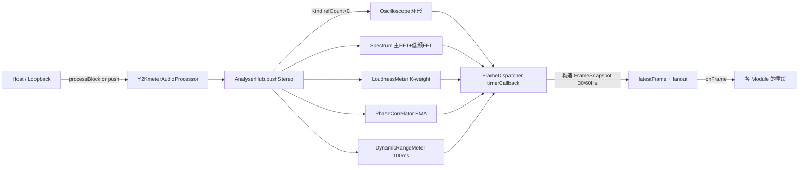

# Y2Kmeter 项目全景简介（AI 上下文导航文档）

> 本文档是为 AI 助手上下文初始化设计的项目导航说明。阅读完本文档，你应能立刻定位到"改哪个文件、调哪个类、走哪条数据流"。
>
> **开发过程的易错点 / 约束 / 已知限制已提炼为面向 AI 的知识库 [docs/](docs/INDEX.md)**（构建、渲染 GL、窗口布局、分析模块、UI 功能、通用教训六个主题），本文只保留理解项目现状所需的内容。
>
> **Steam 渠道相关内容（成就 / 云存档 / 独立 build-steam 流水线）单独维护在 [STEAM_OVERVIEW.md](STEAM_OVERVIEW.md)**，本文不重复；涉及 `source/steam/`、`Y2K_STEAM_BUILD`、`dist-steam/` 的改动先看那份文档。

---

## 1. 项目概述

### 1.1 项目定位
- **产品名**：`Y2Kmeter` （版本：`3.2.0`）
- **产品形态**：一款 **音频分析仪/音频计量插件**（纯分析，不产生音频输出的插件模式），带有强烈的 **Y2K / Windows 95-98-XP 像素复古粉色（Pink XP）** 视觉主题。
- **产品分类**：`VST3_CATEGORIES = "Analyzer" "Fx"`（DAW 分类中会被识别为分析仪）。
- **发行形态**（在 [CMakeLists.txt](/I:/Y2KMeter/CMakeLists.txt) 中通过 `juce_add_plugin` 定义）：
  - **Windows**：`VST3` + `Standalone` 独立应用
  - **macOS**：`VST3` + `Standalone` + `AU`
  - **BundleID / VST3 Plug ID**：`cn.iisaacbeats.Y2Kmeter`
- **开源协议**：GPL-3.0（详见 [LICENSE](/I:/Y2KMeter/LICENSE)）。

### 1.2 主要功能一览

**① 音频分析与计量**（可组合模块见 §3.4；v3.1 起响度 / 示波器 / 相位 / 动态四类各合并为一个模块，另有 1 个已下线模块 `eq`(拼豆频谱)；由 `AnalyserHub` 的 6 路分析统一驱动、按引用计数按需启用）

> **v3.1 模块控制面板**：每个模块标题栏有齿轮按钮，点开在模块内展开可收起的参数抽屉（显示项、样式、速度、FFT scale、频段染色、齿音阈值等）；**收起时模块外观与旧版一致**，旧存档与布局预设照常加载。示波器 / 波形历史去掉 Freeze 按钮：示波器**按住画布慢放 50 倍**，波形历史**按住画布完全冻结**，松手都直接回实时。详见 [docs/analysis-modules.md](docs/analysis-modules.md) §7。

> **v3.2 本轮变更**（细节见 [docs/analysis-modules.md](docs/analysis-modules.md) §7.1 / §7.6 / §7.12 ~ §7.15）：
> · 频段染色改成 **MiniMeters Stereometer 式三路点云**（低 `#E60045` / 中 `#665AFF` / 高 `#00FFFF`，默认分频 200 / 2000 Hz，每次开启染色即复位分频点），示波器与立体声场共用；散点新增**点大小 / 消失速度**，立体声场三路各一条**独立残影**（GL 多层 FBO）。
> · VU 表换成**三种结构完全不同的表盘**（半圆 / 弧形 240° 圆表 / 楔形刻度），全部跟随主题色。
> · 抽屉：**点外部自动收起**（同时只允许开一个）、滚动条主题化、emoji 绘制排除抽屉区域（层级在面板之下）。
> · 频谱补回 **Slope** 参数（0–12 dB/oct，默认 4.5 = 旧 SLOPE 开关"开"）；语谱图接入**按住冻结**并补音名读数；波形历史 / 语谱图 / 立体声频段图按住时读数**跟随鼠标**。
> · 修掉三个渲染问题：语谱图低速滚动的明暗闪烁（子列偏移）、动态模块 Crest 历史的毛刺闪烁（列相位锁定）、X-Y / 李萨如标尺环放大后画到邻居模块（GL 几何自裁）。
> · 悬停说明整体校对（响度补 RMS / 真峰值、各模块补新增参数与抽屉位置）。

- **响度计量**：ITU-R BS.1770-4（LUFS-M 瞬时 / LUFS-S 短时 / LUFS-I 积分，含 -70 LUFS 绝对门限 + 相对门限 + 静音自动重置）
- **电平表**：RMS L/R、True Peak L/R（4× 过采样插值）
- **动态范围**：Peak / RMS / Crest / Short-term DR / Integrated DR
- **相位分析**：相关度 Correlation / 宽度 Width / 平衡 Balance / Goniometer 相位图
- **频谱分析**：对数轴 20Hz~20kHz、双路 FFT（2048 主路 + 8192 低频路）
- **示波器**：Waveform / X-Y / Lissajous 李萨如图
- **持续滚动瀑布波形**（Waveform）
- **频谱瀑布图**（Spectrogram 像素方格风格 / Spectrogram 3D 三维曲面）
- **模拟指针 VU 表**（三种表盘：半圆 / 弧形 240° 圆表 / 楔形刻度（老式扇形）；单指针或 L/R 双针 + LED 信号灯，非对称弹道）
- **声像雷达**（Stereo Field，半圆雷达，幅度驱动声像位置）
- **频谱声像图**（Stereo Map，按频率逐段对比 L/R：PAN 轴 ±1 声像偏向（上=L / 中=居中 / 下=R），MONO 轴为**倒置的单声道保留量**（上=100% 干净 / 下=50% 满幅抵消）；**未发布**）
- **实时节拍 / 音乐调性**（Tempo / Key：BPM + 大调 / 自然小调 / 和声小调 / 旋律小调 + 关系调 + 可解释置信度；后台线程分析，未加载模块时完全不运行）
- **（已下线）拼豆频谱**（`Spectrum Perlerbeads` / `ModuleType::eq`，Y2K 主题的拼豆格子频谱，**仅可视化，不做实际 EQ 处理**）：v3.0.6 起因性能问题暂时从产品中移除 —— 不进"添加模块"菜单，旧存档里的 `type="eq"` 节点在加载时**同位置同尺寸**迁移成 `spectrum`。

> v3.1 起，实时 LUFS / 真峰值 / 相位相关 / 相位平衡 / 动态 Meters / DR / Crest 已作为"项目开关"并入响度 / 相位 / 动态模块，复用同一路分析结果，后端零新增计算。旧存档里的这些类型字符串仍可加载。

**② Milkdrop 可视化**（libprojectM 4 原生 OpenGL）

- 预设浏览（←→ 切换 / 空格随机 + 随机去重），本地 9000+ 个预设
- **预设收藏库（Like）**：收藏 / 取消收藏 / 内置库 ↔ 收藏库切换，状态持久化
- **后处理效果面板**：38 个开关型效果（invert / 万花镜 / 漩涡 / 鱼眼 / 像素化 / 故障 / 色调分离 / 复古 / 灰度 / 边缘 / 暗角 / 隧道 / 水波 / 融化 / 噪声 / 镜像 / 破碎 / 螺旋 / 扭转 / 色散 / 霓虹 / 热成像 / 酸性 / VHS / CRT / 双色调 / 泛光 / 二值化 / 棱镜等）
- **color 面板**（整体染色）、**tweak 面板**（uv 几何畸变 + 万花镜对称）、**wave 面板**（简单波形样式编辑）
- 脱离 / 浮动窗口渲染、内部降采样、wave 参数持久化
- macOS 专属性能治理：num_inst / GetPixel / wavecode_samples 自动归一化（防高开销预设拖垮帧率）

**③ VirtuPet 电子宠物**

- 音频信号驱动的像素电子宠物，完整状态机（孵化蛋 / 觅食 / 睡眠 / 生病 / 死亡），随机蛋样式、巡逻 / 说话 / 跳跃行为

**④ 主题与视觉系统**（Y2K / Pink XP 像素复古风）

- **12 个手工调校预设主题**（数据驱动、外观零回归）：糖果粉 / 星空深蓝 / 赛博紫 / 橘色波普 / 水蓝珠光 / 苏打绿 / 丛林绿 / Windows XP 经典 / 红黑暗夜 / 纯黑灰（OLED 友好）/ 纯白灰 / 黑粉（默认主题）
- **调色板重构（v2.10）**：左下角「Palette Studio」面板 —— 色相环 + 明暗（Dark/Light/Auto）+ 氛围 + 和谐方式 + 随机；`OKLCH` 感知均匀色彩空间 + Recipe 配方 + WCAG 对比度护栏（自动修复可读性）；支持 7 个语义角色微调（自动/手动锁定）、撤销/重做（40 步）、A/B 对比、迷你预览卡、质量徽章
- **我的主题**（自定义 = 一等公民）：可命名保存 ≤24 套（独立存档到 `%APPDATA%\Y2Kmeter.themeLibrary.xml`，Load 存档只合并、不覆盖）、重命名/删除/排序、分享码（`Y2KT1-xxxx` ≤80 字符）复制/粘贴、`.y2kpalette` 文件导入导出、桌面纹理（7 种）+ 标题图标（8 候选）自选、恢复默认（Reset）
- **7 种桌面纹理**：棋盘格 / 像素星星 / 网格扫描线 / 大圆点 / 泡泡 / 斜条纹 / 爱心
- 拖入图片生成「拼豆像素画」贴到桌面背景

**⑤ 布局预设**（11 个常规 + 3 个 stick 条状变体，编号 4 / 8 已废弃）

- 默认网格 / 横向铺满（顶部 / 底部）/ MV（全屏 + 模块条 + Milkdrop）/ Studio Monitor 双行监听 / Focus + Sidecar 主视觉 + 仪表列 / Broadcast Loudness 广播响度合规 / Only Milkdrop 全屏单模块
- **全屏磁贴预设**（14/15/16，提炼自用户三份 Save 存档 `频谱为主` / `所有模块全部放到屏幕里` / `多功能集合`）：下拉名 `FULL: SPECTRUM` / `FULL: ALL MODULES` / `FULL: MULTI COMBO`。三者都是全屏且锁死窗口尺寸；只复刻模块类型与位置尺寸，**不含 VirtuPet**、**不带任何模块内部设置**，模块一律用各自独立的构造默认值（详见 §4.4）。
- **stick 条状变体**（仅 stick 模式下出现在下拉里，条高同为 250px，只是条内模块不同）：`BAR: CLASSIC` 经典条 / `BAR: SPECTROGRAM`（3D 瀑布 → 2D 瀑布）/ `BAR: MILKDROP`（Stereo Field → Milkdrop）/ `BAR: SPEC + MILK`（两者叠加）

**⑥ 桌面集成（Standalone 专属）**

- 音频源选择：麦克风 / 桌面系统音频采集（macOS 走 ScreenCaptureKit、Windows 走 WASAPI Loopback）
- 无边框窗口 + 自定义标题栏（关闭 / 置顶 / 最小化 / 布局锁定 / 双击标题栏全屏）
- 模块脱离 / 停靠（浮动窗口）、预设导出 / 导入（Save / Load）
- 自动更新检查、可选匿名遥测、新手引导（右键添加 VirtuPet → 播放音频孵化）

### 1.3 技术栈
| 项目 | 版本 / 说明 |
| --- | --- |
| 语言 | C++17（`CMAKE_CXX_STANDARD 17`，`CXX_EXTENSIONS OFF`） |
| 框架 | **JUCE 8.0.12**（通过 `FetchContent` 自动拉取） |
| DSP | `juce::dsp`（FFT、Windowing） |
| GPU | `juce::juce_opengl`（Editor 挂 `OpenGLContext`，绘制走 GPU）；Milkdrop 模块使用 libprojectM 4 native OpenGL（架构与避坑见 [docs/rendering-gl.md](docs/rendering-gl.md)） |
| 构建 | CMake ≥ 3.22 |
| Windows CRT | 强制静态 CRT（`MultiThreaded`，避免依赖 VC_redist） |
| macOS 语言扩展 | Objective-C++（`.mm` 文件走 ScreenCaptureKit 桌面音频采集） |
| 安装器 | Inno Setup（[Y2Kmeter_installer.iss](/I:/Y2KMeter/Y2Kmeter_installer.iss)） |
| 字体 | `Silkscreen-Regular.ttf`（像素英文字体，通过 `juce_add_binary_data` 打包） |
| 项目性能特性 | 支持 **LTO/IPO** + **PGO**（`Y2K_ENABLE_LTO`、`Y2K_PGO_MODE`）|
| 特殊宏 | `Y2K_ENABLE_PERF_COUNTERS=0`（发布版关闭性能计数）、`JUCE_USE_CUSTOM_PLUGIN_STANDALONE_APP=1`（用自定义 Standalone 外壳）、`Y2K_ENABLE_LOGGING`（仅 RelWithDebInfo 定义，见 §1.4） |

---

### 1.4 日志输出方案（开发约定）

**现状**：正式发布包（Release / Debug / MinSizeRel）**不产生任何日志文件**，也不执行日志字符串拼接；只有 **RelWithDebInfo** 构建才会启用日志并落盘。

**实现机制**（编译器开关 + 宏）：

1. `CMakeLists.txt` 中通过生成器表达式定义编译宏：
   ```cmake
   $<$<CONFIG:RelWithDebInfo>:Y2K_ENABLE_LOGGING=1>
   ```
2. [`source/Y2KLogging.h`](/I:/Y2KMeter/source/Y2KLogging.h) 定义 `Y2K_LOG(msg)` 宏：
   - 定义 `Y2K_ENABLE_LOGGING` 时 → 展开为 `juce::Logger::writeToLog(msg)`；
   - 未定义时 → 展开为 `((void)0)`，参数里的字符串拼接 / `juce::String` 构造在**预处理阶段即被丢弃**，零运行时开销。
3. Standalone 应用在 [`Y2KStandaloneApp.cpp`](/I:/Y2KMeter/source/standalone/Y2KStandaloneApp.cpp) 的 `initialise()` 中仅当 `Y2K_ENABLE_LOGGING` 定义时才挂载 `juce::FileLogger`（输出到 exe 同目录 `Y2Kmeter_debug.log`），`shutdown()` 对称卸载；相关代码全部用 `#ifdef Y2K_ENABLE_LOGGING` 包裹。

**后续开发如何加日志**：

- 直接调用 `Y2K_LOG("前缀 + " + juce::String(value));`，**不要**再直接写 `juce::Logger::writeToLog(...)`（否则脱离宏控制，Release 包也会产生字符串拼接）。
- `Y2K_LOG` 参数必须是纯字符串/拼接表达式，**禁止含副作用**（如会修改状态的函数调用），否则关闭日志的构建中副作用会被一并删除。
- 已使用 `Y2K_LOG` 的调用点：`UpdateChecker.cpp`、`Y2KStandaloneApp.cpp`、`MilkdropModule.cpp`、`ProjectMApi.cpp`、`UpdateDialog.cpp`。

### 1.5 现场诊断日志（`source/diag/Y2KDiagLog.h`，v3.0.x）

**为什么单独再做一套**：`Y2K_LOG` 只在 RelWithDebInfo 编译期开启，正式发出去的 Release 包**根本不含日志代码**，用户现场出问题（如"所有 GL 模块卡死"）时无法让用户自己产日志。本模块是**运行时开关**的诊断日志，Release 包也编译，默认关闭。

**开关**（任一即可）：

1. **RelWithDebInfo 构建自动开启**（`shouldEnable()` 里判 `Y2K_ENABLE_LOGGING`，
   该宏只在本工程的 RelWithDebInfo 配置定义）→ 打 RelWithDebInfo 安装包即"带日志的包"，
   Release 安装包不含任何日志输出（`toy_perf_log.txt` / `Y2Kmeter_debug.log` 同样只在
   RelWithDebInfo 编译）；
2. 显式打开（Release 也要日志时）：`cmake ... -DY2K_DIAG_LOG_DEFAULT_ON=ON`；
3. 环境变量 `Y2K_DIAG_LOG=1`（`0/off` 可强制关闭）；
4. exe 同目录或 `<用户数据目录>/Y2Kmeter/` 下放一个 `Y2Kmeter_diag_on.txt` 空文件。

`Y2K_DIAG_VERBOSE=1` 额外每 5 s 打印一次全部 GL 直渲染模块状态。

**产物**：`<桌面>/Y2Kmeter_Diag/`（桌面不可写回退文档/用户数据目录）

| 文件 | 内容 |
| --- | --- |
| `Y2Kmeter_diag_*.log` | 主日志：环境信息（OS/CPU/内存/多屏 DPI/是否远程桌面）、GL vendor/renderer/version/GLSL、上下文创建/attach/detach、每 5 s 的出帧与耗时摘要、慢操作告警 |
| `Y2Kmeter_hang_*.dmp` | 卡死瞬间的 Minidump（Windows，最多 3 份），配合构建 PDB 可直接看所有线程调用栈 |
| `Y2Kmeter_snapshot_*.txt` | 手动快照（`Ctrl/⌘ + Shift + D` 或 `reportNow()`） |
| `README_请把这个文件夹发给开发者.txt` | 给非技术用户的回收说明 |

**卡死定位机制**（全自动，不需要用户操作）：

1. `y2k::diag::setPhase("...")` 在 GL 线程每个大步骤前后打标记（projectM 渲染、FBO blit、`glTexImage2D`、`glReadPixels`、各模块的 snapshot 锁等待与绘制分支……）。日志里"最后一次 phase"就是卡住的位置。
2. 心跳通道 `GlFrame / UiMessage / Dispatch / Audio`：看门狗线程每 250 ms 检查，GL 5 s、UI 4 s 无心跳即判停摆，自动输出 `STALL` 报告（各线程 phase、通道空闲时长、Editor 尺寸/DPI/attach 状态、全部 GL 直渲染模块的可见性/顶点数/纹理与 FBO 尺寸/构建与渲染耗时）+ Minidump。
3. `attach` 后 10 s 仍无 `newOpenGLContextCreated` → 单独告警（驱动创建上下文卡死 / 远程桌面软件渲染）。
4. GL 线程每次 `renderOpenGL` 末尾查一次 `glGetError`，异常限流记录。

**编码约定**：

- 高频路径只允许 `heartbeat()` / `setPhase()`（原子写）与 `addFrameSample()` 这类累加，**禁止**直接 `write()` 拼字符串。
- 一律用宏 `Y2K_DIAG / Y2K_DIAGC / Y2K_DIAG_PHASE / Y2K_DIAG_SLOW`，关闭时参数表达式完全不求值（零开销）。
- `writeCritical` 会立即 flush，仅用于上下文创建/销毁、STALL、会话头等"崩了也必须留下"的事件。

**出包**（两套并行，互不影响）：

| 包 | 构建配置 / 目录 | 脚本 | 产物 |
| --- | --- | --- | --- |
| 正式包 | `Release` / `cmake-build-release-visual-studio` | `build_installer.bat` | `dist/Y2Kmeter_Setup_<ver>_x64.exe` |
| 诊断包 | `RelWithDebInfo` / `cmake-build-relwithdebinfo-visual-studio-ninja` | `build_installer_diag.bat` | `dist/Y2Kmeter_Setup_<ver>_Diag_x64.exe` |

- 两个 `.iss` 的关系：`Y2Kmeter_diag_installer.iss` 只定义 `MyConfig/MyBuildDir/MyOutputSuffix/MyVersionSuffix` 后 `#include "Y2Kmeter_installer.iss"`，安装逻辑（组件页、VST3 目录页、预设解压、AppId 覆盖安装）完全共用；主脚本里所有可变项都用 `#ifndef` 保护，默认值保持原来的 Release 行为。
- 诊断构建的 configure 必须带 `-DY2K_DIAG_LOG_DEFAULT_ON=ON`，否则打出来的包不写日志（`build_installer_diag.bat` 会检查 `CMakeCache.txt` 并在为 OFF 时二次确认）。
- 诊断包产物带 `Y2Kmeter.pdb`：用户回传的 `.dmp` 只能靠同一次构建的 PDB 解析，**打包后不要再重新编译**。

---

## 2. 核心分层架构

```
┌────────────────────────────────────────────────────────────────┐
│  Standalone 外壳（source/standalone）                            │
│    Y2KStandaloneApp / WasapiLoopbackCapture / MacDesktopCapture │
│    · 无边框 Y2K 窗口 / 系统输出 Loopback 采集                     │
├────────────────────────────────────────────────────────────────┤
│  Plugin 层                                                       │
│    Y2KmeterAudioProcessor  (PluginProcessor.h/cpp)              │
│      ↑ 音频线程 processBlock 拉数据                              │
│    Y2KmeterAudioProcessorEditor (PluginEditor.h/cpp)            │
│      ↑ UI 线程 承载 ModuleWorkspace                              │
├────────────────────────────────────────────────────────────────┤
│  Analysis 层（source/analysis）                                  │
│    AnalyserHub —— 中央调度枢纽                                   │
│      · LoudnessMeter / PhaseCorrelator / DynamicRangeMeter      │
│      · 主/低频双路 FFT + 立体声示波器环形缓冲                     │
│      · Kind 引用计数（按需计算）+ FrameSnapshot（一帧一份）       │
├────────────────────────────────────────────────────────────────┤
│  UI 框架层（source/ui）                                          │
│    ModuleWorkspace —— 所有分析模块的拖拽工作区                   │
│    ModulePanel     —— 所有模块的基类（像素窗口外观）              │
│    PinkXPStyle     —— 主题系统 + LookAndFeel                    │
│    UiFrameClock    —— 自适应帧率的 UI 时钟                       │
├────────────────────────────────────────────────────────────────┤
│  Modules 层（source/ui/modules）                                 │
│    EqModule / LoudnessModule / OscilloscopeModule /             │
│    SpectrumModule / PhaseModule / DynamicsModule /              │
│    WaveformModule / SpectrogramModule / Spectrogram3DModule /   │
│    VuMeterModule / StereoField / StereoMap / VirtuPetModule     │
│    （v3.1：响度 / 示波器 / 相位 / 动态各自合并为单一模块，          │
│     旧细分类型仅作存档别名保留；每个模块有齿轮「控制面板」）        │
├────────────────────────────────────────────────────────────────┤
│  Perf 层（source/perf）                                          │
│    PerformanceCounterSystem —— 性能计数系统（默认关闭）           │
└────────────────────────────────────────────────────────────────┘
```

### 2.1 关键调用关系
1. **音频入口 → 分析**：`Y2KmeterAudioProcessor::processBlock` → `AnalyserHub::pushStereo` → 分发到 6 路：`Oscilloscope / Spectrum / Loudness / Phase / Dynamics / MusicAnalysis`。前 5 路在音频线程内联计算；`MusicAnalysis` 只做降混 + 写入有界环形缓冲，真正的 FFT / 自相关 / chroma 在独立后台线程。
2. **UI 拉分析结果**：`AnalyserHub` 内部 `FrameDispatcher` 在 UI 线程按目标频率（FPS 按钮 30/60/120/无上限）组装 `FrameSnapshot`，通过 `FrameListener::onFrame(frame)` 派发给所有订阅的模块。v2.9 起由 Editor 的 vblank 同步时钟驱动（§4.2），与显示器刷新同相。
3. **模块的 UI 生命周期**：模块继承 `ModulePanel + AnalyserHub::FrameListener`，构造时 `hub.retain(Kind::xxx)` + `hub.addFrameListener(this)`，析构时对称 release + remove。**未加载的模块 → 引用计数为 0 → `pushStereo` 自动跳过对应计算路径**。
4. **Standalone 音频源**：`Y2KStandaloneApp` 通过 `WasapiLoopbackCapture`（Win）或 `MacDesktopAudioCapture`（macOS 使用 ScreenCaptureKit）获取"系统外放音频"，直接 push 到 `AnalyserHub`（不走 `processBlock`）。DAW 场景则由宿主经 `processBlock` 送入。

---

## 3. 代码结构说明

### 3.1 根目录关键文件
| 文件 | 作用 |
| --- | --- |
| [CMakeLists.txt](/I:/Y2KMeter/CMakeLists.txt) | CMake 主构建脚本；含 macOS 图标流水线、字体打包、平台条件源、LTO/PGO |
| [CMakePresets.json](/I:/Y2KMeter/CMakePresets.json) | CMake 预设集合（含 clangd 用的 Ninja preset） |
| [PluginProcessor.h/.cpp](/I:/Y2KMeter/PluginProcessor.h) | 顶层 `AudioProcessor`；持有 `AnalyserHub` 与状态持久化逻辑 |
| [PluginEditor.h/.cpp](/I:/Y2KMeter/PluginEditor.h) | 顶层 `AudioProcessorEditor`；Pink XP 外壳 + 自画标题栏 + `ModuleWorkspace` 托管 |
| [Y2Kmeter_installer.iss](/I:/Y2KMeter/Y2Kmeter_installer.iss) | Windows Inno Setup 安装器脚本 |
| [assets/](/I:/Y2KMeter/assets) | Logo、图标、VirtuPet 精灵图（角色 20 只 × 33 动作 + 蛋 8 款） |
| [ttf/](/I:/Y2KMeter/ttf) | 打包用像素字体 |

### 3.2 `source/analysis`（音频分析）
| 文件 | 类 / 关键实现 |
| --- | --- |
| [AnalyserHub.h](/I:/Y2KMeter/source/analysis/AnalyserHub.h) | `LoudnessMeter` / `PhaseCorrelator` / `DynamicRangeMeter` / `AnalyserHub`（**注意**：为了绕过 MSVC include-guard 串扰，四个类都塞进了同一个头，实现分散在各自 cpp）|
| [AnalyserHub.cpp](/I:/Y2KMeter/source/analysis/AnalyserHub.cpp) | `AnalyserHub::pushStereo` 主路+低频路双 FFT、`FrameDispatcher` 内部 Timer、Kind 引用计数、FrameSnapshot 组装与广播 |
| [LoudnessMeter.cpp](/I:/Y2KMeter/source/analysis/LoudnessMeter.cpp) | K-weighting 双级 IIR + 400ms 动量 LUFS、3s 短期、全程积分（含相对门限）、100ms RMS、4× 过采样 True Peak |
| [PhaseCorrelator.cpp](/I:/Y2KMeter/source/analysis/PhaseCorrelator.cpp) | EMA 滑动窗计算 correlation / width / balance |
| [DynamicRangeMeter.cpp](/I:/Y2KMeter/source/analysis/DynamicRangeMeter.cpp) | 100ms 块统计 + top-20% 分位 short-DR / integrated-DR |
| [music/RealFft.h/.cpp](/I:/Y2KMeter/source/analysis/music/RealFft.cpp) | `RealFft`：极简 radix-2 FFT（纯 C++，不依赖 JUCE，供测试目标直接链接） |
| [music/TempoEstimator.h/.cpp](/I:/Y2KMeter/source/analysis/music/TempoEstimator.cpp) | `TempoEstimator`：46ms/25% hop 分帧 → 24 对数带谱通量 → 8s 包络归一化自相关 + 谐波梳状 + 对数正态速度先验 → 三候选中值 + 八度迟滞 + 置信度 |
| [music/KeyEstimator.h/.cpp](/I:/Y2KMeter/source/analysis/music/KeyEstimator.cpp) | `KeyEstimator`：186ms/25% hop 分帧 → 55Hz–5kHz bin 折 12 音级 chroma → 20s 滑动窗口 → KK 轮廓 Pearson 相关（大调 / 自然 / 和声 / 旋律小调共 48 候选）+ 关系调迟滞 + 置信度 |
| [music/MusicAnalysisEngine.h/.cpp](/I:/Y2KMeter/source/analysis/music/MusicAnalysisEngine.cpp) | 音频线程降混 + 无锁 SPSC 环形缓冲（131072 采样）；后台 `juce::Thread` 消费并发布 `Result`；**首次订阅才分配缓冲/建线程**，无模块时零资源 |
| [music/MusicAnalysisTypes.h](/I:/Y2KMeter/source/analysis/music/MusicAnalysisTypes.h) | `Result` / `Status` / `Mode` / `KeySpelling`（按调式选常用拼写）/ `RelativeKey`（关系调）—— 纯 C++，供 UI 与测试共用 |
| [FreqScale.h](/I:/Y2KMeter/source/analysis/FreqScale.h) | **v3.1** `y2k::fscale`：log / mel / linear 频率轴正反映射（"FFT scale"），Hub 取样与 UI 坐标共用，纯 C++ |
| [BandSplit.h](/I:/Y2KMeter/source/analysis/BandSplit.h) | **v3.1** `y2k::bands::BandSplitter`：LR4 三频段分离（默认 200 / 2000 Hz，可调）→ 三路独立 L/R 信号；显示层每路一层纯色点云（低红 / 中蓝紫 / 高青，同 MiniMeters Stereometer），仅开启染色时计算，纯 C++ |
| [OscHistory.h](/I:/Y2KMeter/source/analysis/OscHistory.h) | **v3.1** 示波器样本长环形历史（2^18），按住慢放用，仅按住期间分配 / 录制 |
| [SibilanceDetector.h/.cpp](/I:/Y2KMeter/source/analysis/SibilanceDetector.h) | 齿音检测（5–12 kHz 带通 + 包络 + 迟滞门限）；v3.1 起阈值可设（`setThresholdDb`，默认 -35 dB），供波形历史使用 |

### 3.3 `source/ui`（UI 框架）
| 文件 | 关键内容 |
| --- | --- |
| [ModuleWorkspace.h](/I:/Y2KMeter/source/ui/ModuleWorkspace.h) | `ModuleType` 枚举 / `ModulePanel` 基类 / `ModuleWorkspace` 主类 / `ThemeSwatchBar` / `HideChromeButton`（**同一个头包含多个类**，同样为绕过 MSVC 串扰）|
| [ModuleWorkspace.cpp](/I:/Y2KMeter/source/ui/ModuleWorkspace.cpp) | 拖拽 / 网格吸附 / 布局持久化 / 拼豆图片 / 底部 toolbar / 添加菜单 / 鼠标事件 |
| [ModulePanel.cpp](/I:/Y2KMeter/source/ui/ModulePanel.cpp) | 各模块统一的像素窗口：标题栏 + 齿轮（控制面板）/ 弹出 / 关闭按钮 + 边缘/角拖拽缩放 + 右下 CPU 小字 |
| [ModuleControlDrawer.h/.cpp](/I:/Y2KMeter/source/ui/ModuleControlDrawer.h) | **v3.1** 模块控制面板抽屉：覆盖式盖在内容区顶部，由 `ModulePanel::buildParamDefs()` 的参数表生成控件（choice / toggle / slider，分组、条件可见、窄模块换行、超高滚动），自己不存状态 |
| [HoldSlowMo.h](/I:/Y2KMeter/source/ui/HoldSlowMo.h) | **v3.1** 按住交互共享状态机（示波器 = 慢放 50 倍 / 波形历史、语谱图 = 完全冻结，松手回实时；频谱保留自己的实现） |
| [ModulePanel.h](/I:/Y2KMeter/source/ui/ModulePanel.h) | **只是一个兼容 shim**，内部只 `#include "source/ui/ModuleWorkspace.h"` |
| [PinkXPStyle.h/.cpp](/I:/Y2KMeter/source/ui/PinkXPStyle.h) | 主题系统（12 预设 + 生成器 custom）+ 19 色槽位 + 扩展槽（`accent2`/`chartRamp[8]`/`danger`/`warn`/`ok`）+ OKLab 渐变采样 + 桌面纹理 + `PinkXPLookAndFeel` |
| [source/ui/palette/](/I:/Y2KMeter/source/ui/palette/) | 调色板重构模块：`OkLchUtils`（OKLCH/色域裁剪/WCAG）、`ThemeSpec`（意图参数+分享码）、`PaletteGenerator`（Recipe+护栏，纯 C++）、`ThemeLibrary`（我的主题）、`PalettePanel`（新面板 UI） |
| [UiFrameClock.h/.cpp](/I:/Y2KMeter/source/ui/UiFrameClock.h) | 统一 UI 帧时钟（阶段1性能改造，目前尚未强制接线，主流数据流仍走 `AnalyserHub::FrameDispatcher`） |
| [HoverHelp.h/.cpp](/I:/Y2KMeter/source/ui/HoverHelp.h) | 悬停提示：`y2k::help` 文案库（模块详细说明 / 全局开关持久化）+ `Y2KTooltipWindow`（统一解析控件 / 模块 / 自绘按钮提示，仪表内容区静止才弹出）；绘制在 `PinkXPLookAndFeel::drawTooltip`（详见 [docs/ui-features.md](docs/ui-features.md)） |
| [UiPrefs.h/.cpp](/I:/Y2KMeter/source/ui/UiPrefs.h) | 进程级 UI 偏好（`Y2Kmeter.uiPrefs.xml`：界面语言 / 悬停提示开关），独立于布局与预设 |
| [../i18n/Localisation.h/.cpp](/I:/Y2KMeter/source/i18n/Localisation.h) | 界面国际化 `y2k::i18n` / `y2k::tr` / `y2k::trf`：语言包（`i18n/*.lang`）注册与合并、查表翻译（精确 / 数字模板 / 逐行）、按语言字体、运行时切换广播（详见 [docs/ui-features.md](docs/ui-features.md)） |

### 3.4 `source/ui/modules`（分析模块 UI）
每个模块都是 `ModulePanel + AnalyserHub::FrameListener` 双继承。

| 文件 | 模块 | 数据源 |
| --- | --- | --- |
| [EqModule.h/.cpp](/I:/Y2KMeter/source/ui/modules/EqModule.h) | `EqModule`（Y2K 像素频谱可视化，非真实 EQ） | `Spectrum` |
| [LoudnessModule.h/.cpp](/I:/Y2KMeter/source/ui/modules/LoudnessModule.h) | `LoudnessModule`（**v3.1 合并**原 实时 LUFS / 真峰值 / 响度主表：项目开关 M / S / I / TP / RMS + 样式「灯条 / 数字读数」） | `Loudness` |
| [OscilloscopeModule.h/.cpp](/I:/Y2KMeter/source/ui/modules/OscilloscopeModule.h) | `OscilloscopeModule`（**v3.1 合并**原 OscilloscopeWave：显示类型 波形 / X-Y / 李萨如，波形可选 L / R / 双声道（配色跟随主题）；X-Y / 李萨如可开**频段染色**；Freeze 按钮取消，改**按住画布慢放 50 倍**；v1.8.4 起 XY/Lissajous 峰值驱动自动缩放 + 同心标尺环） | `Oscilloscope` |
| [SpectrumModule.h/.cpp](/I:/Y2KMeter/source/ui/modules/SpectrumModule.h) | `SpectrumModule`（频谱 + peak hold；**v3.1** 顶部四按钮（Peak / Sharp / 曲线 / 通道）搬进控制面板，另加 **FFT scale**（log / mel / linear）与 **Slope**（0–12 dB/oct，默认 4.5，0 = 关闭）；按住画布 = 子弹时间，悬停读数按追加音名） | `Spectrum` |
| [PhaseModule.h/.cpp](/I:/Y2KMeter/source/ui/modules/PhaseModule.h) | `PhaseModule`（Goniometer + Correlation Dial + Width/Balance Bar；**v3.1 合并**原相位相关 / 相位平衡：四个项目可独立开关，相位图 / 条形各有样式；按启用项动态订阅 Phase / Oscilloscope） | `Phase` + `Oscilloscope` |
| [DynamicsModule.h/.cpp](/I:/Y2KMeter/source/ui/modules/DynamicsModule.h) | `DynamicsModule`（Peak/RMS 柱 + DR short / integrated + Crest 值 + Crest 历史；**v3.1 合并**原 DynamicsMeters / DR / Crest：六个项目可独立开关，读数样式，历史跨度 1–35 s 可调且持久化） | `Dynamics` |
| [WaveformModule.h/.cpp](/I:/Y2KMeter/source/ui/modules/WaveformModule.h) | `WaveformModule`（滚动瀑布波形，像素列；**v3.1** 工具栏 / SPEED 栏 / Freeze 取消：着色来源（Pitch / Loudness / Sibilance）、速度、**双声道上下分轨**、**齿音识别阈值**都在控制面板，按住画布完全冻结） | `Oscilloscope` |
| [SpectrogramModule.h/.cpp](/I:/Y2KMeter/source/ui/modules/SpectrogramModule.h) | `SpectrogramModule`（像素方格频谱瀑布图，双路 FFT 合成；**v3.1** 控制面板：滚动方向 上 / 下 / 左 / 右、shaper、速度、颜色、FFT scale；上 / 下方向走"展开成无环形纹理"路径；**按住画布完全冻结**，悬停读数在冻结时追加音名） | `Spectrum` |
| [Spectrogram3DModule.h/.cpp](/I:/Y2KMeter/source/ui/modules/Spectrogram3DModule.h) | `Spectrogram3DModule`（**v3.1** 控制面板：颜色模式 Theme / Heat / Grey / Ice、深度方向 右后 / 左后、速度；v1.8.6 新增 3D 频谱曲面图；v1.9.0~v1.9.4 P1~P4 四轮 CPU 性能优化；v2.2.5 GPU Shader 迁移 → 15+ 轮调试后回退为纯 CPU；v2.2.5~v2.2.6 P5~P6 进一步优化：visibleRows 150→100、repaint 节流 20ms、Path 对象循环外复用 clear()） | `Spectrum` |
| [FineSplitModules.h/.cpp](/I:/Y2KMeter/source/ui/modules/FineSplitModules.h) | `VuMeterModule`（**表盘样式三种结构**：半圆 / 弧形 240° 圆表 / 楔形刻度（老式扇形，刻度线左长右短）；指针样式 Thin line / Wedge / Stereo L/R；信号灯开关）。**v3.1：原 `LufsRealtime` / `TruePeak` / `PhaseCorrelation` / `PhaseBalance` / `DynamicsMeters` / `DynamicsDr` / `DynamicsCrest` 类已并入 Loudness / Phase / Dynamics 模块，只剩枚举值作为旧存档别名** | 视模块而定 |
| [StereoFieldModule.h/.cpp](/I:/Y2KMeter/source/ui/modules/StereoFieldModule.h) | `StereoFieldModule`（v2.7.0 新增：半圆雷达声像指示，`peak=max(|L|,|R|)` 驱动径向距离、`balance=(|R|-|L|)/(|L|+|R|)` 驱动方向；**自动缩放**：1 s 周期峰值归一 + 10% 死区，雷达轮廓固定、dB 标签按增益换算 + 渐隐残影；**v3.1** 控制面板：点大小 1–6 px、点消失速度、频段染色（三路各自一条残影轨迹）） | `Oscilloscope` |
| [StereoMapModule.h/.cpp](/I:/Y2KMeter/source/ui/modules/StereoMapModule.h) | `StereoMapModule`（**未发布/开发中**：两个模式在 v3.1 起由控制面板切换（顶部按钮取消），并新增 FFT scale —— `PAN` 按频率对比 L/R 频谱、纵轴声像偏向 ±1（上 L 下 R）；`MONO` 显示切单声道后的保留量，**上下倒置**（顶 = 100% 干净、底 = 50% 满幅抵消，曲线越往下越糟）；频率轴 20Hz–20kHz（对数 / 梅尔 / 线性），384×240 默认尺寸，GL 直渲染 + CPU 回退双路径，含悬停标尺与点击读数气泡；**按住画布 = 子弹时间**（幅度类量只拖慢回落沿 50 倍；声像是有符号量，两个方向同速放慢），按住时悬停读数追加音名） | `Spectrum`（L/R 分路 + mid 单声道路） |
| [TempoKeyModule.h/.cpp](/I:/Y2KMeter/source/ui/modules/TempoKeyModule.h) | `TempoKeyModule`（**v2.9.9 补充**：BPM 大字 + 调性大字 + 关系调副行 + 置信度条；START/STOP/RESET（未启动时 RESET 会自动 START，连续 3 s 无信号自动 reset）；点击 BPM 列弹 `x2 / /2` 气泡、点击 KEY 列弹 7 个音名气泡（复用 Toybox readout bubble）；字号按实测字宽收缩，窄尺寸不裁字） | `MusicAnalysis` |
| [VirtuPetModule.h/.cpp](/I:/Y2KMeter/source/ui/modules/VirtuPetModule.h) | `VirtuPetModule`（宠物状态机 + 精灵图动画） | `Loudness`（用信号强度驱动饥饿/健康）|
| [MilkdropModule.h/.cpp](/I:/Y2KMeter/source/ui/modules/MilkdropModule.h) | `MilkdropModule`（v2.5.2：Editor GL 上下文渲染 → offscreen FBO + 跨 FBO blit 零拷贝管线，~60fps 无遮盖 + auto 轮播 + 预设跳转 + 分辨率缩放 1:1/1:2/1:4；GLView 支持浮动态独立 OpenGLContext；新增 Standalone 脱离/浮动/停靠/置顶/布局持久化；archive v2.2.4：PBO 异步回读 + Triple-buffer 无锁帧传输；v2.6.1：color 面板 RGB+Bright 四行滑块 + effects 面板 invert/shadows 纯开关 + 脱离模式 FBO 渲染路径修复；**v2.6.5：效果系统架构重构（注册表驱动 + efftop/effbottom 分类）+ 38 个后处理效果（含第三批 19 个实验性效果）+ effects 面板动态网格布局**；**v2.6.6：wave 样式编辑面板（mode/X/Y/R/G/B/A/Mys 滑块 + dots/thick/add/bright 开关）+ 预设文本注入机制**；**v2.6.7：tweak 面板重构为后处理 uv 几何畸变（7 浮点 zoom/rot/warp/dx/dy/sx/sy + 3 整数万花镜 kaleido/fold_x/fold_y 滑块）+ 实时生效不重载预设**；**v2.7.1：预设收藏库 like（右下角爱心收藏/双向箭头切换 + 双向索引记忆 + 随机去重）**） | `Oscilloscope`（立体声 PCM 推流 → `bass`/`mid`/`treb` 变量驱动视觉效果）|
| [MilkdropVisualState.h](/I:/Y2KMeter/source/ui/modules/MilkdropVisualState.h) | `MilkdropVisualState`（v2.6.1 新增，v2.6.5 扩展：Milkdrop 后处理全局视觉状态结构体，`tint_r/g/b` + `brightness` + 38 个开关效果字段 + `isNeutral()`；v2.6.7 新增 `offset` 成员承载 tweak 后处理 uv 畸变；由 Editor 全局共享并持久化到 Processor host state） | — |
| [MilkdropEffect.h](/I:/Y2KMeter/source/ui/modules/MilkdropEffect.h) | `MilkdropEffect`（v2.6.5 新增，header-only：`MilkdropEffectId` 枚举 + `MilkdropEffectDef` 元数据 + `GetMilkdropEffectDefs()` 注册表；驱动 effects 面板 UI 动态生成与 shader uniform 传递） | — |
| [MilkdropWaveState.h](/I:/Y2KMeter/source/ui/modules/MilkdropWaveState.h) | `MilkdropWaveState`（v2.6.6 新增，header-only：Milkdrop 简单波形样式覆盖状态结构体 + 16 种 `wave_mode` 名称表 + `GetWaveModeName()` + `ReplaceWaveKeyValue()`/`ApplyWaveParamsToPresetText()` 预设文本注入函数；全局共享并持久化到 Processor host state） | — |
| [MilkdropVisualOffsetState.h](/I:/Y2KMeter/source/ui/modules/MilkdropVisualOffsetState.h) | `MilkdropVisualOffsetState`（v2.6.7 新增，header-only：tweak 后处理 uv 几何畸变数据载体，7 个浮点 `value[]` + 3 个整数 `ivalue[]` + `isNeutral()`/`reset()` + `GetVisualOffsetParams()`/`GetVisualOffsetIntParams()` 元数据；作为 `MilkdropVisualState::offset` 成员随视觉状态每帧传递到 `MilkdropTintPass`） | — |

### 3.5 `source/standalone`（Standalone App）
| 文件 | 作用 |
| --- | --- |
| [Y2KStandaloneApp.cpp](/I:/Y2KMeter/source/standalone/Y2KStandaloneApp.cpp) | 自实现 `juce::JUCEApplication` + `Y2KMainWindow`（DocumentWindow）替换 JUCE 内建的 `StandaloneFilterApp`；启动 → 加载 settings → 创建 Processor+Editor → 绑定 Loopback 音源 → 恢复主题/FPS/位置/尺寸/固定态 |
| [WasapiLoopbackCapture.h/.cpp](/I:/Y2KMeter/source/standalone/WasapiLoopbackCapture.h) | Windows：裸 WASAPI + `AUDCLNT_STREAMFLAGS_LOOPBACK`，采集"系统默认播放端点"输出，输出统一立体声 float32 |
| [MacDesktopAudioCapture.h/.mm](/I:/Y2KMeter/source/standalone/MacDesktopAudioCapture.h) | macOS：`ScreenCaptureKit` 获取桌面音频（Objective-C++） |
| [AudioDumpRecorder.h/.cpp](/I:/Y2KMeter/source/standalone/AudioDumpRecorder.h) | **仅 macOS**，通过环境变量 `Y2KM_AUDIO_DUMP` 系列开启，把音频原样落盘做调试 |

### 3.6 `source/perf`
| 文件 | 作用 |
| --- | --- |
| [PerformanceCounterSystem.h/.cpp](/I:/Y2KMeter/source/perf/PerformanceCounterSystem.h) | 全局性能计数系统（发布版 `Y2K_ENABLE_PERF_COUNTERS=0` 关闭）；提供 `ScopedPerfTimer`、`ScopedLockWaitMeasure` 用于埋点 |

---

## 4. 关键类 / 接口清单

### 4.1 `Y2KmeterAudioProcessor`（[PluginProcessor.h](/I:/Y2KMeter/PluginProcessor.h)）
- 音频线程接口：`prepareToPlay`、`processBlock`、`releaseResources`。
- 关键成员：`std::unique_ptr<AnalyserHub> analyserHub;`（**pimpl 隐藏**，头文件里只前向声明）。
- 状态持久化（`getStateInformation` / `setStateInformation`）：
  - 顶层 XML 根 `<PBEQ_State>`，含 `analysisInputGainDb`、`editorW/editorH` 属性；
  - 子节点 `<PBEQ_Layout>` 承载 `ModuleWorkspace` 布局（模块位置 / 拼豆图 / 主题 / FPS 等）。
  - Milkdrop 相关属性直接挂顶层：`milkdropTintR/G/B`、`milkdropBrightness`、`milkdropInvert/Shadows/...` 等效果开关、`milkdropWaveXxx` 波形覆盖、`milkdropOffsetXxx`（tweak uv 畸变），以及 **v2.7.1 新增的 `milkdropUseLikeLibrary`**（收藏库切换状态，`std::atomic<bool>` 持久化）。
- 分析开关：`setAnalysisActive(false)` 时 `processBlock` 完全跳过分析（UI 不可见时用）。
- CPU 负载：`getCpuLoad()` 供每个模块右下角显示；Loopback 路径用 `registerLoopbackRenderTime` 通道注入。
- 分析前置增益：`setAnalysisInputGainDb / getAnalysisInputGainLinear`（-10 ~ +36 dB），只作用于分析路径，不改变透传输出。
- **P4 flush 钩子**：`flushPendingUiStateBeforeSave`（Editor 注册；`getStateInformation` 前 flush 掉 workspace 的 debounce 布局变更）。

### 4.2 `AnalyserHub`（[AnalyserHub.h](/I:/Y2KMeter/source/analysis/AnalyserHub.h)）
- **枚举** `AnalyserHub::Kind`：`Oscilloscope=0 / Spectrum=1 / Loudness=2 / Phase=3 / Dynamics=4 / MusicAnalysis=5 / NumKinds=6`。
- **MusicAnalysis 生命周期（v2.9.9 补充）**：`retain(Kind::MusicAnalysis)` 的 0→1 会调用 `musicEngine.setActive(true)`（分配环形缓冲 + 启动后台线程），`release` 到 0 时 `setActive(false)` 停线程；未加载 Tempo/Key 模块的实例不建线程、不分配缓冲、音频线程零开销。`pushStereo` 只做 `(L+R)/2` 入队，FFT/自相关/chroma 全部在工作线程。
- **引用计数** `retain(Kind)` / `release(Kind)` / `isActive(Kind)` —— UI 线程调用；`pushStereo` 里读原子决定是否跳过某路计算。
- **FrameSnapshot**：一帧一份聚合数据（`activeMask`、`tickCount`、示波器 L/R 2048 样本、频谱 mag 1024/4096、Loudness/Phase/Dynamics 快照）。
- **FrameDispatcher**（pimpl）：`startFrameDispatcher(hz)` 设定目标频率（上限 120Hz）。v2.9 起支持**外部帧时钟**：Editor 挂 `juce::VBlankAttachment` 后调用 `setExternalFrameClock(true)`，内部 Timer 停转，改由 Editor 在每个 vblank（按 FPS 上限抽稀后）调用 `dispatchFrameNow(ts)` —— 分发与显示器刷新同相；vblank 停摆（显示器休眠/远程桌面）由 Editor 10Hz 看门狗切回 Timer。`FrameSnapshot` 新增 `timeSec/dtSec` 供模块做帧率无关动画，快照本身走 4 槽复用池（不再每帧 37KB make_shared）。
- **模块订阅**：`addFrameListener(listener)` / `removeFrameListener`；每帧 UI 线程回调 `onFrame(const FrameSnapshot&)`。
- **兼容旧接口**：`getOscilloscopeSnapshot / getSpectrumSnapshot / getSpectrumMagnitudes(Lo) / getSpectrumMagnitudesBlended`。
- **L/R 分路频谱（未发布，为 Stereo Map 新增）**：`getSpectrumMagnitudesBlendedLR(destL, destR, numPoints, fMin, fMax)` —— 与 `getSpectrumMagnitudesBlended` 同一频率轴/带宽聚合逻辑，仅数据源改为 `magDataL` / `magDataR`。代价是主 FFT 由单路变三路（mid + L + R，共用同一个 `fft` 实例和窗函数，环形 FIFO 各一份）。
- **常量**：`fftOrder=11 (2048)`，`fftOrderLo=13 (8192)`，`spectrumXoverHz=500Hz`，`oscilloscopeBufferSize=2048`，`spectrumBins=160`。

### 4.3 `Y2KmeterAudioProcessorEditor`（[PluginEditor.h](/I:/Y2KMeter/PluginEditor.h)）
- 关键子成员：`std::unique_ptr<ModuleWorkspace> workspace;`（pimpl 前向声明）。
- 双形态区分：`const bool isPluginHost;`（VST3/AU/AAX/LV2 → true；Standalone → false）。
  - **插件模式**下：不画自画标题栏、不接管窗口拖拽 / 关闭 / 置顶，隐藏"信号源"下拉与布局预设（保留 Save/Load）。
  - **Standalone 模式**下：完整 Y2K 外壳（标题栏 + 三按钮 + 无边框窗口拖拽 + 系统 Loopback）。
- **GPU**：类末尾持有 `juce::OpenGLContext openGLContext;`，构造末尾 `attachTo(*this)`，析构起始 `detach()`。
- **FPS 上限（封顶语义）**：FPS 按钮选择 30/60/120/无上限；`applyAdaptiveFrameRate` 仅保证 FrameDispatcher 目标频率与上限一致，不再动态降档。v2.9 起上限由 vblank 抽稀实现（上限 ≥ 显示器刷新率时每帧分发 = 跟随刷新率）。
- **真实帧率统计（v2.9）**：FPS 标签以 GL 线程实际出帧数（`renderOpenGL` 里 `glFrameCounter`）为准，而非分发次数 —— GL 跟不上时多次 repaint 会被合并，分发数不变但屏幕实际掉帧，旧统计会把掉帧"藏"起来。
- **持久化协作**：Editor 构造时读 `Processor.getSavedLayoutXml` 恢复布局；`workspace->onLayoutChanged` → 写回 Processor。
- **Windows Direct2D 处理**：首次 `visibilityChanged` 时通过 `renderingEngineConfigured` flag 强制切换到软光栅/GDI，规避 AMD `atidxx64.dll` 卸载死锁（详见头文件相关注释）。
- **Chrome 隐藏态**：Hide 按钮收缩窗口；实现"幂等化" —— Hide 前完整快照 bounds 与 resizeLimits，Show 时直接 setBounds 回快照，避免累积漂移。
- **双击标题栏切换全屏**（v1.8.2 新增，v2.6.0 后按平台拆分）：`mouseDoubleClick` 中命中 `getTitleBarBounds()` 且避开按钮与标题文字热区后，走 `toggleFakeFullScreen()` —— **macOS** 调用 `rw->setFullScreen(!isFullScreen())` 进入系统原生全屏（独立 Space、隐藏菜单栏/Dock）；**Windows** 保留 v2.5.8 的伪最大化（setBounds 到 userArea，避免覆盖任务栏及 PopupMenu Z 序遮挡）。仅 Standalone 非 chrome 隐藏态下生效，插件宿主模式不接管。切换前先把 `draggingWindow=false` 复位，避免上一帧 `mouseDown` 启动的 `windowDragger` 残留拖拽态。
- **布局锁定按钮 L**（v1.8.3 新增）：位于顶栏「最小化 _」按钮左侧，从右到左依次为 `× / * / _ / L`。点击切换 `layoutLocked`，同步 `ModuleWorkspace::setLayoutLocked` 与 Processor `setLayoutLocked`（XML 属性 `layoutLocked="1"` 序列化）。锁定时：
  - 顶层窗口通过 `setResizeLimits(cur, cur, cur, cur)` 冻结尺寸（**不用 `setResizable(false, ...)`，那会重建 native 窗口导致闪现**），Editor 双击标题栏切全屏仍可用（因为 fullscreen 不走 resize limits）。
  - Editor::mouseDown 在锁定态跳过 `windowDragger.startDraggingComponent`，即无法拖动窗口。
  - 关键接口：`isLayoutLocked() / handleLockClicked() / applyLayoutLocked(locked, initial)` + 构造期延迟 flag `pendingLockApplyOnAttach`（顶层窗口尺寸未就绪时先记账，`visibilityChanged` 时再应用，避免构造期 assert）。
- 顶部三按钮几何：`getCloseButtonBounds / getPinButtonBounds / getMinimiseButtonBounds`；chrome 隐藏态特殊：`getFloatingCloseButtonBounds`。
- **VirtuPet 保活**：只有当工作区存在 VirtuPet 模块时，Editor 才 `hub.retain(Kind::Loudness)` 保持信号驱动状态机。
- **Milkdrop 收藏库桥接（v2.7.1 新增）**：`IsMilkdropUseLikeLibrary` / `RequestMilkdropToggleLibrary` / `ToggleMilkdropLibraryState` / `SetMilkdropUseLikeLibrary` / `RequestMilkdropUnlinkReload` / `HasMilkdropLikedPresets` / `GetMilkdropCurrentPresetFilePath`；`renderOpenGL` 消费库切换与取消收藏重扫请求，维护双向索引记忆 `milkdrop_builtin_preset_index_ / milkdrop_like_preset_index_`。

### 4.4 `ModuleWorkspace`（[ModuleWorkspace.h](/I:/Y2KMeter/source/ui/ModuleWorkspace.h)）
- **模块工厂**：`setModuleFactory(f)`，Editor 侧会按 `ModuleType` 构造具体 `ModulePanel` 派生类（见 [PluginEditor.cpp](/I:/Y2KMeter/PluginEditor.cpp) 的 `createModule`）。
- **底部 Toolbar 组件**（自左至右）：`ThemeSwatchBar` → 布局预设下拉 + Save/Load → Grid → FPS → GAIN → Source → Hide。
- **布局预设** `LayoutPreset`：`defaultGrid=1 / horizontalFull=2 / horizontalBottom=3 / mv=5 / studioMonitor=6 / focusSidecar=7 / broadcastLoudness=9 / onlyMilkdrop=10 / fullSpectrumFocus=14 / fullAllModules=15 / fullMultiCombo=16`（编号 `4`、`8` 已废弃，保留空洞以兼容历史存档）；另有三条 stick 条状变体 `stickBarSpectrogram=11 / stickBarMilkdrop=12 / stickBarSpecMilk=13`。枚举只追加不重排，保护旧存档里记录的 preset id。
  - **Horizontal Bar T/B (2/3)**：横向铺满屏幕宽度，默认模块横向等分 canvas；Preset 2 贴屏幕顶部、Preset 3 贴屏幕底部。默认模块序列为 `Spectrogram3D / LUFS RT / VU / StereoField / Spectrum / OscWave / Waveform`（v2.7.3 起将 `Dynamics` 替换为 `LUFS RT` 并拉短，`VU`/`StereoField` 拉宽以适配低分辨率屏幕）。
  - **stick 条状变体 (11/12/13)**：只在 stick 驻留态的下拉里出现（避免改窗口形状破坏 AppBar 占位）。三条与 2/3 共用**同一套**"屏幕宽 × 条高 250"几何 + 网格对齐 + redock 流程，仅条内模块序列/宽度权重不同：11 = `Spectrogram` 替换 `Spectrogram3D`；12 = `Milkdrop` 替换 `StereoField`（权重 2.2，窄条靠加宽才看得清）；13 = 两者同时替换。贴顶/贴底由当前 dock 侧（T/B）决定，`applyLayoutPreset` 用 `stickActive ? stickBottomAligned : (presetId==3)` 判定；应用后回写 `ModuleWorkspace::setStickPresetLabel()`，下拉 placeholder 显示当前条状预设名。
  - **MV (Preset 5)**：**Windows** 铺满当前显示器 userArea（视觉等同全屏）；**macOS** 铺满 totalArea 后调用 `rw->setFullScreen(true)` 进入系统原生全屏（隐藏菜单栏/Dock）。上方 180px 横向模块条（同 Preset 2 的 7 个默认模块），下方 Milkdrop 模块占满剩余 canvas 区域。代码位于 `applyLayoutPreset` case 5。
  - **Studio Monitor (6)**：双行监听——上排频谱行（`Spectrum / Spectrogram / Waveform`，拉宽 ≈1.5:1 保证频率信号可读）+ 下排仪表行（`VU / StereoField / LUFS RT / TruePeak`，半圆仪表保持 ≈2:1 避免空白）。
  - **Focus + Sidecar (7)**：左 65% `Spectrogram` 主视觉（普通瀑布，帧率友好）+ 右 35% `VU / StereoField / LUFS RT` 竖排。
  - **Broadcast Loudness (9)**：上排响度读数（`LUFS RT / TruePeak / Dynamics DR / Dynamics Crest`）+ 下排仪表（`VU / StereoField / Dynamics Meters`）。
  - **Only Milkdrop (10)**：全屏（Windows userArea / macOS 原生全屏）+ 单个最大化 `Milkdrop` 模块。
  - **全屏磁贴预设 (14/15/16)**：由用户三份 Save 存档（`.settings` → `filterState` → `<PBEQ_Layout>`）提炼，静态表在 `PluginEditor.cpp` 匿名 namespace 的 `kFullSpectrumTiles / kFullAllModulesTiles / kFullMultiComboTiles`（9 / **25** / 10 块；v3.0.6 起 15 号按最新存档 `Y2Kmeter_all.settings` 重排并去掉已下线的拼豆频谱）。只取 `<Module>` 的 `type + x/y/w/h`（参考画布 2560×1328，均为 8px 网格对齐），**丢弃 VirtuPet 节点与除"显示模式"以外的全部 `<state>` 子节点**；显示模式由 `FullScreenTile::mode` 逐块指定（-1 = 用模块默认），覆盖 `oscilloscope`(波形/X-Y/李萨如) / `oscilloscopeWave`(左/右/双) / `stereoMap`(PAN/MONO) / `spectrogram`(Classic/Sharp/Sharper) —— 全部模块预设里三块示波器、三块示波波形、两块声像图在存档里本来就是**不同模式**。`applyFullScreenTilePreset()` 复制 Preset 10 的全屏几何（Windows 物理口径 userArea / macOS totalArea + 原生全屏、resizeLimits 锁死），按当前 canvas 归一化映射并吸附 8px 网格后逐块 `createModule()` + `setBounds()` + `addModule(false)`。切换预设时用户当前养着的 VirtuPet 仍按 `applyLayoutPreset` 末尾的既有机制保留到右下角（存档里的宠物状态不复刻）。
- **拼豆像素画（PerlerImage）**：拖入图片 → 按 `cellSize`（默认 4，范围 1..15）降采样 + 每格取原图平均色 → 生成像素画 → 作为 canvas 底图；每张贴画对应一个 `PerlerImageLayer` 子 Component 与模块**同 z-order 层级**。
- **P4 debounce**：`LayoutChangeCoalescer`（16ms 单发计时器），大量小改动只派发 1 次 `onLayoutChanged`。
- **hit-test 挖洞**：`setHitTestHoles`，chrome 隐藏态下让浮层按钮的鼠标事件冒泡回 Editor。
- **Add-Menu Hover 预览**：右键/双击空白区弹菜单，hover 到某模块名时在鼠标位置绘制半透明预览快照，缓存已渲染的 `Image`。
- **音频源下拉**（Standalone）：`setAudioSourceItems(items, selectedId)`，回调 `onAudioSourceChanged(sourceId, isLoopback)`。
- **布局锁定态**（v1.8.3 新增）：`setLayoutLocked(bool) / isLayoutLocked()`。锁定时 `mouseDown / mouseDoubleClick / isInterestedInFileDrag` 三处早退 —— 拼豆贴画拖动/缩放/删除/滑块、右键或双击空白弹「添加模块」菜单、拖入图片文件添加贴画等**入口全部禁用**，但主题切换、Save/Load、FPS/GAIN/Source/Hide toolbar 保持可用。子模块层面：`ModulePanel` 与 `VirtuPetModule` 各自的 `mouseMove/mouseDown` 通过匿名 namespace 里的 `isPanelLayoutLocked` 辅助函数上溯查询顶层锁定态，锁定时跳过 resize/move 启动、关闭 × 按钮点击也失效（视觉上不高亮）。

### 4.5 `ModulePanel`（[ModuleWorkspace.h](/I:/Y2KMeter/source/ui/ModuleWorkspace.h)）
- 派生类通过 `paintContent` / `layoutContent` 定制绘制与布局；基类负责标题栏/关闭按钮/拖拽缩放/CPU 小字。
- 尺寸约束：`minSize`（默认 64×64）与 `defaultSize`（每个派生类通过 `setDefaultSize` 声明）。
- `isVisuallyActiveInWorkspace()`：判断模块是否真的在 workspace 可见区，用于跳过重绘。
- **控制面板（v3.1）**：`setControlPanelEnabled(true)` 使标题栏出现齿轮；模块覆写 `buildParamDefs / getParamValue / setParamValue`，由 `ModuleControlDrawer` 生成控件；`refreshControlPanel()` 在外部改参数后同步；`ParamDef.id` 即存档键。详见 [docs/analysis-modules.md](docs/analysis-modules.md) §7。
- **退役类型迁移（v3.1）**：`isRetiredModuleType()` / `resolveRetiredModuleType(type, seedOut)`（`ModuleWorkspace.cpp`）把旧细分类型映射成存活类型 + 外观种子；`Editor::createModule` 是唯一漏斗。`restoreModuleSpecificState` 一律"缺键不覆盖"。
- `setSoftwarePaintTarget(bool) / isSoftwarePaintTarget()`（v2.9.9 补充）：声明"本次绘制目标是软件 Image"（如 `createComponentSnapshot` 的 hover 预览）。绘制内部持有 GL 纹理 Image 缓存的模块（目前只有 `Spectrogram3DModule`）必须读这个标志并回退软件 Image，否则 macOS 必崩 —— 详见 [docs/rendering-gl.md](docs/rendering-gl.md)「GL Image 消费规则」。

### 4.6 `PinkXP`（[PinkXPStyle.h](/I:/Y2KMeter/source/ui/PinkXPStyle.h)）
- **13 个主题槽**（`ThemeId` 只追加不重排，保护旧存档）：12 个手工调校预设（数据驱动原值）+ `custom`（=11，生成器主题）。默认主题 `blackPink`。
- **调色板重构 API（S2）**：`applyThemeFromSpec(spec, name)` / `applyUserTheme(spec, name)` / `getCurrentThemeSpec()` —— 模块仍读 `PinkXP::pinkXXX` 等 19 槽位符号，映射层保证兼容；扩展槽 `accent2` / `chartRamp[8]` / `danger` / `warn` / `ok`。
- **图表渐变（A3/S4）**：`sampleChartRamp(t)` / `interpolateOkLab(a, b, t)` 在 OKLab 空间插值；Spectrogram / Spectrum / Waveform / Oscilloscope 已改用 `chartRamp`。
- **主题订阅**：`subscribeThemeChanged(cb) → token`，用于组件切主题时刷新缓存的颜色。
- **桌面纹理共享缓存**：`getSharedDesktopTexture(w,h)` 跨实例复用（多插件实例共用同一张 Image），主题切换时 `invalidateDesktopTextureCache()`。
- **两种字体接口**：`getFont(h)` 有 1.5x 放大（正文），并叠加全局 UI 密度缩放 `uiScale()`（低分辨率下更紧凑）；`getAxisFont(h)` 保持原大小（坐标轴刻度专用，不缩放）。
- **UI 密度缩放（v2.7.5 新增）**：`uiScale() / ui(px) / setUiScale() / uiScaleForDisplay(userArea)` —— 按屏幕逻辑分辨率自动分级（0.75~1.0），统一缩放标题栏 / 工具栏 / 模块 chrome 尺寸与正文字号，解决低分辨率屏幕上"非仪表部分过大、仪表区被压缩"的问题；支持多屏跨屏自动校准。
- **悬停标尺公共辅助（v2.7.0 新增）**：`formatFreqHz(hz)` 格式化频率读数（`<1kHz → "xxx Hz"`，`≥1kHz → "x.x kHz"`）；`noteNameForHz(hz)` 频率 → 音名（十二平均律 A4 = 440 Hz，如 `"A4"`，越界返回空串）；`drawHoverRuler(g, canvas, pos, readout)` 在仪表区绘制十字线 + 鼠标右上方读数框（自动越界回退），供频谱类/时序类模块复用。
- **默认主题（v2.7.0 变更）**：全局默认主题由 `winXP` 改为 `blackPink`（首次无存档启动时的缺省配色）。

---

## 5. 业务逻辑流程

### 5.1 音频 → 分析 → UI 数据流



**关键点**：
1. `pushStereo` 每次调用只做**引用计数 > 0** 的路径。
2. `FrameDispatcher` 是 UI 线程 `juce::Timer`；每 tick 拉取所有活跃 Kind 的最新快照 → 组装 `FrameSnapshot` → 通过 `SpinLock` 原子发布到 `latestFrame`（`shared_ptr<const FrameSnapshot>`）→ 依次调 `frameListeners[i]->onFrame(frame)`。
3. 每个模块的 `onFrame` 里通常只做数据缓存 + `repaint(dirty)`，重绘节流由 `lastRepaintMs` 或 `tickCount % N` 控制。

### 5.2 Standalone 启动流程（[Y2KStandaloneApp.cpp](/I:/Y2KMeter/source/standalone/Y2KStandaloneApp.cpp)）

```
main
 → START_JUCE_APPLICATION(Y2KStandaloneApp)
 → Y2KStandaloneApp::initialise:
     1. 加载 PropertiesFile / .settings
     2. 创建 Y2KmeterAudioProcessor
     3. new Y2KMainWindow（DocumentWindow，addToDesktop=false, 底色=纯黑）
     4. Editor = processor.createEditor()（GL 上下文已全平台移除）
     5. setContentNonOwned(editor)
     6. 从 settings 恢复：主题、FPS、窗口位置/尺寸、alwaysOnTop
     7. addToDesktop() + setVisible(true)（同步执行，黑色底色与暗黑主题无缝衔接，无闪屏）
     8. callAsync 恢复 chromeVisible（依赖 editor.isShowing()==true）
     9. 启动 WasapiLoopbackCapture（Win）/ MacDesktopAudioCapture（macOS）
    10. onAudio callback → hub.pushStereo + processor.registerLoopbackRenderTime
 → shutdown:
     1. 停 loopback（thread join）
     2. deleteEditorImmediately
     3. delete processor
     4. 保存 settings
```

### 5.3 布局持久化流程

```
用户操作模块（拖动 / 缩放 / 添加 / 删除 / 拼豆图）
  → ModulePanel 或 ModuleWorkspace notifyLayoutChanged
  → LayoutChangeCoalescer.startTimer(16ms)     // 抑动合并
  → 16ms 后 dispatchLayoutChangeNow
  → workspace.onLayoutChanged 回调
  → Editor 里 processor.setSavedLayoutXml(xml)
  → 之后 host 调 getStateInformation 时会先触发 flushPendingUiStateBeforeSave 强制立刻 flush
  → getStateInformation 序列化到 host state
```

> 附：v1.8.3 起 XML 根节点新增 `layoutLocked="1"` 属性（true 才写出，false 或缺省视为未锁）。反序列化在 `Y2KmeterAudioProcessor::setStateInformation` 里；Editor 构造末尾会调 `applyLayoutLocked(processor.getLayoutLocked(), initial=true)` 恢复初始态，若顶层窗口尺寸尚未就绪则延迟到 `visibilityChanged` 应用。

### 5.4 主题切换流程（调色板重构 v2.10）

```
预设主题切换：
  用户点 ThemeSwatchBar 预设色票
  → PinkXP::applyTheme(id)（数据驱动原值，不经过生成器，视觉零回归）
  → 19 槽位 + chartRamp（回退 pink 阶梯）写入全局
  → invalidateDesktopTextureCache() → ThemeChangedCallback 全组件重绘

调色面板（Palette Studio）实时预览：
  点预览方块 / "+" → PalettePanel::show()
  → 快照当前主题（还原点）+ spec = getCurrentThemeSpec()（预设则从 Accent/Background fit）
  → 色相环/明暗/氛围/和谐/随机 → spec 变化 → 16ms 节流 → PinkXP::applyThemeFromSpec(spec, "Custom")
  → 内部：ThemeSpec → PaletteGenerator（OKLCH Recipe + 护栏）→ Theme(19+扩展槽) → commitTheme
  → 撤销/重做 40 步；A/B 按住临时回到快照；Revert 回打开前主题
  → 关闭面板保留当前效果（未命名 Custom）；「Apply & Save」命名存入 ThemeLibrary

自定义主题持久化（颜色存档独立）：
  主题库有独立的用户级文件：<userAppData>/Y2Kmeter.themeLibrary.xml
    → ThemeLibrary 的每次增删改（save/rename/remove/move）都立即落盘，
      与任何 .settings 存档 / 宿主工程无关 —— Load 新存档不会清空用户自己的颜色主题。
  启动/加载存档时只做合并（ThemeLibrary::mergeFromXmlString）：
    → 存档里的 themeLib 与内存库取并集（同名同色去重，同名不同色自动改名追加）

  Standalone 启动 → ThemeLibrary::ensureLoadedFromLibraryFile()
                   → mergeFromSettings(ui.themeLibrary)   ← 旧用户首次升级即完成迁移
  Standalone 退出 → saveUiAndAudioState() 仍把库写回 ui.themeLibrary（让导出的存档带上主题）
  Standalone Load 预设 → 覆盖 .settings 并重启 → 新进程按上面两条"合并"，用户主题不丢

  VST3（R19）：
    getStateInformation → themeId / themeName / themeSpec / themeLib 写入 <PBEQ_State>
    setStateInformation → 主题库走 mergeFromXmlString（不再 loadFromXmlString 清空），
                          插件态恢复（Standalone 跳过，避免与 ui.* 双写冲突）
```

---

## 6. 特殊约定与注意事项

### 6.1 头文件合并（**极其重要**）
项目里存在几处"多个类合并到同一个头文件"的**违反常规的做法**，原因是 **绕过 MSVC 多文件同批编译时的 include-guard 跨 TU 串扰问题**：

- [source/analysis/AnalyserHub.h](/I:/Y2KMeter/source/analysis/AnalyserHub.h) 里同时定义了 `LoudnessMeter`、`PhaseCorrelator`、`DynamicRangeMeter`、`AnalyserHub`。
- [source/ui/ModuleWorkspace.h](/I:/Y2KMeter/source/ui/ModuleWorkspace.h) 里同时定义了 `ModuleType` / `ModulePanel` / `ModuleWorkspace` / `ThemeSwatchBar` / `HideChromeButton`。
- [source/ui/ModulePanel.h](/I:/Y2KMeter/source/ui/ModulePanel.h) 只是**兼容 shim**，唯一作用是 `#include "source/ui/ModuleWorkspace.h"`。

⚠️ **修改建议**：不要拆散这些头；如需在头里前置声明多个类、或者需要新增强关联的类，请合并到同一头。

### 6.2 pimpl 前向声明约定
- `Y2KmeterAudioProcessor` 的 `analyserHub` 成员：**头里只前向声明** `class AnalyserHub;`，完整定义只在 cpp 中出现。
- `Y2KmeterAudioProcessorEditor` 的 `workspace` 成员同样处理。
- `AnalyserHub` 的 `FrameDispatcher` 也是 pimpl，隐藏 `juce::Timer` 依赖。

### 6.3 音频线程约束
- `pushStereo`、`processBlock`、`registerLoopbackRenderTime` 必须**无锁 / 无堆分配 / 无系统调用**。
- 重要设计：
  - 分析前置增益临时缓冲 `analysisGainBufferStereo/Mono` 在 `prepareToPlay` 里预分配，`processBlock` 只 `setSize` 兜底。
  - 用户改增益 → `pendingLoudnessReset.store(true)` → 音频线程下一帧消费并 `resetLoudness()`（避免 UI 线程碰 loudness 内部积分器）。
  - 快照发布走 `SpinLock` + `shared_ptr swap`（MSVC C++17 下 `std::atomic<shared_ptr>` 不可用）。

### 6.4 平台差异
- **Windows**：
  - 强制静态 CRT（`MultiThreaded` / `MultiThreadedDebug`）—— 干净 Win10/11 免装 VC redist。
  - 首次 Editor 可用时 **强制关闭 Direct2D 渲染**（切软光栅/GDI），规避 AMD 驱动在 DLL 卸载时的 loader lock 死锁。
  - Standalone Loopback 用裸 WASAPI + `AUDCLNT_STREAMFLAGS_LOOPBACK`。
  - 链接 `ole32 / uuid / avrt`。
- **macOS**：
  - 启用 Objective-C++（`enable_language(OBJCXX)`），仅编译 `.mm` 文件时用。
  - 桌面音频走 `ScreenCaptureKit`（macOS 13+）；链接 `ScreenCaptureKit / AVFoundation / CoreMedia / Foundation`。
  - macOS 图标流水线：`assets/icon.ico` → sips 解码 PNG → `scripts/macos_iconize.m` 渲染圆角 squircle → iconutil 打包 `Icon.icns`。
  - VirtuPet 精灵图运行期从 bundle `Contents/Resources/assets/VirtuPet/` 读取（构建时 `POST_BUILD` 由 CMake 复制到 `.vst3` 与 `.app`）。
  - 额外构建 AU 插件；`AudioDumpRecorder` 通过环境变量 `Y2KM_AUDIO_DUMP*` 开启调试转储。

### 6.5 GPU / OpenGL

**v2.3.1 最终架构**（参见 [GPU_ARCHITECTURE_DESIGN.md](/I:/Y2KMeter/docs/GPU_ARCHITECTURE_DESIGN.md)）：

- Editor 类末尾持有 `juce::OpenGLContext openGLContext`，**必须放在类末尾**（保证反向析构顺序时最先 detach）。
- 构造末尾 `openGLContext.attachTo(*this)`，析构最开始显式 `detach()` 兜底。
- Editor 实现 `juce::OpenGLRenderer`，在 `renderOpenGL()` 中完成所有 GPU 模块渲染。
- projectM 使用 `openglRenderFrameFbo(fbo_id)` 渲染到独立 offscreen FBO，再跨 FBO `glBlitFramebuffer` 搬运到各模块在 FBO 0（CachedImage）上的正确位置。
- ★ **永远不 clear FBO 0**（CachedImage 合成面）——clear 会破坏 JUCE 已合成的所有组件 UI。
- 插件宿主与 Standalone **共用**，宿主下 JUCE 会为 Editor 创建 GL 子层不影响宿主窗口其余部分。
- 坐标系统：`getLocalPoint(milk, point)` 纯组件树遍历 + `openGLContext.getRenderingScale()` DPI 缩放 + Y-flip。
- ★ **vendored JUCE 有本地补丁**（含 mac GL 的 VBO orphaning、repaint 按显示器刷新合并、Font 比较快速路径等），补丁清单 / 升级流程见 [third_party/juce_patches/README.md](third_party/juce_patches/README.md)；改 JUCE 源码必须同步导出补丁并补配置期校验标记（否则 CMake 配置会报错）。
- ★ **`OpenGLContext::getCurrentContext() != nullptr` 不等于"绘制目标是 GL 目标"**。GL 渲染线程上跑的任何离屏软件绘制（`createComponentSnapshot` 等）也同样满足这个判断。`OpenGLImageType` 的 Image 只能被 GL 上下文消费，画进软件 Image 在 macOS 会越界读崩溃（Windows 不炸）—— 见 [docs/rendering-gl.md](docs/rendering-gl.md)「GL Image 消费规则」。

### 6.6 性能优化点

> **v2.9 性能优化轮（目标：跑满 120fps 不掉帧）重写本节。**
> 历史策略（`lastRepaintMs` 毫秒节流 + `tickCount % N` 分频 + DPI×倍率）**已全部移除** ——
> 这些节流把各模块锁在 30~60fps，与 120fps 目标直接冲突，且节流常量随 DPI 缩放、
> 与刷新率拍频，是帧率不稳定的元凶之一。

**帧调度层**
- 帧分发由 **vblank 对齐时钟**驱动（见 §4.2 / §4.3）：数据更新 → repaint → GL 合成与显示器刷新同相，
  消除旧 `startTimerHz(120)`（实际 8ms = 125Hz）与 120Hz 刷新之间的 5Hz 拍频（每 200ms 一次双更/空更抖动）。
- **v2.9.1 修正**：v2.9 首版把分发完全押在 vblank 回调上，但 JUCE Windows VBlankThread 通过
  AsyncUpdater 派发事件、消息线程繁忙时会**直接丢弃**回调（`flagPaintPending` 合并），而 GL 渲染
  线程持锁执行 `renderOpenGL` + `paintComponent` 又周期性阻塞消息线程 → 负反馈把分发锁死到 ~30fps。
  修复：vblank 只提供相位参考，采用 **vblank 时间信用（credit）模型** —— 每个回调把真实间隔累加进
  credit，满一个目标间隔就消费并分发（144Hz 显示器限 120fps 的 6/5 分频由余量自动实现、被吞的
  回调由 credit 自动追帧）；同时启动**兜底 Timer**（周期=目标间隔），墙钟判据下 vblank 被吞期间
  分发频率仍不低于上限；两入口共用 `lastDispatchWallMs` 去重。vblank 停摆（显示器休眠/远程桌面）
  由 10Hz 看门狗切回 Hub 内部 Timer。
- 每个分发帧都允许 repaint；**不再有模块级硬编码节流**。负载上限统一由用户的 FPS 按钮（封顶语义）控制。
- 掉帧可观测性：FPS 标签统计 GL 实际出帧数（§4.3），掉一帧就能看到 119/120 而不是自欺的"120"。
  注意：若显示器物理刷新率低于上限（如 60Hz 屏设 120fps），标签会如实显示 60 —— 旧版显示的是
  "分发次数"（虚高 ~100），新版显示真实出帧。

**帧率无关动画（[FramePacing.h](/I:/Y2KMeter/source/ui/FramePacing.h)）**
- 所有"每帧系数"按 **120Hz 标定**（= 旧版默认分发率，换算后 120Hz 下观感与旧版一致），
  用 `alphaForDt / stepForDt / framesToSec` 按 `frame.dtSec` 换算。已覆盖：Dynamics（平滑/峰值保持/
  Crest 历史带）、Loudness、Eq（peak 下落）、Phase、Spectrum（曲线平滑）、FineSplit 全族
  （LUFS/TruePeak/PhaseBalance/DynamicsMeters/DR 的平滑、闪烁、心跳相位、TP 保持）、
  StereoField（残影衰减）、DynamicsCrest（历史带按 30 样本/秒时间推进，修复 120Hz 下
  "20s 跨度实际只有 5 秒"的旧 bug）。
- VuMeter 由自有 60Hz Timer 驱动改为 **onFrame 驱动弹道 + repaint**（可达 120fps），
  Timer 降级为 10Hz 兜底（onFrame 断流 >100ms 时主动拉最新帧）。

**模块级开销削减**
- `SpectrumModule`：旧"每帧新建整张 ARGB Image → 软件光栅化全部内容 → 整图上传纹理"的缓存
  改为**静态层缓存**（底衬/网格/坐标文字，按物理像素渲染，尺寸/DPI/主题色变化才重建，GL 复用纹理）
  + 曲线每帧直接画。
- `DynamicsCrestModule`：历史曲线 Path 抽稀到绘图区像素宽度（1050 点 → ~几百点），
  Path 复用成员缓冲，填充路径直接 `fill = p` 复用。
- `renderOpenGL`（Editor）：Milkdrop 静音 PCM 用静态只读数组（免 120Hz 下每帧 16KB 堆分配清零），
  组件树遍历的 `std::function` 递归改泛型递归 lambda（免类型擦除/堆分配）。
- FrameSnapshot 组装走复用池 + 成员 scratch vector，fanout 零分配。

**保留的既有优化（仍然有效）**
- 模块**按需计算**：`hub.retain(Kind)` / `release(Kind)` 引用计数为 0 时 `pushStereo` 跳过对应分析。
- `AnalysisActive`：宿主折叠/隐藏时跳过整段分析。
- 各模块静态层/离屏 Image 缓存：Loudness、Oscilloscope、Spectrogram、Spectrogram3D（P2/P3）等。
- Spectrogram3D `magToIdx` LUT、`depthPalettes` 预计算、`cached3DImage.clear()` 复用。

**已知边界（后续可继续优化）**
- JUCE GL 渲染线程在组件需要重绘时**持锁执行** `renderOpenGL()`（projectM 的 CPU 逐顶点求值在锁内），
  消息线程会随之停顿；Milkdrop 可见且 120Hz 时这是最大的单点。彻底解法需 patch 内嵌 JUCE，
  把 `renderOpenGL` 移出 MessageManager 锁（出锁后仅允许 FBO 渲染 + 合成，禁止触碰组件树）。
- JUCE 2D GL 渲染器的路径/描边在 CPU 光栅化，复杂 Path（波形、频谱虚线峰值）仍是每帧成本主体。

### 6.7 编译期宏
| 宏 | 默认值 | 作用 |
| --- | --- | --- |
| `Y2K_ENABLE_PERF_COUNTERS` | 0（发布） | 关闭性能计数系统；`ScopedPerfTimer` / `recordEvent` 变 no-op |
| `JUCE_USE_CUSTOM_PLUGIN_STANDALONE_APP` | 1 | 关闭 JUCE 内建 StandaloneFilterApp，改用 `Y2KStandaloneApp` |
| `JUCE_PLUGINHOST_ARA` / `JUCE_PLUGINHOST_LV2` | 0 | 关闭 ARA/LV2 宿主集成，减小二进制 |
| `JUCE_VST3_CAN_REPLACE_VST2` | 0 | 不做 VST2 兼容 |
| `Y2K_ENABLE_LTO` | ON | Release 启用 LTO/IPO |
| `Y2K_PGO_MODE` | OFF | 可切 GENERATE / USE 做 PGO |

### 6.8 版本号 / Bundle ID 一致性
- CMake 里 `project(Y2Kmeter VERSION x.y.z)` 与 `juce_add_plugin(... VERSION x.y.z)`（[CMakeLists.txt](/I:/Y2KMeter/CMakeLists.txt) 共 3 处 `VERSION`，当前 `3.2.0`）**必须一致**，任何版本号变更都要同步 [Y2Kmeter_installer.iss](/I:/Y2KMeter/Y2Kmeter_installer.iss) 里的版本字段，**同时**修改 [PluginEditor.cpp](/I:/Y2KMeter/PluginEditor.cpp) 里 3 处 `"vx.y.z"` 字面量（`getStringWidth` 一处，含 debug/正式两变体；`versionText` 两处），以及 [README.md](/I:/Y2KMeter/README.md) 的版本徽章。
- `BUNDLE_ID = cn.iisaacbeats.Y2Kmeter` **不要改**，改了会导致所有用户 DAW 里的插件实例丢失识别。

### 6.9 VirtuPet 资源约定
- 精灵图目录：[assets/VirtuPet/](/I:/Y2KMeter/assets/VirtuPet)
  - `role/` 原始角色大图（20 只）
  - `role_cut_by_xlsx_40x40/{RoleName}/` 每只角色 33 个动作切图（40×40 像素）
  - `egg/` + `egg_38x38/` 8 款蛋（4 帧孵化动画）
- 运行时通过 `VirtuPetModule::findVirtuPetSubDir` 定位，优先 macOS bundle → 兜底源仓库路径。

### 6.10 存在但已废弃/预留的符号
- `SpectrumOverviewModule_REMOVED`：空壳，**不要引用**。
- `UiFrameClock`：源码已入库但当前**未强制接线**（模块仍走 `AnalyserHub::FrameDispatcher`）。作为后续统一节拍器的迁移目标存在。

---

## 7. 常见修改场景速查

| 场景 | 首选修改点 |
| --- | --- |
| 新增一种分析计算 | `AnalyserHub` 里加 `Kind`、加 pushStereo 分支、加 FrameSnapshot 字段 |
| 新增一个模块类型 | 1) `ModuleWorkspace.h` 的 `ModuleType` 枚举扩展；2) `moduleTypeToString`/`stringToModuleType`（含向后兼容旧字符串→新类型映射）；3) `getModuleDisplayName`；4) `PluginEditor.cpp` 的 `createModule` 工厂加 case + `availableTypes` 补录；5) `PerformanceCounterSystem.cpp` 的 `moduleTypeNameById` 追加条目（ID 按枚举序数编排）；6) `CMakeLists.txt` 加新 `.h/.cpp`；7) `PROJECT_OVERVIEW.md` 同步更新。**若删除旧类型，参见 [docs/analysis-modules.md](docs/analysis-modules.md)「新模块注册清单」** |
| 给模块加/改参数（控制面板） | 覆写 `buildParamDefs / getParamValue / setParamValue`，存档读写用"缺键不覆盖"，默认值 = 旧外观；`ParamDef.id` 即存档键不能改名；文案补 `i18n/zh-CN.lang`。步骤见 [docs/analysis-modules.md](docs/analysis-modules.md) §7.11 |
| 合并 / 退役一个模块类型 | `ModuleType` 枚举保留不删；`ModuleWorkspace.cpp` 的 `isRetiredModuleType` + `resolveRetiredModuleType` 登记"旧类型 → 存活类型 + 外观种子"；从 `availableTypes` 移除。预设表无需改，都经 `createModule` |
| 改频率轴刻度 | `source/analysis/FreqScale.h`（唯一事实来源）；Hub 取样函数 `scale` 参数 + UI 坐标换算要同步 |
| 加一个主题 | `PinkXPStyle.h` `ThemeId` 加枚举；`PinkXPStyle.cpp` `getAllThemes()` 追加 `Theme` 结构；`ThemeSwatchBar` 会自动展现 |
| 自定义主题持久化 | 保存：`Y2KStandaloneApp::saveUiAndAudioState()` 写 `ui.customPrimary`/`ui.customSecondary`；加载：`initialise()` 1.15) 分支检测 `ThemeId::custom` → 读回 `Colour::fromString()` → `applyCustomTheme()` |
| 修改音频前置增益范围 | `PluginProcessor.cpp` 的 `clampGainDb`（当前 -10..+36 dB）+ `ModuleWorkspace` 里 gainSlider 的 setRange |
| 换字体 | `CMakeLists.txt` 的 `Y2KM_FONT_EN_SRC`；`PinkXP::loadActiveTypeface` 里 BinaryData 引用 |
| 调 FPS 分档策略 | [PluginEditor.cpp](/I:/Y2KMeter/PluginEditor.cpp) 的 `applyAdaptiveFrameRate` |
| 改布局持久化 XML 结构 | `Y2KmeterAudioProcessor::getStateInformation` + `ModuleWorkspace::saveLayoutTree/loadLayoutFromTree` |
| Standalone 启动时初始化 | [Y2KStandaloneApp.cpp](/I:/Y2KMeter/source/standalone/Y2KStandaloneApp.cpp) 的 `initialise()`（1.15) 主题恢复 / 恢复 FPS / 恢复 Loopback 选择等散落于此）|
| Auto-Hide 智能隐藏调试 | 状态机在 [`PluginEditor.cpp`](/I:/Y2KMeter/PluginEditor.cpp) 的 `onChromeVisibleChanged` 回调；鼠标事件转发在 [`ModuleWorkspace.cpp`](/I:/Y2KMeter/source/ui/ModuleWorkspace.cpp) 的 `mouseMove`/`mouseExit`。UI 层级架构与 auto-hide 关键机制见 [docs/window-layout.md](docs/window-layout.md) |

---

## 8. 附：目录树（简化版）

```
Y2Kmeter/
├── CMakeLists.txt                 ─ 主构建脚本（版本号 / JUCE 引入 / 平台条件源 / LTO/PGO）
├── CMakePresets.json              ─ CMake 预设集合
├── PluginProcessor.h/.cpp         ─ 顶层 AudioProcessor（AnalyserHub + 状态持久化）
├── PluginEditor.h/.cpp            ─ 顶层 Editor（Pink XP 外壳 + 自画标题栏 + GL 合成）
├── Y2Kmeter_installer.iss         ─ Windows Inno Setup 安装器（diag / diagrel 为 #include 变体）
├── build_installer.bat            ─ Release 打包脚本（诊断包 build_installer_diag.bat）
├── build_macos_installer.sh       ─ macOS 打包脚本
├── README.md / PROJECT_OVERVIEW.md / STEAM_OVERVIEW.md / LICENSE / docs/（AI 开发须知知识库）
├── assets/                        ─ 图标 / VirtuPet 精灵图 / Milkdrop 预设（9000+）
├── ttf/                           ─ 打包用像素字体（Silkscreen）
├── i18n/                          ─ 语言包（*.lang，中英文）
├── scripts/                       ─ macOS 图标流水线等辅助脚本
├── tests/                         ─ 分析算法单元测试（RealFft / Tempo / Key）
├── third_party/                   ─ vendored JUCE 8.0.12 + juce_patches/（本地补丁 0001~0006）
└── source/
    ├── Y2KLogging.h               ─ 编译期日志开关宏 Y2K_LOG（§1.4）
    ├── analysis/                  ─ AnalyserHub + 6 路分析器 + music/（BPM / 调性）
    ├── ui/                        ─ ModuleWorkspace / ModulePanel / PinkXPStyle / UiFrameClock / HoverHelp / UiPrefs
    │   ├── modules/               ─ 各分析模块 UI（含 Milkdrop / VirtuPet / TempoKey / Recorder / StereoField / StereoMap）
    │   ├── palette/               ─ 调色板重构（OkLch / ThemeSpec / PaletteGenerator / ThemeLibrary / PalettePanel）
    │   └── toys/                  ─ Toybox 玩具盒互动系统
    ├── standalone/                ─ Y2KStandaloneApp + WASAPI Loopback（Win）/ ScreenCaptureKit（mac）采集
    ├── i18n/                      ─ 国际化运行时（Localisation / tr / trf）
    ├── diag/                      ─ 运行时诊断日志 Y2KDiagLog（§1.5）
    ├── network/                   ─ 更新检查 / 遥测
    ├── steam/                     ─ Steam 集成（成就 / 云存档，见 STEAM_OVERVIEW.md）
    └── perf/                      ─ 性能计数系统（发布版关闭）
```

---

