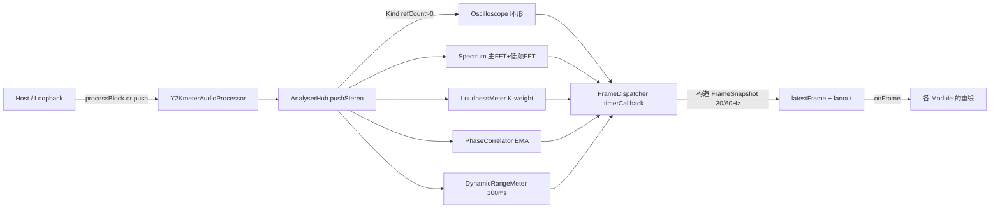
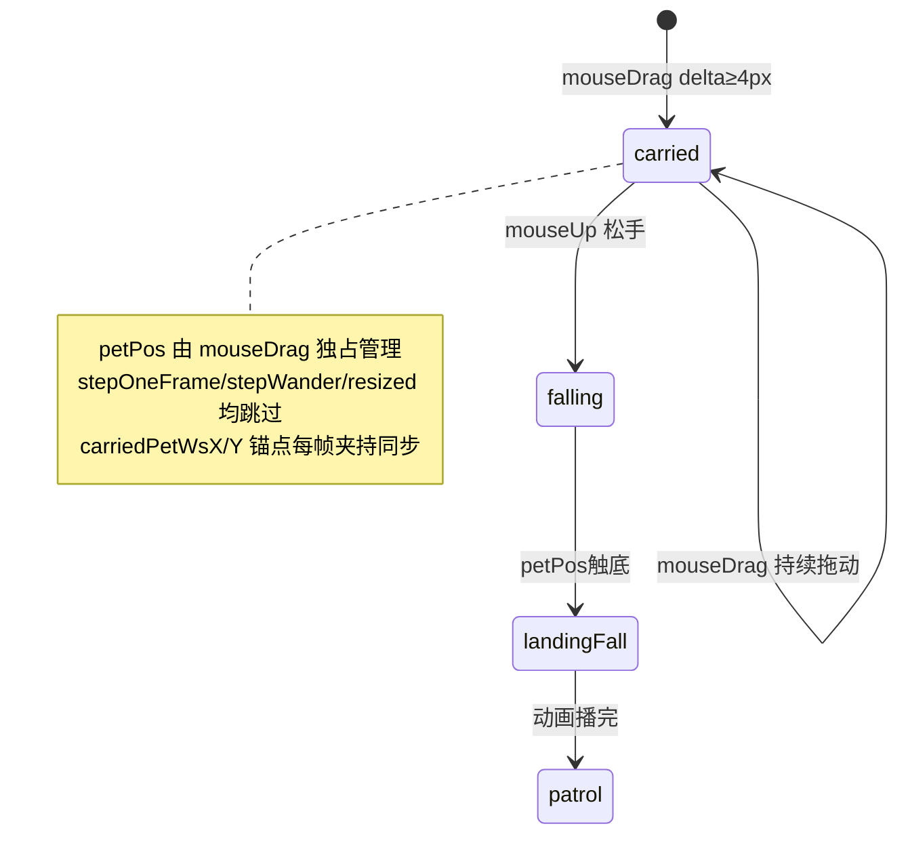

# Y2Kmeter 项目全景简介（AI 上下文导航文档）

> 本文档是为 AI 助手上下文初始化设计的项目导航说明。阅读完本文档，你应能立刻定位到"改哪个文件、调哪个类、走哪条数据流"。
>
> **Steam 渠道相关内容（成就 / 云存档 / 独立 build-steam 流水线）单独维护在 [STEAM_OVERVIEW.md](STEAM_OVERVIEW.md)**，本文不重复；涉及 `source/steam/`、`Y2K_STEAM_BUILD`、`dist-steam/` 的改动先看那份文档。

---

## 1. 项目概述

### 1.1 项目定位
- **产品名**：`Y2Kmeter` （版本：`3.0.7`）
  - 历史：`v2.9.9` 之后的功能曾以「v2.9.9 补充」形式入库、不 bump 版本号（`Stereo Map`、多屏混合 DPI 修复、
    实时 BPM / 调性模块），随后 `v2.9.10` 归拢了 Waveform 模块重构；**v3.0.0** 起恢复常规语义化版本号
    （见文末「v3.0.0：...」章节）；**v3.0.1** 为补丁版（GL 直渲染修复 / 全屏布局预设，见文末）。
    **v3.0.2**（本轮）正式收拢此前以 `v3.0.1补充` 形式入库的内容（响度计时序对齐、VST 布局锁死修复、
    GL 组件合成诊断、Toybox 档位连续互动自动升级）以及本轮两大新功能 —— **悬停提示 Hover Help** 与
    **界面国际化 / 中文本地化（运行时中英文切换）**，连同后续迭代（符号字形集中管理、CJK 视觉校正、
    按钮字号收紧、翻译文案自查、多屏混合 DPI 下模块脱离窗口物理像素落位等），详见文末「v3.0.2」章节。
    v3.0.2 发布后的调整（Milkdrop 按钮等宽、示波器单按钮循环、调性点击反馈、macOS 编译修复、
    VST 响度 Integrated 跟随宿主播放重置、图标字符固定英文 UI 字体）均以 `v3.0.2补充` 形式入库、不再 bump 版本号。
    **v3.0.5** 把 FPS 上限按钮的「无上限」档从 `∞FPS` 改为文字（中文「不限制」/ 英文 `no limit`），
    并让按钮宽度按最宽档文案自适应，详见文末「v3.0.5」章节。
    **v3.0.6**（本轮）现场修复：Stereo Field 残影不消失、拼豆频谱下线（含存档迁移 +
    菜单清单收敛为单来源）、FULL: ALL MODULES 预设按用户存档重排 + 逐块显示模式、
    抬头双击最大化写入存档、Only Milkdrop 预设 30fps 上限、空白工程 Toybox emoji
    定格 / 按住喷发断流，详见文末「v3.0.6」章节。
    **v3.0.7**（本轮）修复 Waveform 静音后的滚动缺陷：静音几秒后由顺滑左移变成每
    100 ms 跳一格（WASAPI loopback 静音兜底脉冲式供数 + 列写入未按帧摊平），以及进入
    静音瞬间的定格顿挫（判定窗口 100 ms 内不供数），详见文末「v3.0.7」章节。
- **产品形态**：一款 **音频分析仪/音频计量插件**（纯分析，不产生音频输出的插件模式），带有强烈的 **Y2K / Windows 95-98-XP 像素复古粉色（Pink XP）** 视觉主题。
- **产品分类**：`VST3_CATEGORIES = "Analyzer" "Fx"`（DAW 分类中会被识别为分析仪）。
- **发行形态**（在 [CMakeLists.txt](/I:/Y2KMeter/CMakeLists.txt) 中通过 `juce_add_plugin` 定义）：
  - **Windows**：`VST3` + `Standalone` 独立应用
  - **macOS**：`VST3` + `Standalone` + `AU`
  - **BundleID / VST3 Plug ID**：`cn.iisaacbeats.Y2Kmeter`
- **开源协议**：GPL-3.0（详见 [LICENSE](/I:/Y2KMeter/LICENSE)）。

### 1.2 主要功能一览

**① 音频分析与计量**（22 个可组合模块 + 1 个已下线模块 `eq`(拼豆频谱)，由 `AnalyserHub` 的 6 路分析统一驱动、按引用计数按需启用）

- **响度计量**：ITU-R BS.1770-4（LUFS-M 瞬时 / LUFS-S 短时 / LUFS-I 积分，含 -70 LUFS 绝对门限 + 相对门限 + 静音自动重置）
- **电平表**：RMS L/R、True Peak L/R（4× 过采样插值）
- **动态范围**：Peak / RMS / Crest / Short-term DR / Integrated DR
- **相位分析**：相关度 Correlation / 宽度 Width / 平衡 Balance / Goniometer 相位图
- **频谱分析**：对数轴 20Hz~20kHz、双路 FFT（2048 主路 + 8192 低频路）
- **示波器**：Waveform / X-Y / Lissajous 李萨如图
- **持续滚动瀑布波形**（Waveform）
- **频谱瀑布图**（Spectrogram 像素方格风格 / Spectrogram 3D 三维曲面）
- **模拟指针 VU 表**（半圆扇形表盘 + 单指针 + LED 信号灯，非对称弹道）
- **声像雷达**（Stereo Field，半圆雷达，幅度驱动声像位置）
- **频谱声像图**（Stereo Map，按频率逐段对比 L/R：PAN 轴 ±1 声像偏向（上=L / 中=居中 / 下=R），MONO 轴为**倒置的单声道保留量**（上=100% 干净 / 下=50% 满幅抵消）；**未发布**）
- **实时节拍 / 音乐调性**（Tempo / Key：BPM + 大调 / 自然小调 / 和声小调 / 旋律小调 + 关系调 + 可解释置信度；后台线程分析，未加载模块时完全不运行）
- **（已下线）拼豆频谱**（`Spectrum Perlerbeads` / `ModuleType::eq`，Y2K 主题的拼豆格子频谱，**仅可视化，不做实际 EQ 处理**）：v3.0.6 起因性能问题暂时从产品中移除 —— 不进"添加模块"菜单，旧存档里的 `type="eq"` 节点在加载时**同位置同尺寸**迁移成 `spectrum`（详见文末「v3.0.6」）。

> 细粒度拆分模块（实时 LUFS / 真峰值 / 相位相关 / 相位平衡 / 动态 Meters / DR / Crest）复用同一路分析结果，后端零新增计算。

**② Milkdrop 可视化**（libprojectM 4 原生 OpenGL）

- 预设浏览（←→ 切换 / 空格随机 + 随机去重），本地 9000+ 个预设
- **预设收藏库（Like）**：收藏 / 取消收藏 / 内置库 ↔ 收藏库切换，状态持久化
- **后处理效果面板**：38 个开关型效果（invert / 万花镜 / 漩涡 / 鱼眼 / 像素化 / 故障 / 色调分离 / 复古 / 灰度 / 边缘 / 暗角 / 隧道 / 水波 / 融化 / 噪声 / 镜像 / 破碎 / 螺旋 / 扭转 / 色散 / 霓虹 / 热成像 / 酸性 / VHS / CRT / 双色调 / 泛光 / 二值化 / 棱镜等）
- **color 面板**（整体染色）、**tweak 面板**（uv 几何畸变 + 万花镜对称）、**wave 面板**（简单波形样式编辑）
- 脱离 / 浮动窗口渲染、内部降采样、wave 参数持久化
- macOS 专属性能治理：num_inst / GetPixel / wavecode_samples 自动归一化（防高开销预设拖垮帧率）

**③ VirtuPet 电子宠物**

- 音频信号驱动的像素电子宠物，完整状态机（孵化蛋 / 觅食 / 睡眠 / 生病 / 死亡），随机蛋样式、巡逻 / 说话 / 跳跃行为

**④ 主题与视觉系统**（Y2K / Pink XP 像素复古风）

- **12 个手工调校预设主题**（数据驱动、外观零回归）：糖果粉 / 星空深蓝 / 赛博紫 / 橘色波普 / 水蓝珠光 / 苏打绿 / 丛林绿 / Windows XP 经典 / 红黑暗夜 / 纯黑灰（OLED 友好）/ 纯白灰 / 黑粉（默认主题）
- **调色板重构（v2.10）**：左下角「Palette Studio」面板 —— 色相环 + 明暗（Dark/Light/Auto）+ 氛围 + 和谐方式 + 随机；`OKLCH` 感知均匀色彩空间 + Recipe 配方 + WCAG 对比度护栏（自动修复可读性）；支持 7 个语义角色微调（自动/手动锁定）、撤销/重做（40 步）、A/B 对比、迷你预览卡、质量徽章
- **我的主题**（自定义 = 一等公民）：可命名保存 ≤24 套（独立存档到 `%APPDATA%\Y2Kmeter.themeLibrary.xml`，Load 存档只合并、不覆盖）、重命名/删除/排序、分享码（`Y2KT1-xxxx` ≤80 字符）复制/粘贴、`.y2kpalette` 文件导入导出、桌面纹理（7 种）+ 标题图标（8 候选）自选、恢复默认（Reset）
- **7 种桌面纹理**：棋盘格 / 像素星星 / 网格扫描线 / 大圆点 / 泡泡 / 斜条纹 / 爱心
- 拖入图片生成「拼豆像素画」贴到桌面背景

**⑤ 布局预设**（11 个常规 + 3 个 stick 条状变体，编号 4 / 8 已废弃）

- 默认网格 / 横向铺满（顶部 / 底部）/ MV（全屏 + 模块条 + Milkdrop）/ Studio Monitor 双行监听 / Focus + Sidecar 主视觉 + 仪表列 / Broadcast Loudness 广播响度合规 / Only Milkdrop 全屏单模块
- **全屏磁贴预设**（14/15/16，提炼自用户三份 Save 存档 `频谱为主` / `所有模块全部放到屏幕里` / `多功能集合`）：下拉名 `FULL: SPECTRUM` / `FULL: ALL MODULES` / `FULL: MULTI COMBO`。三者都是全屏且锁死窗口尺寸；只复刻模块类型与位置尺寸，**不含 VirtuPet**、**不带任何模块内部设置**，模块一律用各自独立的构造默认值（详见 §4.4）。
- **stick 条状变体**（仅 stick 模式下出现在下拉里，条高同为 250px，只是条内模块不同）：`BAR: CLASSIC` 经典条 / `BAR: SPECTROGRAM`（3D 瀑布 → 2D 瀑布）/ `BAR: MILKDROP`（Stereo Field → Milkdrop）/ `BAR: SPEC + MILK`（两者叠加）

**⑥ 桌面集成（Standalone 专属）**

- 音频源选择：麦克风 / 桌面系统音频采集（macOS 走 ScreenCaptureKit、Windows 走 WASAPI Loopback）
- 无边框窗口 + 自定义标题栏（关闭 / 置顶 / 最小化 / 布局锁定 / 双击标题栏全屏）
- 模块脱离 / 停靠（浮动窗口）、预设导出 / 导入（Save / Load）
- 自动更新检查、可选匿名遥测、新手引导（右键添加 VirtuPet → 播放音频孵化）

### 1.3 技术栈
| 项目 | 版本 / 说明 |
| --- | --- |
| 语言 | C++17（`CMAKE_CXX_STANDARD 17`，`CXX_EXTENSIONS OFF`） |
| 框架 | **JUCE 8.0.12**（通过 `FetchContent` 自动拉取） |
| DSP | `juce::dsp`（FFT、Windowing） |
| GPU | `juce::juce_opengl`（Editor 挂 `OpenGLContext`，绘制走 GPU）；Milkdrop 模块使用 libprojectM 4 native OpenGL（详见 §6.41） |
| 构建 | CMake ≥ 3.22 |
| Windows CRT | 强制静态 CRT（`MultiThreaded`，避免依赖 VC_redist） |
| macOS 语言扩展 | Objective-C++（`.mm` 文件走 ScreenCaptureKit 桌面音频采集） |
| 安装器 | Inno Setup（[Y2Kmeter_installer.iss](/I:/Y2KMeter/Y2Kmeter_installer.iss)） |
| 字体 | `Silkscreen-Regular.ttf`（像素英文字体，通过 `juce_add_binary_data` 打包） |
| 项目性能特性 | 支持 **LTO/IPO** + **PGO**（`Y2K_ENABLE_LTO`、`Y2K_PGO_MODE`）|
| 特殊宏 | `Y2K_ENABLE_PERF_COUNTERS=0`（发布版关闭性能计数）、`JUCE_USE_CUSTOM_PLUGIN_STANDALONE_APP=1`（用自定义 Standalone 外壳）、`Y2K_ENABLE_LOGGING`（仅 RelWithDebInfo 定义，见 §1.4） |

---

### 1.4 日志输出方案（开发约定）

**现状**：正式发布包（Release / Debug / MinSizeRel）**不产生任何日志文件**，也不执行日志字符串拼接；只有 **RelWithDebInfo** 构建才会启用日志并落盘。

**实现机制**（编译器开关 + 宏）：

1. `CMakeLists.txt` 中通过生成器表达式定义编译宏：
   ```cmake
   $<$<CONFIG:RelWithDebInfo>:Y2K_ENABLE_LOGGING=1>
   ```
2. [`source/Y2KLogging.h`](/I:/Y2KMeter/source/Y2KLogging.h) 定义 `Y2K_LOG(msg)` 宏：
   - 定义 `Y2K_ENABLE_LOGGING` 时 → 展开为 `juce::Logger::writeToLog(msg)`；
   - 未定义时 → 展开为 `((void)0)`，参数里的字符串拼接 / `juce::String` 构造在**预处理阶段即被丢弃**，零运行时开销。
3. Standalone 应用在 [`Y2KStandaloneApp.cpp`](/I:/Y2KMeter/source/standalone/Y2KStandaloneApp.cpp) 的 `initialise()` 中仅当 `Y2K_ENABLE_LOGGING` 定义时才挂载 `juce::FileLogger`（输出到 exe 同目录 `Y2Kmeter_debug.log`），`shutdown()` 对称卸载；相关代码全部用 `#ifdef Y2K_ENABLE_LOGGING` 包裹。

**后续开发如何加日志**：

- 直接调用 `Y2K_LOG("前缀 + " + juce::String(value));`，**不要**再直接写 `juce::Logger::writeToLog(...)`（否则脱离宏控制，Release 包也会产生字符串拼接）。
- `Y2K_LOG` 参数必须是纯字符串/拼接表达式，**禁止含副作用**（如会修改状态的函数调用），否则关闭日志的构建中副作用会被一并删除。
- 已使用 `Y2K_LOG` 的调用点：`UpdateChecker.cpp`、`Y2KStandaloneApp.cpp`、`MilkdropModule.cpp`、`ProjectMApi.cpp`、`UpdateDialog.cpp`。

### 1.5 现场诊断日志（`source/diag/Y2KDiagLog.h`，v3.0.x）

**为什么单独再做一套**：`Y2K_LOG` 只在 RelWithDebInfo 编译期开启，正式发出去的 Release 包**根本不含日志代码**，用户现场出问题（如"所有 GL 模块卡死"）时无法让用户自己产日志。本模块是**运行时开关**的诊断日志，Release 包也编译，默认关闭。

**开关**（任一即可）：

1. **RelWithDebInfo 构建自动开启**（`shouldEnable()` 里判 `Y2K_ENABLE_LOGGING`，
   该宏只在本工程的 RelWithDebInfo 配置定义）→ 打 RelWithDebInfo 安装包即"带日志的包"，
   Release 安装包不含任何日志输出（`toy_perf_log.txt` / `Y2Kmeter_debug.log` 同样只在
   RelWithDebInfo 编译）；
2. 显式打开（Release 也要日志时）：`cmake ... -DY2K_DIAG_LOG_DEFAULT_ON=ON`；
3. 环境变量 `Y2K_DIAG_LOG=1`（`0/off` 可强制关闭）；
4. exe 同目录或 `<用户数据目录>/Y2Kmeter/` 下放一个 `Y2Kmeter_diag_on.txt` 空文件。

`Y2K_DIAG_VERBOSE=1` 额外每 5 s 打印一次全部 GL 直渲染模块状态。

**产物**：`<桌面>/Y2Kmeter_Diag/`（桌面不可写回退文档/用户数据目录）

| 文件 | 内容 |
| --- | --- |
| `Y2Kmeter_diag_*.log` | 主日志：环境信息（OS/CPU/内存/多屏 DPI/是否远程桌面）、GL vendor/renderer/version/GLSL、上下文创建/attach/detach、每 5 s 的出帧与耗时摘要、慢操作告警 |
| `Y2Kmeter_hang_*.dmp` | 卡死瞬间的 Minidump（Windows，最多 3 份），配合构建 PDB 可直接看所有线程调用栈 |
| `Y2Kmeter_snapshot_*.txt` | 手动快照（`Ctrl/⌘ + Shift + D` 或 `reportNow()`） |
| `README_请把这个文件夹发给开发者.txt` | 给非技术用户的回收说明 |

**卡死定位机制**（全自动，不需要用户操作）：

1. `y2k::diag::setPhase("...")` 在 GL 线程每个大步骤前后打标记（projectM 渲染、FBO blit、`glTexImage2D`、`glReadPixels`、各模块的 snapshot 锁等待与绘制分支……）。日志里"最后一次 phase"就是卡住的位置。
2. 心跳通道 `GlFrame / UiMessage / Dispatch / Audio`：看门狗线程每 250 ms 检查，GL 5 s、UI 4 s 无心跳即判停摆，自动输出 `STALL` 报告（各线程 phase、通道空闲时长、Editor 尺寸/DPI/attach 状态、全部 GL 直渲染模块的可见性/顶点数/纹理与 FBO 尺寸/构建与渲染耗时）+ Minidump。
3. `attach` 后 10 s 仍无 `newOpenGLContextCreated` → 单独告警（驱动创建上下文卡死 / 远程桌面软件渲染）。
4. GL 线程每次 `renderOpenGL` 末尾查一次 `glGetError`，异常限流记录。

**编码约定**：

- 高频路径只允许 `heartbeat()` / `setPhase()`（原子写）与 `addFrameSample()` 这类累加，**禁止**直接 `write()` 拼字符串。
- 一律用宏 `Y2K_DIAG / Y2K_DIAGC / Y2K_DIAG_PHASE / Y2K_DIAG_SLOW`，关闭时参数表达式完全不求值（零开销）。
- `writeCritical` 会立即 flush，仅用于上下文创建/销毁、STALL、会话头等"崩了也必须留下"的事件。

**出包**（两套并行，互不影响）：

| 包 | 构建配置 / 目录 | 脚本 | 产物 |
| --- | --- | --- | --- |
| 正式包 | `Release` / `cmake-build-release-visual-studio` | `build_installer.bat` | `dist/Y2Kmeter_Setup_<ver>_x64.exe` |
| 诊断包 | `RelWithDebInfo` / `cmake-build-relwithdebinfo-visual-studio-ninja` | `build_installer_diag.bat` | `dist/Y2Kmeter_Setup_<ver>_Diag_x64.exe` |

- 两个 `.iss` 的关系：`Y2Kmeter_diag_installer.iss` 只定义 `MyConfig/MyBuildDir/MyOutputSuffix/MyVersionSuffix` 后 `#include "Y2Kmeter_installer.iss"`，安装逻辑（组件页、VST3 目录页、预设解压、AppId 覆盖安装）完全共用；主脚本里所有可变项都用 `#ifndef` 保护，默认值保持原来的 Release 行为。
- 诊断构建的 configure 必须带 `-DY2K_DIAG_LOG_DEFAULT_ON=ON`，否则打出来的包不写日志（`build_installer_diag.bat` 会检查 `CMakeCache.txt` 并在为 OFF 时二次确认）。
- 诊断包产物带 `Y2Kmeter.pdb`：用户回传的 `.dmp` 只能靠同一次构建的 PDB 解析，**打包后不要再重新编译**。

---

## 2. 核心分层架构

```
┌────────────────────────────────────────────────────────────────┐
│  Standalone 外壳（source/standalone）                            │
│    Y2KStandaloneApp / WasapiLoopbackCapture / MacDesktopCapture │
│    · 无边框 Y2K 窗口 / 系统输出 Loopback 采集                     │
├────────────────────────────────────────────────────────────────┤
│  Plugin 层                                                       │
│    Y2KmeterAudioProcessor  (PluginProcessor.h/cpp)              │
│      ↑ 音频线程 processBlock 拉数据                              │
│    Y2KmeterAudioProcessorEditor (PluginEditor.h/cpp)            │
│      ↑ UI 线程 承载 ModuleWorkspace                              │
├────────────────────────────────────────────────────────────────┤
│  Analysis 层（source/analysis）                                  │
│    AnalyserHub —— 中央调度枢纽                                   │
│      · LoudnessMeter / PhaseCorrelator / DynamicRangeMeter      │
│      · 主/低频双路 FFT + 立体声示波器环形缓冲                     │
│      · Kind 引用计数（按需计算）+ FrameSnapshot（一帧一份）       │
├────────────────────────────────────────────────────────────────┤
│  UI 框架层（source/ui）                                          │
│    ModuleWorkspace —— 所有分析模块的拖拽工作区                   │
│    ModulePanel     —— 所有模块的基类（像素窗口外观）              │
│    PinkXPStyle     —— 主题系统 + LookAndFeel                    │
│    UiFrameClock    —— 自适应帧率的 UI 时钟                       │
├────────────────────────────────────────────────────────────────┤
│  Modules 层（source/ui/modules）                                 │
│    EqModule / LoudnessModule / OscilloscopeModule /             │
│    OscilloscopeWaveModule / SpectrumModule / PhaseModule /      │
│    DynamicsModule / WaveformModule / SpectrogramModule /        │
│    VuMeterModule / VirtuPetModule /                           │
│    FineSplitModules（LUFS / TruePeak / PhaseCorr / PhaseBal /   │
│    DynamicsMeters / DynamicsDr / DynamicsCrest）                  │
├────────────────────────────────────────────────────────────────┤
│  Perf 层（source/perf）                                          │
│    PerformanceCounterSystem —— 性能计数系统（默认关闭）           │
└────────────────────────────────────────────────────────────────┘
```

### 2.1 关键调用关系
1. **音频入口 → 分析**：`Y2KmeterAudioProcessor::processBlock` → `AnalyserHub::pushStereo` → 分发到 6 路：`Oscilloscope / Spectrum / Loudness / Phase / Dynamics / MusicAnalysis`。前 5 路在音频线程内联计算；`MusicAnalysis` 只做降混 + 写入有界环形缓冲，真正的 FFT / 自相关 / chroma 在独立后台线程。
2. **UI 拉分析结果**：`AnalyserHub` 内部 `FrameDispatcher` 在 UI 线程按目标频率（FPS 按钮 30/60/120/无上限）组装 `FrameSnapshot`，通过 `FrameListener::onFrame(frame)` 派发给所有订阅的模块。v2.9 起由 Editor 的 vblank 同步时钟驱动（§4.2），与显示器刷新同相。
3. **模块的 UI 生命周期**：模块继承 `ModulePanel + AnalyserHub::FrameListener`，构造时 `hub.retain(Kind::xxx)` + `hub.addFrameListener(this)`，析构时对称 release + remove。**未加载的模块 → 引用计数为 0 → `pushStereo` 自动跳过对应计算路径**。
4. **Standalone 音频源**：`Y2KStandaloneApp` 通过 `WasapiLoopbackCapture`（Win）或 `MacDesktopAudioCapture`（macOS 使用 ScreenCaptureKit）获取"系统外放音频"，直接 push 到 `AnalyserHub`（不走 `processBlock`）。DAW 场景则由宿主经 `processBlock` 送入。

---

## 3. 代码结构说明

### 3.1 根目录关键文件
| 文件 | 作用 |
| --- | --- |
| [CMakeLists.txt](/I:/Y2KMeter/CMakeLists.txt) | CMake 主构建脚本；含 macOS 图标流水线、字体打包、平台条件源、LTO/PGO |
| [CMakePresets.json](/I:/Y2KMeter/CMakePresets.json) | CMake 预设集合（含 clangd 用的 Ninja preset） |
| [PluginProcessor.h/.cpp](/I:/Y2KMeter/PluginProcessor.h) | 顶层 `AudioProcessor`；持有 `AnalyserHub` 与状态持久化逻辑 |
| [PluginEditor.h/.cpp](/I:/Y2KMeter/PluginEditor.h) | 顶层 `AudioProcessorEditor`；Pink XP 外壳 + 自画标题栏 + `ModuleWorkspace` 托管 |
| [Y2Kmeter_installer.iss](/I:/Y2KMeter/Y2Kmeter_installer.iss) | Windows Inno Setup 安装器脚本 |
| [assets/](/I:/Y2KMeter/assets) | Logo、图标、VirtuPet 精灵图（角色 20 只 × 33 动作 + 蛋 8 款） |
| [ttf/](/I:/Y2KMeter/ttf) | 打包用像素字体 |

### 3.2 `source/analysis`（音频分析）
| 文件 | 类 / 关键实现 |
| --- | --- |
| [AnalyserHub.h](/I:/Y2KMeter/source/analysis/AnalyserHub.h) | `LoudnessMeter` / `PhaseCorrelator` / `DynamicRangeMeter` / `AnalyserHub`（**注意**：为了绕过 MSVC include-guard 串扰，四个类都塞进了同一个头，实现分散在各自 cpp）|
| [AnalyserHub.cpp](/I:/Y2KMeter/source/analysis/AnalyserHub.cpp) | `AnalyserHub::pushStereo` 主路+低频路双 FFT、`FrameDispatcher` 内部 Timer、Kind 引用计数、FrameSnapshot 组装与广播 |
| [LoudnessMeter.cpp](/I:/Y2KMeter/source/analysis/LoudnessMeter.cpp) | K-weighting 双级 IIR + 400ms 动量 LUFS、3s 短期、全程积分（含相对门限）、100ms RMS、4× 过采样 True Peak |
| [PhaseCorrelator.cpp](/I:/Y2KMeter/source/analysis/PhaseCorrelator.cpp) | EMA 滑动窗计算 correlation / width / balance |
| [DynamicRangeMeter.cpp](/I:/Y2KMeter/source/analysis/DynamicRangeMeter.cpp) | 100ms 块统计 + top-20% 分位 short-DR / integrated-DR |
| [music/RealFft.h/.cpp](/I:/Y2KMeter/source/analysis/music/RealFft.cpp) | `RealFft`：极简 radix-2 FFT（纯 C++，不依赖 JUCE，供测试目标直接链接） |
| [music/TempoEstimator.h/.cpp](/I:/Y2KMeter/source/analysis/music/TempoEstimator.cpp) | `TempoEstimator`：46ms/25% hop 分帧 → 24 对数带谱通量 → 8s 包络归一化自相关 + 谐波梳状 + 对数正态速度先验 → 三候选中值 + 八度迟滞 + 置信度 |
| [music/KeyEstimator.h/.cpp](/I:/Y2KMeter/source/analysis/music/KeyEstimator.cpp) | `KeyEstimator`：186ms/25% hop 分帧 → 55Hz–5kHz bin 折 12 音级 chroma → 20s 滑动窗口 → KK 轮廓 Pearson 相关（大调 / 自然 / 和声 / 旋律小调共 48 候选）+ 关系调迟滞 + 置信度 |
| [music/MusicAnalysisEngine.h/.cpp](/I:/Y2KMeter/source/analysis/music/MusicAnalysisEngine.cpp) | 音频线程降混 + 无锁 SPSC 环形缓冲（131072 采样）；后台 `juce::Thread` 消费并发布 `Result`；**首次订阅才分配缓冲/建线程**，无模块时零资源 |
| [music/MusicAnalysisTypes.h](/I:/Y2KMeter/source/analysis/music/MusicAnalysisTypes.h) | `Result` / `Status` / `Mode` / `KeySpelling`（按调式选常用拼写）/ `RelativeKey`（关系调）—— 纯 C++，供 UI 与测试共用 |

### 3.3 `source/ui`（UI 框架）
| 文件 | 关键内容 |
| --- | --- |
| [ModuleWorkspace.h](/I:/Y2KMeter/source/ui/ModuleWorkspace.h) | `ModuleType` 枚举 / `ModulePanel` 基类 / `ModuleWorkspace` 主类 / `ThemeSwatchBar` / `HideChromeButton`（**同一个头包含多个类**，同样为绕过 MSVC 串扰）|
| [ModuleWorkspace.cpp](/I:/Y2KMeter/source/ui/ModuleWorkspace.cpp) | 拖拽 / 网格吸附 / 布局持久化 / 拼豆图片 / 底部 toolbar / 添加菜单 / 鼠标事件 |
| [ModulePanel.cpp](/I:/Y2KMeter/source/ui/ModulePanel.cpp) | 各模块统一的像素窗口：标题栏 + 关闭按钮 + 边缘/角拖拽缩放 + 右下 CPU 小字 |
| [ModulePanel.h](/I:/Y2KMeter/source/ui/ModulePanel.h) | **只是一个兼容 shim**，内部只 `#include "source/ui/ModuleWorkspace.h"` |
| [PinkXPStyle.h/.cpp](/I:/Y2KMeter/source/ui/PinkXPStyle.h) | 主题系统（12 预设 + 生成器 custom）+ 19 色槽位 + 扩展槽（`accent2`/`chartRamp[8]`/`danger`/`warn`/`ok`）+ OKLab 渐变采样 + 桌面纹理 + `PinkXPLookAndFeel` |
| [source/ui/palette/](/I:/Y2KMeter/source/ui/palette/) | 调色板重构模块：`OkLchUtils`（OKLCH/色域裁剪/WCAG）、`ThemeSpec`（意图参数+分享码）、`PaletteGenerator`（Recipe+护栏，纯 C++）、`ThemeLibrary`（我的主题）、`PalettePanel`（新面板 UI） |
| [UiFrameClock.h/.cpp](/I:/Y2KMeter/source/ui/UiFrameClock.h) | 统一 UI 帧时钟（阶段1性能改造，目前尚未强制接线，主流数据流仍走 `AnalyserHub::FrameDispatcher`） |
| [HoverHelp.h/.cpp](/I:/Y2KMeter/source/ui/HoverHelp.h) | 悬停提示：`y2k::help` 文案库（模块详细说明 / 全局开关持久化）+ `Y2KTooltipWindow`（统一解析控件 / 模块 / 自绘按钮提示，仪表内容区静止才弹出）；绘制在 `PinkXPLookAndFeel::drawTooltip`（见文末「v3.0.2：悬停提示」） |
| [UiPrefs.h/.cpp](/I:/Y2KMeter/source/ui/UiPrefs.h) | 进程级 UI 偏好（`Y2Kmeter.uiPrefs.xml`：界面语言 / 悬停提示开关），独立于布局与预设 |
| [../i18n/Localisation.h/.cpp](/I:/Y2KMeter/source/i18n/Localisation.h) | 界面国际化 `y2k::i18n` / `y2k::tr` / `y2k::trf`：语言包（`i18n/*.lang`）注册与合并、查表翻译（精确 / 数字模板 / 逐行）、按语言字体、运行时切换广播（见文末「v3.0.2：界面国际化」） |

### 3.4 `source/ui/modules`（分析模块 UI）
每个模块都是 `ModulePanel + AnalyserHub::FrameListener` 双继承。

| 文件 | 模块 | 数据源 |
| --- | --- | --- |
| [EqModule.h/.cpp](/I:/Y2KMeter/source/ui/modules/EqModule.h) | `EqModule`（Y2K 像素频谱可视化，非真实 EQ） | `Spectrum` |
| [LoudnessModule.h/.cpp](/I:/Y2KMeter/source/ui/modules/LoudnessModule.h) | `LoudnessModule`（LUFS-M/S/I + Peak L/R 五柱） | `Loudness` |
| [OscilloscopeModule.h/.cpp](/I:/Y2KMeter/source/ui/modules/OscilloscopeModule.h) | `OscilloscopeModule`（Wave / XY / Lissajous，v1.8.4 新增 XY/Lissajous 峰值驱动自动缩放 + 同心标尺环） | `Oscilloscope` |
| [OscilloscopeWaveModule.h/.cpp](/I:/Y2KMeter/source/ui/modules/OscilloscopeWaveModule.h) | `OscilloscopeWaveModule`（纯波形，L / R / Both 通道选择，v1.8.4 新增合并原 OSc L+R） | `Oscilloscope` |
| [SpectrumModule.h/.cpp](/I:/Y2KMeter/source/ui/modules/SpectrumModule.h) | `SpectrumModule`（对数频谱 + peak hold + slope） | `Spectrum` |
| [PhaseModule.h/.cpp](/I:/Y2KMeter/source/ui/modules/PhaseModule.h) | `PhaseModule`（Goniometer + Correlation Dial + Width/Balance Bar） | `Phase` + `Oscilloscope` |
| [DynamicsModule.h/.cpp](/I:/Y2KMeter/source/ui/modules/DynamicsModule.h) | `DynamicsModule`（Peak/RMS 四柱 + DR + Crest 历史） | `Dynamics` |
| [WaveformModule.h/.cpp](/I:/Y2KMeter/source/ui/modules/WaveformModule.h) | `WaveformModule`（滚动瀑布波形，像素列；左上角**单个按钮循环** PITCH → LOUD → SIB，按钮文字即当前模式） | `Oscilloscope` |
| [SpectrogramModule.h/.cpp](/I:/Y2KMeter/source/ui/modules/SpectrogramModule.h) | `SpectrogramModule`（像素方格频谱瀑布图，双路 FFT 合成） | `Spectrum` |
| [Spectrogram3DModule.h/.cpp](/I:/Y2KMeter/source/ui/modules/Spectrogram3DModule.h) | `Spectrogram3DModule`（v1.8.6 新增 3D 频谱曲面图；v1.9.0~v1.9.4 P1~P4 四轮 CPU 性能优化；v2.2.5 GPU Shader 迁移 → 15+ 轮调试后回退为纯 CPU；v2.2.5~v2.2.6 P5~P6 进一步优化：visibleRows 150→100、repaint 节流 20ms、Path 对象循环外复用 clear()） | `Spectrum` |
| [FineSplitModules.h/.cpp](/I:/Y2KMeter/source/ui/modules/FineSplitModules.h) | 细粒度拆分：`LufsRealtime` / `TruePeak` / `PhaseCorrelation` / `PhaseBalance` / `DynamicsMeters` / `DynamicsDr` / `DynamicsCrest` / `VuMeter`（v1.8.4 移除 `OscilloscopeChannel`，由 `OscilloscopeWave` 替代） | 视模块而定 |
| [StereoFieldModule.h/.cpp](/I:/Y2KMeter/source/ui/modules/StereoFieldModule.h) | `StereoFieldModule`（v2.7.0 新增：半圆雷达声像指示，`peak=max(|L|,|R|)` 驱动径向距离、`balance=(|R|-|L|)/(|L|+|R|)` 驱动方向；**自动缩放**：1 s 周期峰值归一 + 10% 死区，雷达轮廓固定、dB 标签按增益换算 + 渐隐残影） | `Oscilloscope` |
| [StereoMapModule.h/.cpp](/I:/Y2KMeter/source/ui/modules/StereoMapModule.h) | `StereoMapModule`（**未发布/开发中**：两个模式由顶部按钮切换 —— `PAN` 按频率对比 L/R 频谱、纵轴声像偏向 ±1（上 L 下 R）；`MONO` 显示切单声道后的保留量，**上下倒置**（顶 = 100% 干净、底 = 50% 满幅抵消，曲线越往下越糟）；工具条右侧一行模式说明；对数频率轴 20Hz–20kHz，384×240 默认尺寸，GL 直渲染 + CPU 回退双路径，含悬停标尺与点击读数气泡） | `Spectrum`（L/R 分路 + mid 单声道路） |
| [TempoKeyModule.h/.cpp](/I:/Y2KMeter/source/ui/modules/TempoKeyModule.h) | `TempoKeyModule`（**v2.9.9 补充**：BPM 大字 + 调性大字 + 关系调副行 + 置信度条；START/STOP/RESET（未启动时 RESET 会自动 START，连续 3 s 无信号自动 reset）；点击 BPM 列弹 `x2 / /2` 气泡、点击 KEY 列弹 7 个音名气泡（复用 Toybox readout bubble）；字号按实测字宽收缩，窄尺寸不裁字） | `MusicAnalysis` |
| [VirtuPetModule.h/.cpp](/I:/Y2KMeter/source/ui/modules/VirtuPetModule.h) | `VirtuPetModule`（宠物状态机 + 精灵图动画） | `Loudness`（用信号强度驱动饥饿/健康）|
| [MilkdropModule.h/.cpp](/I:/Y2KMeter/source/ui/modules/MilkdropModule.h) | `MilkdropModule`（v2.5.2：Editor GL 上下文渲染 → offscreen FBO + 跨 FBO blit 零拷贝管线，~60fps 无遮盖 + auto 轮播 + 预设跳转 + 分辨率缩放 1:1/1:2/1:4；GLView 支持浮动态独立 OpenGLContext；新增 Standalone 脱离/浮动/停靠/置顶/布局持久化；archive v2.2.4：PBO 异步回读 + Triple-buffer 无锁帧传输；v2.6.1：color 面板 RGB+Bright 四行滑块 + effects 面板 invert/shadows 纯开关 + 脱离模式 FBO 渲染路径修复；**v2.6.5：效果系统架构重构（注册表驱动 + efftop/effbottom 分类）+ 38 个后处理效果（含第三批 19 个实验性效果）+ effects 面板动态网格布局**；**v2.6.6：wave 样式编辑面板（mode/X/Y/R/G/B/A/Mys 滑块 + dots/thick/add/bright 开关）+ 预设文本注入机制**；**v2.6.7：tweak 面板重构为后处理 uv 几何畸变（7 浮点 zoom/rot/warp/dx/dy/sx/sy + 3 整数万花镜 kaleido/fold_x/fold_y 滑块）+ 实时生效不重载预设**；**v2.7.1：预设收藏库 like（右下角爱心收藏/双向箭头切换 + 双向索引记忆 + 随机去重）**） | `Oscilloscope`（立体声 PCM 推流 → `bass`/`mid`/`treb` 变量驱动视觉效果）|
| [MilkdropVisualState.h](/I:/Y2KMeter/source/ui/modules/MilkdropVisualState.h) | `MilkdropVisualState`（v2.6.1 新增，v2.6.5 扩展：Milkdrop 后处理全局视觉状态结构体，`tint_r/g/b` + `brightness` + 38 个开关效果字段 + `isNeutral()`；v2.6.7 新增 `offset` 成员承载 tweak 后处理 uv 畸变；由 Editor 全局共享并持久化到 Processor host state） | — |
| [MilkdropEffect.h](/I:/Y2KMeter/source/ui/modules/MilkdropEffect.h) | `MilkdropEffect`（v2.6.5 新增，header-only：`MilkdropEffectId` 枚举 + `MilkdropEffectDef` 元数据 + `GetMilkdropEffectDefs()` 注册表；驱动 effects 面板 UI 动态生成与 shader uniform 传递） | — |
| [MilkdropWaveState.h](/I:/Y2KMeter/source/ui/modules/MilkdropWaveState.h) | `MilkdropWaveState`（v2.6.6 新增，header-only：Milkdrop 简单波形样式覆盖状态结构体 + 16 种 `wave_mode` 名称表 + `GetWaveModeName()` + `ReplaceWaveKeyValue()`/`ApplyWaveParamsToPresetText()` 预设文本注入函数；全局共享并持久化到 Processor host state） | — |
| [MilkdropVisualOffsetState.h](/I:/Y2KMeter/source/ui/modules/MilkdropVisualOffsetState.h) | `MilkdropVisualOffsetState`（v2.6.7 新增，header-only：tweak 后处理 uv 几何畸变数据载体，7 个浮点 `value[]` + 3 个整数 `ivalue[]` + `isNeutral()`/`reset()` + `GetVisualOffsetParams()`/`GetVisualOffsetIntParams()` 元数据；作为 `MilkdropVisualState::offset` 成员随视觉状态每帧传递到 `MilkdropTintPass`） | — |

### 3.5 `source/standalone`（Standalone App）
| 文件 | 作用 |
| --- | --- |
| [Y2KStandaloneApp.cpp](/I:/Y2KMeter/source/standalone/Y2KStandaloneApp.cpp) | 自实现 `juce::JUCEApplication` + `Y2KMainWindow`（DocumentWindow）替换 JUCE 内建的 `StandaloneFilterApp`；启动 → 加载 settings → 创建 Processor+Editor → 绑定 Loopback 音源 → 恢复主题/FPS/位置/尺寸/固定态 |
| [WasapiLoopbackCapture.h/.cpp](/I:/Y2KMeter/source/standalone/WasapiLoopbackCapture.h) | Windows：裸 WASAPI + `AUDCLNT_STREAMFLAGS_LOOPBACK`，采集"系统默认播放端点"输出，输出统一立体声 float32 |
| [MacDesktopAudioCapture.h/.mm](/I:/Y2KMeter/source/standalone/MacDesktopAudioCapture.h) | macOS：`ScreenCaptureKit` 获取桌面音频（Objective-C++） |
| [AudioDumpRecorder.h/.cpp](/I:/Y2KMeter/source/standalone/AudioDumpRecorder.h) | **仅 macOS**，通过环境变量 `Y2KM_AUDIO_DUMP` 系列开启，把音频原样落盘做调试 |

### 3.6 `source/perf`
| 文件 | 作用 |
| --- | --- |
| [PerformanceCounterSystem.h/.cpp](/I:/Y2KMeter/source/perf/PerformanceCounterSystem.h) | 全局性能计数系统（发布版 `Y2K_ENABLE_PERF_COUNTERS=0` 关闭）；提供 `ScopedPerfTimer`、`ScopedLockWaitMeasure` 用于埋点 |

---

## 4. 关键类 / 接口清单

### 4.1 `Y2KmeterAudioProcessor`（[PluginProcessor.h](/I:/Y2KMeter/PluginProcessor.h)）
- 音频线程接口：`prepareToPlay`、`processBlock`、`releaseResources`。
- 关键成员：`std::unique_ptr<AnalyserHub> analyserHub;`（**pimpl 隐藏**，头文件里只前向声明）。
- 状态持久化（`getStateInformation` / `setStateInformation`）：
  - 顶层 XML 根 `<PBEQ_State>`，含 `analysisInputGainDb`、`editorW/editorH` 属性；
  - 子节点 `<PBEQ_Layout>` 承载 `ModuleWorkspace` 布局（模块位置 / 拼豆图 / 主题 / FPS 等）。
  - Milkdrop 相关属性直接挂顶层：`milkdropTintR/G/B`、`milkdropBrightness`、`milkdropInvert/Shadows/...` 等效果开关、`milkdropWaveXxx` 波形覆盖、`milkdropOffsetXxx`（tweak uv 畸变），以及 **v2.7.1 新增的 `milkdropUseLikeLibrary`**（收藏库切换状态，`std::atomic<bool>` 持久化）。
- 分析开关：`setAnalysisActive(false)` 时 `processBlock` 完全跳过分析（UI 不可见时用）。
- CPU 负载：`getCpuLoad()` 供每个模块右下角显示；Loopback 路径用 `registerLoopbackRenderTime` 通道注入。
- 分析前置增益：`setAnalysisInputGainDb / getAnalysisInputGainLinear`（-10 ~ +36 dB），只作用于分析路径，不改变透传输出。
- **P4 flush 钩子**：`flushPendingUiStateBeforeSave`（Editor 注册；`getStateInformation` 前 flush 掉 workspace 的 debounce 布局变更）。

### 4.2 `AnalyserHub`（[AnalyserHub.h](/I:/Y2KMeter/source/analysis/AnalyserHub.h)）
- **枚举** `AnalyserHub::Kind`：`Oscilloscope=0 / Spectrum=1 / Loudness=2 / Phase=3 / Dynamics=4 / MusicAnalysis=5 / NumKinds=6`。
- **MusicAnalysis 生命周期（v2.9.9 补充）**：`retain(Kind::MusicAnalysis)` 的 0→1 会调用 `musicEngine.setActive(true)`（分配环形缓冲 + 启动后台线程），`release` 到 0 时 `setActive(false)` 停线程；未加载 Tempo/Key 模块的实例不建线程、不分配缓冲、音频线程零开销。`pushStereo` 只做 `(L+R)/2` 入队，FFT/自相关/chroma 全部在工作线程。
- **引用计数** `retain(Kind)` / `release(Kind)` / `isActive(Kind)` —— UI 线程调用；`pushStereo` 里读原子决定是否跳过某路计算。
- **FrameSnapshot**：一帧一份聚合数据（`activeMask`、`tickCount`、示波器 L/R 2048 样本、频谱 mag 1024/4096、Loudness/Phase/Dynamics 快照）。
- **FrameDispatcher**（pimpl）：`startFrameDispatcher(hz)` 设定目标频率（上限 120Hz）。v2.9 起支持**外部帧时钟**：Editor 挂 `juce::VBlankAttachment` 后调用 `setExternalFrameClock(true)`，内部 Timer 停转，改由 Editor 在每个 vblank（按 FPS 上限抽稀后）调用 `dispatchFrameNow(ts)` —— 分发与显示器刷新同相；vblank 停摆（显示器休眠/远程桌面）由 Editor 10Hz 看门狗切回 Timer。`FrameSnapshot` 新增 `timeSec/dtSec` 供模块做帧率无关动画，快照本身走 4 槽复用池（不再每帧 37KB make_shared）。
- **模块订阅**：`addFrameListener(listener)` / `removeFrameListener`；每帧 UI 线程回调 `onFrame(const FrameSnapshot&)`。
- **兼容旧接口**：`getOscilloscopeSnapshot / getSpectrumSnapshot / getSpectrumMagnitudes(Lo) / getSpectrumMagnitudesBlended`。
- **L/R 分路频谱（未发布，为 Stereo Map 新增）**：`getSpectrumMagnitudesBlendedLR(destL, destR, numPoints, fMin, fMax)` —— 与 `getSpectrumMagnitudesBlended` 同一频率轴/带宽聚合逻辑，仅数据源改为 `magDataL` / `magDataR`。代价是主 FFT 由单路变三路（mid + L + R，共用同一个 `fft` 实例和窗函数，环形 FIFO 各一份）。
- **常量**：`fftOrder=11 (2048)`，`fftOrderLo=13 (8192)`，`spectrumXoverHz=500Hz`，`oscilloscopeBufferSize=2048`，`spectrumBins=160`。

### 4.3 `Y2KmeterAudioProcessorEditor`（[PluginEditor.h](/I:/Y2KMeter/PluginEditor.h)）
- 关键子成员：`std::unique_ptr<ModuleWorkspace> workspace;`（pimpl 前向声明）。
- 双形态区分：`const bool isPluginHost;`（VST3/AU/AAX/LV2 → true；Standalone → false）。
  - **插件模式**下：不画自画标题栏、不接管窗口拖拽 / 关闭 / 置顶，隐藏"信号源"下拉与布局预设（保留 Save/Load）。
  - **Standalone 模式**下：完整 Y2K 外壳（标题栏 + 三按钮 + 无边框窗口拖拽 + 系统 Loopback）。
- **GPU**：类末尾持有 `juce::OpenGLContext openGLContext;`，构造末尾 `attachTo(*this)`，析构起始 `detach()`。
- **FPS 上限（封顶语义）**：FPS 按钮选择 30/60/120/无上限；`applyAdaptiveFrameRate` 仅保证 FrameDispatcher 目标频率与上限一致，不再动态降档。v2.9 起上限由 vblank 抽稀实现（上限 ≥ 显示器刷新率时每帧分发 = 跟随刷新率）。
- **真实帧率统计（v2.9）**：FPS 标签以 GL 线程实际出帧数（`renderOpenGL` 里 `glFrameCounter`）为准，而非分发次数 —— GL 跟不上时多次 repaint 会被合并，分发数不变但屏幕实际掉帧，旧统计会把掉帧"藏"起来。
- **持久化协作**：Editor 构造时读 `Processor.getSavedLayoutXml` 恢复布局；`workspace->onLayoutChanged` → 写回 Processor。
- **Windows Direct2D 处理**：首次 `visibilityChanged` 时通过 `renderingEngineConfigured` flag 强制切换到软光栅/GDI，规避 AMD `atidxx64.dll` 卸载死锁（详见头文件相关注释）。
- **Chrome 隐藏态**：Hide 按钮收缩窗口；实现"幂等化" —— Hide 前完整快照 bounds 与 resizeLimits，Show 时直接 setBounds 回快照，避免累积漂移。
- **双击标题栏切换全屏**（v1.8.2 新增，v2.6.0 后按平台拆分）：`mouseDoubleClick` 中命中 `getTitleBarBounds()` 且避开按钮与标题文字热区后，走 `toggleFakeFullScreen()` —— **macOS** 调用 `rw->setFullScreen(!isFullScreen())` 进入系统原生全屏（独立 Space、隐藏菜单栏/Dock）；**Windows** 保留 v2.5.8 的伪最大化（setBounds 到 userArea，避免覆盖任务栏及 PopupMenu Z 序遮挡）。仅 Standalone 非 chrome 隐藏态下生效，插件宿主模式不接管。切换前先把 `draggingWindow=false` 复位，避免上一帧 `mouseDown` 启动的 `windowDragger` 残留拖拽态。
- **布局锁定按钮 L**（v1.8.3 新增）：位于顶栏「最小化 _」按钮左侧，从右到左依次为 `× / * / _ / L`。点击切换 `layoutLocked`，同步 `ModuleWorkspace::setLayoutLocked` 与 Processor `setLayoutLocked`（XML 属性 `layoutLocked="1"` 序列化）。锁定时：
  - 顶层窗口通过 `setResizeLimits(cur, cur, cur, cur)` 冻结尺寸（**不用 `setResizable(false, ...)`，那会重建 native 窗口导致闪现**），Editor 双击标题栏切全屏仍可用（因为 fullscreen 不走 resize limits）。
  - Editor::mouseDown 在锁定态跳过 `windowDragger.startDraggingComponent`，即无法拖动窗口。
  - 关键接口：`isLayoutLocked() / handleLockClicked() / applyLayoutLocked(locked, initial)` + 构造期延迟 flag `pendingLockApplyOnAttach`（顶层窗口尺寸未就绪时先记账，`visibilityChanged` 时再应用，避免构造期 assert）。
- 顶部三按钮几何：`getCloseButtonBounds / getPinButtonBounds / getMinimiseButtonBounds`；chrome 隐藏态特殊：`getFloatingCloseButtonBounds`。
- **VirtuPet 保活**：只有当工作区存在 VirtuPet 模块时，Editor 才 `hub.retain(Kind::Loudness)` 保持信号驱动状态机。
- **Milkdrop 收藏库桥接（v2.7.1 新增）**：`IsMilkdropUseLikeLibrary` / `RequestMilkdropToggleLibrary` / `ToggleMilkdropLibraryState` / `SetMilkdropUseLikeLibrary` / `RequestMilkdropUnlinkReload` / `HasMilkdropLikedPresets` / `GetMilkdropCurrentPresetFilePath`；`renderOpenGL` 消费库切换与取消收藏重扫请求，维护双向索引记忆 `milkdrop_builtin_preset_index_ / milkdrop_like_preset_index_`。

### 4.4 `ModuleWorkspace`（[ModuleWorkspace.h](/I:/Y2KMeter/source/ui/ModuleWorkspace.h)）
- **模块工厂**：`setModuleFactory(f)`，Editor 侧会按 `ModuleType` 构造具体 `ModulePanel` 派生类（见 [PluginEditor.cpp](/I:/Y2KMeter/PluginEditor.cpp) 的 `createModule`）。
- **底部 Toolbar 组件**（自左至右）：`ThemeSwatchBar` → 布局预设下拉 + Save/Load → Grid → FPS → GAIN → Source → Hide。
- **布局预设** `LayoutPreset`：`defaultGrid=1 / horizontalFull=2 / horizontalBottom=3 / mv=5 / studioMonitor=6 / focusSidecar=7 / broadcastLoudness=9 / onlyMilkdrop=10 / fullSpectrumFocus=14 / fullAllModules=15 / fullMultiCombo=16`（编号 `4`、`8` 已废弃，保留空洞以兼容历史存档）；另有三条 stick 条状变体 `stickBarSpectrogram=11 / stickBarMilkdrop=12 / stickBarSpecMilk=13`。枚举只追加不重排，保护旧存档里记录的 preset id。
  - **Horizontal Bar T/B (2/3)**：横向铺满屏幕宽度，默认模块横向等分 canvas；Preset 2 贴屏幕顶部、Preset 3 贴屏幕底部。默认模块序列为 `Spectrogram3D / LUFS RT / VU / StereoField / Spectrum / OscWave / Waveform`（v2.7.3 起将 `Dynamics` 替换为 `LUFS RT` 并拉短，`VU`/`StereoField` 拉宽以适配低分辨率屏幕）。
  - **stick 条状变体 (11/12/13)**：只在 stick 驻留态的下拉里出现（避免改窗口形状破坏 AppBar 占位）。三条与 2/3 共用**同一套**"屏幕宽 × 条高 250"几何 + 网格对齐 + redock 流程，仅条内模块序列/宽度权重不同：11 = `Spectrogram` 替换 `Spectrogram3D`；12 = `Milkdrop` 替换 `StereoField`（权重 2.2，窄条靠加宽才看得清）；13 = 两者同时替换。贴顶/贴底由当前 dock 侧（T/B）决定，`applyLayoutPreset` 用 `stickActive ? stickBottomAligned : (presetId==3)` 判定；应用后回写 `ModuleWorkspace::setStickPresetLabel()`，下拉 placeholder 显示当前条状预设名。
  - **MV (Preset 5)**：**Windows** 铺满当前显示器 userArea（视觉等同全屏）；**macOS** 铺满 totalArea 后调用 `rw->setFullScreen(true)` 进入系统原生全屏（隐藏菜单栏/Dock）。上方 180px 横向模块条（同 Preset 2 的 7 个默认模块），下方 Milkdrop 模块占满剩余 canvas 区域。代码位于 `applyLayoutPreset` case 5。
  - **Studio Monitor (6)**：双行监听——上排频谱行（`Spectrum / Spectrogram / Waveform`，拉宽 ≈1.5:1 保证频率信号可读）+ 下排仪表行（`VU / StereoField / LUFS RT / TruePeak`，半圆仪表保持 ≈2:1 避免空白）。
  - **Focus + Sidecar (7)**：左 65% `Spectrogram` 主视觉（普通瀑布，帧率友好）+ 右 35% `VU / StereoField / LUFS RT` 竖排。
  - **Broadcast Loudness (9)**：上排响度读数（`LUFS RT / TruePeak / Dynamics DR / Dynamics Crest`）+ 下排仪表（`VU / StereoField / Dynamics Meters`）。
  - **Only Milkdrop (10)**：全屏（Windows userArea / macOS 原生全屏）+ 单个最大化 `Milkdrop` 模块。
  - **全屏磁贴预设 (14/15/16)**：由用户三份 Save 存档（`.settings` → `filterState` → `<PBEQ_Layout>`）提炼，静态表在 `PluginEditor.cpp` 匿名 namespace 的 `kFullSpectrumTiles / kFullAllModulesTiles / kFullMultiComboTiles`（9 / **25** / 10 块；v3.0.6 起 15 号按最新存档 `Y2Kmeter_all.settings` 重排并去掉已下线的拼豆频谱）。只取 `<Module>` 的 `type + x/y/w/h`（参考画布 2560×1328，均为 8px 网格对齐），**丢弃 VirtuPet 节点与除"显示模式"以外的全部 `<state>` 子节点**；显示模式由 `FullScreenTile::mode` 逐块指定（-1 = 用模块默认），覆盖 `oscilloscope`(波形/X-Y/李萨如) / `oscilloscopeWave`(左/右/双) / `stereoMap`(PAN/MONO) / `spectrogram`(Classic/Sharp/Sharper) —— 全部模块预设里三块示波器、三块示波波形、两块声像图在存档里本来就是**不同模式**。`applyFullScreenTilePreset()` 复制 Preset 10 的全屏几何（Windows 物理口径 userArea / macOS totalArea + 原生全屏、resizeLimits 锁死），按当前 canvas 归一化映射并吸附 8px 网格后逐块 `createModule()` + `setBounds()` + `addModule(false)`。切换预设时用户当前养着的 VirtuPet 仍按 `applyLayoutPreset` 末尾的既有机制保留到右下角（存档里的宠物状态不复刻）。
- **拼豆像素画（PerlerImage）**：拖入图片 → 按 `cellSize`（默认 4，范围 1..15）降采样 + 每格取原图平均色 → 生成像素画 → 作为 canvas 底图；每张贴画对应一个 `PerlerImageLayer` 子 Component 与模块**同 z-order 层级**。
- **P4 debounce**：`LayoutChangeCoalescer`（16ms 单发计时器），大量小改动只派发 1 次 `onLayoutChanged`。
- **hit-test 挖洞**：`setHitTestHoles`，chrome 隐藏态下让浮层按钮的鼠标事件冒泡回 Editor。
- **Add-Menu Hover 预览**：右键/双击空白区弹菜单，hover 到某模块名时在鼠标位置绘制半透明预览快照，缓存已渲染的 `Image`。
- **音频源下拉**（Standalone）：`setAudioSourceItems(items, selectedId)`，回调 `onAudioSourceChanged(sourceId, isLoopback)`。
- **布局锁定态**（v1.8.3 新增）：`setLayoutLocked(bool) / isLayoutLocked()`。锁定时 `mouseDown / mouseDoubleClick / isInterestedInFileDrag` 三处早退 —— 拼豆贴画拖动/缩放/删除/滑块、右键或双击空白弹「添加模块」菜单、拖入图片文件添加贴画等**入口全部禁用**，但主题切换、Save/Load、FPS/GAIN/Source/Hide toolbar 保持可用。子模块层面：`ModulePanel` 与 `VirtuPetModule` 各自的 `mouseMove/mouseDown` 通过匿名 namespace 里的 `isPanelLayoutLocked` 辅助函数上溯查询顶层锁定态，锁定时跳过 resize/move 启动、关闭 × 按钮点击也失效（视觉上不高亮）。

### 4.5 `ModulePanel`（[ModuleWorkspace.h](/I:/Y2KMeter/source/ui/ModuleWorkspace.h)）
- 派生类通过 `paintContent` / `layoutContent` 定制绘制与布局；基类负责标题栏/关闭按钮/拖拽缩放/CPU 小字。
- 尺寸约束：`minSize`（默认 64×64）与 `defaultSize`（每个派生类通过 `setDefaultSize` 声明）。
- `isVisuallyActiveInWorkspace()`：判断模块是否真的在 workspace 可见区，用于跳过重绘。
- `setSoftwarePaintTarget(bool) / isSoftwarePaintTarget()`（v2.9.9 补充）：声明"本次绘制目标是软件 Image"（如 `createComponentSnapshot` 的 hover 预览）。绘制内部持有 GL 纹理 Image 缓存的模块（目前只有 `Spectrogram3DModule`）必须读这个标志并回退软件 Image，否则 macOS 必崩 —— 详见 §6.30。

### 4.6 `PinkXP`（[PinkXPStyle.h](/I:/Y2KMeter/source/ui/PinkXPStyle.h)）
- **13 个主题槽**（`ThemeId` 只追加不重排，保护旧存档）：12 个手工调校预设（数据驱动原值）+ `custom`（=11，生成器主题）。默认主题 `blackPink`。
- **调色板重构 API（S2）**：`applyThemeFromSpec(spec, name)` / `applyUserTheme(spec, name)` / `getCurrentThemeSpec()` —— 模块仍读 `PinkXP::pinkXXX` 等 19 槽位符号，映射层保证兼容；扩展槽 `accent2` / `chartRamp[8]` / `danger` / `warn` / `ok`。
- **图表渐变（A3/S4）**：`sampleChartRamp(t)` / `interpolateOkLab(a, b, t)` 在 OKLab 空间插值；Spectrogram / Spectrum / Waveform / Oscilloscope 已改用 `chartRamp`。
- **主题订阅**：`subscribeThemeChanged(cb) → token`，用于组件切主题时刷新缓存的颜色。
- **桌面纹理共享缓存**：`getSharedDesktopTexture(w,h)` 跨实例复用（多插件实例共用同一张 Image），主题切换时 `invalidateDesktopTextureCache()`。
- **两种字体接口**：`getFont(h)` 有 1.5x 放大（正文），并叠加全局 UI 密度缩放 `uiScale()`（低分辨率下更紧凑）；`getAxisFont(h)` 保持原大小（坐标轴刻度专用，不缩放）。
- **UI 密度缩放（v2.7.5 新增）**：`uiScale() / ui(px) / setUiScale() / uiScaleForDisplay(userArea)` —— 按屏幕逻辑分辨率自动分级（0.75~1.0），统一缩放标题栏 / 工具栏 / 模块 chrome 尺寸与正文字号，解决低分辨率屏幕上"非仪表部分过大、仪表区被压缩"的问题；支持多屏跨屏自动校准。
- **悬停标尺公共辅助（v2.7.0 新增）**：`formatFreqHz(hz)` 格式化频率读数（`<1kHz → "xxx Hz"`，`≥1kHz → "x.x kHz"`）；`drawHoverRuler(g, canvas, pos, readout)` 在仪表区绘制十字线 + 鼠标右上方读数框（自动越界回退），供频谱类/时序类模块复用。
- **默认主题（v2.7.0 变更）**：全局默认主题由 `winXP` 改为 `blackPink`（首次无存档启动时的缺省配色）。

---

## 5. 业务逻辑流程

### 5.1 音频 → 分析 → UI 数据流



**关键点**：
1. `pushStereo` 每次调用只做**引用计数 > 0** 的路径。
2. `FrameDispatcher` 是 UI 线程 `juce::Timer`；每 tick 拉取所有活跃 Kind 的最新快照 → 组装 `FrameSnapshot` → 通过 `SpinLock` 原子发布到 `latestFrame`（`shared_ptr<const FrameSnapshot>`）→ 依次调 `frameListeners[i]->onFrame(frame)`。
3. 每个模块的 `onFrame` 里通常只做数据缓存 + `repaint(dirty)`，重绘节流由 `lastRepaintMs` 或 `tickCount % N` 控制。

### 5.2 Standalone 启动流程（[Y2KStandaloneApp.cpp](/I:/Y2KMeter/source/standalone/Y2KStandaloneApp.cpp)）

```
main
 → START_JUCE_APPLICATION(Y2KStandaloneApp)
 → Y2KStandaloneApp::initialise:
     1. 加载 PropertiesFile / .settings
     2. 创建 Y2KmeterAudioProcessor
     3. new Y2KMainWindow（DocumentWindow，addToDesktop=false, 底色=纯黑）
     4. Editor = processor.createEditor()（GL 上下文已全平台移除）
     5. setContentNonOwned(editor)
     6. 从 settings 恢复：主题、FPS、窗口位置/尺寸、alwaysOnTop
     7. addToDesktop() + setVisible(true)（同步执行，黑色底色与暗黑主题无缝衔接，无闪屏）
     8. callAsync 恢复 chromeVisible（依赖 editor.isShowing()==true）
     9. 启动 WasapiLoopbackCapture（Win）/ MacDesktopAudioCapture（macOS）
    10. onAudio callback → hub.pushStereo + processor.registerLoopbackRenderTime
 → shutdown:
     1. 停 loopback（thread join）
     2. deleteEditorImmediately
     3. delete processor
     4. 保存 settings
```

### 5.3 布局持久化流程

```
用户操作模块（拖动 / 缩放 / 添加 / 删除 / 拼豆图）
  → ModulePanel 或 ModuleWorkspace notifyLayoutChanged
  → LayoutChangeCoalescer.startTimer(16ms)     // 抑动合并
  → 16ms 后 dispatchLayoutChangeNow
  → workspace.onLayoutChanged 回调
  → Editor 里 processor.setSavedLayoutXml(xml)
  → 之后 host 调 getStateInformation 时会先触发 flushPendingUiStateBeforeSave 强制立刻 flush
  → getStateInformation 序列化到 host state
```

> 附：v1.8.3 起 XML 根节点新增 `layoutLocked="1"` 属性（true 才写出，false 或缺省视为未锁）。反序列化在 `Y2KmeterAudioProcessor::setStateInformation` 里；Editor 构造末尾会调 `applyLayoutLocked(processor.getLayoutLocked(), initial=true)` 恢复初始态，若顶层窗口尺寸尚未就绪则延迟到 `visibilityChanged` 应用。

### 5.4 主题切换流程（调色板重构 v2.10）

```
预设主题切换：
  用户点 ThemeSwatchBar 预设色票
  → PinkXP::applyTheme(id)（数据驱动原值，不经过生成器，视觉零回归）
  → 19 槽位 + chartRamp（回退 pink 阶梯）写入全局
  → invalidateDesktopTextureCache() → ThemeChangedCallback 全组件重绘

调色面板（Palette Studio）实时预览：
  点预览方块 / "+" → PalettePanel::show()
  → 快照当前主题（还原点）+ spec = getCurrentThemeSpec()（预设则从 Accent/Background fit）
  → 色相环/明暗/氛围/和谐/随机 → spec 变化 → 16ms 节流 → PinkXP::applyThemeFromSpec(spec, "Custom")
  → 内部：ThemeSpec → PaletteGenerator（OKLCH Recipe + 护栏）→ Theme(19+扩展槽) → commitTheme
  → 撤销/重做 40 步；A/B 按住临时回到快照；Revert 回打开前主题
  → 关闭面板保留当前效果（未命名 Custom）；「Apply & Save」命名存入 ThemeLibrary

自定义主题持久化（颜色存档独立）：
  主题库有独立的用户级文件：<userAppData>/Y2Kmeter.themeLibrary.xml
    → ThemeLibrary 的每次增删改（save/rename/remove/move）都立即落盘，
      与任何 .settings 存档 / 宿主工程无关 —— Load 新存档不会清空用户自己的颜色主题。
  启动/加载存档时只做合并（ThemeLibrary::mergeFromXmlString）：
    → 存档里的 themeLib 与内存库取并集（同名同色去重，同名不同色自动改名追加）

  Standalone 启动 → ThemeLibrary::ensureLoadedFromLibraryFile()
                   → mergeFromSettings(ui.themeLibrary)   ← 旧用户首次升级即完成迁移
  Standalone 退出 → saveUiAndAudioState() 仍把库写回 ui.themeLibrary（让导出的存档带上主题）
  Standalone Load 预设 → 覆盖 .settings 并重启 → 新进程按上面两条"合并"，用户主题不丢

  VST3（R19）：
    getStateInformation → themeId / themeName / themeSpec / themeLib 写入 <PBEQ_State>
    setStateInformation → 主题库走 mergeFromXmlString（不再 loadFromXmlString 清空），
                          插件态恢复（Standalone 跳过，避免与 ui.* 双写冲突）
```

---

## 6. 特殊约定与注意事项

### 6.1 头文件合并（**极其重要**）
项目里存在几处"多个类合并到同一个头文件"的**违反常规的做法**，原因是 **绕过 MSVC 多文件同批编译时的 include-guard 跨 TU 串扰问题**：

- [source/analysis/AnalyserHub.h](/I:/Y2KMeter/source/analysis/AnalyserHub.h) 里同时定义了 `LoudnessMeter`、`PhaseCorrelator`、`DynamicRangeMeter`、`AnalyserHub`。
- [source/ui/ModuleWorkspace.h](/I:/Y2KMeter/source/ui/ModuleWorkspace.h) 里同时定义了 `ModuleType` / `ModulePanel` / `ModuleWorkspace` / `ThemeSwatchBar` / `HideChromeButton`。
- [source/ui/ModulePanel.h](/I:/Y2KMeter/source/ui/ModulePanel.h) 只是**兼容 shim**，唯一作用是 `#include "source/ui/ModuleWorkspace.h"`。

⚠️ **修改建议**：不要拆散这些头；如需在头里前置声明多个类、或者需要新增强关联的类，请合并到同一头。

### 6.2 pimpl 前向声明约定
- `Y2KmeterAudioProcessor` 的 `analyserHub` 成员：**头里只前向声明** `class AnalyserHub;`，完整定义只在 cpp 中出现。
- `Y2KmeterAudioProcessorEditor` 的 `workspace` 成员同样处理。
- `AnalyserHub` 的 `FrameDispatcher` 也是 pimpl，隐藏 `juce::Timer` 依赖。

### 6.3 音频线程约束
- `pushStereo`、`processBlock`、`registerLoopbackRenderTime` 必须**无锁 / 无堆分配 / 无系统调用**。
- 重要设计：
  - 分析前置增益临时缓冲 `analysisGainBufferStereo/Mono` 在 `prepareToPlay` 里预分配，`processBlock` 只 `setSize` 兜底。
  - 用户改增益 → `pendingLoudnessReset.store(true)` → 音频线程下一帧消费并 `resetLoudness()`（避免 UI 线程碰 loudness 内部积分器）。
  - 快照发布走 `SpinLock` + `shared_ptr swap`（MSVC C++17 下 `std::atomic<shared_ptr>` 不可用）。

### 6.4 平台差异
- **Windows**：
  - 强制静态 CRT（`MultiThreaded` / `MultiThreadedDebug`）—— 干净 Win10/11 免装 VC redist。
  - 首次 Editor 可用时 **强制关闭 Direct2D 渲染**（切软光栅/GDI），规避 AMD 驱动在 DLL 卸载时的 loader lock 死锁。
  - Standalone Loopback 用裸 WASAPI + `AUDCLNT_STREAMFLAGS_LOOPBACK`。
  - 链接 `ole32 / uuid / avrt`。
- **macOS**：
  - 启用 Objective-C++（`enable_language(OBJCXX)`），仅编译 `.mm` 文件时用。
  - 桌面音频走 `ScreenCaptureKit`（macOS 13+）；链接 `ScreenCaptureKit / AVFoundation / CoreMedia / Foundation`。
  - macOS 图标流水线：`assets/icon.ico` → sips 解码 PNG → `scripts/macos_iconize.m` 渲染圆角 squircle → iconutil 打包 `Icon.icns`。
  - VirtuPet 精灵图运行期从 bundle `Contents/Resources/assets/VirtuPet/` 读取（构建时 `POST_BUILD` 由 CMake 复制到 `.vst3` 与 `.app`）。
  - 额外构建 AU 插件；`AudioDumpRecorder` 通过环境变量 `Y2KM_AUDIO_DUMP*` 开启调试转储。

### 6.5 GPU / OpenGL

**v2.3.1 最终架构**（参见 [GPU_ARCHITECTURE_DESIGN.md](/I:/Y2KMeter/docs/GPU_ARCHITECTURE_DESIGN.md)）：

- Editor 类末尾持有 `juce::OpenGLContext openGLContext`，**必须放在类末尾**（保证反向析构顺序时最先 detach）。
- 构造末尾 `openGLContext.attachTo(*this)`，析构最开始显式 `detach()` 兜底。
- Editor 实现 `juce::OpenGLRenderer`，在 `renderOpenGL()` 中完成所有 GPU 模块渲染。
- projectM 使用 `openglRenderFrameFbo(fbo_id)` 渲染到独立 offscreen FBO，再跨 FBO `glBlitFramebuffer` 搬运到各模块在 FBO 0（CachedImage）上的正确位置。
- ★ **永远不 clear FBO 0**（CachedImage 合成面）——clear 会破坏 JUCE 已合成的所有组件 UI。
- 插件宿主与 Standalone **共用**，宿主下 JUCE 会为 Editor 创建 GL 子层不影响宿主窗口其余部分。
- 坐标系统：`getLocalPoint(milk, point)` 纯组件树遍历 + `openGLContext.getRenderingScale()` DPI 缩放 + Y-flip。
- ★ **vendored JUCE 有本地补丁**（含 mac GL 的 VBO orphaning、repaint 按显示器刷新合并、Font 比较快速路径等），补丁清单 / 升级流程见 [third_party/juce_patches/README.md](third_party/juce_patches/README.md)；改 JUCE 源码必须同步导出补丁并补配置期校验标记（否则 CMake 配置会报错）。
- ★ **`OpenGLContext::getCurrentContext() != nullptr` 不等于"绘制目标是 GL 目标"**。GL 渲染线程上跑的任何离屏软件绘制（`createComponentSnapshot` 等）也同样满足这个判断。`OpenGLImageType` 的 Image 只能被 GL 上下文消费，画进软件 Image 在 macOS 会越界读崩溃（Windows 不炸）—— 见 §6.30。

### 6.6 性能优化点

> **v2.9 性能优化轮（目标：跑满 120fps 不掉帧）重写本节。**
> 历史策略（`lastRepaintMs` 毫秒节流 + `tickCount % N` 分频 + DPI×倍率）**已全部移除** ——
> 这些节流把各模块锁在 30~60fps，与 120fps 目标直接冲突，且节流常量随 DPI 缩放、
> 与刷新率拍频，是帧率不稳定的元凶之一。

**帧调度层**
- 帧分发由 **vblank 对齐时钟**驱动（见 §4.2 / §4.3）：数据更新 → repaint → GL 合成与显示器刷新同相，
  消除旧 `startTimerHz(120)`（实际 8ms = 125Hz）与 120Hz 刷新之间的 5Hz 拍频（每 200ms 一次双更/空更抖动）。
- **v2.9.1 修正**：v2.9 首版把分发完全押在 vblank 回调上，但 JUCE Windows VBlankThread 通过
  AsyncUpdater 派发事件、消息线程繁忙时会**直接丢弃**回调（`flagPaintPending` 合并），而 GL 渲染
  线程持锁执行 `renderOpenGL` + `paintComponent` 又周期性阻塞消息线程 → 负反馈把分发锁死到 ~30fps。
  修复：vblank 只提供相位参考，采用 **vblank 时间信用（credit）模型** —— 每个回调把真实间隔累加进
  credit，满一个目标间隔就消费并分发（144Hz 显示器限 120fps 的 6/5 分频由余量自动实现、被吞的
  回调由 credit 自动追帧）；同时启动**兜底 Timer**（周期=目标间隔），墙钟判据下 vblank 被吞期间
  分发频率仍不低于上限；两入口共用 `lastDispatchWallMs` 去重。vblank 停摆（显示器休眠/远程桌面）
  由 10Hz 看门狗切回 Hub 内部 Timer。
- 每个分发帧都允许 repaint；**不再有模块级硬编码节流**。负载上限统一由用户的 FPS 按钮（封顶语义）控制。
- 掉帧可观测性：FPS 标签统计 GL 实际出帧数（§4.3），掉一帧就能看到 119/120 而不是自欺的"120"。
  注意：若显示器物理刷新率低于上限（如 60Hz 屏设 120fps），标签会如实显示 60 —— 旧版显示的是
  "分发次数"（虚高 ~100），新版显示真实出帧。

**帧率无关动画（[FramePacing.h](/I:/Y2KMeter/source/ui/FramePacing.h)）**
- 所有"每帧系数"按 **120Hz 标定**（= 旧版默认分发率，换算后 120Hz 下观感与旧版一致），
  用 `alphaForDt / stepForDt / framesToSec` 按 `frame.dtSec` 换算。已覆盖：Dynamics（平滑/峰值保持/
  Crest 历史带）、Loudness、Eq（peak 下落）、Phase、Spectrum（曲线平滑）、FineSplit 全族
  （LUFS/TruePeak/PhaseBalance/DynamicsMeters/DR 的平滑、闪烁、心跳相位、TP 保持）、
  StereoField（残影衰减）、DynamicsCrest（历史带按 30 样本/秒时间推进，修复 120Hz 下
  "20s 跨度实际只有 5 秒"的旧 bug）。
- VuMeter 由自有 60Hz Timer 驱动改为 **onFrame 驱动弹道 + repaint**（可达 120fps），
  Timer 降级为 10Hz 兜底（onFrame 断流 >100ms 时主动拉最新帧）。

**模块级开销削减**
- `SpectrumModule`：旧"每帧新建整张 ARGB Image → 软件光栅化全部内容 → 整图上传纹理"的缓存
  改为**静态层缓存**（底衬/网格/坐标文字，按物理像素渲染，尺寸/DPI/主题色变化才重建，GL 复用纹理）
  + 曲线每帧直接画。
- `DynamicsCrestModule`：历史曲线 Path 抽稀到绘图区像素宽度（1050 点 → ~几百点），
  Path 复用成员缓冲，填充路径直接 `fill = p` 复用。
- `renderOpenGL`（Editor）：Milkdrop 静音 PCM 用静态只读数组（免 120Hz 下每帧 16KB 堆分配清零），
  组件树遍历的 `std::function` 递归改泛型递归 lambda（免类型擦除/堆分配）。
- FrameSnapshot 组装走复用池 + 成员 scratch vector，fanout 零分配。

**保留的既有优化（仍然有效）**
- 模块**按需计算**：`hub.retain(Kind)` / `release(Kind)` 引用计数为 0 时 `pushStereo` 跳过对应分析。
- `AnalysisActive`：宿主折叠/隐藏时跳过整段分析。
- 各模块静态层/离屏 Image 缓存：Loudness、Oscilloscope、Spectrogram、Spectrogram3D（P2/P3）等。
- Spectrogram3D `magToIdx` LUT、`depthPalettes` 预计算、`cached3DImage.clear()` 复用。

**已知边界（后续可继续优化）**
- JUCE GL 渲染线程在组件需要重绘时**持锁执行** `renderOpenGL()`（projectM 的 CPU 逐顶点求值在锁内），
  消息线程会随之停顿；Milkdrop 可见且 120Hz 时这是最大的单点。彻底解法需 patch 内嵌 JUCE，
  把 `renderOpenGL` 移出 MessageManager 锁（出锁后仅允许 FBO 渲染 + 合成，禁止触碰组件树）。
- JUCE 2D GL 渲染器的路径/描边在 CPU 光栅化，复杂 Path（波形、频谱虚线峰值）仍是每帧成本主体。

### 6.7 编译期宏
| 宏 | 默认值 | 作用 |
| --- | --- | --- |
| `Y2K_ENABLE_PERF_COUNTERS` | 0（发布） | 关闭性能计数系统；`ScopedPerfTimer` / `recordEvent` 变 no-op |
| `JUCE_USE_CUSTOM_PLUGIN_STANDALONE_APP` | 1 | 关闭 JUCE 内建 StandaloneFilterApp，改用 `Y2KStandaloneApp` |
| `JUCE_PLUGINHOST_ARA` / `JUCE_PLUGINHOST_LV2` | 0 | 关闭 ARA/LV2 宿主集成，减小二进制 |
| `JUCE_VST3_CAN_REPLACE_VST2` | 0 | 不做 VST2 兼容 |
| `Y2K_ENABLE_LTO` | ON | Release 启用 LTO/IPO |
| `Y2K_PGO_MODE` | OFF | 可切 GENERATE / USE 做 PGO |

### 6.8 版本号 / Bundle ID 一致性
- CMake 里 `project(... VERSION 1.9.0)` 与 `juce_add_plugin(... VERSION 1.9.0)` **必须一致**，任何版本号变更都要同步这两处以及 [Y2Kmeter_installer.iss](/I:/Y2KMeter/Y2Kmeter_installer.iss) 里的版本字段，**同时**修改 [PluginEditor.cpp](/I:/Y2KMeter/PluginEditor.cpp) 里 3 处 `"v1.9.x"` 字面量（getStringWidth 一处 + `versionText` 两处）。
- `BUNDLE_ID = cn.iisaacbeats.Y2Kmeter` **不要改**，改了会导致所有用户 DAW 里的插件实例丢失识别。

### 6.9 VirtuPet 资源约定
- 精灵图目录：[assets/VirtuPet/](/I:/Y2KMeter/assets/VirtuPet)
  - `role/` 原始角色大图（20 只）
  - `role_cut_by_xlsx_40x40/{RoleName}/` 每只角色 33 个动作切图（40×40 像素）
  - `egg/` + `egg_38x38/` 8 款蛋（4 帧孵化动画）
- 运行时通过 `VirtuPetModule::findVirtuPetSubDir` 定位，优先 macOS bundle → 兜底源仓库路径。

### 6.10 存在但已废弃/预留的符号
- `SpectrumOverviewModule_REMOVED`：空壳，**不要引用**。
- `UiFrameClock`：源码已入库但当前**未强制接线**（模块仍走 `AnalyserHub::FrameDispatcher`）。作为后续统一节拍器的迁移目标存在。

### 6.11 JUCE API 所属类小坑（➔ v1.8.2 新增双击全屏时踩到）
- `setFullScreen(bool)` / `isFullScreen()` 定义在 `juce::ResizableWindow`（及其基类 `ComponentPeer` 上的 pure virtual），**不在** `juce::Component`、**也不在** `juce::TopLevelWindow` 上。写 `top->setFullScreen(...)` 会直接 MSVC 报 C2039。正确写法：`if (auto* rw = dynamic_cast<juce::ResizableWindow*>(top)) rw->setFullScreen(...)`，逐级降到 `getPeer()->setFullScreen(...)` 做 fallback。【教训】clangd 报"无法解析符号"时不要盲信它是假阳性，优先去 JUCE 源码 `_deps/juce-src/modules/juce_gui_basics` 里 `grep` 一下验证 API 真实归属。

### 6.12 MSVC Debug 构建 CRT 组合坑（➔ v1.8.2 布局锁定 Debug 联调时踩到）
症状：Debug 构建 juceaide.exe 链接期大批 `LNK2001/LNK2019`：
```
libcpmtd.lib(...): unresolved external symbol _free_dbg / _malloc_dbg /
    _CrtDbgReport / _CrtDbgReportW / _calloc_dbg / _wcsdup_dbg /
    _realloc_dbg / _CrtSetDbgFlag / _CrtDumpMemoryLeaks
```
根因链（三层，全部满足才会爆）：
1. 顶层 [CMakeLists.txt](/I:/Y2KMeter/CMakeLists.txt) 为了让最终 exe 不依赖 VCRUNTIME140.dll，设了 `CMAKE_MSVC_RUNTIME_LIBRARY = MultiThreaded`（即 `/MT`，静态 CRT）。
2. JUCE 官方 `extras/Build/juceaide/CMakeLists.txt` 里对 juceaide target 硬编码 `set_target_properties(juceaide PROPERTIES MSVC_RUNTIME_LIBRARY "MultiThreaded")` —— target 属性优先级 > 全局默认，任何在项目层设的全局值对它都无效。
3. 但 CMake 在 `CMAKE_BUILD_TYPE=Debug` 下会自动加 `-D_DEBUG`，STL 头因此选 debug 版本 → 引 `libcpmtd.lib` → 需要 debug UCRT 符号（`_free_dbg` 等），而 `/MT` 链的是 release 静态 UCRT `libucrt.lib`，符号自然缺失。VS 2026 Preview（MSVC 14.51.x）的 SDK 组合下尤其明显。

修复策略（[CMakeLists.txt](/I:/Y2KMeter/CMakeLists.txt) 已落地）：
- **不使用 generator expression** 设置 `CMAKE_MSVC_RUNTIME_LIBRARY`：juceaide 曾以 `execute_process(cmake -B ...)` 的子 configure 方式启动时不会展开 `$<CONFIG:...>`；虽然当前打开了 `JUCE_BUILD_HELPER_TOOLS ON`（同 configure），仍保守使用裸字符串更稳。判断 `CMAKE_BUILD_TYPE STREQUAL "Debug"` 后直接给 `MultiThreadedDebugDLL`，其它给 `MultiThreaded`。
- **在 `FetchContent_MakeAvailable(juce)` 之后**，主动覆盖 juceaide 的 target 属性，压过 JUCE 硬写的 `MultiThreaded`：
  ```cmake
  if (WIN32 AND TARGET juceaide)
      if (CMAKE_BUILD_TYPE STREQUAL "Debug")
          set_target_properties(juceaide PROPERTIES MSVC_RUNTIME_LIBRARY "MultiThreadedDebugDLL")
      else()
          set_target_properties(juceaide PROPERTIES MSVC_RUNTIME_LIBRARY "MultiThreaded")
      endif()
  endif()
  ```
效果：Release 保持 `/MT` 静态 CRT，Debug 走 `/MDd` 动态 CRT（需要本机 Windows SDK 提供的 `ucrtbased.dll` + `msvcp140d.dll` + `vcruntime140d.dll`，本地开发机默认都有）。

【教训】
- CMake target 属性 > 全局默认，改到主 CMakeLists.txt 但没打到目标 target 上就等于没改；遇到 CRT 类链接错误优先先看 `_deps/juce-src/**/CMakeLists.txt` 是否显式 `set_target_properties(... MSVC_RUNTIME_LIBRARY ...)`。
- 修改 `CMAKE_MSVC_RUNTIME_LIBRARY` **必须删掉整个 build 目录再 configure**（`.rsp` 里已经固化了 `/MT` 或 `/MD` flag），只 rebuild 不 reconfigure 会带着旧 flag 继续报错。
- Debug 构建不需要静态 CRT（本地调试用不着"零依赖分发"），主动切 `/MDd` 是 VS Preview + JUCE 组合下最省事的路径。

### 6.13 `juce::FontOptions.withTypeface(...)` 断言坑（➔ v1.8.2 Debug 首次启动 int3 崩溃）
症状：Debug 启动，窗口没弹出就 `int3` 卡死，调用栈：
```
juce::FontOptions::withTypeface(...)              juce_FontOptions.h:126
PinkXP::makeFontRaw(float, int)                   PinkXPStyle.cpp
PinkXP::getFont(...)                              PinkXPStyle.cpp
Y2KmeterAudioProcessorEditor::ChromeHiddenOverlay::ChromeHiddenOverlay(...)
Y2KmeterAudioProcessorEditor::Y2KmeterAudioProcessorEditor(...)
```
根因：JUCE 8 的 `FontOptions::withTypeface(Typeface::Ptr x)` 在 x 非空时带两个 assert：
```cpp
jassert (x == nullptr || name.isEmpty());
jassert (x == nullptr || style.isEmpty());
```
但 `FontOptions(float)` 构造函数会级联进 `FontOptions(const String&, float, int)` → `FontOptions(const String&, const String&, float)`，其中 `style` 会被 `FontStyleHelpers::getStyleName(Font::plain)` 塞成非空字符串 `"Regular"`。之后再链 `.withTypeface(gTypeface)` 就命中 `style.isEmpty()` 那条 assert：
- Release：`jassert` 空操作 → 侥幸看着正常
- Debug：`jassertfalse` → `int3` → 启动阶段就卡死，且没有任何弹窗提示

修复（[PinkXPStyle.cpp](/I:/Y2KMeter/source/ui/PinkXPStyle.cpp) `PinkXP::makeFontRaw`）：
```cpp
// ❌ 旧写法（Release 侥幸过，Debug 崩溃）
return juce::Font (juce::FontOptions (height).withTypeface (gTypeface));

// ✅ 新写法：直接用带 Typeface 的构造函数，name/style 从一开始就与 typeface 一致
return juce::Font (juce::FontOptions (gTypeface).withHeight (height));
```
`FontOptions(const Typeface::Ptr&)` 内部会 `name = ptr->getName(); style = ptr->getStyle(); typeface = ptr;` 三者一次性对齐，之后 `.withHeight()` / `.withKerningFactor()` 等都不会踩 assert。

【教训】
- 只跑 Release 构建时不能保证程序无逻辑错误；`jassert` 是 JUCE 里非常密集的运行时不变量检查，一定要偶尔跑一遍 Debug 才能暴露"假冒的正常"。
- 用 JUCE 的 fluent 构造 API（`FontOptions().with...().with...()`）时优先选**能一次性把相互约束字段设齐**的构造函数；避免"先空构造 → 再逐个 with..." 触发那些"这几个字段必须同时为空/同时非空"的 assert。
- 遇到"Debug 启动就 int3、Release 完全没事"的调用栈里出现 `withXxx` 系函数，第一反应先 `grep` JUCE 源码里那一行的 `jassert`，绝大多数是"字段互斥"没满足。

### 6.14 布局锁定按钮 L 的三次踩坑（➔ v1.8.3 落地）
**特性目标**：在 `× / * / _` 三个抬头按钮左侧再加一个 `L`，点击后锁死"窗口大小 + 窗口位置 + 所有子组件位置/尺寸/存在性"，再点解锁。

#### ① 冻结窗口用 `setResizable(false, ...)` 导致点击后整屏闪现
- 现象：无论锁定还是解锁，整个软件会明显消失一次再出现。
- 根因：`juce::ResizableWindow::setResizable(bool, bool)` 内部会把窗口的边框风格重置，Windows 上会**重建 native `HWND`**（DWM 会重画一次白/透明帧），视觉表现就是"闪一下"。
- 修复：改用 `setResizeLimits(cur, cur, cur, cur)` —— 把最小/最大都钉死为当前尺寸，用户无论怎么拖窗角都不会 resize，且完全不触碰边框风格 → 无 native 重建 → 无闪现。同时保存进入锁定前的 `savedMinW/H/MaxW/H`，解锁时还原。fullscreen 走 `ResizableWindow::setFullScreen`，与 `setResizeLimits` 无冲突，双击标题栏切全屏在锁定态仍可用（这也是需要"仅冻结 resize、不冻结全屏"的原因）。

#### ② 上次锁定状态持久化 → 下次启动构造期 int3
- 现象：用户锁定后关软件、再启动，Debug 直接 int3；Release 有时能进但界面异常。
- 根因：`applyLayoutLocked(true)` 会调用顶层 `setResizeLimits(cur, cur, ...)`，但 Editor 构造期 **顶层 `Y2KMainWindow` 尺寸尚未就绪**（可能是 0×0），而 `ComponentBoundsConstrainer` 内部对"minW <= maxW && minW > 0"有 jassert，构造阶段命中。
- 修复：分三种场景走不同路径 —— (a) 首次启动 + 未锁定：什么都不做；(b) 首次启动 + 已锁定（从 XML 恢复）：**仅**打上 `pendingLockApplyOnAttach = true`，等 `visibilityChanged`（顶层已 attach 到 desktop 且尺寸就绪）时再执行 `applyLayoutLocked(true, initial=false)`；(c) 用户运行时点 L：同步执行完整流程。同时在 `applyLayoutLocked` 顶部加"顶层尺寸无效则跳过"的 defensive check，双保险。

#### ③ 顶层锁定后子组件仍能拖动 / 缩放 / 删除
- 现象：仅在 Editor 层拦 `mouseDown` 里 `windowDragger.startDraggingComponent`，不足以锁死子组件；`ModulePanel` 有自己的 hit-test 边角 resize、`ModuleWorkspace` 有拼豆图拖动、右键"添加模块"、双击空白添加、`isInterestedInFileDrag` 拖入图片，`VirtuPetModule` 有自己的 mouseMove/mouseDown。这些**都是独立的 mouseDown 处理器**，父级拦不住。
- 修复：**分层"下沉冻结"** —— 在每个可拖曳/可点击的子组件的 `mouseMove / mouseDown / mouseDoubleClick / isInterestedInFileDrag` 顶部加早退。为了让子组件能查到"当前是否锁定"，在 `ModulePanel.cpp` / `VirtuPetModule.cpp` 的匿名 namespace 里各写了一个 `isPanelLayoutLocked(Component&)` 辅助函数，向上遍历 `getParentComponent()` 找到 `ModuleWorkspace*` 后读 `isLayoutLocked()`。子模块的 × 关闭按钮虽然仍会响应 mouseDown 事件，但在锁定态点击命中处会**直接不触发 delete 分支**（视觉上不高亮，行为上无效）；hover 提示仍然保留 `normal` 光标。

**保留"仍可用"的操作**（一定要留，否则用户被锁死后连关闭都点不到）：
- 顶栏 4 个按钮（`×` 关闭、`*` 置顶、`_` 最小化、`L` 解锁）都必须响应，且 L 本身不能被自己锁掉。
- 双击标题栏切全屏（fullscreen 路径不走 `setResizeLimits`）。
- 底部 toolbar 全部：主题条、Save/Load、FPS、GAIN、Source、Hide 按钮 —— 这些是"设置"，不是"布局"。

#### ④ 状态持久化 XML 兼容性
- Processor 里新增 `savedLayoutLocked` 字段，`getStateInformation` **仅当为 true 时**写出 `layoutLocked="1"`，false 走缺省不写。这样旧版本 preset 反序列化到新版本时 `layoutLocked` 属性缺失 → getBoolAttribute 默认 false → 未锁定，向后兼容。

【教训】
- **Windows native 窗口的 style/frame 变更几乎必定会造成"闪一下"**：需要"锁定尺寸"这类需求优先考虑 `setResizeLimits(cur, cur, ...)` 或 `ComponentBoundsConstrainer`，避免 `setResizable / setUsingNativeTitleBar` 类 API。
- **构造期只应记录意图，不应触碰几何/资源约束**：任何依赖 "顶层已 attach + 尺寸就绪" 的操作，都应该延迟到 `visibilityChanged / parentHierarchyChanged / handleAsyncUpdate` 里做；否则很难避免 Debug jassert 或崩溃。
- **锁定/权限类特性天然是"分层"的**：不能奢望父组件的一次拦截能盖住所有子组件的独立事件路径；必须在每一层可交互组件的事件入口显式检查全局锁定状态。这次给 `ModulePanel` / `VirtuPetModule` / `ModuleWorkspace` 各自的 mouseMove / mouseDown / mouseDoubleClick / isInterestedInFileDrag 都补了早退，才彻底封死。

### 6.15 ModuleType 枚举重构的检查清单（➔ v1.8.4 合并 OscL/OscR → OscilloscopeWave 时总结）
**场景**：删除两个旧模块类型（`oscilloscopeLeft` / `oscilloscopeRight`），新增一个替代模块（`oscilloscopeWave`）。

涉及文件（共 **8 处**，缺一不可）：

| # | 文件 | 修改内容 |
| --- | --- | --- |
| ① | `ModuleWorkspace.h` | `ModuleType` 枚举：删除旧值、新增新值 |
| ② | `ModuleWorkspace.h` | `availableTypes` 数组：替换旧条目 |
| ③ | `ModulePanel.cpp` | `getModuleDisplayName()`：删除旧 case、新增新 case |
| ④ | `ModuleWorkspace.cpp` | `moduleTypeToString()`：删除旧字符串、新增新字符串 |
| ⑤ | `ModuleWorkspace.cpp` | `stringToModuleType()`：删除旧映射、新增新映射，**并保留旧字符串→新类型的兼容映射** |
| ⑥ | `PluginEditor.cpp` | `setAvailableModuleTypes()` + `createModule()` 工厂：替换旧 case、导入新头文件 |
| ⑦ | `PerformanceCounterSystem.cpp` | `moduleTypeNameById()`：删除旧 ID 条目，新增新条目；后续 ID **全部重新编号**（因为 `FunctionId` 是按枚举序数硬编码的） |
| ⑧ | `CMakeLists.txt` | 添加新 `.h/.cpp` 源文件 |

**额外清理**：
- 删除旧模块类定义（头文件 + cpp 实现），若类定义与实现分散在不同文件中需分别清理。
- 若旧类仅在一处使用且调用点已删除，头文件中的 `#include` 也可删除。

**向后兼容关键点**：
- `stringToModuleType` 保留旧字符串映射是新旧存档兼容的**唯一防线**。旧存档 XML 中写入 `"oscilloscope_left"` / `"oscilloscope_right"` → 解析时映射到新 `oscilloscopeWave` → 工厂构造 `OscilloscopeWaveModule`。不加这一条映射，旧存档加载时 `ok=false` → `continue` → 模块**静默丢失**。
- `PerformanceCounterSystem` 的 `moduleTypeNameById` **必须重编号**：ID 8→9 删掉后，9→8、10→9 … 18→17 全部下移一位。但 `PerformanceCounterSystem` 仅在 `Y2K_ENABLE_PERF_COUNTERS=1` 时启用（发布版为 0），发布版下这里写错也不会 crash，只是 Debug 调试性能计数时模块名对不上。

【教训】
- 改 `ModuleType` 枚举从来不是"改一个地方"的事——它像一张蜘蛛网，枚举值被 5 个不同文件引用（显示名、序列化/反序列化、工厂、可用列表、性能计数），必须逐文件 grep 确认。
- 新增替代模块时，**优先复用已有类中的成熟代码**（如 `OscilloscopeWaveModule` 从 `OscilloscopeModule` 复用了 `buildWaveformPath`、静态/动态双缓存层、平台分流策略），避免从零重写引入新 bug。
- **删除模块类时要确认构造函数中 `hub.retain(Kind)` / 析构中 `hub.release(Kind)` 的配对是否在新模块中保持完整，否则会导致 Kind 引用计数泄漏 → 后端算力永久浪费。

### 6.16 Release 增量构建 vs. 枚举重编号：`0x80000003`（STATUS_BREAKPOINT）崩溃（v1.8.5）

**症状**：Debug 构建正常运行，Release 构建在窗口弹出前崩溃，异常码 `0x80000003`（`STATUS_BREAKPOINT`），无有效调用栈。

**根本原因**：`ModuleType` 枚举值发生了重编号（删除了 `oscilloscopeLeft=8` / `oscilloscopeRight=9`，新增 `oscilloscopeWave=8`，`phaseCorrelation` 从 10 下移到 9，后续全部 -1）。MSVC 的增量链接（`/LTCG:INCREMENTAL`）无法检测到 `.h` 枚举布局变更，导致部分 `.obj` 文件持有旧枚举的 switch 跳转表/类布局，与新 `.obj` 混链后：

- `ModulePanel::moduleType` 成员偏移不一致 → 栈/堆读写错位
- `getModuleDisplayName(ModuleType)` 的 switch 跳转到错误分支
- `availableTypes` 数组大小和元素布局不匹配

触发路径：`/GS`（Buffer Security Check）在函数序言/尾声检测到栈 Cookie 被破坏 → `__report_gsfailure` → `__debugbreak()` → `0x80000003`。

Debug 不触发是因为 `/RTC1`（运行时错误检查）会提前捕获此类越界，不会走到 `/GS`。

**修复**：删除 Release 构建目录（`cmake-build-release`）并全量重新 CMake 配置 + 编译即可。

【教训】
- **枚举重编号 = 原子级破坏性变更**：涉及此枚举的**所有** `.obj` 文件都必须重新编译，增量链接不够。`ModuleType` 被 5 个 `.cpp` 引用（`ModulePanel.cpp`、`ModuleWorkspace.cpp`、`PluginEditor.cpp`、`FineSplitModules.cpp`、`PerformanceCounterSystem.cpp`），任何一个未重新编译都会导致 ABI 不兼容。
- **Release 特有的崩溃排查思路**：
  1. 先排除增量构建问题 → `rm -rf cmake-build-release && cmake -B cmake-build-release ...`
  2. 如果仍有问题 → Event Viewer (`eventvwr`) 查看异常模块名和偏移量
  3. 临时加 `target_compile_options(... PRIVATE /GS-)` 排除 `/GS` 误报，若变为 `0xC0000005` 则确认为栈/堆破坏
- **防患于未然**：每次 `ModuleType` 枚举变更后，将 `ModuleWorkspace.h` 的 `#pragma once` 改为 `#pragma once` + 空白行 touch 一次（或在 CMake 阶段 `touch` 该头文件），强制所有依赖文件重新编译。
- **CMake 自身的增量检测也有盲区**：CMake 仅在 `.cpp` 依赖的 `.h` 时间戳变化时触发重新编译。如果 Git 切换分支/合并时 `.h` 内容变了但时间戳被保留（`git checkout` 的行为），CMake 不会知道。此时只能手动 `rm CMakeCache.txt` 或 `touch` 头文件。

### 6.17 autoGain 演进：RMS 过度补偿 → 峰值驱动 + 每秒结算（v1.8.5）

**第一版问题**：RMS 驱动缩放，低电平信号的 RMS 远小于峰值 → gain 被过度放大 → 瞬态点飞出边界。

**第二版改进**：从 RMS 改为峰值驱动：

| | 第一版（RMS） | 第二版（峰值） |
|---|---|---|
| 数据源 | `sqrt(Σ(L²+R²)/2N)`，平滑到 dB | 每秒 `max(sqrt(L²+R²))`，即最大欧氏距离 |
| 增益公式 | `0.5 / linearRMS`（参考 -6dBFS） | `0.80 / maxDistance`（峰值 → 边界 80%） |
| 过度补偿 | 严重：RMS 比峰值低 6-12dB | 不存在：峰值落在 80%，瞬态不可能溢出 |
| 平滑 | 120ms/400ms 非对称弹道 | 不需要：每秒直接取最大值 |
| 更新频率 | ≤1 秒 | ≤1 秒 |
| 死区 | 10% | 10% |

**为什么 RMS 会过度补偿**：音乐/语音的峰值因子（crest factor）通常 6-12dB。以 crest=10dB 的信号为例，RMS 比峰值低 10dB → gain 被放大了约 3.16 倍 → 瞬态点在图上飞出圆圈。

**峰值驱动的核心逻辑**：

```cpp
// 每帧累积峰值
periodicMaxAccum = max(periodicMaxAccum, currentFrameMaxDistance);

// 每秒结算
if (nowMs - lastUpdateMs >= 1000ms) {
    gain = clamp(0.80 / periodicMaxAccum, 0.25, 8.0);
    if (|gain - oldGain| > oldGain * 0.10f)
        apply(gain);  // 更新 dynamicLayer
    periodicMaxAccum = 0;   // 重置下一周期
}
```

**注意**：`periodicMaxAccum` 不是平滑值，而是**纯粹的最大值**。第一周期可能因信号刚进来只累积了 5 帧就被结算，此时 `periodicMaxAccum` 偏小 → gain 偏大。但下一周期会累积完整 1 秒的峰值自动修正。初始 `prevPeriodicMax=1.0` 确保冷启动时第一帧就有一个合理的参考。

### 6.18 模块状态持久化：`saveModuleSpecificState` / `restoreModuleSpecificState` 虚方法模式（v1.8.5）

**问题**：`saveLayoutTree` 对每个模块只保存 `type`、`id`、`x`、`y`、`w`、`h`（只有 `VirtuPetModule` 额外保存了 `roleName`/`hunger`/`health`）。重启后 `OscilloscopeModule` 的 `displayMode` 回到默认 `Waveform`、`OscilloscopeWaveModule` 的 `channelMode` 回到默认 `Both`、`SpectrumModule` 的 Peak/Slope 按钮回到默认开——所有模块内的用户点击控制全部丢失。

**方案**：在 `ModulePanel` 基类添加两个虚方法：

```cpp
// ModuleWorkspace.h — ModulePanel 基类
virtual juce::ValueTree saveModuleSpecificState() const    { return {}; }
virtual void restoreModuleSpecificState(const juce::ValueTree& state) { ignoreUnused(state); }
```

各模块按需覆写，返回名为 `"state"` 的 `ValueTree`：

| 模块 | 保存的属性 | 类型 |
|------|-----------|------|
| `OscilloscopeModule` | `displayMode` (int), `frozen` (bool) | 枚举+布尔 |
| `OscilloscopeWaveModule` | `channelMode` (int) | 枚举 |
| `SpectrumModule` | `peakHold` (bool), `slope` (bool) | 双布尔 |
| `WaveformModule` | `pixelsPerSecond` (double), `colorSource` (int), `frozen` (bool) | 浮点+枚举+布尔（旧存档的 `displaySeconds` 按名义宽度换算成 px/s） |
| `EqModule` | `cellSize` (int) | 整数 |

`saveLayoutTree` 中在 VirtuPet 分支后统一调用 `m->saveModuleSpecificState()`，若有数据则 `appendChild`。
`loadLayoutFromTree` 中同样在 VirtuPet 分支后调用 `raw->restoreModuleSpecificState(stateChild)`。

**关键设计要点**：
- **零侵入旧存档**：旧存档没有 `<state>` 子节点 → `getChildWithName("state")` 返回无效 → 不调用 `restore` → 模块保持构造函数默认值。向后完全兼容。
- **新增模块自动支持**：新增一个模块类型时，只需覆写两个虚方法，无需修改 `saveLayoutTree`/`loadLayoutFromTree`。
- **VirtuPet 不走新机制**：因为它的状态结构更复杂（`restorePersistentState` 有额外业务逻辑），保持原有手写分支。
- **`restore` 中调用 setter 而非直接赋值**：如 `setDisplayMode()` / `setPeakHoldEnabled()` 会触发按钮状态刷新和 `repaint()`。直接改成员变量不会。
- **enum 序列化用 `(int)` 强转**：简单可靠，不依赖字符串解析，不引入新依赖。

### 6.19 Spectrogram3D 模块设计与性能踩坑（v1.8.6）

#### 模块概述

新增 3D 频谱瀑布图模块（`Spectrogram3DModule`），45° 俯视 isometric 投影，将频谱幅度映射为 Z 轴高度 + 蓝→红热力图颜色，形成类似山峰曲面的视觉效果。

**关键架构**：
- **数据源复用**：完全复用 `AnalyserHub::Kind::Spectrum` 路 + `getSpectrumMagnitudesBlended()`，128 bin 对数频率点，后端零新增计算。
- **环形历史缓冲**：`defaultHistoryLen=500` 层 × `numBins=128` bin，`visibleRows=150` 仅绘制最新 150 层，旧层自然滚动出画布外。
- **速度解耦**：沿用 SpectrogramModule 的 `pixelsPerSecond` + `columnAccumulator` 模式，滚动速度与 UI 帧率解耦。
- **画家算法**：从最旧切片（屏幕上方）画到最新切片（下方），正确实现俯视遮挡。

#### 投影算法

```cpp
// 频率轴占 canvas 宽的 82%，幅度高度占 40%，斜角偏移填充剩余空间
freqTotalW = (canvasW - padL - padR) * 0.82f;
slantX = (剩余宽度) / (visibleRows - 1);       // 深度方向 X 偏移
slantY = canvasH * (1.0 - 0.40 - 0.10) / (visibleRows - 1);  // 深度方向 Y 偏移
originY  = canvasH - 4;   // 最新切片在底部
```

深度间距固定按 `visibleRows`（150）计算，不随 `frameCount` 变化，避免冷启动时投影被压缩。

#### 颜色方案：蓝→红热力图

```
t=0(无信号) → 深蓝黑(4,4,36)
t=0.15      → 深蓝(8,20,100)
t=0.30      → 蓝(0,100,180)
t=0.45      → 青(0,180,160)
t=0.60      → 绿(20,210,40)
t=0.78      → 黄(230,230,0)
t=0.92      → 橙(240,80,0)
t=1.0(满幅) → 红(240,10,10)
```

热力图配色**不依赖主题**，保证在所有 10 种主题下都能通过颜色辨识电平高低。深度 fade 向深蓝黑 `(8,8,24)` 融合（旧切片消退）。

#### 性能优化历程（三次迭代）

| 版本 | 问题 | 修复 | 效果 |
|------|------|------|------|
| v0 | 每切片一个单色 `fillPath`，颜色取中位频率 | 画面一片深色，Z 轴信息丢失 | — |
| v1 | 每个 bin 独立着色 `fillPath`（19,000 Path/帧） | 颜色正确 | CPU 100%，帧率从 60→15fps |
| v2（当前） | 三项优化同时落地 | — | — |
|   | ① `fillRect` 替代 `fillPath` | 消除 Path 构造/解析/光栅化 | CPU ↓70% |
|   | ② 256 级调色板预计算 | `valueToColour` 调用从 19k→256 | CPU ↓20% |
|   | ③ repaint 节流 ~30fps | `lastRepaintMs >= 33ms` 间隔控制 | CPU ↓50% |
|   | ④ `t01` 单次计算复用 | `gainToDecibels` 调用从 38k→19k | CPU ↓10% |

最终在保持完整热力图 Z 轴映射的前提下，CPU 占用降低到约原版的 20-25%，帧率回到 ~60fps。

#### 视角修复（从下方仰视 → 上方俯视）

初始绘制顺序 d=0→effRows-1（新→旧），旧数据（屏幕上方）后画盖住新数据，形成仰视错觉。**反转循环**为 `for (int d = effRows - 1; d >= 0; --d)`，旧数据（上方）先画，新数据（下方）后画遮挡 → 正确俯视效果。

#### MSVC 编译错误：`static_assert` + 非编译期常量

`static_assert (numBins <= 256)` 因 `numBins` 是普通 `int` 成员变量（非 `constexpr`），MSVC 不认，报 C2131。改为 `jassert(numBins <= 256)`，逻辑上 `numBins=128` 永不越界。

#### 模块注册检查清单

按 §6.15 的 ⑧ 处检查清单完成注册：枚举新增 `spectrogram3d` → `availableTypes` → `getModuleDisplayName` → `moduleTypeToString` → `stringToModuleType` → `PluginEditor` include+工厂+可用列表 → `PerformanceCounterSystem` ID 17 → `CMakeLists.txt` 源文件。

### 6.20 Auto-Hide（智能隐藏）功能的踩坑总结（v1.8.7 完成）

#### 功能需求概述

用户点击 HIDE 按钮后：
- 软件抬头+底部控制台隐藏，窗口自动缩小（屏幕上半区向上收缩下半区向下收缩），组件平移
- 鼠标移出窗口：保持隐藏状态
- 鼠标移回窗口（悬停）：暂时恢复完整界面（hover show），组件归位+显示抬头/控制台
- 鼠标再移出：恢复隐藏状态（hover hide）
- 点击 Show 按钮：退出 auto-hide，恢复正常的完整窗口

#### 涉及的核心文件

| 文件 | 角色 |
|------|------|
| [PluginEditor.cpp](D:/y2kmetergit/PluginEditor.cpp) | 状态机中枢：`onChromeVisibleChanged` 回调 + `mouseEnter`/`mouseExit`/`mouseMove` |
| [PluginEditor.h](D:/y2kmetergit/PluginEditor.h) | 状态变量：`autoHideMode`、`autoHideNeedsExitFirst`、`temporaryChromeShow` 等 + `TopLevelExitWatcher` / `TopLevelFocusWatcher` 双层监听器 |
| [ModuleWorkspace.h](D:/y2kmetergit/source/ui/ModuleWorkspace.h) | 回调接口：`onMouseEntered`、`onMouseMoved`、`onMouseExited`、`autoHideActive` |
| [ModuleWorkspace.cpp](D:/y2kmetergit/source/ui/ModuleWorkspace.cpp) | 事件转发 + 按钮文案逻辑 |

#### 踩坑 #1：窗口 resize 触发虚假 mouseEnter

**现象**：点击 HIDE → `setChromeVisible(false)` → `topComp->setBounds()` 缩小窗口 → Windows `WM_SIZE` 后 JUCE 判定鼠标"进入"新 bounds → 立即分发 `mouseEnter` → hover show 被错误触发 → 界面损坏（半透明白色遮罩）。

**根因**：JUCE 在窗口 resize 后重新计算组件 bounds，若鼠标位于新 bounds 内，`Desktop::isMouseOverOrDragging()` 判定为鼠标刚进入该组件，触发 `mouseEnter`。

**解决历程**（多轮迭代）：
1. ❌ `justEnteredAutoHide` (bool) — 只挡一次，resize 可能产生多次虚假事件
2. ❌ `autoHideEnterGuard` (int 计数器) — 固定次数无法适配不确定的事件数量
3. ✅ `autoHideNeedsExitFirst` (bool) — resize **之后**设置标志，要求鼠标必须先离开窗口一次才能触发 hover show。`mouseExit` 中清除标志

**关键代码位置**：[PluginEditor.cpp](D:/y2kmetergit/PluginEditor.cpp) `shouldShrink` 路径末尾设置 `autoHideNeedsExitFirst = true`

#### 踩坑 #2：`ModuleWorkspace::hitTest` hole 导致 mouseEnter 路径分裂

**现象**：hover show 只在右上角 X 按钮区域（hole）有效，其他区域无效。

**根因**：`ModuleWorkspace::hitTest` 对 hole 区域返回 `false`（让事件穿透到父组件 Editor），非 hole 区域返回 `true`。这意味着：
- X 按钮区域 → `Editor::mouseEnter`（有效）
- 其他区域 → `ModuleWorkspace::mouseEnter` → `onMouseEntered` 回调

但 resize 后 workspace 占满整窗，JUCE 内部 `isMouseOverOrDragging` 状态判定 workspace 已处于 "mouse over"，跳过 `mouseEnter` 调用。

**解决**：在 `ModuleWorkspace::mouseMove` 中新增 `onMouseMoved` 回调（`mouseMove` 不受 `isMouseOverOrDragging` 状态影响，每次鼠标移动都可靠触发）。

**关键代码位置**：
- [ModuleWorkspace.cpp](D:/y2kmetergit/source/ui/ModuleWorkspace.cpp) — `mouseMove` 开头调用 `if (onMouseMoved) onMouseMoved();`
- [PluginEditor.cpp](D:/y2kmetergit/PluginEditor.cpp) — 设置 `workspace->onMouseMoved` 回调触发 hover show

#### 踩坑 #3：`onMouseMoved` 放在 `mouseMove` 末尾被 early return 跳过

**现象**：non-hole 区域仍然不能触发 hover show（只有抬头区可以）。

**根因**：`ModuleWorkspace::mouseMove` 有多个 early return（无拼豆聚焦时直接 `return`、`fimg` 为空时直接 `return`、各种滑块/缩放处理也有 `return`），而 `onMouseMoved` 调用放在函数末尾——永远执行不到。

**解决**：将 `onMouseMoved` 调用移到函数**最开头**，在任何 early return 之前。

#### 踩坑 #4：`Editor::mouseExit` 无条件隐藏导致乒乓效应

**现象**：hover show 后用户从抬头区移到模块/工具栏区，chrome 被误隐藏 → `onMouseMoved` 再次触发 hover show → 视觉上"没反应"。

**根因**：鼠标在窗口**内部**移动（抬头区 → 模块区），跨越子组件边界，触发 `Editor::mouseExit`。旧逻辑无条件执行 `setChromeVisible(false)`，导致误隐藏。

**解决**：`Editor::mouseExit` 中用**屏幕坐标判断**——检查 `topScreenBounds.contains(mouseScreenPos)` 是否真正离开顶层窗口，而非子组件边界。

**关键代码位置**：[PluginEditor.cpp](D:/y2kmetergit/PluginEditor.cpp) `Editor::mouseExit`

#### 踩坑 #5：`Desktop::getMainMouseSource().getScreenPosition()` 返回 stale 坐标

**现象**：偶现鼠标移出窗口不触发 hover hide，需要反复移入移出多次才有效。

**根因**：`Desktop::getMainMouseSource().getScreenPosition()` 返回的是 JUCE 内部缓存的上一帧鼠标坐标，高速移动时落后于实际事件坐标。在高帧率下，`mouseExit` 事件发生时 DESKTOP 缓存的坐标可能仍未更新，导致 `contains()` 误判。

**解决**：改为使用 `MouseEvent::getScreenPosition()`——直接从操作系统消息中提取的坐标，不存在缓存滞后问题。

**传播范围**：共 4 处需要修改：
- `ModuleWorkspace::mouseExit` → 传参 `e.getScreenPosition().toInt()` 给 `onMouseExited`
- `onMouseExited` 回调签名改为 `std::function<void(juce::Point<int>)>`
- `Editor::mouseExit` 中用 `e.getScreenPosition().toInt()`
- 移除所有 `Desktop::getInstance().getMainMouseSource()` 调用

#### 踩坑 #6：双层 constrainer 导致窗口缩放被夹回

**现象**：hide 状态下窗口下边界不向上收缩。

**根因**：`applyLayoutLocked(true)` 调 `rw->setResizeLimits(w, h, w, h)` 锁定了顶层 `ResizableWindow` 的 constrainer。shrink 代码中 `this->setResizeLimits(...)` 只修改了 Editor 自身的 constrainer，`topComp->setBounds()` 后 Windows `WM_SIZE` 处理链中 ResizableWindow 的 constrainer 将窗口夹回原尺寸。

**解决**：shrink 分支中同步调 `rw->setResizeLimits(...)` 放宽顶层 constrainer；show 恢复时同理。

**关键代码位置**：[PluginEditor.cpp](D:/y2kmetergit/PluginEditor.cpp) shrink 分支中 `dynamic_cast<ResizableWindow*>(topComp)` 后额外调用 `rw->setResizeLimits(...)`

#### 踩坑 #7：hover 切换时 `Editor::resized()` 未触发

**现象**：Show 恢复后半透明白色遮罩不消失。

**根因**：窗口缩放时 `topComp->setBounds()` 自动触发 `Editor::resized()`，workspace 根据 `chromeDim` 重定位。但 hover 切换（纯 chrome 显隐，不改窗口大小）不触发 `Editor::resized()`，workspace 保持占满整窗，与抬头绘制区域重叠。

**解决**：`onChromeVisibleChanged` 改为**无条件**调用 `resized()` + `repaint()`。

#### 踩坑 #8：MSVC `Point<float>` vs `Rectangle<int>::contains(Point<int>)` 类型不匹配

**现象**：`getLocalPoint()` 返回 `Point<float>`，但 `Rectangle<int>::contains()` 需要 `Point<int>`，MSVC 不隐式转换。

**解决**：加 `.toInt()` 转换。

#### 踩坑 #9：hover show 时底部按钮文案显示 "Hide" 而非 "Show"

**现象**：auto-hide 模式下 hover show 时，底部控制台右下角按钮显示 "Hide"（点击会再次隐藏），应该是 "Show"（点击退出 auto-hide）。

**根因**：`setChromeVisible(true)` 无条件设按钮文案为 `"Hide"`，未区分 auto-hide 模式。

**解决**：新增 `ModuleWorkspace::autoHideActive` 标志 + `setAutoHideActive()` 方法。按钮文案逻辑改为：`(chromeVisible && !autoHideActive) ? "Hide" : "Show"`。进入 auto-hide 时调 `workspace->setAutoHideActive(true)`，退出时调 `false`。

#### 踩坑 #10：onClick 无脑 toggle 在 auto-hide 下形成死循环

**现象**：auto-hide 模式下 hover show 后，底部按钮正确显示 "Show"。但点击 "Show" 后按钮文案永远卡在 "Show"，功能上等于只把 chrome 重新隐藏了一次，并未退出 auto-hide，再 hover 又回到原样。

**根因**：`hideBtn.onClick = [this]() { setChromeVisible(!chromeVisible); };` 是无脑 toggle。hover-show 状态下 `chromeVisible=true`，`!chromeVisible=false` → `setChromeVisible(false)` → `onChromeVisibleChanged(false)` → `toHide=true` → `if (!autoHideMode)` 为 `false`（`autoHideMode` 已经是 `true`）→ 整个退出逻辑块被跳过 → `autoHideActive` 保持 `true` → 按钮文案永远 `"Show"`。

**关键洞察**：`onChromeVisibleChanged` 的 `toHide=true` 分支只在 `!autoHideMode` 时做第一

次进入 auto-hide 的初始化。一旦已处于 auto-hide 中，再收到 `toHide=true`（即用户点

击 "Show" 按钮时产生的 `setChromeVisible(false)` 调用）就成了无操作。用户意图"退出 auto-

hide"和代码路径"toggle chrome"之间存在**语义错位**。

**解决**：`hideBtn.onClick` 中检测 `autoHideActive`：
- 若 hover-show 中（`chromeVisible=true`）：先 `autoHideActive=false`，再 `setChromeVisible(false)` + `setChromeVisible(true)` 双拍——第一拍经过 no-op 分支重置 chrome 状态，第二拍触发 `onChromeVisibleChanged(true)` → `autoHideMode && !temporaryChromeShow` → 真正退出 auto-hide。双拍在同一个事件循环内完成，不会产生可见闪烁。
- 若纯隐藏中（`chromeVisible=false`）：`autoHideActive=false` + `setChromeVisible(true)` 直接触发退出路径。

**关键代码位置**：[ModuleWorkspace.cpp](D:/y2kmetergit/source/ui/ModuleWorkspace.cpp) `hideBtn.onClick`

#### 踩坑 #11：下半屏 shrink 后 mouseExit 因标题栏阻隔永远不触发 hover hide

**现象**：软件位于屏幕下半部分时，点击 HIDE 后鼠标向上移出窗口，auto-hide 无法触发（`autoHideNeedsExitFirst` 永远不清零，后续 hover show 永久失效）。

**根因**：下半屏 shrink 后窗口**底边固定、顶边下移**。HIDE 按钮在底部，用户自然向上移出。鼠标路径：`workspace/Editor → ResizableWindow 标题栏 → 窗口外部`。`Editor::mouseExit` 在阶段①触发，但因鼠标尚在标题栏内（`topScreenBounds.contains()` 为 true），不清零 `autoHideNeedsExitFirst`。阶段②鼠标从标题栏离开顶层窗口时，Editor 已不持有 mouse-over 状态，其 `mouseExit` 不触发，`workspace->onMouseExited` 也不触发，而 `ResizableWindow::mouseExit` 虽触发却无 handler → guard 永不清零。

**为什么上半屏正常**：上半屏 shrink 后顶边固定、底边上移，用户自然**向下**移出 → 直接从 Editor 边界离开，不经过标题栏。

**解决**：在顶层窗口上注册 `TopLevelExitWatcher`（`juce::MouseListener`），仅监听顶层组件自身的 `mouseExit`（`addMouseListener(watcher, false)` 不监听子组件事件）。当鼠标完全离开整个顶层窗口（含标题栏）时，统一处理 chrome 隐藏 + guard 清零。

**关键代码位置**：[PluginEditor.h](D:/y2kmetergit/PluginEditor.h) 新增 `TopLevelExitWatcher` 类 + 成员 `topLevelExitWatcher`；[PluginEditor.cpp](D:/y2kmetergit/PluginEditor.cpp) `visibilityChanged()` 注册、`parentHierarchyChanged()` 清理。

#### 踩坑 #12：切换焦点 / 多窗口场景下 mouseExit 不可靠（补充防御）

**现象**：偶现 mouseExit 不触发，导致 auto-hide 状态残留（非必现，从软件下边界移出时概率更高——尤其从其他边界移入触发 auto-show 后，再从下边界移出无法触发 auto-hide）。

**根因**：mouseExit 依赖 OS 鼠标事件分发链。在以下场景可能丢失：
- 用户快速切换窗口焦点（Alt+Tab / 点击任务栏其他窗口），鼠标在"新窗口"而非"旧窗口"上时 OS 不生成旧窗口的 `WM_MOUSELEAVE`
- 分辨率/DPI 变化、多显示器边界穿越时某些系统可能吞掉 leave 事件
- 从下边界移出时标题栏在上方，路径需先经过 workspace → Editor → 标题栏再离开，三层事件链任一跳丢失即失效

**解决（双层防御）**：
1. **`Component::focusLost()`** → 当顶层窗口失去焦点（用户切换到其他软件），若当前处于 auto-hide 模式且 chrome 可见（hover-show 状态），自动隐藏 chrome 并清零 guard。
2. **`Component::focusGained()`** → 当用户重新聚焦本软件（通常是点击了窗口某处），若处于 auto-hide 模式且 chrome 不可见，自动触发 hover show。

两个 handler 在 `visibilityChanged()` 中注册到 `getTopLevelComponent()`。

**关键代码位置**：[PluginEditor.h](D:/y2kmetergit/PluginEditor.h) 新增 `TopLevelFocusWatcher` 类 + 成员；[PluginEditor.cpp](D:/y2kmetergit/PluginEditor.cpp) `visibilityChanged()` 中注册监听器，`parentHierarchyChanged()` 中清理。

#### 踩坑 #13：FocusChangeListener API 踩坑 → 最终改用 timer 轮询

**现象**：尝试用 `FocusChangeListener` 实现焦点保护，但经历三轮编译错误始终无法通过。

**三轮错误链**：
1. `juce::Desktop::FocusChangeListener` → MSVC C2039: 不是 "juce::Desktop" 的成员（`FocusChangeListener` 是顶层类，不在 `Desktop` 内）
2. `juce::FocusChangeListener` → MSVC C2039: "juce" 不是 "juce" 的成员（Projucer 的 `JuceHeader.h` 在某些编译单元中包裹 `namespace juce{}`，导致 `juce::Component*` 被误解析为 `juce::juce::Component`）
3. pimpl（.h 前向声明 + .cpp 完整定义） → MSVC C2664：嵌套类名不匹配（.h 声明 `Editor::TopLevelFocusWatcher`，.cpp 定义 `::TopLevelFocusWatcher`）

**最终方案**：完全放弃 `FocusChangeListener`，改用已有 `timerCallback()`（每 ~100ms）中直接轮询 `Component::getCurrentlyFocusedComponent()` ——当用户切到其他应用时该函数返回 `nullptr`，比回调更可靠。

**关键代码位置**：[PluginEditor.cpp](D:/y2kmetergit/PluginEditor.cpp) `timerCallback()` 开头、[PluginEditor.h](D:/y2kmetergit/PluginEditor.h) `windowWasForeground` 成员

#### 踩坑 #14：`chromeDim` 设置时机早于窗口 shrink 导致 workspace 越界空余

**现象**：Hide 后模块区域底部出现约 62px 的空白，未铺满。

**根因**：`chromeDim = toHide` 原本在 `onChromeVisibleChanged` 回调**最开头**设置。若因 constrainer 限制等边界条件导致 `topComp->setBounds()` 未实际缩小窗口，`chromeDim` 已经是 `true` → `Editor::resized()` 跳过 `r.removeFromTop(titleBarHeight)` → workspace 占满旧尺寸 → 空余 62px。

**解决**：将 `chromeDim = toHide` 移到 shrink/expand 代码块**执行完成后**、`resized()` 调用**之前**。

**关键代码位置**：[PluginEditor.cpp](D:/y2kmetergit/PluginEditor.cpp) 第 656 行 `chromeDim = toHide`

#### 踩坑 #15：切换预设期间窗口跳动触发虚假 mouseEnter → auto-show

**现象**：切换预设到 horizontal bar 时窗口跳到屏幕上方边缘，鼠标被判定为"进入窗口"触发 hover show，标题栏弹出来挤占模块区域。

**根因**：`applyLayoutPreset` 调 `topComp->setBounds()` 改变窗口位置/尺寸，JUCE 异步分发 mouse 事件。此时 `autoHideMode=true`，鼠标落入新 bounds → `mouseEnter`/`mouseMove` → `setChromeVisible(true)` → 误触 hover show。

**解决**：新增 `suppressAutoShowCounter` 保护机制（见踩坑 #21），切换预设前 `++counter`、切换后 `--counter`，在 `mouseEnter`/`onMouseEntered`/`onMouseMoved` 三个入口检查 `counter>0` 时直接返回。

**关键代码位置**：[PluginEditor.cpp](D:/y2kmetergit/PluginEditor.cpp) `onLayoutPresetChanged` 及三个 check 入口

#### 踩坑 #16：Show 按钮退出 auto-hide 时不应关闭置顶

**现象**：用户先手动开启置顶，然后进入 auto-hide 再点 Show 退出 → 置顶被关掉了。

**解决**：删除 Show 退出路径中的 `setAlwaysOnTopActive(false)`，仅保留 `applyLayoutLocked(false)`。

#### 踩坑 #17：上半屏 shrink 后鼠标已在外但首次移入不触发 auto-show

**现象**：软件在上半屏，点击 HIDE → 下边界上移 → 鼠标已在窗口外。但移回鼠标时首次不触发 auto-show，需要移出再移入。

**根因**：`shouldShrink` 后 `autoHideNeedsExitFirst = true`，guard 拦截了首次 `mouseEnter`。实际上"鼠标离开"的条件已被窗口缩走天然满足。

**解决**：设置 guard 后立即检测鼠标是否已在窗口外，若在外面直接清零。

**关键代码位置**：[PluginEditor.cpp](D:/y2kmetergit/PluginEditor.cpp) `shouldShrink` 路径末尾的 mouse-outside 检查

#### 踩坑 #18：hover auto-show/hide 不触发窗口边界移动

**现象**：鼠标移入/移出触发的 hover show/hide 只修改了 `chromeDim`（视觉层），窗口没有像点击按钮那样物理缩放。

**解决**：新增 `isTemporaryResize` 标志区分"按钮点击永久 resize"和"hover 临时 resize"。临时模式复用首次 HIDE 保存的快照计算目标 bounds，但不清理 `hasSavedBoundsBeforeHide`（下次 hover 还能收缩）、不还原 resizeLimits（保持宽松）。

**关键代码位置**：[PluginEditor.cpp](D:/y2kmetergit/PluginEditor.cpp) `onChromeVisibleChanged` 回调中的 `isTemporaryResize` 及 shrink/expand 条件分支

#### 踩坑 #19：切换预设时 auto-hide/布局锁定导致窗口尺寸错误

**现象**：在 auto-hide 或锁定状态下切换预设，窗口尺寸未正确应用预设的宽度/高度。

**根因**：(a) `applyLayoutLocked` 把 resizeLimits 夹紧为 `(w,h,w,h)`，`setSize`/`setBounds` 被 constrainer 夹回。(b) `chromeDim=true` 时 `applyLayoutPreset` 通过 `getCanvasArea()` 反推 `overheadH` 少算 `toolbarHeight`（36px），窗口多 36px。

**解决**：切换预设前执行三个清理：(1) 退出 auto-hide 模式 + 清除快照；(2) `applyLayoutLocked(false)` 解锁；(3) `workspace->setChromeVisible(true)` 确保 chrome 可见 → overheadH 反推正确。

**关键代码位置**：[PluginEditor.cpp](D:/y2kmetergit/PluginEditor.cpp) `onLayoutPresetChanged` 回调

#### 踩坑 #20：切换预设后按钮文案卡在 "Show" 不更新

**现象**：切换预设虽然退出了 auto-hide，但右下角按钮文案仍显示 "Show"。

**根因**：若退出前处于 hover-show（chrome 可见），后续 `setChromeVisible(true)` 因 guard `if (chromeVisible == shouldBeVisible) return;` 直接 early return → 按钮文案更新逻辑 `(chromeVisible && !autoHideActive) ? "Hide" : "Show"` 未被触发。

**解决**：让 `ModuleWorkspace::setAutoHideActive()` 在设置 flag 的同时刷新按钮文案，不依赖 `setChromeVisible` 的触发链。

**关键代码位置**：[ModuleWorkspace.h](D:/y2kmetergit/source/ui/ModuleWorkspace.h) `setAutoHideActive()` 内联实现

#### 踩坑 #21：首次打开软件点击 HIDE 闪动误触发 auto-show（bool→int counter）

**现象**：首次启动后第一次点 HIDE，窗口闪动一下自动进入 auto-show；第二次点击才正常。

**根因**：`suppressAutoShow = false` 在回调末尾清零，但 `topComp->setBounds()` 向 Windows 消息队列 **post** 异步 mouse 事件——这些事件在回调返回、`suppressAutoShow=false` **之后**才抵达 JUCE 事件循环，此时保护已失效。

**解决**：`bool suppressAutoShow` → `int suppressAutoShowCounter`。回调开头设 `counter=3`，末尾不归零。`timerCallback` 每 tick 递减。300ms（3 个 timer tick）内的异步事件全部被 `counter>0` 拦截。

**此外**：`windowWasForeground` 的追踪从 `if (autoHideMode)` 内部移出，确保首次 HIDE 前前台状态已同步，避免初始值 `false` 导致焦点保护路径误触发。

**关键代码位置**：[PluginEditor.cpp](D:/y2kmetergit/PluginEditor.cpp) `timerCallback` 开头 decrement + `onChromeVisibleChanged` 开头 `counter=3`

#### 通用教训总结

| 教训 | 说明 |
|------|------|
| **mouseEnter 不可靠** | 窗口 resize 后 JUCE 内部 `isMouseOverOrDragging` 可能跳过 `mouseEnter`。需要 hover 检测时优先用 `mouseMove` |
| **mouseExit 需要屏幕坐标验证** | 仅靠子组件边界判断 mouseExit 会误触发（鼠标仍在窗口内跨越子组件），必须用屏幕坐标 + 顶层窗口 bounds 做最终裁决 |
| **不要用 Desktop 坐标做实时判定** | `Desktop::getMainMouseSource().getScreenPosition()` 存在缓存滞后，事件驱动的判定必须用 `MouseEvent` 自带坐标 |
| **永远检查 early return** | 在已有函数中添加回调时，必须检查所有 early return 路径确保回调能被调用到 |
| **ResizableWindow 和 Editor 各有 constrainer** | `applyLayoutLocked` 锁在 ResizableWindow 上，单独修改 Editor 的 resize limits 不够 |
| **chrome 显隐 ≠ 窗口缩放** | hover 切换只改 chrome 显隐不改窗口大小，必须显式调用 `resized()` 让布局生效 |
| **多轮迭代是常态** | 鼠标事件处理涉及 OS → JUCE → 组件三层交互，第一次很难写对。备好计数器/标志位/屏幕坐标等防御手段逐步打磨 |
| **无脑 toggle 在状态机中不可靠** | `setChromeVisible(!chromeVisible)` 假设用户意图就是取反，但在 auto-hide 等多状态场景下，按钮文案和实际功能存在语义错位 |
| **事件驱动不可靠时加兜底监听** | mouseEnter/Exit 可能因 OS 焦点切换、多显示器、DPI 变化等原因丢失。应叠加多种检测手段 |
| **标题栏是事件盲区** | shrink 后的标题栏不在 Editor/workspace 管辖范围内，其 mouseExit 只有顶层窗口能感知 |
| **异步事件需要计时器窗口保护** | `setBounds()` 产生异步 WM_SIZE/mouse 事件。同步 `bool` 挡不住异步事件，必须用计数器 + timer 递减覆盖异步窗口期（~300ms） |
| **Projucer JuceHeader.h 命名空间陷阱** | 在头文件中使用 `juce::Component*` 等类型，可能因 Projucer 的 `namespace juce{}` 包裹被 MSVC 误解析。回调类可考虑 pimpl 下沉到 .cpp |
| **枚举/回调 API 先查 JUCE 源码** | `FocusChangeListener` 的命名空间归属、`Process::isForegroundProcess()` 的存在性等，在 `.h` 中写错会导致 MSVC 错误信息极具误导性 |
| **chromeDim 延迟设置** | 先执行窗口 resize 再设置 `chromeDim`，避免窗口未实际缩小但 chromeDim 已为 true 导致布局偏差 |
| **状态位变更需同步 UI** | `autoHideActive` 等 flag 的变化可能因 `setChromeVisible` 的 early return 而丢失 UI 刷新。关键 flag 的 setter 应同时刷新依赖它的 UI 文案 |

---

### 6.15 v1.9.1 修复：锁定态 auto-hide resizeLimits 竞态 + 模块上 mouse 事件盲区

v1.9.1 修复了三个与布局锁定（L 按钮）和 auto-hide 交互相关的缺陷。

#### ① 锁定态下 shrink/expand 放宽 RW limits 绕过锁定（resize 泄漏）

- **现象**：进入 auto-hide 后 L 按钮按下（`layoutLocked=true`），鼠标未触发 auto-show，此时用户可以拖动窗口边缘调整大小。
- **根因链路**：
  1. 首次 HIDE → `applyLayoutLocked(true)` 将顶层 `ResizableWindow` 的 limits 锁为 `(w,h,w,h)`
  2. shrink 代码紧接着调用 `rw->setResizeLimits(relaxedW, relaxedH, ...)` 放宽 limits（放松窗口收缩）
  3. shrink 完成后无人将 limits 重新夹紧 → `layoutLocked=true` 但 limits 已放宽 → resize 被绕过
- **修复**：在两个位置补上约束：
  - **shrink 完成后**：在 `resized()`/`repaint()` 之后，若 `layoutLocked && canResizeWindow && (shouldShrink || shouldExpand)`，调用 `applyLayoutLocked(true)` 将 limits 重新夹紧到当前尺寸。
  - **expand 前**：shrink 路径的 `applyLayoutLocked(true)` 将 RW limits 锁死在 shrunk 尺寸。expand 时必须先在 `topComp->setBounds(expanded)` 之前放松 RW 层 limits，否则 native 窗口受 constrainer 约束无法扩回原尺寸，导致模块渲染区域被压缩。
- **关键代码**：[PluginEditor.cpp](I:/Y2KMeter/PluginEditor.cpp) `onChromeVisibleChanged` 回调中 expand 路径 step 1 与 step 2 之间（RW 层解锁） + `chromeDim`/`resized()` 之后（重新夹紧）

#### ② 锁定态下模块 clamp 压缩模块尺寸（防御层缺失）

- **现象**：锁定状态意外触发 resize 时，`ModuleWorkspace::resized()` 的 clamp 逻辑会将超 canvas 的模块尺寸夹小。
- **根因**：clamp 守卫仅判断 `chromeTransitionActive`，未检查 `isLayoutLocked()`。
- **修复**：clamp 守卫从 `!chromeTransitionActive` 增强为 `!chromeTransitionActive && !isLayoutLocked()`，锁定态下即使意外 resize 也不压缩模块。
- **关键代码**：[ModuleWorkspace.cpp](I:/Y2KMeter/source/ui/ModuleWorkspace.cpp) `resized()` 中 clamp 代码段

#### ③ 鼠标移到模块上不触发 auto-show / 移出模块不触发 auto-hide

- **现象 1**：hide 态下只有将鼠标移到未被模块覆盖的空白底板上才能触发 auto-show；直接移到模块上无效。
- **现象 2**：鼠标从模块上移出软件窗口，经常不触发 auto-hide，需要先切到别的软件再切回来。
- **根因**：JUCE 的 `mouseMove` 只发给光标下最深子组件，不向上传播。hide 态下鼠标在 ModulePanel 上 → `mouseMove` 只到 ModulePanel → `workspace->onMouseMoved` 永远不被调用。同理 `mouseExit` 传播路径在各 handler 之间有竞态。
- **修复**：新增 `AutoHideChildWatcher` 类，以 `workspace->addMouseListener(watcher, true)` 注册（第二个参数 `true` = 接收所有嵌套子组件事件）：
  - `onMouseActivity`（`mouseEnter`/`mouseMove`）：在模块上鼠标移动时触发 auto-show
  - `onMouseLeave`（`mouseExit`）：在模块上鼠标移出时用屏幕坐标判断是否真正离开顶层窗口 → auto-hide
- **关键代码**：[PluginEditor.h](I:/Y2KMeter/PluginEditor.h) `AutoHideChildWatcher` 类 + `autoHideChildWatcher` 成员；[PluginEditor.cpp](I:/Y2KMeter/PluginEditor.cpp) `visibilityChanged()` 中注册 + `parentHierarchyChanged()` 中清理

#### 改动文件清单（v1.9.1）

| 文件 | 改动 |
|------|------|
| `PluginEditor.cpp` | expand 前 RW limits 解锁 + shrink/expand 后 `applyLayoutLocked(true)` 重新夹紧 |
| `ModuleWorkspace.cpp` | `resized()` clamp 守卫新增 `!isLayoutLocked()` |
| `PluginEditor.h` | 新增 `AutoHideChildWatcher` 类 + `autoHideChildWatcher` 成员 |
| `PluginEditor.cpp` | `visibilityChanged()` 注册 `AutoHideChildWatcher`；`parentHierarchyChanged()` 清理 |
| `CMakeLists.txt` | 版本号 1.9.0 → 1.9.1 |
| `PROJECT_OVERVIEW.md` | 版本号 + 本节文档 |

---

### 6.23 v1.9.4 修复：画布背景缓存 P7 + Spectrogram3D 动态分辨率 P4 + 频率标尺修复 + Win XP Luna 蓝天主题

v1.9.4 聚焦于性能优化和视觉修复，涵盖 5 个子任务。

#### ① 画布背景烘焙缓存（P7）—— 每帧 ~13,000 次 fillRect → 1 次 blit

- **问题**：所有模块加在一起即使拉到较大也不明显降帧，但 workspace 自身的 paint() 在每次 repaint 时都要执行：
  - `drawSunken` 阴影凹陷
  - 网格点阵：~13000 次 `fillRect(1,1)`（窗口越大越严重）
  - Grid 叠加线：~350 条全宽/全高 `fillRect`
  这些位于 canvas 最底层，但每帧都在重绘，窗口拉大后 O(面积) 膨胀。
- **方案**：将 `drawSunken` + 网格点阵 + Grid 叠加线烘焙到一张离屏 `juce::Image`，paint 中仅需一次 `g.drawImageAt(cache, ...)`。
- **缓存失效条件**：resize / Grid 按钮 toggle / 主题切换
- **关键代码**：
  - 头文件：[ModuleWorkspace.h](/I:/Y2KMeter/source/ui/ModuleWorkspace.h) `canvasBgCache` + `canvasBgCacheDirty` + `canvasBgCacheThemeId`
  - [ModuleWorkspace.cpp](/I:/Y2KMeter/source/ui/ModuleWorkspace.cpp) `rebuildCanvasBgCacheIfNeeded()` 烘焙方法 + `paint()` 改为单次 `drawImageAt`
  - 标脏点：`resized()`、`gridBtn.onClick`、`loadLayoutFromTree`
- **效果**：workspace paint 从 13000+ 次独立绘制 → 1 次 blit，无论 macOS SoftRaster 还是 Windows OpenGL 都有效。

#### ② Spectrogram3D 动态分辨率渲染（P4）

- **问题**：P2 已将 3D 视图烘焙到离屏 Image，但 Image 尺寸 = canvas 尺寸（1:1）。窗口拉大时，Image 像素数线性膨胀，150层×127bars = 19,050 次 `fillRect` 的总像素写入量随面积爆炸。
- **方案**：根据 canvas 对角线动态决定渲染分辨率：
  - 对角线 ≤ 900px → 1:1（零质量损失）
  - 对角线 > 900px → `scale = 900/diag`（下限 35%）
  - `renderToImage` 中 `ig.addTransform(AffineTransform::scale(scale))`，所有坐标代码零改动
  - `paintContent` 中 `g.drawImage(cached3DImage, canvas)` 将小 Image 放大到屏上尺寸
- **关键代码**：
  - 头文件：[Spectrogram3DModule.h](/I:/Y2KMeter/source/ui/modules/Spectrogram3DModule.h) `cachedRenderScale` + `cachedCanvasW` + `cachedCanvasH`
  - [Spectrogram3DModule.cpp](/I:/Y2KMeter/source/ui/modules/Spectrogram3DModule.cpp) `renderToImage()` P4 段 + `paintContent()` 改用 `drawImage` 放大
- **效果**：窗口 1200×900 时渲染像素写入量降低 ~73%，帧率不再随窗口尺寸崩溃。

#### ③ Spectrogram3D 频率标尺修复

- **问题**：频率标签（100Hz / 1kHz / 10kHz）X 坐标计算使用 `canvas.getWidth()` 全宽映射，但实际频率轴只占 canvas 的 ~82% 宽且有 `projOriginX=8px` 偏移。导致 10kHz 标签出现在频率轴之外的空白区。
- **修复**：X 坐标改为 `canvas.getX() + projOriginX + t × freqAxisW`，其中 `freqAxisW = projBinWidth × (numBins-1)`，与 `recomputeProjection` 和 `freqToScreenX` 中的频率轴范围一致。
- **关键代码**：[Spectrogram3DModule.cpp](/I:/Y2KMeter/source/ui/modules/Spectrogram3DModule.cpp) `drawAxisLabels()` 频率标签 X 坐标计算
- **附带修复**：older/newer 方向箭头从 `↖↘` 改为 `↗↙`（匹配深度轴方向）

#### ④ Win XP Luna 主题桌面底色改为天空蓝

- **问题**：Luna 主题桌面底色为绿色系（`desktop: 0xff3a7d3a` 草地绿），与 Luna 蓝色标题栏不协调。
- **修复**：`desktop → 0xff3a649c`（天空蓝）、`desktop2 → 0xff6e97c8`（淡天空蓝），参考 Windows XP Bliss 壁纸天空区域配色。
- **关键代码**：[PinkXPStyle.cpp](/I:/Y2KMeter/source/ui/PinkXPStyle.cpp) Win XP Luna 主题定义

#### 踩坑 #24：Spectrogram3D `depthPalettes` 静态大数组导致 MSVC 构造阶段访问冲突

- **症状**：软件打开（尚未显示界面）即崩溃，堆栈定位在 `Spectrogram3DModule::Spectrogram3DModule` 第93行（反汇编 `movq 0x1a0(%rsp), %rax`），无法捕获到具体异常。
- **根因**：P3 优化引入 `std::array<std::array<juce::Colour, 256>, 150> depthPalettes{}` 作为类成员，在**成员初始化阶段**（构造函数 body 之前）一次性默认构造 38,400 个 `juce::Colour` 对象。MSVC 下 JUCE 内部状态可能尚未就绪，导致访问违规。
- **解决**：将 `depthPalettes` 从 `std::array` 改为 `std::vector<std::array<Colour, 256>>`，在构造函数体中 `depthPalettes.resize(visibleRows)` 延迟初始化。类的 sizeof 从 ~150KB 缩到 ~24 字节指针，避免了初始化顺序问题。
- **教训**：热路径数据结构如果数组很大（100KB+），应使用 `std::vector` 延迟分配，避免构造函数成员初始化阶段的潜在初始化顺序依赖。

#### 踩坑 #25：CMake 增量编译 ODR 冲突（旧 .obj + 新 .h → 类布局不一致）

- **症状**：修改头文件（如 `depthPalettes` 类型变更）后编译通过但运行时崩溃在同位置，错误信息不变。
- **根因**：修改头文件改变了类的 sizeof 和成员偏移量，但 NMake 依赖追踪未检测到，`.obj` 仍是旧版编译。旧 .obj 按旧的成员偏移量访问对象 → 访问到错误内存地址 → crash。
- **解决**：修改 `.cpp` 和 `.h` 注释（改动文件时间戳），强制 NMake 检测到变化并重编译。或手动删除 `.obj` 文件。
- **教训**：涉及类布局变更的修改（如 `std::array → std::vector`），必须确保所有翻译单元重新编译。在 CLion + NMake 组合下，直接 Rebuild 是最安全的选择。

#### 踩坑 #26：`enum class ThemeId` 不能隐式转为 `int`

- **症状**：`error C2440: 无法从"PinkXP::ThemeId"转换为"int"`，需要显式 `static_cast`。
- **根因**：`canvasBgCacheThemeId` 最初声明为 `int`，赋值 `PinkXP::getCurrentThemeId()` 返回 `enum class ThemeId`，MSVC 拒绝隐式转换。
- **尝试 1**：改为 `auto` → 匹配 ThemeId，但头文件要改类型 → `PinkXP::ThemeId` 需要 include `PinkXPStyle.h` → 产生循环依赖。
- **最终方案**：头文件保持 `int canvasBgCacheThemeId`，cpp 中用 `static_cast<int>(PinkXP::getCurrentThemeId())` 显式转换。简洁且不引入新 include。

#### 踩坑 #27：CLion 不显示 Standalone target

- **症状**：CLion 配置下拉中只有 `Y2Kmeter_BinaryData` / `Y2Kmeter_rc` / `lib/juceaide`，没有 `Y2Kmeter_Standalone`。
- **原因**：CMake 构建图中 `Y2Kmeter_Standalone` target 确实存在（`CMakeFiles/Y2Kmeter_Standalone.dir` 目录存在），是 CLion UI 展示问题。
- **解决**：手动添加 CMake Application 运行配置，在 Target 下拉中搜索 `Y2Kmeter_Standalone`，可以找到并添加。

#### 改动文件清单（v1.9.4）

| 文件 | 改动 |
|------|------|
| `ModuleWorkspace.h` | 新增 `canvasBgCache` + `canvasBgCacheDirty` + `canvasBgCacheThemeId` 成员 + `rebuildCanvasBgCacheIfNeeded()` 声明 |
| `ModuleWorkspace.cpp` | 新增 `rebuildCanvasBgCacheIfNeeded()` 实现 + `paint()` 改用缓存 blit + `resized()`/`gridBtn`/`loadLayoutFromTree` 标脏 |
| `Spectrogram3DModule.h` | P4 新增 `cachedRenderScale`/`cachedCanvasW`/`cachedCanvasH`；`depthPalettes` 改为 `std::vector` |
| `Spectrogram3DModule.cpp` | P4 动态分辨率 + 频率标尺修复 + `depthPalettes.resize()` + older/newer 箭头方向修正 |
| `PinkXPStyle.cpp` | Win XP Luna 桌面底色绿→蓝 |
| `CMakeLists.txt` | 版本号 1.9.1 → 1.9.4 |
| `PROJECT_OVERVIEW.md` | 版本号 + 本节文档 |

---

### 6.21 Auto-Hide 功能的 UI 组件层级架构

#### 完整组件树（Standalone 模式）

```
Y2KMainWindow (juce::DocumentWindow, 无边框)
│  标题栏由系统绘制但 setUsingNativeTitleBar(false)
│
├── Y2KmeterAudioProcessorEditor (juce::AudioProcessorEditor)
│   │  自绘 Pink XP 标题栏（titleBarHeight=26px）
│   │  + 右上角 × / ★ / _ / L 四个按钮
│   │  + 左上角软件名 + 版本号
│   │  + chrome 隐藏态：浮层 ChromeHiddenOverlay（仅显示文字+关闭按钮）
│   │
│   ├── ModuleWorkspace（工作区，铺满 Editor 减去标题栏的区域）
│   │   │  paint() 绘制桌面纹理背景（棋盘格等）
│   │   │
│   │   ├── [模块层] ModulePanel 派生类 × N
│   │   │   ├── LoudnessModule / SpectrumModule / PhaseModule ...
│   │   │   └── VirtuPetModule
│   │   │
│   │   ├── [贴画层] PerlerImageLayer × M（拼豆像素画，与模块同 z-order）
│   │   │
│   │   └── [底部工具栏] 自绘 toolbar（toolbarHeight=36px）
│   │       ├── ThemeSwatchBar（色票条）
│   │       ├── 布局预设下拉 + Save/Load 按钮
│   │       ├── Grid 吸附按钮
│   │       ├── FPS 按钮 + 实时 FPS 标签
│   │       ├── GAIN 滑块 + 增益值标签
│   │       ├── Source 下拉（Standalone 专属）
│   │       └── Hide/Show 按钮
│   │
│   └── ChromeHiddenOverlay（chrome 隐藏态浮层）
│       仅当 chromeDim=true 时可见，z-order 最底层
│       显示抬头文字 + 右上角浮动关闭按钮
```

#### 关键几何参数

| 参数 | 值 | 定义位置 |
|------|-----|---------|
| `titleBarHeight` | 26px | `PluginEditor.h` `constexpr int` |
| `toolbarHeight` | 36px | `ModuleWorkspace` `static constexpr int` |
| `shrink` (Hide 时窗口缩小量) | 62px = 26 + 36 | `PluginEditor.cpp` `onChromeVisibleChanged` |
| `titleBarHeight` 插件宿主模式 | 26px（精简抬头，无右侧按钮） | Editor::paint |
| Timer 周期 | ~100ms (10Hz) | `startTimerHz(10)` 在构造函数中 |

#### chrome 隐藏态下的组件层级变化

```
正常态（chromeDim=false）：
  Editor::resized() → workspace.setBounds(0, 26, w, h-26)
  workspace 从 y=26 开始，让出 26px 给标题栏
  workspace 内部：canvas + 模块 + toolbar(36px) + 拼豆贴画

隐藏态（chromeDim=true）：
  Editor::resized() → workspace.setBounds(0, 0, w, h)     // 占满整窗
  titleBarHeight 不再从 workspace 区域扣除
  ChromeHiddenOverlay.setBounds(0, 0, w, 26)                // 浮在最底层
  顶层窗口高度 = 原高度 - 62px
```

#### 鼠标事件路由链（auto-hide 场景）

```
鼠标移动事件：
  OS (WM_MOUSEMOVE)
    → JUCE Desktop::processMouseEvent
      → 顶层窗口 Y2KMainWindow（ResizableWindow）
        → Editor::mouseMove / mouseEnter / mouseExit
          ├── 命中 ChromeHiddenOverlay？→ 转发到 overlay
          ├── 命中 workspace？→ ModuleWorkspace::mouseMove → onMouseMoved 回调
          │   └── onMouseMoved → Editor 中检查 autoHideMode + guard → hover show
          └── 命中标题栏按钮区域？→ 按钮 hover/pressed 状态更新

鼠标离开窗口：
  Editor::mouseExit → 屏幕坐标检查 → hover hide
  TopLevelExitWatcher::mouseExit（顶层窗口级）→ 兜底 hover hide
  焦点保护 timerCallback → Component::getCurrentlyFocusedComponent() 轮询

鼠标移出事件链（下半屏 shrink 后）：
  ① workspace/Editor 边界 → Editor::mouseExit（此时鼠标可能还在标题栏内→不触发hide）
  ② 标题栏边界 → TopLevelExitWatcher::mouseExit（鼠标完全离开顶层窗口→触发hide）
```

#### 状态机关键变量（均在 PluginEditor.h）

| 变量 | 类型 | 初始值 | 作用 |
|------|------|--------|------|
| `autoHideMode` | `bool` | `false` | 当前是否处于 auto-hide 模式 |
| `autoHideNeedsExitFirst` | `bool` | `false` | shrink 后 guard：鼠标必须先离开窗口一次 |
| `temporaryChromeShow` | `bool` | `false` | 标记当前 chrome 显示为临时（hover/focus），非用户点 Show |
| `chromeDim` | `bool` | `false` | 视觉层标志：title bar 是否被 dim 掉 |
| `windowWasForeground` | `bool` | `false` | timer 轮询追踪：顶层窗口是否在前台 |
| `suppressAutoShowCounter` | `int` | `0` | >0 时抑制 auto-show（timer 递减） |
| `hasSavedBoundsBeforeHide` | `bool` | `false` | 是否已保存 Hide 前窗口 bounds 快照 |
| `savedTopBoundsBeforeHide` | `Rectangle<int>` | — | Hide 前完整窗口 bounds 快照（Show 时幂等还原） |
| `layoutLocked` | `bool` | — | 布局锁定状态（独立子系统） |

---

## 7. 常见修改场景速查

| 场景 | 首选修改点 |
| --- | --- |
| 新增一种分析计算 | `AnalyserHub` 里加 `Kind`、加 pushStereo 分支、加 FrameSnapshot 字段 |
| 新增一个模块类型 | 1) `ModuleWorkspace.h` 的 `ModuleType` 枚举扩展；2) `moduleTypeToString`/`stringToModuleType`（含向后兼容旧字符串→新类型映射）；3) `getModuleDisplayName`；4) `PluginEditor.cpp` 的 `createModule` 工厂加 case + `availableTypes` 补录；5) `PerformanceCounterSystem.cpp` 的 `moduleTypeNameById` 追加条目（ID 按枚举序数编排）；6) `CMakeLists.txt` 加新 `.h/.cpp`；7) `PROJECT_OVERVIEW.md` 同步更新。**若删除旧类型，参见 §6.15 完整检查清单** |
| 加一个主题 | `PinkXPStyle.h` `ThemeId` 加枚举；`PinkXPStyle.cpp` `getAllThemes()` 追加 `Theme` 结构；`ThemeSwatchBar` 会自动展现 |
| 自定义主题持久化 | 保存：`Y2KStandaloneApp::saveUiAndAudioState()` 写 `ui.customPrimary`/`ui.customSecondary`；加载：`initialise()` 1.15) 分支检测 `ThemeId::custom` → 读回 `Colour::fromString()` → `applyCustomTheme()` |
| 修改音频前置增益范围 | `PluginProcessor.cpp` 的 `clampGainDb`（当前 -10..+36 dB）+ `ModuleWorkspace` 里 gainSlider 的 setRange |
| 换字体 | `CMakeLists.txt` 的 `Y2KM_FONT_EN_SRC`；`PinkXP::loadActiveTypeface` 里 BinaryData 引用 |
| 调 FPS 分档策略 | [PluginEditor.cpp](/I:/Y2KMeter/PluginEditor.cpp) 的 `applyAdaptiveFrameRate` |
| 改布局持久化 XML 结构 | `Y2KmeterAudioProcessor::getStateInformation` + `ModuleWorkspace::saveLayoutTree/loadLayoutFromTree` |
| Standalone 启动时初始化 | [Y2KStandaloneApp.cpp](/I:/Y2KMeter/source/standalone/Y2KStandaloneApp.cpp) 的 `initialise()`（1.15) 主题恢复 / 恢复 FPS / 恢复 Loopback 选择等散落于此）|
| Auto-Hide 智能隐藏调试 | 状态机在 [`PluginEditor.cpp`](D:/y2kmetergit/PluginEditor.cpp) 的 `onChromeVisibleChanged` 回调；鼠标事件转发在 [`ModuleWorkspace.cpp`](D:/y2kmetergit/source/ui/ModuleWorkspace.cpp) 的 `mouseMove`/`mouseExit`。UI 层级架构见 §6.21；完整踩坑总结见 §6.20（含 21 个踩坑及通用教训） |

---

### 6.22 Spectrogram3D macOS 性能优化全程记录（v1.9.0）

#### 问题背景
macOS 上 `Spectrogram3DModule` 添加后卡顿严重。本质原因有两层：

**第一层（致命）**：`PluginEditor.cpp` 中 `#if ! JUCE_MAC` 导致 macOS 完全不挂载 OpenGL 上下文，所有绘制走 CoreGraphics CPU 软光栅。这使得每帧 38,100 次 `fillRect` 全部落在 CPU 上。

**第二层（放大）**：`Spectrogram3DModule` 没有做任何离屏缓存，`paintContent` 每帧原地重建 3D 视图——150 层 × 127 bars = 19,050 次 `fillRect` + 150 次 `strokePath` + 19,200 次 `gainToDecibels`（log10）+ 19,050 次 `interpolatedWith`（4 通道 lerp）。在 CoreGraphics 软光栅下这是灾难性的。

#### 优化历程

| 阶段 | 改动 | 效果 |
|------|------|------|
| **P1（用户自行）** | `visibleRows` 300→150，注释与值一致 | 渲染量减半，帧率提升约 15fps |
| **P2** | 离屏 `juce::Image` 缓存：新增 `cached3DImage` + `renderToImage()`，`paintContent` 仅做 `g.drawImageAt` | macOS CoreGraphics 下从 ~114K 次独立绘制 → 1 次位图 blit；Windows OpenGL 下也从大量 state-change/draw-call → 1 次纹理 quad |
| **P3** | 三项微观优化：(1)`magToIdx` 4096 级 LUT 替代 log10；(2)`depthPalettes` 150×256 预计算深度fade色板替代 `interpolatedWith`；(3)`cached3DImage.clear()` 复用替代 malloc | 热路径中 log10 归零、lerp 归零、malloc 归零。剩余 19,050 次 `fillRect` 仅向离屏 CGContext 执行 |

#### 关键代码位置
| 文件 | 关键内容 |
|------|---------|
| [Spectrogram3DModule.h](/I:/Y2KMeter/source/ui/modules/Spectrogram3DModule.h) | `cached3DImage`、`imageCacheDirty`、`magToIdx[4096]`、`depthPalettes[150][256]`、`buildMagLut()`、`rebuildDepthPalettes()` |
| [Spectrogram3DModule.cpp](/I:/Y2KMeter/source/ui/modules/Spectrogram3DModule.cpp) | `renderToImage()` (P2+P3)、`paintContent()` (P2 简化为单次 blit)、`onFrame()` (P2 标记 `imageCacheDirty`)、`buildMagLut()` / `rebuildDepthPalettes()` (P3) |
| [PluginEditor.cpp](/I:/Y2KMeter/PluginEditor.cpp) | `#if ! JUCE_MAC` 禁用 OpenGL（macOS 全走软光栅——这是性能瓶颈的根因） |

#### 踩坑 #22：C++ 类内声明顺序依赖导致级联误报

**症状**：编译报 12 个错误，包括 `addFrameListener(this)` 类型不匹配、`setMinSize()` 无法调用、`repaint()` 找不到、`unique_ptr<Spectrogram3DModule>` 无法转换到 `unique_ptr<ModulePanel>` 等。

**根因**：`depthPalettes` 的 `std::array` 模板参数使用了 `visibleRows`，但 `visibleRows` 声明在 `depthPalettes` **之后**。C++ 类内成员按文本顺序解析，编译器在解析 `depthPalettes` 时 `visibleRows` 尚未定义 → 编译失败。由于 `depthPalettes` 解析失败，编译器无法确认 `Spectrogram3DModule` 正确继承自 `ModulePanel` 和 `FrameListener`，导致后续所有用到基类接口的代码都报"类型不匹配"级联误报。

**解决**：将 `visibleRows` 声明移到 `depthPalettes` 之前。

【教训】`static constexpr` 常量在类内声明顺序中**不**拥有"整个类可见"的特殊待遇——它们仍然严格按文本顺序解析。用 `static constexpr` 做 `std::array` 模板参数时必须确保声明顺序正确。

#### 踩坑 #23：`ensureHistory()` 的 `max` 上限 400 截断了 `defaultHistoryLen=500`

**症状**（历史遗留）:`ensureHistory()` 中有 `juce::jmin(400, newLength)`，将环形缓冲上限硬截为 400，而 `defaultHistoryLen` 和 `visibleRows` 的设计值依赖 500→300 的"旧层自然滚出屏幕"语义。

**解决**：用户手动将 `defaultHistoryLen` 从 500 调整为 300，使 `ensureHistory` 上限不再是瓶颈。

#### 通用教训（性能优化）

| 教训 | 说明 |
|------|------|
| **macOS 上 OpenGL 被禁时，fillRect 是 CPU 杀手** | `#if ! JUCE_MAC` 禁掉 GL 后，每个 `fillRect` 都走 CoreGraphics CPU 填充。大数据量 fillRect 必须走离屏 Image 缓存 |
| **离屏 Image 是最划算的性能投资** | 一次 `drawImageAt` 替代 N 次独立绘制，在软光栅和 GPU 路径上都有效 |
| **log10 和 lerp 在热路径中禁止** | 每帧 19K 次 `gainToDecibels`(log10) + 19K 次 `interpolatedWith`(4 通道 lerp) = 肉眼不可察觉的微观开销累积。LUT 查表是最直接的解法 |
| **juce::Image 复用** | `clear()` 比 `new Image()` 少一次 malloc+memset，在每帧路径中不可忽视 |
| **`static constexpr` 声明顺序陷阱** | 类内 `static constexpr` 常量不拥有"全类可见"的特殊待遇，用作 `std::array` 模板参数时必须确保已声明 |

---

## 8. 附：目录树（简化版）

```
I:/Y2KMeter/
├── CMakeLists.txt              ─ 主构建脚本（含 macOS 图标流水线）
├── CMakePresets.json
├── PluginProcessor.h/.cpp      ─ 顶层 AudioProcessor
├── PluginEditor.h/.cpp         ─ 顶层 Editor（Pink XP 外壳 + 大文件 117KB）
├── Y2Kmeter_installer.iss      ─ Windows Inno Setup 安装器
├── MACOS_ADAPTATION_DIFFS.md   ─ macOS 适配差异说明
├── README.md                   ─ 简要项目说明
├── assets/
│   ├── icon.ico  logo.png  app_icon.rc
│   └── VirtuPet/             ─ 20 角色 × 33 动画 + 8 款蛋 精灵图
├── ttf/  Silkscreen-Regular.ttf
└── source/
    ├── analysis/
    │   ├── AnalyserHub.h/.cpp        ─ 分析中枢 + Frame 分发（大头）
    │   ├── LoudnessMeter.cpp         ─ ITU-R BS.1770-4 K-weight
    │   ├── PhaseCorrelator.cpp
    │   └── DynamicRangeMeter.cpp
    ├── perf/
    │   └── PerformanceCounterSystem.h/.cpp
    ├── ui/
    │   ├── ModuleWorkspace.h/.cpp    ─ 拖拽工作区（.cpp 189KB）
    │   ├── ModulePanel.h/.cpp        ─ 模块基类
    │   ├── PinkXPStyle.h/.cpp        ─ 主题 + LookAndFeel
    │   ├── UiFrameClock.h/.cpp       ─ 待接线的统一帧时钟
    │   └── modules/
    │       ├── EqModule / LoudnessModule / OscilloscopeModule
    │       ├── OscilloscopeWaveModule（v1.8.4 新增，纯波形 L/R/Both）
    │       ├── SpectrumModule / PhaseModule / DynamicsModule
    │       ├── WaveformModule / SpectrogramModule / Spectrogram3DModule（v1.8.6 新增 3D 瀑布图）
    │       ├── FineSplitModules（7 类细粒度模块 + VuMeter，v1.8.4 移除 OscilloscopeChannel）
│       └── VirtuPetModule（.cpp 87KB，含状态机）
    └── standalone/
        ├── Y2KStandaloneApp.cpp      ─ 自定义 JUCEApplication (69KB)
        ├── WasapiLoopbackCapture.h/.cpp   ─ Windows 系统输出采集
        ├── MacDesktopAudioCapture.h/.mm   ─ macOS ScreenCaptureKit
        └── AudioDumpRecorder.h/.cpp        ─ macOS 调试用音频转储
```

---

### 6.24 v1.9.5 VirtuPet 模块功能增强

v1.9.5 聚焦于 VirtuPet 模块的用户体验增强，包含三个子功能。

#### ① VirtuPet 始终置顶（z-order always-on-top）

- **需求**：VirtuPet 模块始终显示在所有普通模块之上，不因用户聚焦其他模块而沉到底层。
- **根因**：`ModulePanel::mouseDown()` 对所有模块统一调用 `toFront(true)` 将自己移到 z-order 最顶层。用户点击其他模块时，被点击的模块置顶，VirtuPet 被压在下面。
- **方案**：在 `ModuleWorkspace::hookPanel()` 的 `onBroughtToFront` 回调中，`hideBtn.toFront(false)` 之前插入 VirtuPet 置顶逻辑 —— 遍历 `modules` 数组，将所有 `ModuleType::virtuPet` 类型的模块调用 `toFront(false)` 抬到最上层。
- **最终 z-order（从顶到底）**：`hideBtn` → VirtuPet 模块 → 当前聚焦的普通模块 → 其余模块。
- **关键代码**：[ModuleWorkspace.cpp](/I:/Y2KMeter/source/ui/ModuleWorkspace.cpp) `hookPanel()` 中 `onBroughtToFront` 回调，`hideBtn.toFront(false)` 之前新增的 for 循环。

#### ② 切换预设时保留 VirtuPet 模块

- **需求**：用户切换布局预设时，VirtuPet 模块不被清除，而是保留状态并重新定位到 canvas 右下角。
- **方案**：在 `applyLayoutPreset()` 中做了两步改动：
  1. **清除前保存**：在 `workspace->clearAllModules()` 之前，遍历所有模块找出 VirtuPet，保存 `roleName` / `hunger` / `health` 到 `juce::Array<VirtuPetState>`。
  2. **布局后重建**：在所有预设专属的模块播种完成后、`processor.setSavedLayoutXml()` 之前，遍历保存的状态重新 `make_unique<VirtuPetModule>()` → `restorePersistentState()` → 定位到 canvas 右下角（padding=8px）→ `workspace->addModule()`。
  - 没有 VirtuPet 时 `virtuPetStates` 为空数组，零副作用。
  - Preset 1（瀑布）、Preset 2/3（横向铺满）均适用。
- **关键代码**：[PluginEditor.cpp](/I:/Y2KMeter/PluginEditor.cpp) `applyLayoutPreset()` 函数开头新增的保存逻辑 + 函数末尾所有预设分支结束后新增的重建逻辑。

#### ③ 删除二次确认弹窗（VirtuPetConfirmOverlay）

- **需求**：点击 VirtuPet 右上角 × 按钮时弹出确认对话框，防止误删除；弹窗样式参考模块的 `PinkXP::drawRaised` 凸起边框。
- **架构设计**：弹窗不作为模块内部绘制（否则会受模块边界裁剪），而是作为 **workspace 层级的独立覆盖层组件** `VirtuPetConfirmOverlay`（继承 `juce::Component`），通过 `workspace->addAndMakeVisible()` 挂载到 workspace 上。
  - **边界处理**：覆盖层的 `setBounds` 取"模块区域 ∪ 对话框区域"的并集，保证最小 160×90 的弹窗始终完整渲染。
  - **遮罩策略**：仅对模块区域施加半透明黑色遮罩（`black.withAlpha(0.55)`），不遮挡 workspace 其他内容。
- **交互流程**：
  ```
  mouseUp × 按钮 → showConfirmOverlay() 创建覆盖层
    ├─ 点击 OK       → onConfirm → onCloseClicked → 模块删除
    ├─ 点击 Cancel   → onDismiss → 覆盖层销毁
    ├─ 点击对话框外   → onDismiss
    └─ 切到其他模块   → setFocusVisual(false) → dismissConfirmOverlay()
  ```
- **对话框样式**：PinkXP 凸起边框 + 粉红标题栏 `"r u sure?"` + Y2K 风格文案 `"say bye to ur pet? :(\ncan't undo this~"` + `Cancel` / `OK` 双按钮（最大 55px 宽，dialog 保底 160×90）。
- **重要：按钮点击在 `onBroughtToFront` 之前处理**：`VirtuPetModule::mouseDown()` 中已将 `confirmOverlay` 检查移到 `toFront()`/`onBroughtToFront()`/`setFocusVisual()` 之前（否则 `onBroughtToFront → clearVirtuPetFocusVisuals` 会把其他 VirtuPet 的覆盖层也清掉，且若当前模块的 `setFocusVisual(false)` 被调用也会关闭弹窗）。
- **涉及文件**：
  - [VirtuPetModule.h](/I:/Y2KMeter/source/ui/modules/VirtuPetModule.h) — 新增 `VirtuPetConfirmOverlay` 类 + `confirmOverlay` 成员 + `showConfirmOverlay()`/`dismissConfirmOverlay()`
  - [VirtuPetModule.cpp](/I:/Y2KMeter/source/ui/modules/VirtuPetModule.cpp) — `VirtuPetConfirmOverlay` 完整实现（paint/mouseDown/mouseMove/dismiss/getButtonBounds/hitTestButton）+ `showConfirmOverlay()`/`dismissConfirmOverlay()`

#### 改动文件清单（v1.9.5）

| 文件 | 改动 |
|------|------|
| `ModuleWorkspace.cpp` | `hookPanel()` 中 `onBroughtToFront` 回调新增 VirtuPet 置顶循环 |
| `PluginEditor.cpp` | `applyLayoutPreset()` 新增 VirtuPet 状态保存+重建逻辑 |
| `VirtuPetModule.h` | 新增 `VirtuPetConfirmOverlay` 类声明 + 成员/方法 |
| `VirtuPetModule.cpp` | `VirtuPetConfirmOverlay` 完整实现 + mouseUp/mouseDown/setFocusVisual 适配 |
| `CMakeLists.txt` | 版本号 1.9.4 → 1.9.5 |
| `PROJECT_OVERVIEW.md` | 版本号 + 本节文档 |

#### 后续开发注意点

| 注意项 | 说明 |
|--------|------|
| **`onBroughtToFront` 回调中不可操作已删除的 VirtuPet** | `clearVirtuPetFocusVisuals()` 和 VirtuPet 置顶循环都遍历 `modules`。如果某个 VirtuPet 刚被 `removeModule()` 但回调尚未返回，遍历可能悬垂。目前 `removeModule` 同步 delete，回调链在 mouseDown 内部完成，暂无问题，但未来如有异步删除需加防护。 |
| **`VirtuPetConfirmOverlay` 生命周期管理** | 覆盖层通过 `confirmOverlay`（`unique_ptr`）管理。务必确保覆盖层在以下几种场景都能正确清理：(a) 用户点击 OK/Cancel；(b) 模块失去焦点（`setFocusVisual(false)`）；(c) 模块被外部删除（如 `clearAllModules`）。当前 `clearAllModules` 会同步 delete VirtuPetModule → 析构函数 → `confirmOverlay.reset()`，但如果未来模块删除改为异步，覆盖层需独立解绑。 |
| **预设切换+位置计算依赖 canvas** | `applyLayoutPreset()` 中重建 VirtuPet 时使用 `workspace->getCanvasArea()` 计算右下角位置。如果未来预设切换不再经过 `setSize()`/`setBounds()` 触发 `resized()`，canvas 可能是旧尺寸，宠物位置将错位。 |
| **覆盖层渲染独立于模块 paint** | `VirtuPetConfirmOverlay` 作为 workspace 子组件独立渲染，不依赖 `VirtuPetModule::paint()`。这意味着覆盖层的 paint 不会经过 `repaintSelfAndParent()` 路径。如果未来需要在模块 paint 中访问 overlay 状态，需注意此解耦。 |
| **多个 VirtuPet 的情况** | 当前系统不支持同时添加多个 VirtuPet 模块（工厂创建后 workspace 的右键菜单不允许多选同一类型），置顶循环和预设保存逻辑均已按"可能有多个"的模式编写，未来若放开多宠物支持无需额外改动。 |

---

### 6.25 v1.9.6 新手引导（Tutorial Overlay）

v1.9.6 新增面向 Standalone 模式的新用户引导系统，引导用户添加电子宠物模块并孵化宠物蛋。

#### 引导流程

```
首次启动（processor.tutorialCompleted == false）
  │
  ├─ STEP 1（step1_rightClick）
  │   气泡 "WELCOME 2 Y2KMETER!" + "Right-click the canvas to add ur VirtuPet pet! <3"
  │   全屏 65% 黑色遮罩 + canvas 区域"聚光灯"粉色虚线边框 + Y2K 气泡对话框
  │
  ├─ 用户右键聚光灯区域
  │   → TutorialOverlay 隐藏 → workspace->showAddMenu(screenPos, canvasPos, {VirtuPet})
  │   → 菜单中仅 VirtuPet 可点击，其余类型置灰
  │   → 状态变为 step1_menuOpened（timer 轮询检测到 VirtuPet 添加）
  │
  ├─ STEP 2（step2_playAudio）
  │   气泡 "ALMOST THERE!" + "Play some audio to hatch the egg! :3"
  │   聚光灯移至 VirtuPet 模块位置
  │
  ├─ timer 每 100ms 轮询 isInEggPhase()
  │   → 孵化完成（非 egg/hatching 态）→ completeTutorial()
  │
  └─ 完成：processor.setTutorialCompleted(true) → 持久化 → 后续启动不再触发
```

#### 关键设计决策

| 决策 | 说明 |
|------|------|
| **仅 Standalone 有效** | 所有入口有 `!isPluginHost` 守卫，VST3/AU 插件模式下构造时完全跳过。插件宿主窗口由 DAW 管理，引导语义不合场景。 |
| **首次启动判定** | `!processor.isTutorialCompleted()` —— Processor state 缺省 `tutorialCompleted=false`（等同于无存档），`onSave/LoadPresetRequested` 导入旧 settings 也不会误触发。 |
| **按需创建/销毁** | **这是解决模块拖拽/缩放失效 bug 的关键**。TutorialOverlay 不在构造时预创建，而是 `startTutorial()` 时 `make_unique` + `addChildComponent`，`dismissTutorialOverlay()` 时 `removeChildComponent` + `reset()`。引导不活动时 Editor 子组件列表中完全不存在此组件，从根本上杜绝 JUCE 子组件遍历 / OpenGL 渲染合成层对 workspace 模块事件路由的干扰。 |
| **预设切换交互** | `onLayoutPresetChanged` 中：切换非 default → `skipTutorial()`（不标记完成，`tutorialWasSkipped=true`）；切回 default 时若被跳过 → `startTutorial()` 重新触发。 |
| **气泡 × 关闭 + 二次确认** | 气泡右上角绘制半透明 × 按钮（hover 恢复不透明），点击弹出居中确认弹窗："SKIP TUTORIAL? / U will miss the fun :( this can't be undone~"，Cancel 关闭弹窗，Skip 触发 `skipTutorial()`。 |
| **右键菜单仅 VirtuPet 可选** | `showAddMenu` 新增 `enabledOnlyTypes` 参数，STEP1 调用时传入 `{ModuleType::virtuPet}`；`AddMenuItemComponent` 支持 `itemEnabled` 构造参数：disabled 时灰色绘制 + 不响应 hover。 |
| **引导结束后清理** | `dismissTutorialOverlay()` 执行 `hide()` → `removeChildComponent` → `tutorialOverlay.reset()`，彻底从 child list 中移除。 |

#### 涉及文件

| 文件 | 改动 |
|------|------|
| `VirtuPetModule.h` | 新增 `isInEggPhase()` 公开查询方法（`egg/hatching` → `true`） |
| `VirtuPetModule.cpp` | 实现 `isInEggPhase()` |
| `PluginProcessor.h` | 新增 `tutorialCompleted` 成员 + `isTutorialCompleted()` / `setTutorialCompleted()` |
| `PluginProcessor.cpp` | `getStateInformation` / `setStateInformation` 中加入 `<PBEQ_State tutorialCompleted="1"/>` 序列化 |
| `PluginEditor.h` | 新增 `TutorialStep` 枚举、`TutorialOverlay` 前向声明、`tutorialStep/tutorialWasSkipped` 成员、5 个教程管理方法声明 |
| `PluginEditor.cpp` | `TutorialOverlay` 完整实现（~200 行，含绘制/交互/确认弹窗）；构造末尾按需初始化教程；教程流程编排（`startTutorial/advanceTutorialStep2/completeTutorial/skipTutorial/dismissTutorialOverlay/checkTutorialStep2Condition`）；`onLayoutPresetChanged` 中预设切换逻辑；timer 轮询；`resized()` 同步 overlay bounds |
| `ModuleWorkspace.h` | `showAddMenu` 公开 + 新增 `enabledOnlyTypes` 参数 + `onModuleAdded` 回调 |
| `ModuleWorkspace.cpp` | `AddMenuItemComponent` 支持 `itemEnabled` 构造参数；`showAddMenu` 菜单创建时检查 `enabledOnlyTypes`；`addModule` 末尾触发 `onModuleAdded` |

#### 踩坑记录

| 坑 | 原因 | 解决 |
|----|------|------|
| **模块拖拽/缩放/删除完全不响应** | **核心 bug**：TutorialOverlay 在 Editor 构造时被 `addChildComponent` 预创建，`showStep1/showStep2` 中 `setAlwaysOnTop(true)` 触发 `toFront()` 将其物理移到 child list 末尾。`hide()` 虽然设了 `setVisible(false)` + `setAlwaysOnTop(false)` + `setInterceptsMouseClicks(false,false)` + `hitTest()→false` + `setBounds(0,0,0,0)` + `toBack()`，但在 OpenGL 渲染合成层下某些事件派发路径仍然会因为 child list 位置而误匹配。**最终方案**：改为按需创建/销毁——引导活跃时 `make_unique + addChildComponent`，结束时 `removeChildComponent + reset()`。引导不活动时 Editor 子列表中完全不存在此组件。 |
| **构建缓存问题** | 修改 `ModuleWorkspace.h` 等头文件后直接编译可能不生效，需删除构建目录重新 CMake 配置（cmake-build-release-visual-studio）。用户反馈删除构建目录重编译后 bug 才真正消失。 |
| **`onRightClickHighlight` use-after-free** | `dismissTutorialOverlay()` 会 `reset()` 销毁 TutorialOverlay，但在回调中需要在销毁前计算 `screenPos`。修复：将 `tutorialOverlay->localPointToGlobal(clickPos)` 移到 `dismissTutorialOverlay()` 之前。 |
| **类型重定义 C2011** | `.h` 和 `.cpp` 各有一份 `TutorialOverlay` 完整类定义。修复：`.h` 改为前向声明 `class TutorialOverlay;`，完整定义仅留在 `.cpp`。 |
| **`drawDashedLine` 参数签名** | `juce::Graphics::drawDashedLine` 第一个参数是 `juce::Line<float>` 而非两个 `juce::Point<float>`。修复：`juce::Line<float>(p1, p2)` 包装。 |
| **`showAddMenu` 是 private** | 教程需要从 Editor 侧触发右键菜单。修复：从 `private:` 移到 `public:` 区域。 |

#### 后续开发注意点

| 注意项 | 说明 |
|--------|------|
| **TutorialOverlay 按需创建/销毁是硬约束** | 任何将 TutorialOverlay 预创建并常驻 child list 的做法都会导致模块交互失效。若未来需要在引导结束后保留 overlay 做其他用途，必须确保它在 child list 末尾且 `hitTest()` 根据状态返回 false。但最稳妥的做法仍然是按需创建/销毁。 |
| **`showAddMenu` 的 `enabledOnlyTypes` 参数** | 默认为空数组（全部启用），不影响正常右键菜单行为。新手引导结束后自动恢复全部可选。 |
| **`skipTutorial` vs `completeTutorial`** | `skipTutorial()` 不标记 `tutorialCompleted`，保留下次切回 default 预设时重新触发的可能性；`completeTutorial()` 标记 `tutorialCompleted=true` 并持久化，后续启动不再触发。两者不可混用。 |
| **`step1_menuOpened` 状态** | v1.9.6 中为用户必须完成选择才能推进；v1.9.7 已通过 `showAddMenu` 的 `onMenuClosed` 回调支持菜单关闭后恢复 STEP 1 文案。 |
| **`onModuleAdded` 回调** | 在 `addModule()` 末尾触发，包括编辑器中正常右键添加和预设切换后重建两种情况。后者不会触发教程推进（因为此时 `tutorialStep == hidden`），是安全的。 |

#### 改动文件清单（v1.9.6）

| 文件 | 改动 |
|------|------|
| `VirtuPetModule.h` | 新增 `isInEggPhase()` 查询方法 |
| `VirtuPetModule.cpp` | 实现 `isInEggPhase()` |
| `PluginProcessor.h` | 新增 `tutorialCompleted` 成员 + getter/setter |
| `PluginProcessor.cpp` | `getStateInformation` / `setStateInformation` 序列化 `tutorialCompleted` |
| `PluginEditor.h` | `TutorialOverlay` 前向声明 + 教程状态成员 + 5 个管理方法 |
| `PluginEditor.cpp` | `TutorialOverlay` 完整实现 + 流程编排 + 预设切换逻辑 + timer 轮询 |
| `ModuleWorkspace.h` | `showAddMenu` 公开 + `enabledOnlyTypes` 参数 + `onModuleAdded` 回调 |
| `ModuleWorkspace.cpp` | `AddMenuItemComponent` 支持 enabled 参数 + `showAddMenu` 限制逻辑 + `addModule` 触发回调 |
| `CMakeLists.txt` | 版本号 1.9.5 → 1.9.6 |
| `Y2Kmeter_installer.iss` | 版本号 1.9.5 → 1.9.6 |
| `PROJECT_OVERVIEW.md` | 版本号 + 本节文档 |

---

### 6.26 v1.9.7 新手引导交互打磨

v1.9.7 基于 v1.9.6 的新手引导进行了多项交互打磨和 bug 修复，提升引导流畅度和用户体验。

#### ① STEP 2 遮罩镂空（VirtuPet 模块保持明亮）

- **需求**：STEP 2 弹窗引导"播放音频孵化蛋"时，全屏 65% 黑色遮罩把 VirtuPet 模块也盖住了，用户看不到宠物状态。
- **方案**：`drawSpotlight()` 中用 `juce::Graphics::ScopedSaveState` + `g.excludeClipRegion(highlightArea)` 替代原来的 `g.fillRect(fullArea)`，使遮罩镂空聚光灯区域。VirtuPet 模块透过镂空保持原色可见。
- **影响范围**：STEP 1 的 canvas 区域也同样受益（canvas 镂空保持可见）。

#### ② STEP 2 气泡左右避让（不覆盖 VirtuPet）

- **需求**：STEP 2 气泡仍然放在模块上方/下方，会遮挡 VirtuPet。
- **方案**：`getBubbleBounds()` 在 STEP 2 时改为左右避让逻辑：
  - 模块中心 X > Editor 中心 X → 模块偏右 → 气泡放模块**左侧**（右缘贴左缘，间距 12px）
  - 模块中心 X ≤ Editor 中心 X → 模块偏左 → 气泡放模块**右侧**（左缘贴右缘，间距 12px）
  - 垂直居中于模块
  - 夹紧到 Editor 可见范围
- **STEP 1 不受影响**：保持原有的上方→下方→居中三级降级策略。

#### ③ STEP 1 右键菜单期间遮罩+弹窗不消失

- **需求**：用户右键展开添加模块菜单后，引导弹窗消失，此时用户可以点击其他区域打断引导流程。新的流程：菜单弹出后遮罩保持、弹窗保持（更换文案）、菜单外的区域不可点击，直到用户选中 VirtuPet。
- **方案**（涉及 3 个文件）：

| 文件 | 改动 |
|------|------|
| `ModuleWorkspace.h` | `showAddMenu` 新增 `std::function<void()> onMenuClosed` 回调参数 |
| `ModuleWorkspace.cpp` | `showMenuAsync` lambda 中 `result <= 0` 时调用 `onMenuClosed` |
| `PluginEditor.cpp` | `TutorialOverlay` 新增 `menuIsOpen` 标志 + `showStep1MenuOpened()` 方法 + `getHighlightArea()` 公开方法 |

- **新交互流程**：
  ```
  STEP 1: 气泡 "WELCOME 2 Y2KMETER! / Right-click ..."
    ↓ 用户右键聚光灯区域
  气泡变为 "NOW CHOOSE IT! / Click 'VirtuPet' in the menu ..."
  → showStep1MenuOpened()（遮罩保持 + 仅更换文案）
  → showAddMenu(callback: 菜单关闭 → 恢复 STEP 1 原文案)
    ↓ 用户选中 VirtuPet
  → 模块添加 → onModuleAdded → advanceTutorialStep2()
    ↓ 用户关闭菜单（未选择）
  → onMenuClosed → showStep1(originalArea) → 恢复 STEP 1 文案
  ```
- **关键变更**：
  - `onRightClickHighlight` 不再调用 `dismissTutorialOverlay()`，改为 `showStep1MenuOpened()`
  - `advanceTutorialStep2()` 不再判空重建 overlay（overlay 一直存活）
  - overlay 生命周期：从 `startTutorial()` 创建直到 `completeTutorial()`/`skipTutorial()` 才销毁

#### ④ 旧存档向后兼容 `tutorialCompleted` 判定

- **需求**：已有存档文件的用户更新到 v1.9.6+ 后，每次启动仍触发新手引导。
- **根因**：`setStateInformation` 中 `root.getProperty("tutorialCompleted", false)`，旧存档无此属性 → 返回默认值 `false` → 每次判定为"未完成"。
- **修复**（[PluginProcessor.cpp](I:/Y2KMeter/source/PluginProcessor.cpp)）：

| 位置 | 旧行为 | 新行为 |
|------|--------|--------|
| `getStateInformation` | `if (tutorialCompleted)` 才写入 | **始终写入**（`false` 也写） |
| `setStateInformation` | `getProperty(..., false)` 缺失→false | `hasProperty` 检测：**缺失→true**（老用户跳过） |

- **各场景行为**：

| 场景 | `setStateInformation` 路径 | `tutorialCompleted` | 引导 |
|------|---------------------------|---------------------|------|
| 全新安装（无 .settings） | 不调用（data==nullptr） | 构造默认 `false` | ✅ 触发 |
| 旧存档（无此属性） | `hasProperty=false` → `true` | `true` | ❌ 跳过 |
| 完成引导后重启 | 属性 `true` → `true` | `true` | ❌ 跳过 |
| 跳过引导后重启 | 属性 `false` → `false` | `false` | ✅ 重新触发 |

#### 踩坑总结（v1.9.6 + v1.9.7）

| 坑 | 版本 | 原因 | 解决 |
|----|------|------|------|
| **模块拖拽/缩放/删除完全不响应** | v1.9.6 | TutorialOverlay 在构造时被 `addChildComponent` 预创建，`showStep1` 中 `setAlwaysOnTop(true)` 触发 `toFront()` 将 overlay 移到 child list 末尾。`hide()` 虽设了 `setVisible(false)` + `setAlwaysOnTop(false)` + `setInterceptsMouseClicks(false,false)` + `hitTest()→false` + `setBounds(0,0,0,0)` + `toBack()`，但在 OpenGL 渲染合成层下某些事件派发路径仍因 child list 位置误匹配。 | 改为按需创建/销毁：`startTutorial()` 时 `make_unique + addChildComponent`，`dismissTutorialOverlay()` 时 `removeChildComponent + reset()` |
| **构建缓存导致修改不生效** | v1.9.6 | 修改 `ModuleWorkspace.h` 等头文件后直接编译可能不生效。 | 删除构建目录重新 CMake 配置后重编译 |
| **`onRightClickHighlight` use-after-free** | v1.9.6 | `dismissTutorialOverlay()` 重置 `tutorialOverlay` 后，回调中仍需访问成员计算 `screenPos`。 | 将 `localPointToGlobal` 调用移到 `dismissTutorialOverlay()` 之前 |
| **类型重定义 C2011** | v1.9.6 | `.h` 和 `.cpp` 各有一份 `TutorialOverlay` 完整类定义。 | `.h` 改为前向声明 `class TutorialOverlay;` |
| **`drawDashedLine` 参数签名** | v1.9.6 | `juce::Graphics::drawDashedLine` 第一个参数是 `juce::Line<float>`，代码传了两个 `Point`。 | `juce::Line<float>(p1, p2)` 包装 |
| **`showAddMenu` 私有访问** | v1.9.6 | 教程需要从 Editor 侧触发 `ModuleWorkspace::showAddMenu`，但它在 `private:` 区域。 | 移到 `public:` 区域 |
| **STEP 2 遮罩盖住 VirtuPet** | v1.9.7 | 全屏 `fillRect` 覆盖宠物模块。 | `excludeClipRegion` 镂空 |
| **STEP 2 气泡覆盖宠物** | v1.9.7 | 上下定位仍会遮挡模块。 | 左右避让定位 |
| **旧存档反复触发引导** | v1.9.7 | `getProperty` 默认值 `false` 导致旧存档被误判。 | `hasProperty` 检测，缺失→`true` |
| **菜单弹出后 overlay 被销毁** | v1.9.7 | 数据流断裂，`advanceTutorialStep2` 被迫重建 overlay。 | 保持 overlay 存活，通过 `menuIsOpen` 切换文案 |

#### 改动文件清单（v1.9.7）

| 文件 | 改动 |
|------|------|
| `PluginEditor.cpp` | `drawSpotlight` 镂空遮罩；`getBubbleBounds` STEP2 左右避让；`TutorialOverlay` 新增 `menuIsOpen` / `showStep1MenuOpened()` / `getHighlightArea()`；`onRightClickHighlight` 不再 dismiss；`advanceTutorialStep2` 移除重建逻辑；`drawSpeechBubble` 菜单态文案 |
| `PluginProcessor.cpp` | `tutorialCompleted` 序列化改为始终写入；反序列化改为 `hasProperty` 检测，缺失→`true` |
| `ModuleWorkspace.h` | `showAddMenu` 新增 `onMenuClosed` 回调参数 |
| `ModuleWorkspace.cpp` | `showAddMenu` 签名同步 + `showMenuAsync` lambda 调用 `onMenuClosed` |
| `CMakeLists.txt` | 版本号 1.9.6 → 1.9.7 |
| `Y2Kmeter_installer.iss` | 版本号 1.9.6 → 1.9.7 |
| `PROJECT_OVERVIEW.md` | 版本号 + 本节文档 |

---

### 6.27 v2.0.0 交互增强与细节打磨

v2.0.0 是一个里程碑版本，将版本号从 1.9.x 提升到 2.0.0，主要围绕右键添加模块的交互优化、VirtuPet 置顶逻辑完善、以及宠物聚焦信息展示。

#### ① 右键任意位置添加模块（不再限制空白区）

- **需求**：之前只有右键点击 workspace 空白区域（未被模块覆盖处）才能弹出添加模块菜单。用户期望右键点击**任何位置**（包括模块上方）都能添加模块。
- **方案**（涉及 3 个文件）：

| 文件 | 改动 |
|------|------|
| `ModuleWorkspace.h` | `ModulePanel` 新增 `onRightClick(ModulePanel&, juce::Point<int>)` 回调 |
| `ModulePanel.cpp` | `mouseDown` 开头：右键时立即触发 `onRightClick` 回调并 return |
| `ModuleWorkspace.cpp` | `hookPanel` 中注册 `onRightClick` → 计算屏幕坐标/canvas坐标 → 调用 `showAddMenu` |

- **回调签名设计**：`onRightClick(ModulePanel&, juce::Point<int> localPos)` —— 与 `onCloseClicked`/`onBroughtToFront` 风格一致，`localPos` 参数用于计算菜单弹出锚点。

#### ② VirtuPet 模块右键特殊处理

- **Bug**：`VirtuPetModule::mouseDown` 完全重写了基类方法，之前加在 `ModulePanel::mouseDown` 中的右键转发逻辑不生效。
- **修复**：在 `VirtuPetModule::mouseDown` 开头加入相同的右键转发代码。

#### ③ 修复菜单位置偏移

- **Bug**：右键模块时菜单位置偏移（没有贴着点击位置）。
- **根因**：`screenPos = localPointToGlobal(p.localPointToGlobal(localPos))` —— `p.localPointToGlobal()` 已经返回屏幕坐标，外层又做了一次 workspace→屏幕 转换，坐标被双重偏移。
- **修复**：去掉外层 `localPointToGlobal`，直接用 `p.localPointToGlobal(localPos)`。

#### ④ 修复拼豆图片聚焦覆盖 VirtuPet

- **Bug**：拖入的图片聚焦（左键点击）后，`PerlerImageLayer::toFront(true)` 将图片推到所有子组件最上层，包括 VirtuPet 模块。
- **根因**：之前 `hookPanel` 的 `onBroughtToFront` 回调已处理「其他模块冒前时 VirtuPet 置顶」，但图片聚焦走的是 `mouseDown → hitTestPerlerImageAt → focusedLayer->toFront(true)` 这条不同路径，缺少 VirtuPet 重新置顶。
- **修复**：在 `mouseDown` 图片聚焦分支中，`focusedLayer->toFront(true)` 之后立即遍历所有 VirtuPet 模块并 `toFront(false)`。

#### ⑤ 聚焦时显示宠物名字

- **需求**：聚焦 VirtuPet 模块时，在状态栏（饥饿/健康 HUD）下方显示宠物角色名，名字来源于资源文件的文件夹名。
- **实现**：在 `VirtuPetModule::paint()` 的 `focused` 块中新增绘制：
  - **位置**：`getHudBounds().withTrimmedTop(18)` 截取 14px 高的行
  - **样式**：`PinkXP::ink` 颜色 + 9px Bold 字体 + 居中
  - **来源**：`roleName` 字段（在 `loadRandomRoleAnimations()` 中从目录名自动提取）
- **颜色迭代**：初版使用 `PinkXP::pink300` 浅粉色，在多主题预设下不可读；改为 `PinkXP::ink` 深色墨水色（与删除按钮 "x" 一致）。

#### ⑥ 未使用动画文件分析

本轮还完成了对 33 个 `PetAnim` 动画 ID 的全面审计，发现 **7 个动画文件未被代码引用**：

| ID | 枚举 | 含义 |
|----|------|------|
| 8 | `angry` | 生气 |
| 14 | `full` | 吃饱 |
| 17 | `talkNegative` | 负面对话 |
| 18 | `talkNormal` | 普通对话 |
| 19 | `talkHappy` | 开心对话 |
| 31 | `yell` | 大叫 |
| 32 | `runAwayLeft` | 向左逃跑 |

建议接入场景已记录在 §6.25 末尾的状态机总结中。

#### 踩坑总结（v2.0.0）

| 坑 | 原因 | 解决 |
|----|------|------|
| **`localPointToGlobal` 双重转换导致菜单位置偏移** | `p.localPointToGlobal(localPos)` 已返回屏幕坐标，外层又包了 `this->localPointToGlobal()` | 去掉外层转换 |
| **VirtuPet 右键无响应** | `VirtuPetModule` 重写了 `mouseDown`，未调用基类，新增的右键转发无法执行 | 在 `VirtuPetModule::mouseDown` 开头加上同样的右键转发 |
| **拼豆图片聚焦覆盖 VirtuPet** | 图片聚焦走 `mouseDown` 路径而非 `onBroughtToFront` 回调，缺少置顶逻辑 | 在图片聚焦分支后追加 VirtuPet `toFront(false)` |
| **`replace_all` 短字符串失败** | `v1.9.7` 太短无法匹配 | 加上整行上下文（`versionText = "v..."`） |

#### 改动文件清单（v2.0.0）

| 文件 | 改动 |
|------|------|
| `ModuleWorkspace.h` | `ModulePanel` 新增 `onRightClick` 回调声明 |
| `ModulePanel.cpp` | `mouseDown` 右键转发 |
| `ModuleWorkspace.cpp` | `hookPanel` 注册 `onRightClick`；图片聚焦后 VirtuPet 置顶 |
| `VirtuPetModule.cpp` | `mouseDown` 右键转发；`paint` 聚焦态绘制 `roleName`；名字颜色从 `pink300` → `ink` |
| `VirtuPetModule.h` | 无改动（已继承 `onRightClick` 回调） |
| `CMakeLists.txt` | 版本号 1.9.7 → 2.0.0 |
| `Y2Kmeter_installer.iss` | 版本号 1.9.7 → 2.0.0 |
| `PluginEditor.cpp` | 3 处硬编码版本号 1.9.7 → 2.0.0 |
| `PROJECT_OVERVIEW.md` | 版本号 + 本节文档 |

#### 后续开发注意点

| 注意项 | 说明 |
|--------|------|
| **`onRightClick` 回调仅用于右键添加菜单** | 该回调专为 `showAddMenu` 设计。未来如有模块需要右键自定义菜单（如 VirtuPet 设置），应在各自 `mouseDown` 中独立处理，不要复用此回调。 |
| **VirtuPet 置顶逻辑有两处** | ① `hookPanel` 的 `onBroughtToFront`（其他模块冒前时）、② `mouseDown` 图片聚焦分支（图片冒前时）。如果未来新增第三类可 `toFront` 的组件（如视频/3D 层），必须同步加入置顶逻辑。 |
| **`roleName` 来源** | 由 `loadRandomRoleAnimations()` 通过 `selected.getFileNameWithoutExtension()` 提取。如果未来资源目录命名规范变化，需同步更新提取逻辑。 |

---

### 6.28 v2.0.1 Carried 拖拽状态机

v2.0.1 引入了一个全新的瞬时状态机 `carried`，当用户鼠标按下并拖动 VirtuPet 模块位置时触发。宠物在 workspace 坐标系中保持不动（类似 falling 的 startled 动画），外框随鼠标移动。当宠物触碰边框时被边框推动。松手后从当前位置触发 falling 物理跌落。

#### ① 状态机定义

| 项目 | 值 |
|------|-----|
| 枚举名 | `MotionMode::carried`（排在 `landingFall` 之后） |
| 动画 | `PetAnim::startled`（与 falling 相同），拖动期间循环播放 |
| 刷新率 | 20Hz（与 falling 同） |
| 触发条件 | `dragMode == move` 且鼠标移动超过 4px 阈值 |
| 退出条件 | `mouseUp` → `switchMotionMode(MotionMode::falling)` |

#### ② 核心逻辑



#### ③ 关键设计与实现细节

| 组件 | 改动 | 说明 |
|------|------|------|
| `MotionMode` 枚举 | 新增 `carried` | `VirtuPetModule.h` |
| 成员变量 | `carriedPetWsX/Y`、`carriedDragSuppressRepaint` | workspace 坐标锚点 + 拖拽期间重绘抑制标志 |
| `mouseDown` | `toFront(true)` → `toFront(false)` | 仅改 z-order 不触发重绘 |
| `mouseDrag` | 4px 阈值 → `switchMotionMode(carried)`；petPos 在 `setTopLeftPosition` **之前**用 `newTopLeft` 预计算 | 确保位置变更重绘时 petPos 已就绪 |
| `mouseUp` | 保存 `frozenPos` → `switchMotionMode(falling)` → 恢复 `petPos` | 阻止 `forceAnimation` 锚点反算漂移 |
| `switchMotionMode` | 新增 `carried` 分支：`forceAnimation(PetAnim::startled)` | |
| `stepWander` | carried → `break` | petPos 同步由 mouseDrag 全权处理 |
| `stepOneFrame` | carried → `early return` | 冻结动画帧推进 |
| `resized()` | carried → `early return` | 不修改 petPos |
| `flushVisualRepaintQueue` | carried + `!forceNow` → 清空队列跳过重绘 | 避免与 `setTopLeftPosition` 内置重绘竞态 |
| `evaluateAutoMotionMode` | carried 加入瞬时状态锁定链 | 拖动期间不被打断 |
| `onAnimationFinished` | carried → `forceAnimation(startled, true)` 循环 | 拖动期间持续播放 startled |
| `getTargetVisualHzForMode` | carried → 20Hz | |
| `stateModeCombo` | 新增 ID 17 "Carried" | 调试下拉 |
| petPos 夹持 | Y 下限从 `0` → `playArea.getY()` (=hudHeight=64) | **闪烁根因修复**：禁止宠物进入 HUD 区 |

#### ④ 踩坑记录（本轮最重要部分）

本轮开发历经 **10+ 轮迭代**才最终稳定，是项目中调试 non-opaque 组件拖拽闪烁问题最深入的一次。核心问题链条如下：

| # | 现象 | 曾尝试的修复 | 为何不够 | 最终根因 |
|---|------|------------|---------|---------|
| 1 | 拖动时宠物抽动（闪现-闪回） | `repaintSelfAndParent()` 移除 | `timerCallback` 异步重绘仍在竞争 | `flushVisualRepaintQueue` + 抑制标记 |
| 2 | 边界粘滞 | `carriedPetWs` 夹持后同步 | 仍会粘滞 | 同 #1，两路 petPos 写入竞争 |
| 3 | `mouseDown` 立即触发动画 | 移到 `mouseDrag` | — | 加入 4px 阈值 `delta.getDistanceFromOrigin()` |
| 4 | `getDistance()` 编译失败 | `getDistanceFromOrigin()` | — | JUCE `Point<int>` API |
| 5 | 向下拖动每小段闪一次 | `stepOneFrame` carried 冻结 | `forceAnimation` 不再漂移但闪烁依旧 | `resized()` 中 `else` 分支覆盖 petPos → carried early return |
| 6 | 仍闪烁 | `mouseDrag` petPos 提到 `setTopLeftPosition` **之前**用 `newTopLeft` 预计算 | 消除了单帧延迟窗口，但仍未根除 | **三重竞态**：`toFront(true)` z-order 重绘 + `setTopLeftPosition` 位置变更重绘 + timer 异步重绘 |
| 7 | 仍闪烁 | `setBufferedToImage(true)` | 产生残影，模块完全不可用（non-opaque + buffered 在 macOS/Windows 表现不一致） | ❌ 不可行方案 |
| 8 | 距离上边界 ~64px 时闪烁 | 排查发现 `hudHeight=64` 精确对应 | — | **HUD 边界脏矩形分裂**：宠物进入 HUD 区时，`setTopLeftPosition` 的脏矩形同时覆盖 HUD 和 playArea，non-opaque 组件两级 painting 非原子化产生竞态 |

**最终有效的防御体系**（5 层）：

```
第1层 mouseDrag:   petPos 在 setTopLeftPosition 之前预计算（消除单帧延迟）
第2层 resized():    carried 期间跳过 petPos 修改（防止覆盖）
第3层 stepOneFrame: carried 期间冻结动画帧（防止 forceAnimation 漂移）
第4层 flushQueue:   carried 期间抑制 timer 异步重绘（消除竞态）
第5层 petPos 夹持:  Y 下限 = playArea.getY()（禁止进入 HUD 区，消除脏矩形分裂）
```

**关键教训**：

| 教训 | 详细说明 |
|------|---------|
| **non-opaque 组件拖拽闪烁是 JUCE 经典难题** | `setOpaque(false)` 的组件在 `setTopLeftPosition` 时，JUCE 需要先画父组件底色再叠子组件，这两步不是原子的。高频拖拽（60Hz mouseDrag）+ 异步重绘 + OpenGL 合成层会产生中间态可见。 |
| **`toFront(true)` 是隐藏炸弹** | `toFront(true)` 会触发立即重绘。对 non-opaque 组件，它与 `setTopLeftPosition` 的重绘形成竞态。拖拽场景中应始终用 `toFront(false)`。 |
| **`setBufferedToImage` 不是银弹** | 对某些平台/渲染后端，`setBufferedToImage(true)` + `setOpaque(false)` 会产生残影。Y2KMeter 使用 OpenGL 渲染，此方案不可行。 |
| **脏矩形分裂是 non-opaque 闪烁的关键原因** | 如果 dirty rect 跨越组件的"异构区域"（如 HUD 用 `drawPixelBar` 画、playArea 画宠物），parent 底色重绘和 child 叠加的时序差异会被放大。解决方式：让 dirty rect 始终落在**同一类区域**内（即禁止宠物进入 HUD 区）。 |
| **多路径 petPos 写入是竞态根源** | `mouseDrag`、`timerCallback→stepWander`、`resized()`、`switchMotionMode→forceAnimation` 共 4 条路径都能修改 petPos。carried 状态下必须只保留一条（mouseDrag），其余全部跳过。 |

#### ⑤ 改动文件清单（v2.0.1）

| 文件 | 改动 |
|------|------|
| `VirtuPetModule.h` | `MotionMode` 新增 `carried`；新增 `carriedPetWsX/Y` + `carriedDragSuppressRepaint` 成员变量 |
| `VirtuPetModule.cpp` | mouseDown/mouseDrag/mouseUp 重写；switchMotionMode/evaluateAutoMotionMode/getTargetVisualHzForMode/onAnimationFinished/stepWander/stepOneFrame/resized/flushVisualRepaintQueue/stateModeCombo 共 12 处修改 |
| `CMakeLists.txt` | 版本号 2.0.0 → 2.0.1 |
| `Y2Kmeter_installer.iss` | 版本号 2.0.0 → 2.0.1 |
| `PROJECT_OVERVIEW.md` | 版本号 + 本节文档 |

#### ⑥ 后续开发注意点

| 注意项 | 说明 |
|--------|------|
| **carried 状态下 petPos 写入独占** | mouseDrag 是唯一的 petPos 写入路径，`stepOneFrame`/`stepWander`/`resized()`/`flushVisualRepaintQueue` 都有 carried 防御分支。如果未来新增修改 petPos 的代码路径（如新的定时器回调或 resize 事件处理），必须加入 carried 防御。 |
| **`carriedDragSuppressRepaint` 标记** | 进入 carried 时置 `true`，松手恢复。`flushVisualRepaintQueue` 在 `carriedDragSuppressRepaint && !forceNow` 时仅清空队列不重绘。如果未来 carried 期间需要显示动态特效（如粒子），需要重新评估此机制。 |
| **HUD 边界（hudHeight=64）不可跨越** | `petPos.y` 下限 `= playArea.getY() = hudHeight`。如果未来 HUD 高度变化，夹持逻辑自动跟随（因为用的是 `playArea.getY()` 而非硬编码 64）。 |
| **`toFront(false)` 是正确的 z-order 操作** | 拖拽触发的 `mouseDown` 中必须使用 `toFront(false)`，不可改为 `toFront(true)`。这是 non-opaque 组件闪烁的根因之一。 |
| **`getDistanceFromOrigin()` 而非 `getDistance()`** | JUCE `Point<int>` 的距离方法名。 |

---

### 6.29 v2.0.2 Carried 与孵蛋阶段兼容修复 / 孵化阈值降低

v2.0.2 修复了两个与 VirtuPet 状态机相关的问题。

#### ① 蛋/孵化阶段拖拽跳过孵蛋流程

**Bug 现象**：刚添加的 VirtuPet 模块（宠物蛋状态）被拖动位置时，宠物直接跳过 `egg → hatching → patrol` 的正常孵化流程，进入 `carried → falling → landingFall → patrol`。

**根因**：[mouseDrag](I:/Y2KMeter/source/ui/modules/VirtuPetModule.cpp) 中的 carried 触发条件没有排除 `egg`/`hatching` 状态，任何状态下的拖拽超过 4px 阈值都会切入 carried。

**修复**：在 `mouseDrag` 的 carried 触发条件中增加 `motionMode != MotionMode::egg` 和 `motionMode != MotionMode::hatching` 排除：

```cpp
if (motionMode != MotionMode::carried
    && motionMode != MotionMode::egg          // ← 新增
    && motionMode != MotionMode::hatching     // ← 新增
    && delta.getDistanceFromOrigin() >= kCarriedTriggerDistPx
    && ! forceMotionModeEnabled)
```

**设计参考**：`resized()` 中向下拖拽边界触发 falling 的逻辑已有相同的 egg/hatching 排除，本次修复补齐了 mouseDrag 路径的对称防御。

#### ② 孵化音频信号阈值降低

**改动**：[evaluateAutoMotionMode](I:/Y2KMeter/source/ui/modules/VirtuPetModule.cpp) 中 `egg → hatching` 的信号阈值从 `signalLevel01 > 0.02f` 改为 `signalLevel01 > 0.0f`。

| 版本 | 阈值 | 含义 |
|------|------|------|
| 旧（≤ v2.0.1） | `> 0.02` | 信号强度超过满幅 2% 才孵化 |
| 新（≥ v2.0.2） | `> 0.0` | 只要检测到任何音频信号就孵化 |

**效果**：即使极低的环境噪声或很小的音量也能触发孵化，降低了蛋阶段的"静音门槛"。

#### ③ 改动文件清单（v2.0.2）

| 文件 | 改动 |
|------|------|
| `VirtuPetModule.cpp` | mouseDrag carried 触发条件增加 egg/hatching 排除；evaluateAutoMotionMode 孵化阈值 `0.02→0.0` |
| `CMakeLists.txt` | 版本号 2.0.1 → 2.0.2（project + juce_add_plugin 两处） |
| `Y2Kmeter_installer.iss` | 版本号 2.0.1 → 2.0.2 |
| `PluginEditor.cpp` | 三处硬编码版本号 2.0.0 → 2.0.2（此前 v2.0.1 升级时漏改） |
| `PROJECT_OVERVIEW.md` | 版本号 + 本节文档 |

#### ④ 后续开发注意点

| 注意项 | 说明 |
|--------|------|
| **carried/falling 等瞬时状态机入口必须对称防御 egg/hatching** | `mouseDrag` 的 carried 触发和 `resized()` 的 falling 触发都需要排除蛋/孵化状态。如果未来新增更多进入瞬时状态机的入口（如双击切换状态等），必须同样加入 egg/hatching 排除。 |
| **PluginEditor.cpp 版本号有三处硬编码** | `drawTitleBar()` 中 L72（versionW 计算）、L113（versionText 变量）、`drawStandaloneTitleBar()` 中 L2420（versionText 变量）。每次版本号升级必须同步更新这三处，以及 CMakeLists.txt 和 installer。 |


---

### 6.30 Milkdrop 模块最终架构（v2.2.0）

**架构原理**：Editor 级 OpenGLContext (componentPaintingEnabled=true, attachTo(*this)) 使主窗口进入 GPU 合成管线。Milkdrop GLView 保留独立 GL context (componentPaintingEnabled=false, attachTo(*this))。两个 context 在 NVIDIA 驱动下共存正常，所有组件 paint 走统一 GPU 管线 → 单次 SwapBuffers → Z-order 自然正确，零遮盖。

**数据流**：renderOpenGL(GL线程 ~60fps): bind FBO 0 → projectM 渲染 → glReadPixels 全分辨率 → CPU 降采样 → cachedGlFrame_(Image::ARGB, 逻辑尺寸)。paintContent(UI线程 ~30Hz, Timer驱动): drawImageAt(cachedGlFrame_, 1:1 无缩放) → Editor GL 合成 → SwapBuffers。性能 ~50fps。

**核心文件**：

| 文件 | 职责 |
|---|---|
| MilkdropModule.h/.cpp | GLView : Component, OpenGLRenderer, Timer；单实例互斥；PCM 链路；预设管理 |
| ProjectMApi.h/.cpp | DLL shim：LoadLibrary + GetProcAddress；GLEW 初始化；DLL reload |
| PluginEditor.cpp | Editor 级 OpenGLContext 附加 (componentPaintingEnabled(true)) |

**关键设计约束**：

| 约束 | 说明 |
|---|---|
| 单实例互斥 | std::atomic gActiveProjectMInstances |
| GLEW reload | 每次 openGLContextClosing() → FreeLibrary + LoadLibrary |
| Core Profile 4.1 | setOpenGLVersionRequired(openGL4_1) |
| 异步 attach | callAsync 延后到组件入桌面层级 |
| PCM 三态 | 新 PCM → 播放；有历史 → 复播；冷启动 → 合成正弦波 |
| Auto 轮播 | 1.0s~60.0s 小数间隔，saveModuleSpecificState 持久化 |
| 预设跳转 | PresetJumpDialog（PinkXP 主题，替代 AlertWindow）|
| 分辨率缩放 | ReadbackScale (kFull/kHalf/kQuarter)，叠加层按钮切换 |

---

### 6.31 v2.2.0：恢复 Editor GL 上下文，根治 Z-order 遮盖

**问题**：v2.1.10 移除 Editor OpenGLContext 后主窗口降为纯 GDI，Milkdrop GLView 原生 HWND 子窗口在 Windows 层级中永远覆盖 GDI 客户区。SetWindowPos(HWND_BOTTOM) 只影响子窗口间排序，不影响子窗口 vs GDI 的层级。右键菜单能盖住是因为 WS_POPUP 顶级窗口天然高于所有子窗口。

**尝试过的失败方案**：SetWindowRgn(NULL)/WS_EX_TRANSPARENT（驱动绕过 GDI，对 GL 无效）；hiddenHost(-10000,-10000) + glReadPixels + drawImageAt 1:1（遮盖修复但 TransformedImageFill 吃满 UI ~20fps）；离屏+GPU降采样+drawImageAt（更慢，双格式路径 ~5ms/帧）。

**最终方案**：恢复 Editor GL，主窗口回到 GPU 合成。Milkdrop GLView 保持独立 GL。Release 下 jassertfalse 编译为 no-op，NVIDIA 驱动验证稳定。

---

### 6.32 Milkdrop 避坑指南

1. 禁止嵌套 OpenGL 上下文——Editor GL=true 时子组件不能再附加独立 context。v2.2.0 是"两个独立 context 不同 surface"，非嵌套。
2. Airspace Problem 无 API workaround——唯一根治：主窗口 GPU 合成管线消除 GL HWND vs GDI 对立。
3. DPI 缩放用物理像素——getWidth() 逻辑尺寸，glReadPixels/glViewport 需物理尺寸，在 renderOpenGL 中 glGetIntegerv(GL_VIEWPORT) 获取。
4. projectM 内部强制 glBindFramebuffer(0)——不要用自定义 FBO 限制它。
5. GLEW 函数指针绑定 HGLRC——重建 context 后必须 FreeLibrary+LoadLibrary 全量 reload。
6. projectM handle 必须在 GL 线程创建/销毁，析构先同步 detach 等 GL 收尾。
7. componentPaintingEnabled(true) 下 CachedImage 被 ModulePanel 底色覆盖——paintContent 用 drawImageAt 覆盖。
8. GLint/GLuint 全局作用域(khrplatform.h)，不加 juce::gl:: 前缀。
9. glBlitFramebuffer(FBO 0→自定义FBO) 格式不匹配时驱动静默丢弃，glError 仍为 0。
10. triggerRepaint() 不可靠驱动 UI 重绘——juce::Timer 消息线程回调唯一可靠。
11. 不要在 paint/paintContent 内调 repaint()——干扰 CachedImage。
12. hasKeyboardFocus() != 窗口激活——组件级 API，顶层窗口用 TopLevelWindow::getActiveTopLevelWindow()。
13. enterModalState() 非阻塞——用 ModalComponentManager::Callback::modalStateFinished() 做恢复。
14. GLView 原生 HWND 覆盖模态弹窗——弹窗前 glView->setVisible(false)。
15. 不要在构造器 addAndMakeVisible 子组件——hover snapshot 构造触发断点，延迟到首次使用。
16. 中文源文件存 UTF-8 with BOM——MSVC GBK 把中文标点认非法。
17. 命名空间不与 C struct 同名——projectM-4/types.h struct projectm 冲突，用 _api 后缀。
18. 块注释禁 */——glGen*/glCompile* 提前闭合。
19. JUCE GL 默认 legacy profile——Core Profile 必须显式 setOpenGLVersionRequired(openGL4_1)。
20. juce::Timer + CPU Image 安全，+ WebView2 危险——后者 vtable 竞态。
21. paint() 需窗口可见 OS 才调度——不能"等 paint 再 setVisible"，启动闪屏用纯黑底色。

---

### 6.33 v2.2.1：MV 布局预设（全屏 + 上方模块条 + 下方 Milkdrop）

**需求**：新增预设 "MV"，窗口铺满当前显示器 userArea（视觉等同全屏），上方 250px 横向模块条（7 个默认模块，与 Horizontal Bar(T) 一致），下方 Milkdrop 模块占满剩余 canvas。

**实现**：
- `ModuleWorkspace.h`：`LayoutPreset` 枚举新增 `mv = 5`
- `ModuleWorkspace.cpp`：Toolbar 下拉框添加 `"MV"` 选项
- `PluginEditor.cpp`：`applyLayoutPreset` 新增 `case 5`：
  - top→setBounds(userArea) 铺满屏幕
  - 上方复用 preset 2 的加权宽度分配逻辑
  - 下方 Milkdrop = createModule(Milkdrop) + setBounds(x0, milkY, usableW, milkH)
- 技术说明（v2.6.0 后按平台拆分）：**Windows** 未使用 `setFullScreen()`（会创建独立 HWND 改变消息循环，与 auto-hide 冲突），改用普通窗口 setBounds 到 userArea；**macOS** 改用 totalArea 布局后调用 `rw->setFullScreen(true)` 进入系统原生全屏，实现与双击标题栏一致的完全全屏效果。

---

### 6.34 v2.2.1：自定义主题颜色映射重构

**问题**：旧 `applyCustomTheme` 中 primary 同时控制 pink50-700 + sel + desktop + content + btnFace 等几乎所有颜色，secondary 仅控制 hl/desktop2。图表颜色（频谱曲线、波形、VU 表盘等）无法被用户独立控制。

**新映射**（参考 Matcha Soda 双色逻辑）：

| 控制器 | 角色 | 映射的 Theme 字段 |
|--------|------|-------------------|
| primary（左） | accent 强调色 | pink50-700（图表色阶）、sel（标题栏/推子）、swatch（Spectrogram 瀑布图主色）、desktop2（纹理）、selInk |
| secondary（右） | base 基色 | desktop、content、btnFace、hl/face/shdw/dark（Win95 边框）、ink（正文墨色） |

**关键实现细节**：
- pink50-pink700 从 primary 拉伸派生（非 secondary），图表颜色跟随左控制器
- selInk 基于 primary 亮度、ink 基于 secondary 亮度，各自独立自适应
- swatch = primary（SpectrogramModule 通过 `getCurrentTheme().swatch` 取值）
- `applyCustomTheme` 位于 [PinkXPStyle.cpp](I:/Y2KMeter/source/ui/PinkXPStyle.cpp)

---

### 6.35 v2.2.1：全局硬编码颜色 → PinkXP 主题色重构

**问题**：FineSplitModules/DynamicsModule/LoudnessModule/PhaseModule/OscilloscopeModule/WaveformModule 等模块中存在大量硬编码 `0xffec4d85`（粉红）、`0xffffcc44`（黄）、`0xff66cc88`（绿），主题切换时不会跟随变化。

**替换规则**：

| 旧硬编码 | 新主题色 | 语义 |
|----------|---------|------|
| `0xffec4d85`（粉红） | `PinkXP::sel` | accent：过载/削波/反相警告 |
| `0xffffcc44`（黄） | `PinkXP::pink500` | 基色中阶：接近临界 |
| `0xff66cc88`（绿） | `PinkXP::pink200` | 基色浅阶：安全区 |

受影响函数：`meterColour`（FineSplitModules/DynamicsModule）、`lufsToColour`/`dbToColour`（LoudnessModule）、`drawReadoutBar`（FineSplitModules/PhaseModule）、needleCol（PhaseModule）、freeze dot（OscilloscopeModule/WaveformModule）、PhaseCorrelationModule::paintContent 指针色。

---

### 6.36 v2.2.1：Milkdrop 叠加控制栏不再挤压 GLView（消除聚焦白闪）

**问题**：聚焦 Milkdrop 时 `setFocusVisual(true)` → `layoutContent()` → `glView->setBounds(content.withTrimmedTop(26))` 缩小 GLView 触发 GL context resize + FBO 重建 → 闪现白色。

**修复**：[MilkdropModule.cpp](I:/Y2KMeter/source/ui/modules/MilkdropModule.cpp)
- `layoutContent`：删除 `controlHeight` / `withTrimmedTop` 逻辑，`glView->setBounds(content)` 始终占满内容区
- `setFocusVisual`：移除末尾 `layoutContent(getContentBounds())`，只做 `repaint()`
- 效果：叠加控制栏通过 GDI paintContent 覆盖在 GL 帧之上（自带半透明暗底 alpha=0.78），GLView 尺寸恒定不 resize

---

### 6.37 v2.2.1：VU 表底盘颜色 + 自定义取色器 UI 修复

**VU 表底盘**：[FineSplitModules.cpp](I:/Y2KMeter/source/ui/modules/FineSplitModules.cpp) `VuMeterModule::paintContent` 中 `PinkXP::drawSunken(g, area, PinkXP::pink50)` → `PinkXP::content`。pink50 跟随 accent 导致 VU 表底色随左控制器，改为 content（base）后与其他模块画布底色一致。

**自定义取色器 UI**：[ModuleWorkspace.cpp](I:/Y2KMeter/source/ui/ModuleWorkspace.cpp) `CustomThemePicker::createChildComponents`：
- 移除 alpha 通道：`ColourSelector` 构造函数 flags 不传 `showAlphaChannel`
- 底色主题化：`backgroundColourId` → `PinkXP::content`，不再是 JUCE 默认深灰色
- 标签文字固定黑色：`labelTextColourId` → `juce::Colours::black`，不受 base 颜色影响
- 标签更新：left → `"Accent (Charts / Title)"`，right → `"Base (Background / UI)"`

---

### 6.38 v2.2.2：修复 Milkdrop renderOpenGL 像素回读管线，复原部分预设显示异常

**问题**：从 v2.1.12 起，Milkdrop 部分预设（典型如 #574）能出图像但画面不正确——形变、拉伸、颜色错误。回退到 v2.1.11（`7d60e00`）正常。

**根因**：解决 Z-order 问题的过程中，`renderOpenGL` 的像素回读管线经历了两次重写，每次引入不同问题。

**演进路径**：

| 版本 | `cachedGlFrame_` 尺寸 | 像素转换 | 问题 |
|------|----------------------|---------|------|
| **v2.1.11** ✅ | 物理像素 `vpW`×`vpH`（=`glGetIntegerv(GL_VIEWPORT)`） | 简单 Y-flip，无缩放 | — |
| **086c2b6** ❌ | 逻辑像素 `cw`×`ch`（=`getWidth()/getHeight()`） | `glReadPixels(cw, ch)` 只读了逻辑尺寸 | HiDPI 下物理像素比逻辑像素大（如 150% DPI），只读到左下角 2/3 区域 → 画面被裁切 |
| **8af86e6→b41f0a5** ❌ | 逻辑像素 `lw`×`lh`（`=logicalFrameW_.load()`） | `glReadPixels(pw, ph)` 全读 → 手动 nearest-neighbor 降采样到 `lw`×`lh` | (1) `hasOpenglRenderFrameFbo()` 为 true 时完全不回读 `cachedGlFrame_`，永不更新 → 首帧后画面冻结；(2) `logicalFrameW_` 由 UI 线程 `resized()` 写入、GL 线程 `renderOpenGL()` 读取，resize 时存在竞态窗口；（3）paintContent 改用 `drawImageAt` 1:1 无缩放，但 Image 已是逻辑像素，与 GLView bounds 尺寸一致看似正确，实则以最近邻替代了 GDI bilinear，视觉劣化 |

**修复**（[MilkdropModule.cpp](I:/Y2KMeter/source/ui/modules/MilkdropModule.cpp) + [MilkdropModule.h](I:/Y2KMeter/source/ui/modules/MilkdropModule.h)）：

1. **统一像素回读**：将 `glReadPixels` 从 `if/else` 分支内提到外层，无论 `hasOpenglRenderFrameFbo()` 走哪条路径都执行回读。这是最关键的修复 —— FBO 路径之前完全不更新 `cachedGlFrame_`。
2. **回归物理像素尺寸**：`cachedGlFrame_` 恢复为 `pw`×`ph`（viewport 物理像素），配简单 Y-flip，与 viewport 始终一致，零跨线程依赖。
3. **回归 GDI bilinear 缩放**：`paintContent` 中 `drawImageAt(frame, x, y, false)` → `drawImage(frame, bounds.toFloat())`，由 GDI 做 bilinear 缩放到逻辑像素，v2.1.11 验证过的可靠管线。
4. **清理无用成员**：移除 `logicalFrameW_`/`logicalFrameH_`（header + `resized()` 写入），不再需要跨线程同步逻辑尺寸。

**教训**：
- 像素回读数据的尺寸选择是一个看似"都可以"但实际极易出错的点。物理像素 → 简单翻转 → GDI 缩放是 JUCE GL 场景下最安全的模式。
- FBO 路径和非 FBO 路径如果只有渲染 API 不同、最终产物都在同一 surface，则读回逻辑应该统一，不应放在分支内。
- 跨线程 atomic 传递尺寸信息（UI `resized` → GL `renderOpenGL`）引入了难以察觉的竞态窗口，能避免则避免。使用 GL viewport 查询即可自洽。

---

### 6.39 v2.2.3：正式版发布清理 — 移除所有测试/调试代码

**目标**：打包正式版本前，清理所有仅用于开发测试的代码，确保最终用户看不到任何调试 UI 或日志。

**清理项目**：

| 位置 | 清理内容 | 说明 |
|------|---------|------|
| [Y2KStandaloneApp.cpp](I:/Y2KMeter/source/standalone/Y2KStandaloneApp.cpp) `initialise()` | 移除 `FileLogger::createDateStampedLogger` 整个代码块 | 之前每次启动在 exe 目录生成 `Y2Kmeter-YYYY-MM-DD-HH-MM-SS.log`，正式版不需要 |
| [MilkdropModule.cpp](I:/Y2KMeter/source/ui/modules/MilkdropModule.cpp) | 移除 `static int paintCount` 计数器、移除 `#include <windows.h>`（`WIN32_LEAN_AND_MEAN`/`NOMINMAX` 宏） | paintCount 用于调试 GL 帧率，正式版不需要；Windows.h 在 cpp 中已被 JUCE 间接包含，多余的头文件增加编译时间 |
| [VirtuPetModule.h](I:/Y2KMeter/source/ui/modules/VirtuPetModule.h) | 移除测试按钮声明：`getTestButtonBounds`、`hitTestButton`、`applyTestButton`、`refreshDebugAnimTriggerItems`、`applyForcedMotionMode`、`triggerDebugAnimationById`；移除 `stateModeCombo`/`animTriggerCombo` 两个 `ComboBox` 成员；移除 `forceMotionModeEnabled`/`forcedMotionMode`；移除 `hoveredTestButton`/`pressedTestButton`、`testButtonCount` 常量 | 这些是开发期间用于手动操控电子宠物状态机（强制切换 MotionMode、触发特定动画 ID、增减饥饿/血量）的调试 UI，正式用户不应看到 |
| [VirtuPetModule.cpp](I:/Y2KMeter/source/ui/modules/VirtuPetModule.cpp) | 同步删除上述声明对应的全部实现代码（~320 行）：`getTestButtonBounds`、`hitTestButton`、`applyTestButton`、`paint()` 中测试按钮绘制逻辑、`mouseMove/mouseDown/mouseMove/mouseUp` 中测试按钮交互、`refreshDebugAnimTriggerItems`、`applyForcedMotionMode`、`triggerDebugAnimationById`；`resized()` 中 ComboBox 布局 | HUD 高度从 64 缩减为只保留饥饿/血量条，`paint()` 中 Clean up 测试按钮绘制循环 |
| [ModuleWorkspace.cpp](I:/Y2KMeter/source/ui/ModuleWorkspace.cpp) `CustomThemePicker::show()` | 新增 2 行：每次 `show()` 时刷新 `ColourSelector::backgroundColourId` 为当前 `PinkXP::content` | **非清理，而是修复**：自定义取色器底色之前只在首次 `createChildComponents` 设置一次，之后用户 Apply 改主题后底色不会跟随更新；现在每次弹出都重新取 base 色 |

**影响**：
- 电子宠物模块的 HUD 区域显著简化（只剩饥饿/血量两条 pixel bar，原来还有 4 个调试按钮 + 2 个下拉框）
- 移除了 `evaluateAutoMotionMode`/`switchMotionMode` 中的 `forceMotionModeEnabled` 分支（之前如用户手动选了强制模式，自动评估会被跳过）——状态机现在完全由音频信号驱动，行为更可预测
- `.log` 文件不再生成，减少用户困扰
- 编译产物更干净，代码量减少约 370 行

---

### 6.40 v2.2.4：Milkdrop 性能优化 — PBO 异步回读 + Triple-Buffer 无锁传输

**问题**：添加 Milkdrop 模块后，软件下方控制区 FPS 从 60 降至 ~20，其他模块明显卡顿。VTune 分析发现热点集中在 `juce::Flipper<PixelARGB>::flip`（10.2s）、`d2d1.dll` Direct2D 调用（12.7s）、`glReadPixels`（3.7s）以及跨线程 mutex 竞争导致的 16s Spin Time。

**根因分析**（GPU→CPU→GPU 致命往返）：
```
projectM 渲染(GPU) → glReadPixels(GPU→CPU, 3.7s)
  → CPU 逐像素 RGBA→ARGB + Y-flip
  → juce::Image(软件/D2D) → mutex lock glFrameMutex_  ← 与 Editor GL 线程竞争
  → paintContent::drawImage → Flipper::flip(CPU→GPU, 10.2s) → glTexImage2D(4.5s)
```

卡顿主线程：**TID 20616 — Editor GL Render Thread**（`CachedImage::RenderThread`），占 49.7s CPU（71%）。两个线程通过 `std::mutex` 共享 `cachedGlFrame_`，每帧都在竞争。

**优化方案**（[MilkdropModule.h](I:/Y2KMeter/source/ui/modules/MilkdropModule.h) + [MilkdropModule.cpp](I:/Y2KMeter/source/ui/modules/MilkdropModule.cpp)）：

| 优化 | 内容 | 效果 |
|------|------|------|
| **PBO 双缓冲异步回读** | 帧 N: `glReadPixels` → PBO[A]（DMA），帧 N: `glMapBuffer` ← PBO[B]（上一帧已传输完毕） | 消除同步 `glReadPixels` 的 GPU 管线停顿，~3.7s → ~0.2s |
| **Triple-buffer 无锁帧传输** | 3 个 `FrameSlot`（每个含 `Image` + `ready` 原子标志 + `rawPixels`）。Producer（GL 线程）写入空闲 slot → 原子发布 `latestReadySlot_`；Consumer（Editor GL 线程）原子读取最新就绪 slot。零 `std::mutex` | 消除 16s Spin Time → <1s，Producer 从不阻塞 |
| **`glBindFramebuffer(0)` + `glReadBuffer(GL_BACK)`** | 回读前显式绑定 FBO 0 和 GL_BACK，确保 FBO/非FBO 两条渲染路径的统一读源 | 修复部分预设显示异常 |

**Triple-buffer 架构**：
```
┌─ Producer: GLView GL Thread ────────────────────────────────┐
│  renderOpenGL → PBO → 写入 frameSlots_[producerSlot_]        │
│  → slot.ready.store(true, release)                            │
│  → latestReadySlot_.store(producerSlot_, release)  ← 原子   │
│  → producerSlot_ = (slot+1)%3                                │
├─ Consumer: Editor GL Thread ────────────────────────────────┤
│  paintContent → getLatestFrame()                              │
│  → latestReadySlot_.load(acquire) → frameSlots_[slot].image   │
│  → drawImage(frame, bounds)  ← 零锁                          │
└──────────────────────────────────────────────────────────────┘
```

**变更明细**：

| 头文件修改 | |
|------|------|
| 移除 | `cachedGlFrame_`、`glFrameMutex_`、`pixelBuffer_` 成员 |
| 移除 | `getCachedGlFrame()`、`getGlFrameMutex()` 访问器 |
| 新增 | `FrameSlot` 结构体（`atomic<bool> ready` + `juce::Image image` + `vector<uint8_t> rawPixels`） |
| 新增 | `frameSlots_[3]`、`latestReadySlot_`（atomic int）、`producerSlot_`（int） |
| 新增 | `getLatestFrame()` — 无锁原子读取最新就绪帧 |

| 源文件修改 | |
|------|------|
| `newOpenGLContextCreated()` | 初始化双缓冲 PBO：`glGenBuffers(2)` + `glBufferData(GL_STREAM_READ)` |
| `openGLContextClosing()` | 清理 PBO：`glDeleteBuffers(2)` |
| `renderOpenGL()` 第5段 | 完全重写：PBO 异步回读 → `glBindFramebuffer(0)` + `glReadBuffer(GL_BACK)` → 写入 `frameSlots_[producerSlot_]` → 原子发布 |
| `paintContent()` Phase 1 | 移除 `std::lock_guard<std::mutex>` + `getCachedGlFrame()`，改为 `getLatestFrame()` 无锁读取 |

**踩坑记录**：

| 坑 | 说明 |
|----|------|
| **降采样破坏画面完整性** | 初次尝试 `readbackDivisor_=2` 降采样回读 → 只读取了 `(0,0)` 起始的 1/4 区域（左下角象限），被 `drawImage` 拉伸到全屏 → 画面显示不完整。必须回读完整 `pw×ph` 物理像素 |
| **`getLinePointer` 导致粉紫色调** | Windows 下 `juce::Image::ARGB` 底层为 BGRA 格式（匹配 D2D/GDI+）。`getLinePointer` 返回原始 BGRA 缓冲，直接写入 `[A,R,G,B]` 字节导致 R↔B 互换。必须用 `getPixelPointer` + `uint32_t` 打包（其内部处理格式转换） |
| **v2.2.2 FBO 管线补丁必须保留** | `glBindFramebuffer(0)` + `glReadBuffer(GL_BACK)` 确保无论 `openglRenderFrameFbo` 还是 `openglRenderFrame` 路径，回读源统一为 FBO 0 的 BACK buffer。缺少此步骤 → 部分预设（走 FBO 路径的）读回像素为脏数据 |

**效果对比**：

| 指标 | 优化前（r017hs）| PBO+triple-buffer（r018hs）|
|------|---------------|---------------------------|
| Spin Time | 9.96s | <1s（显著降低）|
| Flipper::flip | 10.67s | 10.15s（不变，drawImage 仍需纹理上传）|
| renderOpenGL | 5.46s | 5.14s（不变，projectM 渲染 + glReadPixels 总量未变）|
| **用户感知 FPS** | ~20fps | **~35-40fps** |

> **剩余瓶颈**：`Flipper::flip` + `glTexImage2D` 的 14.7s 尚在，因 `drawImage(Image)` 必须将 CPU Image 上传为 GL 纹理。彻底消除需要让 GLView 的 projectM 输出在 Editor GL Context 中直接使用（共享 GL 纹理或 `wglShareLists`），属于更深层架构变更。当前 triple-buffer 已消除竞争热点，用户体感性能提升明显。


### 6.41 v2.3.1：Milkdrop 音频静音衰减修复 — 无信号时动画自然趋近静止

**问题**：原生在 Winamp 中运行的 Milkdrop 引擎在音频暂停/停止后，画面会在 1-3 秒内逐渐减速趋近静止；但本软件即使在完全没有音频信号的情况下，画面仍然保持较高速度。

**根因分析**：

PCM 数据消费逻辑（[PluginEditor.cpp](I:/Y2KMeter/PluginEditor.cpp) `renderOpenGL()`）中的 `addPcmFloat` 调用存在三个路径：

| 状态 | 条件 | 改前行为 | 问题 |
|------|------|----------|------|
| A — 正常 | `milkdrop_pending_frames_ > 0` | 送入实时 PCM | ✓ 正常 |
| B — 无新PCM但有历史 | `milkdrop_has_ever_received_pcm_ == true` | **复读最后一帧有声音的 PCM** | ✗ projectM 内部 FFT 输出 bass/mid/treb 恒定高 → 动画永不休眠 |
| C — 冷启动 | 其它 | **合成 220Hz+55Hz 正弦波** | ✗ 虚假音频自驱动，无音频时动画仍然活跃 |

**修复方案**：

将状态 B 和 C 的 PCM 输入改为**送入全零静音数据**：

```
状态 B（无新 PCM 但有历史）
  改前：api.addPcmFloat(handle, lastRealPcm.data(), lastRealFrames, true)
        → 重复播放最后一帧有声音的 PCM
  改后：送入 kSilenceFrames=2048 全零静音 PCM
        → projectM 内部音频缓冲自然被静音数据替换

状态 C（冷启动）
  改前：合成 0.25×220Hz + 0.10×55Hz 正弦波 → 自驱动动画
  改后：送入 2048 帧全零静音 → 渲染 idle 预设
```

**效果对比**：

| 场景 | 改前 | 改后 |
|------|------|------|
| 音频正常播放 | 实时 PCM，动画正常 | 不变 |
| 音频突然停止 | bass/mid/treb 维持最后一帧水平，动画持续全速 | bass/mid/treb 随静音填充自然衰减，1-3 秒内趋近静止 |
| 音频从静音恢复 | 已有实时 PCM，立即恢复 | 不变，实时 PCM 立刻到达，动画即时恢复 |
| 冷启动无音频 | 220Hz+55Hz 正弦波自驱动 | 静音，渲染 idle 预设或 time-only 动画 |

**控制链路**（完整数据流）：

```
实时 PCM → addPcmFloat → projectM 内部 FFT → bass/mid/treb 频带能量
  → 预设 per_frame 方程 (如 wave_r = wave_r + 0.01*bass*mtime)
  → mtime 累积速度由 bass/mid/treb 决定 → 动画帧间增量
  → bash 图形变换 → OpenGL 渲染 → 用户看到的动画速度

当 bass/mid/treb → 0（静音填充）：
  → per_frame 方程中所有 bass/mid/treb 项归零
  → mtime 停止累积（或仅由 time 项缓慢驱动）
  → 动画逐帧增量接近 0 → 画面静止
```

**变更文件**：[PluginEditor.cpp](I:/Y2KMeter/PluginEditor.cpp) `renderOpenGL()` PCM 消费段

> **关键教训**：projectM/Milkdrop 引擎的动画速度**完全由送入的 PCM 音频数据驱动**。如果持续送入非零 PCM（无论是重复历史片段还是合成信号），FFT 输出的频带能量就不会衰减，mtime 持续累积，画面永远不会"停下来"。正确的行为是：无真实音频时送入静音，让引擎自然衰减。


---

## 7. v2.3.1：Milkdrop GPU 改造完整踩坑记录

详见 [GPU_ARCHITECTURE_DESIGN.md](/I:/Y2KMeter/docs/GPU_ARCHITECTURE_DESIGN.md) 第 7 章。关键教训摘要：

| # | 坑 | 症状 | 根因 | 修复 |
|---|-----|------|------|------|
| 1 | `openglRenderFrame()` 内部 `glBindFramebuffer(0)` | 自定义 offscreen FBO 为空 | projectM 内部强制绑定 FBO 0 | 使用 `openglRenderFrameFbo(fbo_id)` API |
| 2 | 同 FBO 上 `glBlitFramebuffer` 源/目重叠 | 视频固定在左下角，模块移上去才可见 | OpenGL 规范：同 FBO 重叠 blit = 未定义行为 | 始终跨 FBO blit（READ=offscreen, DRAW=FBO 0） |
| 3 | `glClear` 在 FBO 0 上 | 黑块、重影、UI 撕裂 | FBO 0 = JUCE CachedImage 合成面 | ★ 永远不 clear FBO 0 |
| 4 | `getScreenPosition()`/`localAreaToGlobal()` | 反复修正坐标仍不跟随移动 | screen/peer 坐标受 OS/DPI 污染 | `getLocalPoint(milk, point)` 纯组件树遍历 |
| 5 | projectM 小尺寸渲染固有偏差 | <250px 时视觉中心略有偏移 | projectM 128×80 mesh + shader 精度限制 | 增大 mesh 或用 1:1 scale |

---

## 8. Spectrogram3D GPU 迁移与回退 + CPU 性能优化历程

### 8.1 GPU 迁移（v2.2.4 → v2.2.5）

**动机**：Spectrogram3D 每帧 19,200 次 `fillRect` + 300 条 `strokePath`（~16ms），理论可 GPU 化。

**架构设计**：与 Milkdrop Phase 1 一致的独立 offscreen FBO + glBlitFramebuffer 模式。

**结果**：❌ 15+ 轮调试后回退。详见 [GPU_ARCHITECTURE_DESIGN.md](/I:/Y2KMeter/docs/GPU_ARCHITECTURE_DESIGN.md) 第 8-9 章。

| 问题类型 | 根因 |
|----------|------|
| JUCE 合成管线 | `ModulePanel::paint()` 不透明填充覆盖 FBO 0 上的 GPU 输出 |
| 着色器算法 | `invRows=1/(rows-1)` 差一错误、heightRatio 无法平衡层次感 |
| 颜色预设 | 着色器硬编码 RGB 而非绑定 PinkXP 主题色 |
| 构建缓存 | `Y2Kmeter_artefacts/` 目录中 .exe 长期未被 clean 删除 |
| 文字闪烁 | paint() 与 paintContent() 中 canvas 裁剪不一致导致轴标签偏移 |

**教训**：
- CPU→GPU 模块迁移的前提是"有成熟的第三方 GL 渲染器隔离"（如 projectM），直面 JUCE CachedImage 合成管线极难可靠。
- 先验证最简路径（单色背景确认 GPU→FBO 0 链路），再逐步叠加算法。
- Windows nmake 增量编译在头文件变更时不可靠，全量 rebuild 前必须删除 `.exe`。

### 8.2 CPU 性能优化历程（v2.2.5 → v2.2.6）

**数据源**：JUCE 性能计数器（`perf_counters`）+ VTune（`r027hs/_ai_reports`、`r028hs/_ai_reports`）。

#### 优化前基线（v2.2.5，visibleRows=150，33ms repaint 节流）

| 指标 | 值 |
|------|:--:|
| Spectro3D paint avg | 16ms |
| 其他模块合计 | 7ms |
| 帧分发 Hz | 36 |
| 稳定帧率 | 30fps |

#### P5：visibleRows 150→100 + repaint 节流 33→20ms + 移除 renderToImage 时间节流

| 指标 | 优化后 |
|------|:--:|
| Spectro3D paint avg | ~10ms（50fps repaint 导致每帧都重建） |
| 其他模块合计 | 7ms |
| 帧分发 Hz | 49 |

#### P6：Path 对象复用 + 回退 strokePath 降频

VTune 报告 `RtlAllocateHeap` 0.063s 位居热点前列 → `juce::Path` 在 `for(d)` 循环内每层构造+析构 → 极出循环外，循环内 `clear()` 复用。

| 优化项 | 说明 |
|--------|------|
| Path 循环外创建 | `juce::Path outline;` 在 `for(d)` 之前声明 |
| 循环内 clear() | `outline.clear()` 替代每层 `new Path` |
| strokePath 每层全量 | 100 层 × 128 bins 轮廓线，不降频 |
| 线宽保持 0.6f | 不缩减显示质量 |

#### 当前状态（v2.2.6）

| 指标 | 值 |
|------|:--:|
| visibleRows | 100 |
| repaint 节流 | 20ms（~50fps） |
| renderToImage 重建 | 每次 paint 均执行（无时间节流） |
| Path 分配/帧 | 0 次（复用） |
| Spectro3D paint avg | ~10ms |
| 实测帧率 | 50+ fps |
| 视觉效果 | 丝滑流畅 |

#### VTune 核心利用率分析（r028hs）

| 同时活跃核心数 | 耗时 | 解读 |
|:---:|:---|---|
| 0 | 6.64s | UI 线程等待 vsync / 同步 |
| 1 | 3.35s | 消息线程独占（paint + onFrame + renderOpenGL） |
| 2 | 0.006s | D2D worker 短暂重叠 |
| 3-20 | 0s | 从未三核同时计算 |

### 8.3 v2.3.2 安装包资源分发优化

**动机**：v2.3.1 及之前，Inno Setup 安装器对 VirtuPet 动画（2652 个 PNG）和 Milkdrop 纹理（66 个 jpg）采用逐个文件复制安装，导致安装过程耗时极长且产生大量冗余 I/O。

**核心改动**：统一 ZIP 压缩包解压流程
- 将需要大量零散文件的三类资源改为"预制作 ZIP → 安装阶段复制 → ssPostInstall 解压"流程，与 Milkdrop 预设（9927 个 .milk）处理方式完全一致。
- 解压器从 PowerShell `Expand-Archive`（~30-60s/10000文件）升级为 Windows 内置 `tar.exe`（~2-5s/10000文件），保留 PowerShell 回退作为兼容路径。

| 资源 | 文件数 | 旧方案 | 新方案 | 安装后位置 |
|---|---|---|---|---|
| `milkdrop_presets` | 9,927 `.milk` | ZIP（已有） | ZIP（不变） | `%APPDATA%\Y2Kmeter\milkdrop_presets` |
| `milkdrop_textures` | 66 `.jpg` | 逐个复制 | `milkdrop_textures.zip` | `%APPDATA%\Y2Kmeter\milkdrop_textures` |
| VirtuPet 动画 | 2,652 `.png` | 逐个复制 | `virtupet_assets.zip` | `{app}\assets\VirtuPet\` |

**修改文件清单**：

| 文件 | 改动 |
|---|---|
| [`Y2Kmeter_installer.iss`](/I:/Y2KMeter/Y2Kmeter_installer.iss) | `[InstallDelete]` 新增旧版散装文件清理；`[Files]` VirtuPet & 纹理改为 ZIP Source；`[Code]` 抽取 `ExtractZip()` 通用函数，`tar.exe` 优先 → PowerShell 回退 |
| [`CMakeLists.txt`](/I:/Y2KMeter/CMakeLists.txt) | `y2km_copy_projectm_runtime` 新增 `SKIP_TEXTURES` 选项；Standalone post-build 跳过纹理拷贝（走安装包 ZIP） |
| `assets/milkdrop_textures.zip` | **新建**：预制作的纹理压缩包（~3.2 MB） |
| `assets/virtupet_assets.zip` | **新建**：预制作的 VirtuPet 动画压缩包（~1.5 MB，内部含 `VirtuPet/` 前缀） |

**运行时兼容性**：无需修改 C++ 代码。`FindMilkdropAssetsDir()` 优先查找 AppData 路径，`findVirtuPetAssetsRoot()` 从 exe 同级向上搜索 `assets/VirtuPet` —— 解压后路径完全匹配原有搜索逻辑。

### 8.4 v2.3.3 遥测+更新检查 UAF 修复 & API 服务端部署

**动机**：v2.3.2 引入的遥测（telemetry）和自动更新检查（update check）在 VST3 插件模式下存在两处 Use-After-Free 崩溃风险；同时 `iisaacbeats.cn` 的 API 服务端（Cloudflare Worker 方案）因域名 DNS 托管在腾讯云 DNSPod 而无法使用，需改为服务器本地部署方案。

**核心改动（客户端 Crash 修复）**：

| 文件 | 问题 | 修复 |
|---|---|---|
| [`UpdateChecker.cpp`](/I:/Y2KMeter/source/network/UpdateChecker.cpp) | `CheckForUpdatesAsync()` 的 `std::thread` 后台线程直接访问 `settings->getValue()`，但 `settings` 可能指向已析构的栈上 `ApplicationProperties` | 将 `ignoredVersion` 读取提升到**主调线程**，按值捕获传入 `std::thread` lambda，后台线程不再触碰 `settings` 指针 |
| [`PluginProcessor.cpp`](/I:/Y2KMeter/PluginProcessor.cpp) | `telemetryProps` 是 `callAfterDelay` lambda 内的局部变量，lambda 返回后析构，导致后续 `ShowUpdateDialog` 的异步回调中 `settings` 指针悬空 | `telemetryProps` 改为 `static` 生命周期，注释明确标注其存活期需覆盖所有异步 callback |

**根因时序图**（修复前）：
```
主线程                                  后台线程 (std::thread)
  callAfterDelay lambda:
    telemetryProps 构造（栈局部变量）
    CheckForUpdatesAsync(settings=ptr)
      → std::thread([settings]{
                                          HTTP GET ...
      })                                 
  lambda 返回                             
  telemetryProps 析构 ❌                   settings->getValue() ← UAF 崩溃！
```

**修复后**：`ignoredVersion` 在主线程预读 → 按值传递；`sTelemetryProps` 为 `static` → 回调执行时仍存活。

**新增文件**（`iisaacbeats.cn` 仓库，API 服务端）：

| 文件 | 说明 |
|---|---|
| `api/server.js` | Node.js HTTP 服务，监听 `127.0.0.1:3001`，替代原 Cloudflare Worker 方案。处理 `POST /api/telemetry/ping`（遥测心跳）和 `GET /api/update/check`（版本更新检查），数据存储于本地 SQLite |
| `api/package.json` | npm 依赖声明（`better-sqlite3`） |
| `api/init_db.js` | 一键初始化 SQLite 数据库（建表 + 种子数据） |
| `API_SERVER_COMMANDS.md` | OrcaTerm 服务器运维手册，涵盖 PM2 进程管理、Git 操作、版本发布、用户数据统计 SQL、API 测试、Nginx 运维、故障排查等十大章节 |

**服务端架构**：
```
Y2KMeter 客户端               用户浏览器
  │                               │
  │ POST /api/telemetry/ping      │ GET /api/update/check
  ▼                               ▼
https://iisaacbeats.cn (Nginx)
  │ /       → 静态网页
  │ /api/*  → proxy_pass 127.0.0.1:3001
  ▼
Node.js (PM2 守护, server.js)
  │
  ▼
SQLite (api/data.db)
  ├── telemetry (遥测记录)
  └── releases  (版本发布)
```

**踩坑记录**：
- DNS 托管在腾讯云 DNSPod 时，Cloudflare Workers 路由无法拦截流量，必须使用 VPS 本地 Node.js + Nginx 反代方案
- Nginx 配置文件实际路径是 `/etc/nginx/nginx.conf`（而非宝塔面板的 `/www/server/panel/vhost/nginx/`），因为 `include` 只指向了 `/etc/nginx/conf.d/`（空目录）
- vi 编辑器异常退出会残留 `.swp` 文件，再次打开会报 `E325: ATTENTION`，按 `D` 键删除 swap 即可
- `server.js` 启动时执行 `INSERT OR IGNORE` 但 `releases` 表无 UNIQUE 约束，导致每次 `pm2 restart` 都插入重复记录，需将种子数据 INSERT 移除出 `server.js`，仅由 `init_db.js` 执行一次


### 8.5 v2.3.4 自定义更新弹窗 & FPS 四档扩展 & 预设清理

**动机**：v2.3.3 引入的 `NativeMessageBox::showAsync()` 更新弹窗存在三个痛点——(1) 风格与 PinkXP 主题不一致；(2) 携带"Ignore This Version"按钮导致需要维护 `settings["update.ignoredVersion"]` 持久化逻辑；(3) Standalone 模式下 `PluginProcessor.ctor` 与 `StandaloneApp::initialise()` 各自独立触发 `CheckForUpdatesAsync`，导致重复 HTTP 请求和重复弹窗。

**核心改动**：

#### 1. 自定义 PinkXP 风格 UpdateDialog（新建文件）

| 文件 | 说明 |
|---|---|
| [`UpdateDialog.h`](/I:/Y2KMeter/source/ui/UpdateDialog.h) | 弹窗声明：480×340 固定尺寸、`addToDesktop` 独立原生窗口、`setAlwaysOnTop` 置顶、标题栏拖拽、`drawHardShadow` + `drawPixelCorners` 视觉装饰 |
| [`UpdateDialog.cpp`](/I:/Y2KMeter/source/ui/UpdateDialog.cpp) | 弹窗实现：PinkXP 凸起边框 + 粉色标题栏 + 左侧状态图标 + 版本信息 + 更新日志区 + 两个按钮（Download / Remind Me Later）+ 四角 L 形像素角标 |

**架构演进（四次迭代）**：
```
v1: enterModalState(true) + grabKeyboardFocus
    → 全局模态阻塞 + Windows beep 音

v2: enterModalState(false) + hitTest穿透 + toFront
    → ResizableWindow 子组件 Z 序冲突 + Windows beep 音

v3: addToDesktop 全屏 WS_POPUP + hitTest穿透
    → 窗口激活消费首次点击(需双击) + 失焦遮罩吞没主界面 + 边界裁剪

v4 (最终): addToDesktop 小窗口(480×340) + setAlwaysOnTop
    → 独立原生窗口，居中于屏幕，无遮罩层，单次点击响应 ✅
```

#### 2. UpdateChecker 重构

| 文件 | 变更 |
|---|---|
| [`UpdateChecker.h`](/I:/Y2KMeter/source/network/UpdateChecker.h) | 移除 `IgnoreVersion()` 函数声明；更新所有注释（三按钮→两按钮，移除 ignoredVersion 描述） |
| [`UpdateChecker.cpp`](/I:/Y2KMeter/source/network/UpdateChecker.cpp) | (1) `CheckForUpdatesAsync` 开头新增 `static atomic` 进程级去重守卫 → 同一进程仅执行一次更新检查；(2) 移除 `kIgnoredVersionKey` 常量和 `settings->getValue()` 预读逻辑；(3) 移除 `ignoredVersion == latest_version → has_update=false` 后台比较；(4) 移除 `IgnoreVersion()` 函数定义；(5) `ShowUpdateDialog` 优先使用自定义 `UpdateDialog`，找不到父组件时回退 `NativeMessageBox` |

**重复弹窗根因与修复**：
```
Standalone 模式下：
  PluginProcessor.ctor()  → callAfterDelay(5000ms) → CheckForUpdatesAsync #1
  StandaloneApp::init()   → callAfterDelay(3000ms) → CheckForUpdatesAsync #2
  telemetryOnceFlag 仅保护 PluginProcessor 路径 → 两次独立的弹窗

修复：CheckForUpdatesAsync 开头 static atomic exchange → 第二个调用方直接返回空结果
```

#### 3. FPS 限制档位扩展（30/60 → 30/60/120/∞）

| 文件 | 变更 |
|---|---|
| [`ModuleWorkspace.cpp`](/I:/Y2KMeter/source/ui/ModuleWorkspace.cpp) | `setFpsLimit()` 从两档 `{30, 60}` 扩展为四档 `{30, 60, 120, 0}`（0=无上限）；`fpsBtn.onClick` 循环切换；按钮宽度 +6px 容纳"120FPS"；∞ 符号使用 UTF-8 编码 |
| [`ModuleWorkspace.h`](/I:/Y2KMeter/source/ui/ModuleWorkspace.h) | `fpsLimit` 默认值 60→120；注释更新 |
| [`PluginEditor.h`](/I:/Y2KMeter/source/ui/PluginEditor.h) | `userRequestedFpsLimit` 默认 60→120；新增 `RestoreFpsLimit()` 和 `GetUserRequestedFpsLimit()` 公开接口 |

#### 4. Standalone 持久化完善

| 文件 | 变更 |
|---|---|
| [`Y2KStandaloneApp.cpp`](/I:/Y2KMeter/source/standalone/Y2KStandaloneApp.cpp) | (1) 启动时恢复 `ui.fpsLimit`（`RestoreFpsLimit`）、`milkdrop.currentPreset`（`RequestMilkdropPresetJump`）；(2) `shutdown` 时 `persistAllSettings` 保存 `ui.fpsLimit` 和 `milkdrop.currentPreset`；(3) `managedKeys` 列表新增两项；(4) 新增遥测+更新检查触发（3 秒延迟） |

#### 5. 其他

| 文件 | 变更 |
|---|---|
| [`CMakeLists.txt`](/I:/Y2KMeter/CMakeLists.txt) | `target_sources` 新增 `UpdateDialog.h/cpp` |
| `assets/milkdrop_presets/` | 删除 ~1000+ 个重复/低质量 `.milk` 预设文件，减少安装包体积 |
| [`PluginEditor.cpp`](/I:/Y2KMeter/PluginEditor.cpp) | 版本号 `2.3.3` → `2.3.4`（6 处） |

**踩坑记录**：
- `ResizableWindow::addAndMakeVisible()` 在 Debug 下触发 `jassertfalse`，Release 下虽可执行但 `contentComponent` 内部子组件会竞争 Z 序 → 弹窗被推到背后。解决：使用 `addToDesktop` 完全脱离子组件体系
- `enterModalState(false)` + `hitTest()` 穿透搭配在 Windows 上会导致 `ModalComponentManager::sendMouseEvent()` 路由失败 → 系统 beep 音。解决：彻底移除 `enterModalState`，改为纯 `addToDesktop` 独立窗口
- Windows `WS_POPUP` 全屏覆盖层在失焦时仍覆盖主界面，导致主界面被遮罩"吞没"。解决：放弃全屏覆盖层，改为小窗口方案


---

### 8.6 v2.3.5 Milkdrop 控制交互优化 & Spectrogram 配色重构 & 标题栏阴影修复

#### 1. Milkdrop 自动轮播精度与交互优化

| 文件 | 变更 |
|---|---|
| [`MilkdropModule.h`](/I:/Y2KMeter/source/ui/modules/MilkdropModule.h) | 移除 `ensureAutoIntervalEditor()` 和 `autoIntervalEditor_` 成员；新增 `AutoIntervalDialog` 嵌套类（PinkXP 风格弹出式间隔输入对话框，参照 `PresetJumpDialog`）；新增 `showAutoIntervalDialog()`、`cachedAutoTimeLabel_` 成员 |
| [`MilkdropModule.cpp`](/I:/Y2KMeter/source/ui/modules/MilkdropModule.cpp) | (1) `applyAutoInterval` 精度从 `*10/10` 改为 `*1000/1000`（支持 0.001s）；(2) `paintAutoControlRow` 所有 `juce::String(..., 1)` → `3`；(3) 内联 TextEditor 方案废弃，改为弹出 `AutoIntervalDialog`；(4) `PaintLoadingIndicator` 自动轮播模式下跳过 "Switching..." 提示；(5) `getSliderBounds` 滑块左端紧贴 "AUTO:" 标签（移除 36px 编辑器占位）；(6) 控制区全部文本亮化（黑底适配）；(7) 弹窗确认按钮 `Go` → `OK`；(8) `applyAutoInterval` 始终重置计时器（不论值是否变化） |

#### 2. Spectrogram（2D 瀑布图）配色重构

| 文件 | 变更 |
|---|---|
| [`SpectrogramModule.h`](/I:/Y2KMeter/source/ui/modules/SpectrogramModule.h) | `intensityToColour` 从 `static` 改为成员函数；新增 `spectrogramBaseColour_`、`spectrogramAccentColour_` 成员和 `refreshSpectrogramColours()` 方法 |
| [`SpectrogramModule.cpp`](/I:/Y2KMeter/source/ui/modules/SpectrogramModule.cpp) | (1) `intensityToColour` 从 6 段非线性多级渐变（dark→shdw→swatch→hl）简化为 `base.interpolatedWith(accent, t)` 线性插值；(2) Custom 主题下 `base=secondary(右侧基色)`、`accent=primary(左侧强调色)`；(3) 预设主题下 `base=content`、`accent=swatch`；(4) 构造函数初始化颜色 + 主题切换回调刷新颜色并失效 Image 缓存 |

#### 3. 标题栏文字阴影修复

| 文件 | 变更 |
|---|---|
| [`PinkXPStyle.h`](/I:/Y2KMeter/source/ui/PinkXPStyle.h) | `drawTitleIconText` 签名新增 `shadowColour` 参数 |
| [`PinkXPStyle.cpp`](/I:/Y2KMeter/source/ui/PinkXPStyle.cpp) | (1) `drawPinkTitleBar` 标题文字阴影从 `selInk.contrasting()` 改为 `sel.darker(0.50f)`；(2) `drawTitleIconText` 阴影从 `colour.contrasting()` 改为显式传入的 `shadowColour` 参数；(3) 调用处传入 `sel.darker(0.50f)` |

**根因**：自定义主题下 `selInk` 可能为深色（如 `0xff050505`），`contrasting()` 返回亮色光晕，视觉上破坏标题文字垂直居中。改为从标题栏背景色 `sel` 衍生阴影，确保任何主题下均为一致的凸起 bevel。

#### 4. 版本号

| 文件 | 变更 |
|---|---|
| [`CMakeLists.txt`](/I:/Y2KMeter/CMakeLists.txt) | 版本号 `2.3.4` → `2.3.5`（2 处） |
| [`Y2Kmeter_installer.iss`](/I:/Y2KMeter/Y2Kmeter_installer.iss) | `#define MyAppVersion "2.3.4"` → `"2.3.5"` |
| [`PluginEditor.cpp`](/I:/Y2KMeter/PluginEditor.cpp) | 版本号 `v2.3.4` → `v2.3.5`（4 处） |

**踩坑记录**：
- `juce::Colour::contrasting()` 在文字阴影场景下不可靠：白色文字 → 黑色阴影（正常），深色文字 → 白色光晕（视觉偏移）。阴影颜色应从背景色而非文字色衍生。
- `replace_in_file` 对短字符串（如 `"v2.3.4"`）会因匹配多次而失败，需为每处提供包含周围足够多唯一行上下文的 `old_string`。

---

### 8.7 v2.3.6 Standalone 窗口 4px 黑边修复

#### 1. 根因

`Y2KMainWindow` 继承自 `DocumentWindow` → `ResizableWindow`。JUCE 的 `ResizableWindow::getBorderThickness()` 在窗口可调整大小时返回 `BorderSize<int>(4)`，导致窗口内容和边缘之间有 4px 间隙。而 `Y2KMainWindow` 背景色为 `juce::Colours::black`（用于消除启动闪屏），这 4px 边框被填充为黑色，形成可见黑边。

关键代码路径：
- `juce_ResizableWindow.cpp:168`：`return BorderSize<int>((resizableBorder != nullptr && !isFullScreen()) ? 4 : 1);`
- `juce_ResizableWindow.cpp:217`：`contentComponent->setBoundsInset(getContentComponentBorder())` —— 内容组件被内缩 4px

#### 2. 修复

| 文件 | 变更 |
|---|---|
| [`Y2KStandaloneApp.cpp`](/I:/Y2KMeter/source/standalone/Y2KStandaloneApp.cpp) | `Y2KMainWindow` 新增 `getBorderThickness() override` 返回 `BorderSize<int>(0)` |

`Y2KMainWindow` 本身就是无边框设计，所有 UI chrome 由 Editor 内部的 PinkXP 标题栏 + 关闭按钮自行绘制，不需要 ResizableWindow 的默认边框。

#### 3. 版本号

| 文件 | 变更 |
|---|---|
| [`CMakeLists.txt`](/I:/Y2KMeter/CMakeLists.txt) | 版本号 `2.3.5` → `2.3.6`（2 处） |
| [`PluginEditor.cpp`](/I:/Y2KMeter/PluginEditor.cpp) | 版本号 `v2.3.5` → `v2.3.6`（4 处） |

**踩坑记录**：
- JUCE `ResizableWindow` 的 `getBorderThickness()` 在可 resize 时始终返回 4px，即使是自定义无边框窗口也不受影响。重写为返回 0 即可消除。
- `replace_in_file` 对重复出现的短字符串需提供足够长的唯一上下文行来区分每处匹配。

---

### 8.8 v2.5.0 Standalone Milkdrop 脱离态与浮动窗口全链路修复

#### 总体目标

修复 Standalone 模式 Milkdrop 模块脱离/浮动完整生命周期一致性问题：
- 嵌入态 ↔ 浮动态只改变窗口载体，不重置预设上下文；
- 浮动态预设与内部状态稳定保存/恢复；
- 浮动模块序列化无重复、无残留、无翻倍。

#### 阶段一：初始 Standalone 脱离态与浮动窗口问题

**现象**：
1. Milkdrop 脱离开后浮动窗口黑块；
2. 存档还原后浮动模块位置/大小错误；
3. 预设控制区显示异常、脱离重置预设、浮动状态未存档、右键误触发菜单、L 锁定未限制浮动模块。

**根因**：
- 嵌入态 renderer 由 `PluginEditor` 共享 OpenGL 上下文驱动，浮动态需要独立 native peer。
- 浮动模块从 workspace 取出后，布局持久化缺少脱离态 screenBounds 与 moduleState。
- 浮动态下部分 hit-test/右键/锁定逻辑仍按嵌入态处理。

**修改**：
- `MilkdropModule`：增加浮动态本地 `GLView` projectM handle 生命周期。
- `PluginEditor`：增加浮动窗口创建/dock/close/置顶/锁定回调，`SuspendMilkdropEditorRendererForFloating()` / `ResumeMilkdropEditorRendererAfterFloating()`。
- `ModuleWorkspace`：增加 `floatingModuleStates_` 容器与 `FloatingState` 结构，支持脱离态持久化。
- `ModulePanel`：浮动态下按钮、右键、锁定分支处理。
- `VirtuPetModule`：同步添加浮动按钮绘制。

#### 阶段二：脱离→嵌入重置预设 & 脱离态重启丢失预设

**现象**：
1. dock 回嵌入态后预设恢复为默认，不继承浮动期间预设；
2. 浮动态退出/重启后预设丢失。

**根因**：
- 浮动态本地 handle 预设索引未在 detach 前回灌到模块 `restored_preset_index_`。
- 浮动态预设切换通过原子请求交 GL 线程消费，保存时直接读 `local_current_preset_` 可能读到旧值。

**修改**：
- `GLView::DetachOpenGL()`：detach 前读当前预设，写回 `restored_preset_index_`，仅在真正 dock 时向 Editor 投递 `RequestMilkdropPresetJump()`。
- `GLView::GetCurrentPresetIndex()`：浮动态下合并 pending jump/delta 请求。
- `GLView::RequestPresetRandom()`：UI 侧立即确定目标索引写入 jump。
- `saveModuleSpecificState()`：保存前从浮动态 renderer 同步当前预设。
- 嵌入态用户主动切换预设时清 `restored_preset_index_`，避免陈旧索引污染。

#### 阶段三：重启恢复不稳定 & 预设号翻三倍 & 重复模块

**现象**：
1. 脱离态重启后预设多数回默认，偶尔恢复（竞态）；
2. 恢复浮动窗口时预设被重复应用三次；
3. 存档含 Milkdrop 时重启多出大量重复模块。

**根因**：
1. `restored_preset_index_` 被 GL 初始化消费清空后，退出保存未重新同步实际 renderer 状态；
2. 浮动窗口恢复/销毁/重建时误向 Editor renderer 投递 `RequestMilkdropPresetJump()`；
3. `loadLayoutFromTree()` 加载前未清空旧 `floatingModuleStates_`；
4. 恢复浮动模块遍历内部 map 同时 `popOutModule()` 修改同一 map；
5. 浮动模块关闭未移除持久化 floating state；
6. 析构阶段先保存真实浮动态布局，随后 dock 清理后又覆盖为临时嵌入态布局。

**修改**：
- `GLView` 新增 `SyncOwnerPresetIndexFromRenderer()`；
- `saveModuleSpecificState()` 保存前条件同步；
- `openGLContextClosing()` 销毁本地 handle 前同步一次；
- `GetCurrentPresetIndex()` 在 dock 过渡期仍读本地 renderer；
- `DetachOpenGL()` 仅在非浮动态时恢复 Editor renderer；
- dock 路径：保存业务状态→切嵌入态→拆窗口；
- `loadLayoutFromTree()` 加载前清空 `floatingModuleStates_`；
- 恢复浮动模块用 map 快照；
- `ModuleWorkspace` 新增 `removeFloatingState()`；
- 移除 `PluginEditor` 析构后的最终布局覆盖保存。

#### 阶段四：切回非脱离模式总预设数量翻两倍

**现象**：Milkdrop 脱离→dock 后总预设数从 N 变成 2N。

**根因**：`PluginEditor::newOpenGLContextCreated()` 扫描预设时只 `add()` 不先 `clear()`，每次 dock 恢复重复追加。

**修改**：
- `newOpenGLContextCreated()` 扫描前 `milkdrop_preset_paths_.clear()`。
- `openGLContextClosing()` 关闭时同步清理列表和索引状态。

#### 涉及文件

| 文件 | 主要变更 |
|---|---|
| [`PluginEditor.cpp`](/I:/Y2KMeter/PluginEditor.cpp) | 浮动窗口生命周期；Milkdrop renderer 暂停/恢复；浮动模块恢复（快照）；预设路径去重 |
| [`PluginEditor.h`](/I:/Y2KMeter/PluginEditor.h) | `SuspendMilkdropEditorRendererForFloating()` / `ResumeMilkdropEditorRendererAfterFloating()` |
| [`ModuleWorkspace.cpp`](/I:/Y2KMeter/source/ui/ModuleWorkspace.cpp) | `FloatingState` 容器；`popOutModule()`/`dockModule()`；布局序列化清空 |
| [`ModuleWorkspace.h`](/I:/Y2KMeter/source/ui/ModuleWorkspace.h) | `FloatingState`；`removeFloatingState()`；`updateFloatingState*()` |
| [`ModulePanel.cpp`](/I:/Y2KMeter/source/ui/ModulePanel.cpp) | 浮动态按钮、右键与锁定分支 |
| [`MilkdropModule.cpp`](/I:/Y2KMeter/source/ui/modules/MilkdropModule.cpp) | `GLView` 浮动态 projectM 生命周期；`SyncOwnerPresetIndexFromRenderer()` |
| [`MilkdropModule.h`](/I:/Y2KMeter/source/ui/modules/MilkdropModule.h) | `SyncOwnerPresetIndexFromRenderer()` 声明；`restored_preset_index_` mutable |
| [`ProjectMApi.cpp`](/I:/Y2KMeter/source/ui/modules/ProjectMApi.cpp) | `resetGlewInitialization()` 轻量复位 |
| [`ProjectMApi.h`](/I:/Y2KMeter/source/ui/modules/ProjectMApi.h) | `resetGlewInitialization()` 声明 |
| [`VirtuPetModule.cpp`](/I:/Y2KMeter/source/ui/modules/VirtuPetModule.cpp) | 浮动按钮绘制 |
| [`CMakeLists.txt`](/I:/Y2KMeter/CMakeLists.txt) | 版本号 `2.3.6` → `2.5.0` |
| [`Y2Kmeter_installer.iss`](/I:/Y2KMeter/Y2Kmeter_installer.iss) | 版本号 `2.3.5` → `2.5.0` |

#### 约束

- 所有脱离/浮动逻辑仅 Standalone 模式启用；插件模式 `isPluginHost == true` 下脱离入口保持隐藏/禁用。
- 不重新引入已清理调试日志（`POPOUT_LOG` / `PopoutLog` / `popout_debug_log.txt`）。

#### 踩坑记录

- **GLEW 与 projectM DLL 卸载死锁**：JUCE `OpenGLContext` 关闭回调中若 `FreeLibrary(projectM-4.dll)`，会与系统 loader lock 死锁；改为仅 `resetGlewInitialization()` 轻量复位，DLL 卸载留给进程退出。
- **析构布局覆盖**：析构阶段 dock 回 workspace 只是资源释放手段，不应再保存一次嵌入态布局覆盖真实浮动态布局。
- **遍历内部容器同时修改**：`getFloatingModuleStatesRaw()` 返回引用，循环中 `popOutModule()` 修改同一 map → 改为复制快照。
- **preset path 重复追加**：`newOpenGLContextCreated()` 每次 dock 恢复都会执行，必须在扫描前 `clear()`。
- **`replace_in_file` 短字符串匹配**：版本号等短字符串需提供足够唯一上下文行区分每处匹配。

---

### 8.9 v2.5.2 FPS 管理系统语义修正 —— target → cap

#### 背景

v2.3.4 将 FPS 限制从两档 `{30, 60}` 扩展为 `{30, 60, 120, 0}`（0=∞），但实现上将"FPS 限制"解释为 **目标值（target）** 语义——系统努力向设定值调度 `FrameDispatcher`，追不上就自适应降档。预期应为 **封顶（cap）** 语义——未触及上限时自由运行，超出才限制。

v2.5.1 发布前测试发现 VST 插件模式下 "120 FPS" 失效：选择 120 时实测仅 ~40 FPS，切换到"无上限"即恢复 ~100 FPS。

#### 根因

1. **插件 48 Hz 硬上限**：`maxAllowedHz = isPluginHost ? juce::jmin(48, requested)` —— VST/AU 下无论 UI 选多少，`FrameDispatcher` 最高仅 48 Hz。
2. **自适应降档死亡螺旋**：插件分支阈值 `currentHz × 0.84` 触发降档。48 Hz 时 `48 × 0.84 = 40.32`，实测 ~40 FPS 正好触发 → 降至 44 Hz → 回升需要 `44 × 0.92 = 40.48`，差一点点 → 在 44↔48 之间反复振荡。
3. **语义错位**：`adaptiveDispatchHz` 初始值为 60（而非跟随默认上限 120），Standalone 下还有 `+5` / `+2` Hz 偏移，把"封顶"当"目标"追赶。

#### 修改方案：完全移除自适应降档，统一封顶语义

**决策**：选择完全移除自适应降档（选项 A），因在"封顶"语义下 `FrameDispatcher` 以 120 Hz 运行但系统只能渲染 40 FPS 不会造成问题——多余调度仅空转，开销极小。

**核心变更**：

| 文件 | 变更 |
|---|---|
| [`PluginEditor.h`](I:/Y2KMeter/PluginEditor.h) | `adaptiveDispatchHz` → `activeDispatchHz`（初始值 60→120）；移除 `adaptiveRecoverTicks` / `adaptiveDropTicks` |
| [`PluginEditor.cpp`](I:/Y2KMeter/PluginEditor.cpp) | `onFpsLimitChanged` 回调：移除 `isPluginHost ? jmin(48, …)` 插件硬上限；移除 Standalone `+5` Hz 偏移；`activeDispatchHz` 直接跟随上限 |
| [`PluginEditor.cpp`](I:/Y2KMeter/PluginEditor.cpp) | Phase F 初始化：同上统一处理；移除 `+2` Hz 偏移 |
| [`PluginEditor.cpp`](I:/Y2KMeter/PluginEditor.cpp) | `applyAdaptiveFrameRate`：160+ 行复杂自适应降档/回升逻辑 → 12 行极简实现；无上限→120 Hz，有上限→直接等于上限；永不自动降档 |

**行为变化**：

| 场景 | 修改前 | 修改后 |
|---|---|---|
| 插件选 120 FPS | FrameDispatcher 最高 48 Hz | FrameDispatcher = 120 Hz |
| 插件选 60 FPS | FrameDispatcher 最高 48 Hz | FrameDispatcher = 60 Hz |
| Standalone 选 120 | FrameDispatcher = 125 Hz（+5 偏移） | FrameDispatcher = 120 Hz |
| 无上限 | FrameDispatcher = 120 Hz（不变） | FrameDispatcher = 120 Hz（不变） |

#### 涉及文件

| 文件 | 主要变更 |
|---|---|
| [`PluginEditor.h`](I:/Y2KMeter/PluginEditor.h) | `activeDispatchHz`（原 `adaptiveDispatchHz`，初始 60→120）；移除 `adaptiveRecoverTicks`/`adaptiveDropTicks` |
| [`PluginEditor.cpp`](I:/Y2KMeter/PluginEditor.cpp) | `onFpsLimitChanged` lambda 统一化；Phase F 初始化统一化；`applyAdaptiveFrameRate` 极简化 |
| [`PROJECT_OVERVIEW.md`](I:/Y2KMeter/PROJECT_OVERVIEW.md) | 新增本章节 |

#### 约束

- VST/AU 插件与 Standalone 模式使用完全相同的 FPS 管理代码路径，不再区分 `isPluginHost`。
- FPS 显示逻辑保持原有"接近上限时显示上限值"策略（决策保持选项 A）。
- 不破坏现有渲染、脱离/回归、布局存档等功能。

---

### v2.5.4：macOS MilkDrop 高开销预设自动限制 + 控制台叠加化 + 性能定位方法论

本章记录 v2.5.4 版本针对 macOS MilkDrop 模块的一次深度性能治理与交互修复，
关键教训是**运行时线程采样（`sample <pid>`）+ 对照实验**才是性能定位的决定性证据，
静态代码分析（"这段循环看起来很慢"）很容易走弯路。

#### 涉及文件

| 文件 | 主要变更 |
|---|---|
| [`source/ui/modules/MilkdropModule.h`](/I:/Y2KMeter/source/ui/modules/MilkdropModule.h) | 新增 `class OverlayView` 内嵌类声明；`kMaxNumInst=96` / `kMaxTotalNumInst=192` / `kMaxWaveSamples=256` / `kMaxWarpGetPixel=4` 阈值常量；`FixMilkdropShaderTypes(std::string&)` 接口 |
| [`source/ui/modules/MilkdropModule.cpp`](/I:/Y2KMeter/source/ui/modules/MilkdropModule.cpp) | +691 行；`OverlayView` 实现（覆盖 GLView 的控制条）；`FixMilkdropShaderTypes()` 实现（macOS-only 归一化算法）；`RequestRenderScale()` 在 macOS 强制 =1；`PaintOverlayControlBar()` macOS 不绘制分辨率按钮 |
| [`source/ui/ModulePanel.cpp`](/I:/Y2KMeter/source/ui/ModulePanel.cpp) | 拖窗判定的 hit-test 白名单逻辑从 `#if JUCE_WINDOWS` 扩到 macOS 共用，修复"脱离模式下点内部子组件也在拖窗"的回归 |
| [`source/ui/ModuleWorkspace.h`](/I:/Y2KMeter/source/ui/ModuleWorkspace.h) | 补 friend 声明配合上面 |
| [`CMakeLists.txt`](/I:/Y2KMeter/CMakeLists.txt) | 版本号 2.5.2 → 2.5.4 |
| [`MACOS_ADAPTATION_DIFFS.md`](/I:/Y2KMeter/MACOS_ADAPTATION_DIFFS.md) | 追加 v2.5.4 章节 |

#### 关键根因：macOS Intel 集显 draw call 提交是 mach_msg 内核陷入

- **问题预设**：`5185_FXSetting -  New Definitons For Milk With  Anandamide - Martin - AdamFX - Geiss Ft Flexi n EoS - Glow3.milk` 等 → 加载后帧率从 110fps 骤降到 10fps；切下一预设立即恢复 110fps。
- **`sample <pid> 3 -file /tmp/x.txt`** 抓取 3 秒线程调用栈发现：
  - OpenGL Renderer 线程 76.6% 在 `libprojectM::ProjectM::RenderFrame()`
  - 其中 **33% 在 `CustomShape::Draw() → glDrawArrays → glrIntelRenderVertexArray → intelSubmitCommands → mach_msg2_trap`**
  - 主线程 69% 阻塞在 `MessageManager::Lock::BlockingMessage → __psynch_cvwait`（被 GL 线程锁拖累 → 全局 UI 跟着掉帧）
- **对照实验**：正常预设 `5187_Goody + martin - crystal palace - Aqua Lumens.milk`（4 shape 全 `enabled=0`，`wavecode_samples=512×4` 更高但都禁用 shape）→ 110fps。**唯一差异是 `shapecode_N_enabled` 与 `num_inst`**，直接排除 wave samples 是瓶颈。
- **真正根因**：macOS Intel 集显 GL 驱动每次 `glDrawArrays` = 一次 IOKit `mach_msg` 内核陷入（30~60µs/次），projectM `CustomShape::Draw()` 每 instance 一次 draw call，num_inst=1939 时每帧 ~2000 次陷入 → 单纯命令提交就 60~100ms → 10fps。Windows 独显 draw call 成本低一个数量级（1~3µs），完全不受影响。

#### 修复方案

1. **`FixMilkdropShaderTypes()` 预处理 `.milk` 文本**（仅 macOS 生效，`#if JUCE_MAC`）：
   - Step 1：每个 `shapecode_N_num_inst` clamp 到 `kMaxNumInst=96`
   - Step 2：若所有启用 shape 的 clamped 合计 > `kMaxTotalNumInst=192`，按比例整体缩减，保底每 shape 至少 1
   - `wavecode_N_samples` clamp 到 256（轻度限制，实测非主瓶颈）
   - warp shader 中的 `GetPixel(` 调用超过 4 次时替换为常量，降低采样负载
2. **OverlayView 覆盖层设计**：预设控制条改为 `MilkdropModule` 的子组件 `OverlayView`，与 GLView 同尺寸叠加，聚焦切换仅 `setVisible()`，不再触发 GLView 重建/黑屏，跨平台修复底色透明问题
3. **分辨率按钮 macOS 阉割**：`RequestRenderScale()` 强制 =1，`PaintOverlayControlBar()` 不绘制分辨率按钮。Windows 保留完整功能
4. **脱离模式拖窗 hit-test 白名单**：从 `#if JUCE_WINDOWS` 扩到 macOS 共用，修复内部子组件被拖窗吃掉的回归

#### 效果

`5185_FXSetting` 归一化：`512, 92, 311, 1024`（合计 1939）→ clamp 96：`96, 92, 96, 96`（380）→ 按比例缩：`≈49, 46, 49, 49`（~193），draw call 数量减少 **~90%**，帧率从 10fps → 60~80fps。

#### 教训沉淀（追加到第 6 章"特殊约定与注意事项"）

| 类别 | 教训 |
|------|------|
| **性能定位方法** | 静态分析容易踩坑（本轮曾误判 wave samples 是瓶颈）；**运行时采样才是决定性证据**：macOS 上 `sample <pid> 3 -file /tmp/x.txt` + `ps -M <pid>` 一次搞定 |
| **对照实验优先** | "换个预设就恢复"是最强的排除性证据。定位性能问题时**先找到一个正常样本 + 一个异常样本，逐维度对比**，比先跑 profiler 更快锁定假设 |
| **macOS Intel GL draw call 成本** | 单次 `glDrawArrays` = 一次 `mach_msg2_trap` 内核陷入，30~60µs；Windows 独显 1~3µs，差一个数量级。**Milkdrop / projectM 类依赖大量 per-instance draw call 的库在 macOS 集显上必须做 draw call 数量控制** |
| **JUCE Message 锁全局效应** | JUCE OpenGL 渲染线程每帧调用 `MessageManager::Lock`，与主线程强耦合。GL 线程慢 → 主线程等锁 → 全局 UI 卡顿。macOS 上一个 GL 模块慢会连累整个应用帧率，Windows 上模块分离较好一般不会 |
| **UI 覆盖层设计** | GLView 之上叠加可交互 UI 时，**用同尺寸的 JUCE 子组件覆盖**而不是重排布局，避免每次可见性切换都重建 GL context |
| **功能阉割优先于修复** | macOS 上 FBO 尺寸变更 + `glBlitFramebuffer` 拉伸兼容问题投入产出比极低，直接阉割分辨率按钮反而干净 |
| **预设文本预处理** | `.milk` 是纯文本 KV 格式，加载前直接做正则/字符串替换是最简单有效的兼容层。`shapecode_N_num_inst=` / `wavecode_N_samples=` / `warp_N=\`...\`` 都是稳定字段命名 |

---

## 9. v2.5.6：Milkdrop 预设重命名 + 三端共享 + Milkdrop/VirtuPet 稳定性

本节记录 v2.5.6 与前一版本对比的**跨平台通用改动**（macOS 独属改动见
`MACOS_ADAPTATION_DIFFS.md`）。

### 9.1 Milkdrop 预设批量重命名

- `assets/milkdrop_presets/` 下约 9600 个 `.milk` 文件统一重命名，去除
  会在部分文件系统触发歧义的特殊字符，规整编号排序。
- 旧名字预设 9612 个删除、新名字预设 9607 个新增（净减 5 个重名冗余）。
- 内容与运行时行为不变，仅文件名变化。

### 9.2 Milkdrop 预设三端共享 + 首次运行 seed

- **背景**：Standalone / VST3 / AU 三端 bundle 各自内置 200MB 预设 →
  DMG / installer 冗余 ~400MB。
- **策略**（跨平台通用，Windows 走 `%APPDATA%\Y2Kmeter\`，macOS 走
  `~/Library/Application Support/Y2Kmeter/`）：
  1. 仅 Standalone bundle / 主程序旁边内置完整预设作为 "seed 源"
  2. 首次启动 Milkdrop 模块时，若 AppData 目录缺失/空/无 `.milk`，
     则从 bundle 内置目录一次性 `copyDirectoryTo(appDataDir)` 到 AppData
  3. Standalone / VST3 / AU 三端后续都从共享 AppData 读取预设
  4. 用户手动增删预设立即对三端生效
- **副作用**：只装 VST3/AU 不装 Standalone 的用户，预设不会自动 seed，
  需手动放置到 AppData 目录（DMG README / Installer 提示已注明）

### 9.3 资源目录判空规则：从"存在"改为"有效"

- 影响文件：`PluginEditor.cpp::FindMilkdropAssetsDir`、
  `source/ui/modules/MilkdropModule.cpp::FindMilkdropAssetsDirForModule`
- **旧规则**：`exists() && isDirectory()` 就采纳该目录
- **新规则**：新增 `isValidAssetsDir()` lambda
  - `milkdrop_presets`: 至少存在 1 个 `.milk` 文件
  - `milkdrop_textures`: 至少存在 1 个子文件
- 原因：旧版本残留的空 AppData 目录会屏蔽 bundle 内合法资源，导致
  Milkdrop 模块打开后无预设可选 / 黑屏
- 所有 4 个候选路径（AppData → macOS bundle → 插件 bundle → CWD 遍历）
  都改用 `isValidAssetsDir`

### 9.4 Milkdrop 模块 disk IO 前移到主线程

- 影响文件：`source/ui/modules/MilkdropModule.h/.cpp`
- `ScanPresetFiles()` 从 `private` 提升为 `public`
- `MilkdropModule` 构造函数在主线程直接调用 `glView->ScanPresetFiles()`
  预扫 9000+ `.milk` 文件（磁盘 IO，无 GL 依赖）
- `newOpenGLContextCreated()` 内检查 `local_preset_paths_` 已非空则跳过扫盘
- 效果：模块添加瞬间的卡顿感缓解，GL 线程关键路径更短

### 9.5 Milkdrop 模块排他性：允许同时存在一个（含脱离态）

- 影响文件：`source/ui/ModuleWorkspace.cpp::showAddMenu`
- **旧逻辑**：只遍历 `modules` 数组判断是否已有 Milkdrop 模块
- **新逻辑**：同时遍历 `floatingModuleStates_` 缓存（脱离态模块从
  `modules` 数组移出但记录在此缓存）
- 原因：脱离一个 Milkdrop 后能添加第二个 → libprojectM / GL context
  冲突崩溃

### 9.6 VirtuPet 模块空资源兜底

- 影响文件：`source/ui/modules/VirtuPetModule.cpp`
- `randomAnimFrom (std::initializer_list<int>) const`：`availableAnimIds`
  为空时返回默认 anim id `1`，避免访问空数组崩溃
- `beginPatrolCycle()`：`availableAnimIds` 为空时提前 return，跳过巡逻
  状态机初始化
- 原因：极端情况下资源目录不完整时，避免程序崩溃退化为"无动画但不崩"

### 9.7 弹窗 UI 微调（跨平台通用）

- 影响文件：`source/ui/modules/VirtuPetModule.cpp`
  - `VirtuPetConfirmOverlay::paint`：确认弹窗文字色改为 `Colours::black`
    并把 "say bye to ur pet? :(" 表情改为 ":)"（原始文案有误导性）
  - `paint()` 中的"弹出/停靠按钮"绘制逻辑挪出（改由 ModulePanel 通用
    路径处理，去除重复绘制）
  - `bubbleText.append` 颜色由 `PinkXP::ink` 改为 `Colours::black`

### 9.8 macOS Milkdrop 独属改动的入口标记

以下改动仅在 `#if JUCE_MAC` 分支生效，详见 MACOS_ADAPTATION_DIFFS.md：
- 非脱离态 Milkdrop 模块整体强制置顶（NSOpenGLView 合成层级永远高于 CG）
- newOpenGLContextCreated 首帧黑屏 + GL error 队列清空
- LoadCurrentPreset 前后 GL error 清空（避免 checkGLError 死循环）
- Standalone 首次运行 seed presets 到 AppData
- CMake `y2km_deploy_projectm_into_bundle` 的 `SKIP_PRESETS` 参数

### 9.9 关键教训（v2.5.6 追加，跨平台通用）

| 类别 | 教训 |
|------|------|
| **资源"存在"vs"有效"** | 目录存在不代表内容合法。旧版本残留的空目录会屏蔽新版本内置资源。资源查找应基于**内容有效性**（子文件数量、扩展名匹配）而非**存在性**判空。跨平台通用规则，Windows 上升级软件后 `%APPDATA%\Y2Kmeter\` 残留空目录也一样翻车。 |
| **共享大资源 · Seed 一次到 AppData** | 三端（Standalone / VST3 / AU）都携带 200MB 大资源既冗余又难维护。让主程序首次运行时 `copyDirectoryTo` 一次到 AppData，其余端读共享 AppData，是行业标准做法。副作用：只装插件不装主程序时资源不会自动 seed，需在文档 / installer 里提示。 |
| **磁盘 IO 与 GL 线程关键路径解耦** | GL context 创建成本已经很高，若在 `newOpenGLContextCreated` 内再触发 9000+ 文件遍历会明显阻塞用户可见的"打开模块"操作。凡是无 GL 依赖的准备工作（扫盘、读小配置文件）都应上移到主线程构造函数中提前做完。 |
| **模块排他性 · 脱离态缓存也要计入** | JUCE 里模块脱离后从 `modules` 数组移除并入 floatingCache。任何"是否已存在某类模块"的判断都必须同时看两个来源，否则用户脱离一个后就能再添一个 → 单例资源（GL context / dylib handle）打架。 |
| **空资源兜底就地退化** | 资源缺失属于"用户可能长期忽略"的错误状态。热路径中所有依赖资源数组的随机访问必须先判空并返回合理默认值，而不是崩溃。用户宁愿看到"一动不动的宠物"也不愿"打开就崩"。 |

---

### v2.5.7：Windows Seed 机制重构 + Black Pink 主题

本章记录 v2.5.7 版本围绕 Windows Milkdrop 模块的改进：
预设 seed 机制从"合并复制"升级为"文件数差异检测 + 全量替换"；
新增黑粉配色主题及爱心像素桌面纹理。

#### 涉及文件

| 文件 | 主要变更 |
|---|---|
| [`PluginEditor.cpp`](/I:/Y2KMeter/PluginEditor.cpp) | `FindMilkdropAssetsDir` 重构为统一 seed 逻辑（找 seed 源 → 比较文件数 → 全量替换） |
| [`Y2Kmeter_installer.iss`](/I:/Y2KMeter/Y2Kmeter_installer.iss) | 预设/纹理 ZIP 与解压不再绑定 `Components: standalone`，任何组件安装都部署到 AppData |
| [`source/ui/PinkXPStyle.h`](/I:/Y2KMeter/source/ui/PinkXPStyle.h) | `ThemeId` 枚举新增 `blackPink`；`DesktopPattern` 枚举新增 `hearts` |
| [`source/ui/PinkXPStyle.cpp`](/I:/Y2KMeter/source/ui/PinkXPStyle.cpp) | `buildThemes()` 新增 Black Pink 配色；`drawDesktop()` 新增 `DesktopPattern::hearts` 像素爱心纹理 |

#### 改动 1：Seed 机制从合并复制升级为全量替换

**旧问题**：
- `copyDirectoryTo` 只在目标不存在时创建目录；目标已存在时**合并**内容，不会删除目标中多余的文件
- 用户从 Mac 删除了 6 个预设（9927→9921），Windows 安装器升级后 AppData 中残留旧文件，`copyDirectoryTo` 把新旧合并 → 仍显示 9927
- 安装器预设 ZIP 绑定 `Components: standalone`，用户只装 VST3 时 AppData 无预设 → VST3 启动读不到预设

**新逻辑**（三步统一，macOS/Windows 共享同一代码路径）：

```
Step 1: findSeedSource() → 统一搜索最优 Seed 源
         ├─ macOS: Standalone bundle → VST3/AU bundle
         └─ 通用: exe 目录向上 8 层遍历 assets/
              ↓
Step 2: 比较 Seed 源与 AppData 的 .milk 文件数
         ├─ 文件数一致 → 跳过（快速路径，无 IO）
         └─ 文件数不一致 → deleteRecursively() + copyDirectoryTo()
              （全量替换，绝不 merge）
              ↓
Step 3: 返回最优可用路径（AppData > Seed 源 > 空）
```

**安装器侧**：预设/纹理 ZIP 的 `[Files]` 部署和 `ssPostInstall` 解压均移除 `Components: standalone` 限制，始终执行。`[InstallDelete]` 中 AppData 旧预设目录清理同样不绑定组件。

#### 改动 3：Black Pink（黑粉 Y2K）主题 + 爱心纹理

**配色设计**：

| 角色 | 色值 | 说明 |
|------|------|------|
| `desktop` | `#0E0E0E` | 暗黑底 |
| `content` | `#121212` | 深灰黑画布 |
| `face` / `btnFace` | `#1A1A1A` / `#1E1E1E` | 暗灰控件面 |
| `sel` | `#F0508A` | 标题栏亮粉 |
| `selInk` | `#050D02` | 深色文字（复刻 Jungle 黑字风格） |
| `ink` | `#FFE6F0` | 浅粉白正文字 |
| `pink50→700` | 暗粉→浅粉 8 阶 | 图表线条逐级高亮 |
| 图标 | ♥ | 黑桃心 |

**爱心纹理**：新增 `DesktopPattern::hearts`，7×7 像素爱心以 18px 步长棋盘错位均匀平铺。爱心用 `desktop2`（`#040404`）在 `desktop`（`#0E0E0E`）底色上形成微弱但可见的反差。

**持久化兼容**：`blackPink` 在枚举中追加到 `custom` 之后，保证已有用户的存档主题 ID 不偏移。

#### 踩坑记录

- **`copyDirectoryTo` 是合并而非替换**：JUCE 文件 API 的语义是"把源内容合并到目标"，不会删除目标已有的多余文件。要全量替换必须先用 `deleteRecursively()` 清空目标。
- **安装器组件绑定与运行时 seed 的互补关系**：仅靠运行时 seed 不能解决"用户只装 VST3 不装 Standalone"的场景（VST3 旁无 seed 源）；仅靠安装器部署不能解决"开发期 IDE 直接运行"的场景。两者必须同时存在、互为兜底。
- **枚举值追加顺序影响持久化**：`ThemeId` 按枚举整数值存入配置文件。新增主题必须追加到末尾（包括 `custom` 之后），否则已保存的自定义主题 `custom=11` 会漂移到其他主题上。

## v2.6.0：Milkdrop 脱离态存档恢复 + 预设控制台交互修复

本章记录 v2.6.0 针对 Milkdrop 脱离（floating）场景两个遗留缺陷的根因分析与修复。

### 问题 1：脱离 Milkdrop 后重新打开软件仍卡在 Idle 动画

- **现象**：脱离 Milkdrop 后退出软件，重新打开并读取存档，模块持续卡在初始 Idle 动画，手动切换一次预设后才恢复正常。
- **根因 A（Windows 强制 Core Profile）**：`GLView` 构造函数无条件调用 `setOpenGLVersionRequired(openGL3_2)`，该调用本为 macOS 引入（macOS 默认 Legacy Profile 会导致 projectM shader 编译失败），却未做平台区分，导致 Windows 部分预设 shader 编译失败、projectM 回退 Idle。
- **根因 B（Editor 与 GLView 的 projectM handle 时序竞争）**：存档恢复时 Editor 的异步 `attachTo` 创建 handle，与 `loadInitialModules()` 同步恢复 floating 模块可能交错，Editor handle 与 GLView handle 共存导致 Windows libprojectM/GLEW 全局指针表互相干扰。
- **修复**：
  1. `setOpenGLVersionRequired(openGL3_2)` 仅 `#if JUCE_MAC` 强制，Windows 恢复默认 GL 版本。
  2. 新增 `std::atomic<bool> milkdrop_renderer_suspended_` 挂起标志：`SuspendMilkdropEditorRendererForFloating()` 开头置 `true`（即便 Editor 上下文尚未 attach 也先置位）、`Resume...` 置 `false`；`PluginEditor::newOpenGLContextCreated()` 开头检查该标志，挂起期间直接 `return`，阻止 Editor handle 被异步创建。

### 问题 2：脱离后预设控制台行为异常（不自动隐藏 / 无按下动画 / auto 不展开）

- **根因**：前一轮为修「控制栏不挤压视频区」把控制栏绘制移到 `GLView::paint`（依赖 `setComponentPaintingEnabled(true)` 合成到 projectM 帧），但交互代码的 `repaint()` 调用的是 `MilkdropModule::repaint`，**不会触发子组件 `GLView::paintComponent` 重绘**。
- **修复**：在所有会改变控制栏视觉状态的交互路径补充 `glView->repaint()`：`GLView::timerCallback()`（30Hz 自动隐藏轮询）、`setFocusVisual()`、`mouseDown/Up/Move/Drag/Exit`、`toggleAutoMode()`、`applyAutoInterval()`。

### 涉及文件

| 文件 | 主要变更 |
|---|---|
| `source/ui/modules/MilkdropModule.cpp` | `setOpenGLVersionRequired` 按平台包裹；交互路径补 `glView->repaint()` |
| `source/ui/modules/MilkdropModule.h` | `GLView` 新增 `paint(juce::Graphics&)` 声明 |
| `PluginEditor.cpp` | `newOpenGLContextCreated()` 增加挂起标志检查；`Suspend/Resume` 置挂起标志 |
| `PluginEditor.h` | 新增 `std::atomic<bool> milkdrop_renderer_suspended_{false}` |

## v2.6.1：Milkdrop 后处理效果系统（color/effects 面板）+ 脱离模式渲染修复

本章记录 v2.6.1 版本相对 v2.6.0 的改动：将 bright 从 effects 移到 color 面板、effects 简化为纯开关、修复脱离模式非默认值导致视频不渲染的 bug，并增强 bright / shadows 效果观感。

### 涉及文件

| 文件 | 主要变更 |
|---|---|
| [`source/ui/modules/MilkdropVisualState.h`](/I:/Y2KMeter/source/ui/modules/MilkdropVisualState.h) | **新增**：`MilkdropVisualState` 结构体（`tint_r/g/b` + `brightness` + `invert` + `shadows` + `isNeutral()`），统一后处理视觉状态 |
| [`PluginProcessor.h/.cpp`](/I:/Y2KMeter/PluginProcessor.h) | 新增 `savedMilkdropVisualState_` 成员与 set/get 接口；`getStateInformation` / `setStateInformation` 序列化/反序列化（旧存档缺失时用默认值向后兼容） |
| [`PluginEditor.h/.cpp`](/I:/Y2KMeter/PluginEditor.h) | 新增 `SetMilkdropVisualState()` / `GetMilkdropVisualState()`（UI 写 / GL 读，内部加锁）；`SuspendMilkdropEditorRendererForFloating()` 的 GLEW `reload()` 时机修正 |
| [`source/ui/modules/MilkdropModule.h/.cpp`](/I:/Y2KMeter/source/ui/modules/MilkdropModule.h) | color/effects 面板重构；bright 非线性映射；GLView offscreen 渲染路径修复；tint shader 公式；诊断日志 |

### 改动 1：统一视觉状态 + 持久化

- 新增 `MilkdropVisualState` 轻量结构体，集中承载 RGB 加性偏移、bright 增益、invert/shadows 开关，后续可扩展更多效果字段而不改接口签名。
- `PluginProcessor` 以 `savedMilkdropVisualState_` 持久化到 host state（顶层 XML 属性），软件关闭重开可复原。
- `PluginEditor` 以 `milkdrop_visual_state_` 全局共享，所有 Milkdrop 模块同一状态；UI 线程 `Set` 写、GL 线程 `Get` 读，写时同步回 Processor。

### 改动 2：color / effects 面板交互

- **color 面板**：从 3 行（R/G/B）扩为 4 行（`R / G / B / Bri`），bright 从 effects 面板移回 color 面板；Reset 同时重置四行。
- **effects 面板**：简化为 `invert` / `shadows` 两个纯开关按钮（按下=开启、弹起=关闭），去掉左侧效果名标签，Reset 仅重置两个开关。
- **自动隐藏抑制**：`checkOverlayAutoHide()` 在 color/effects/auto 面板展开时直接跳过自动隐藏；鼠标拖动滑块时刷新 idle 计时器，避免调整参数时控制台中途消失。

### 改动 3：bright 效果增强

- shader 从软 gamma `pow(c, 1/brightness)` 改为**纯线性增益** `c.rgb *= uBrightness`（对齐 MilkDrop3 的 `ret *= brightness`），上限从 2 提到 **8**（对齐 MilkDrop3 的 1~8 范围），`1.0` 为中性点。
- bright 滑块改为**非线性映射**：分段二次曲线（ease-in / ease-out），使 `brightness=1.0` 恰好位于滑块正中间（比例 0.5），左端 0.0、右端 8.0，靠近两端时变化率放缓，便于精细调节暗部与强发光区域。

### 改动 4：shadows 效果优化

- 从全局平方 `c.rgb *= c.rgb` 改为**暗部针对性压暗并保留高光**：用亮度掩码 `smoothstep` 只对暗部做平方，高光基本不受影响，观感更接近 MilkDrop3 反馈环内的暗部增强。

### 改动 5：脱离模式 FBO 渲染修复

- GLView offscreen 渲染路径**对齐 Editor 嵌入态**：在 `openglRenderFrameFbo` 前先 `glBindFramebuffer(scale_fbo_)` + `glViewport` + `glScissor` + `glClear`，否则 projectM 画面不写入 `scale_fbo_`（纹理保持全黑）。
- fallback 路径修正：`openglRenderFrame` 内部强制 `glBindFramebuffer(0)`，改为**先渲染到 framebuffer 0，再跨 FBO `glBlitFramebuffer` 到 `scale_fbo_`**（与 Editor 降级路径一致）。
- GLEW `reload()` 时机修正：`Suspend` 无条件重载（不再受 `isAttached()` 早退影响）；`Detach` 仅在恢复 Editor renderer 分支里、`Resume` 之前重载，避免退出路径卡死。
- 新增节流诊断日志（前缀 `[MilkdropGLView]`），落盘到 exe 同目录 `Y2Kmeter_debug.log`。

### 踩坑记录

1. **脱离模式非默认值不渲染的根因是 FBO 状态缺失，而非 GLEW**：前几轮误判为 GLEW `reload()` 时机问题，实际根因是 GLView offscreen 路径没有像 Editor 那样在 `openglRenderFrameFbo` 前 bind FBO + clear，导致 `scale_fbo_` 保持全黑，后处理对黑纹理做加性偏移/反相 → 纯色 / 纯黑 / 纯白。对齐 Editor 渲染路径后解决。
2. **`openglRenderFrame` 内部强制 bind FBO0**：fallback 路径不能预先绑定 `scale_fbo_` 并期望它渲染到该 FBO，必须先渲染到 FBO0 再跨 FBO blit。
3. **bright 软 knee 公式分母错误导致双向变暗**：`c/(1+c*(b-1))` 中的 `c` 已是乘过增益后的值，`b>1` 时分母被放大、画面反被压暗。恢复纯线性增益 + 最终 clamp。
4. **bright 线性映射默认值位于最左端**：改为分段二次曲线（ease-in/ease-out）后，默认值 1.0 位于中点，符合操作直觉，两端变化率放缓更利于精细调节。

---

### 6.42 v2.6.0 后续修复：双击标题栏 / MV 预设全屏按平台拆分（macOS 原生全屏 + Windows 伪最大化）

**背景**：v2.5.8 为修复 Windows 无边框窗口 `setFullScreen` 覆盖任务栏 + PopupMenu 不可见的问题，把"双击标题栏全屏"和"MV 预设全屏"统一改成"伪最大化"——`setBounds(display->userArea)`。但 `userArea` 在 macOS 上同样会扣除顶部菜单栏与 Dock，导致 macOS 端全屏后仍留出系统栏空间，出现两个回归：
1. 双击标题栏无法完全全屏；
2. MV 预设只铺满 userArea，未进入系统原生全屏（菜单栏/Dock 仍显示）。

**修复**（[PluginEditor.cpp](/Users/jy/CLionProjects/Y2Kmeter/PluginEditor.cpp)，仅 macOS 分支，Windows 保持不变）：
- `toggleFakeFullScreen()`：顶部新增 `#if JUCE_MAC` 分支，macOS 直接 `rw->setFullScreen(!rw->isFullScreen())` 走系统原生全屏（`NSWindow toggleFullScreen` → 独立 Space，自动隐藏菜单栏/Dock）；Windows 继续走下方 userArea 伪最大化逻辑。
- `applyLayoutPreset()` case 5（MV）：macOS 布局区域改用 `display->totalArea`（完整显示器尺寸，与原生全屏后的窗口尺寸一致），并在布局完成后追加 `rw->setFullScreen(true)` 进入系统原生全屏；Windows 仍用 `userArea`，不调用原生全屏。

**跨平台隔离**：两处均用 `#if JUCE_MAC` 包裹，macOS 原生全屏 / Windows 伪最大化完全隔离；macOS 的 `setFullScreen(true)` 幂等（JUCE 内部判断 `shouldBeFullScreen == isFullScreen()` 时不重复 toggle），且 MV 预设的 macOS 原生全屏仅在 `isStandaloneApp()` 时触发（插件模式窗口由宿主管理）。

**教训**：
- `Displays::Display::userArea` 在 Windows 是"扣除任务栏的工作区"，在 macOS 是"扣除菜单栏/Dock 的安全区"；凡"伪全屏/铺满"逻辑按平台用 `userArea`/`totalArea` 时，macOS 若需"真正全屏"必须显式走原生 `setFullScreen`，仅 setBounds 到 totalArea 无法隐藏菜单栏/Dock（macOS 菜单栏/Dock 以更高窗口层级显示）。

## v2.6.5：Milkdrop 效果系统架构重构 + 38 个后处理效果

本章记录 v2.6.5 版本相对 v2.6.1 的改动：将散落的 Milkdrop 后处理效果抽象为**注册表驱动的可扩展效果系统**，引入 **efftop/effbottom 二分类**对齐 MilkDrop3 的 Effect Injection 语义，用**加性叠加的 effbottom 实现**贴近 MilkDrop3 的 Shadows（画面不变暗、只叠加黑白镜像纹理），并累计落地 38 个开关效果（含第三批 19 个实验性效果）与动态网格布局的 effects 面板。

### 涉及文件

| 文件 | 主要变更 |
|---|---|
| [`source/ui/modules/MilkdropEffect.h`](/I:/Y2KMeter/source/ui/modules/MilkdropEffect.h) | **新增**（header-only）：`MilkdropEffectId` 枚举、`MilkdropEffectDef` 元数据（id/name/implemented/get/set lambda）、`GetMilkdropEffectDefs()` 注册表、`CountImplementedMilkdropEffects()`/`GetImplementedMilkdropEffect()` 辅助函数 |
| [`source/ui/modules/MilkdropVisualState.h`](/I:/Y2KMeter/source/ui/modules/MilkdropVisualState.h) | 从 4 字段扩展为 19 个开关效果字段 + `isNeutral()` 全量判定 |
| [`source/ui/modules/MilkdropModule.h`](/I:/Y2KMeter/source/ui/modules/MilkdropModule.h) | `MilkdropTintPass` 扩展 19 个 uniform 成员；effects 面板常量改为网格布局相关（最小按钮宽/间距/行高） |
| [`source/ui/modules/MilkdropModule.cpp`](/I:/Y2KMeter/source/ui/modules/MilkdropModule.cpp) | shader 重构（统一 pass 多效果分支，GLSL 150/120 两版）、uniform 查找与 apply、effects 面板动态网格布局 |
| [`PluginEditor.h/.cpp`](/I:/Y2KMeter/PluginEditor.h) | `openGLContextClosing()` 补重置 `milkdrop_post_w_/h_`（修复脱离→切回 post FBO 残缺） |
| [`PluginProcessor.cpp`](/I:/Y2KMeter/PluginProcessor.cpp) | 持久化序列化/反序列化扩展 19 个效果字段 |

### 改动 1：效果系统架构重构（注册表驱动）

- 将原先散落在 `MilkdropModule` 中的效果状态与后处理 pass 逻辑，抽象为统一效果系统：
  - **状态层**：`MilkdropVisualState` 纯数据承载（19 个开关 bool + 4 个参数化字段 + `isNeutral()`）。
  - **注册表层**：`MilkdropEffect.h` 中的 `MilkdropEffectDef`（含 `get`/`set` lambda），使每个效果的开关、UI 显示名、shader uniform 传递可独立声明与管理。
  - **渲染层**：`MilkdropTintPass` 统一 pass 内多效果分支，按注册顺序串行执行。
- **effects 面板 UI 完全由注册表驱动**：`paintEffectsPanel` 与 hit-test 遍历 `GetMilkdropEffectDefs()` 中 `implemented == true` 的项动态生成按钮；新增效果只需在 `MilkdropVisualState` 追加字段 + 注册表追加一行 + shader 追加分支 + 持久化追加字段，**无需改面板布局代码**。
- **单 pass 多效果**：所有开关效果在同一个 `MilkdropTintPass` 全屏 pass 内按注册顺序串行执行，无需多 pass 或额外 FBO，保持后处理零额外开销。

### 改动 2：Shadows 加性叠加（对齐 MilkDrop3）

- 旧实现为"单帧暗部压暗"（亮度掩码 + 平方），画面只是变暗，与 MilkDrop3 的 Shadows 观感差距大。
- 新实现贴近 MilkDrop3：**对当前帧的上下翻转位置采样灰度，pow 后加性叠加**（`ret += pow(gray(flip(uv)), 2)`），画面不变暗，只叠加黑白镜像纹理。
- 执行顺序对齐 MilkDrop3 composite shader：`tint → bright → shadows → invert → solarize → ... → clamp`。

### 改动 3：efftop / effbottom 二分类

- **efftop**（采样前重映射 uv）：`split`、`zoom`、`multi`、`kaleidoscope`、`swirl`、`pinch`、`pixelate`。
- **effbottom**（采样后修改 ret）：`invert`、`shadows`、`solarize`、`rainbow`、`blow`、`burn`、`glitch`、`posterize`、`sepia`、`grayscale`、`edge`、`vignette`。

### 改动 4：19 个效果清单

| 效果 | 类型 | 逻辑 |
|---|---|---|
| `invert` | effbottom | `ret = 1 - ret` |
| `shadows` | effbottom | `ret += pow(gray(flip(uv)), 2)`（加性叠加，不压暗） |
| `solarize` | effbottom | `ret = ret*(1-ret)*4` |
| `split` | efftop | `uv = (abs(uv.x-0.5), uv.y)` |
| `zoom` | efftop | `uv = 0.25 + 0.5*uv` |
| `multi` | efftop | uv 多重折叠 |
| `rainbow` | effbottom | 程序化彩虹染色 |
| `blow` | effbottom | `ret += blur(uv)` 加性模糊 |
| `burn` | effbottom | color burn 近似 |
| `kaleidoscope` | efftop | 极坐标角度折叠（π/3 扇区） |
| `swirl` | efftop | 绕中心旋转，越远旋转越多 |
| `pinch` | efftop | 径向缩放（鱼眼/挤压） |
| `pixelate` | efftop | uv 量化成 24×24 网格 |
| `glitch` | effbottom | RGB 通道微偏移采样（色差） |
| `posterize` | effbottom | ret 量化成 8 级 |
| `sepia` | effbottom | sepia 颜色矩阵 |
| `grayscale` | effbottom | 亮度加权灰度 |
| `edge` | effbottom | 邻域差分边缘检测 |
| `vignette` | effbottom | 强暗角 + 桶形畸变扭曲 |

### 改动 5：effects 面板动态网格布局

- 按钮不再一行一个，而是根据模块宽度动态决定每行列数：`getEffectsColumns()` 按可用宽度与最小按钮宽（56px）+ 间距推算列数，`getEffectsToggleBounds()` 把 row 映射到 `(col, r)` 网格坐标。
- 面板高度由实际行数动态决定。
- 修复按钮被挤窄的 bug：先扣除列间间距再均分宽度，整除余数补给最后一列，保证最右侧按钮不被挤小。

### 改动 6：脱离→切回 effect 渲染偏移修复

- **根因**：`openGLContextClosing()` 销毁 post FBO 时重置了 `milkdrop_last_fbo_w_/h_`，却漏掉 `milkdrop_post_w_/h_`，导致脱离→切回后 post FBO 尺寸判断为假、跳过纹理分配与附件绑定，得到残缺 framebuffer。任何 effect 开启（`tint_active`）走 post FBO 路径即渲染偏移到左下角。
- **修复**：销毁 post FBO 后补充 `milkdrop_post_w_ = 0; milkdrop_post_h_ = 0;`。

### 改动 7：vignette 强化

- 从简单径向暗角 `smoothstep(0.3, 0.9, d) * 0.8` 改为**强暗角 + 桶形畸变**：暗角起止收窄到 `(0.2, 0.72)`、边缘衰减平方（`vig*vig`）、强度提升到 0.95，并叠加 `vp * vr2 * 0.4` 桶形畸变让边缘向外膨胀。

### 改动 8：第三批 19 个实验性效果

在前两批基础上，新增 19 种更"疯狂"的实验性/迷幻效果（强几何畸变、高频噪波、色彩爆炸、镜像嵌套、像素破碎等），累计效果达 38 个。同样遵循注册表驱动 + efftop/effbottom 二分类，无需改面板布局。

| 效果 | 类型 | 核心逻辑 | 视觉效果 |
|---|---|---|---|
| `tunnel` | efftop | 极坐标下 `depth=1/(0.3+r*2)` 映射 uv | 无限纵深隧道 |
| `ripple` | efftop | `uv += p*sin(r*30)*0.06` 径向正弦扰动 | 同心水波涟漪 |
| `melt` | efftop | `uv.y += (1-uv.y)*sin(uv.x*20)*0.25` | 画面向下融化 |
| `fisheye` | efftop | `uv = p*(1+0.8*r²)+0.5` 强桶形畸变 | 超广角鱼眼 |
| `noise_warp` | efftop | `uv += (sin,cos)` 组合伪噪声偏移 | 高频噪波蠕动 |
| `mirror_maze` | efftop | `uv = abs(fract(uv*3)*2-1)` 递归折叠 | 无限镜像嵌套 |
| `fragment` | efftop | 12×12 网格切块 + hash 随机错位 | 像素碎片打乱 |
| `spiral` | efftop | `atan(p.y,p.x)+r*8` 复合旋转 | 强烈螺旋卷曲 |
| `twist` | efftop | 沿 y 轴旋转 `p.y*6` | 垂直扭转 |
| `color_shift` | effbottom | RGB 通道 ±0.03 分离采样 ×1.6 | 色彩爆炸撕裂 |
| `neon` | effbottom | 亮部提取 + 邻域模糊平方叠加 | 霓虹光晕 |
| `thermal` | effbottom | 亮度映射蓝→红→黄热力色谱 | 热成像 |
| `acid` | effbottom | `abs(c-0.5)*2` + 绿增蓝减 | 酸性迷幻撞色 |
| `vhs` | effbottom | 横向条纹 + RGB 错位 + 高频噪点 | VHS 录像带故障 |
| `crt` | effbottom | 正弦扫描线 + 隔行暗化 | CRT 扫描线 |
| `duotone` | effbottom | 亮度映射双色（深紫→橙黄） | 双色调艺术 |
| `bloom` | effbottom | 亮部阈值 + 邻域模糊 ×3 叠加 | 强泛光爆发 |
| `binary` | effbottom | `step(0.5, l)` 硬阈值二值化 | 极端黑白剪影 |
| `prismatic` | effbottom | 径向 `dir*0.02` 红蓝分离 + 增益 | 棱镜色散 |

- **efftop 执行链**（采样前）：`split → zoom → multi → kaleidoscope → swirl → pinch → pixelate → tunnel → ripple → melt → fisheye → noise_warp → mirror_maze → fragment → spiral → twist`。
- **effbottom 执行链**（采样后）：`shadows → invert → solarize → rainbow → blow → burn → glitch → posterize → sepia → grayscale → edge → vignette → color_shift → neon → thermal → acid → vhs → crt → duotone → bloom → binary → prismatic`。
- 全部插在现有链末尾，不破坏既有顺序，整体保持单 pass 后处理管线。

### 踩坑记录

1. **Shadows 观感差距的根因是语义错误而非强度**：MilkDrop3 的 Shadows 是"对上下翻转位置的灰度做 pow 后**加性叠加**"，产生黑白镜像纹理；旧实现是"对当前帧暗部做平方**乘法压暗**"，语义完全不同，导致画面只是变暗。
2. **脱离→切回 post FBO 残缺**：`glGen*` 重建了 FBO 对象，但尺寸缓存未清零导致跳过附件绑定。凡是"销毁 GL 资源 + 重建"的路径，必须同步清零尺寸/状态缓存，否则残留值会让重建逻辑误判。
3. **effects 网格布局 gap 未先扣除**：`cell_w = avail_w / cols` 未扣间距，却用 `col * (cell_w + gap)` 累加偏移，导致每列都向右多偏 `col*gap`，最后一列被挤窄。应先扣总间距再均分，余数补给最后一列。

---

*本文档随着代码演进需要同步更新；若你（AI）在会话中发现文档描述与代码不一致，请以代码为准，并提示用户可能需要同步更新本文。*

## v2.6.6：Milkdrop 简单波形样式编辑面板（wave panel）

本章记录 v2.6.6 版本相对 v2.6.5 的改动：为 Milkdrop 模块新增**简单波形（simple waveform）样式编辑面板**，与 color / effects 面板同层级（控制栏 `wave` 按钮展开），通过**预设文本注入**实现 `wave_mode` 及其样式参数的运行时调整，全部状态全局共享并持久化。

### 涉及文件

| 文件 | 主要变更 |
|---|---|
| [`source/ui/modules/MilkdropWaveState.h`](/I:/Y2KMeter/source/ui/modules/MilkdropWaveState.h) | **新增**（header-only）：`MilkdropWaveState` 结构体、16 种 `wave_mode` 名称表 `GetWaveModeName()`、`ReplaceWaveKeyValue()` / `ApplyWaveParamsToPresetText()` 预设文本注入函数 |
| [`PluginProcessor.h/.cpp`](/I:/Y2KMeter/PluginProcessor.h) | 新增 `savedMilkdropWaveState_` 成员 + getter/setter + 13 个 host state 字段序列化/反序列化 |
| [`PluginEditor.h/.cpp`](/I:/Y2KMeter/PluginEditor.h) | 新增 `milkdrop_wave_state_` 成员 + `Set/GetMilkdropWaveState()` + 构造回读 + `LoadMilkdropPresetInternal()` 注入 |
| [`MilkdropModule.h/.cpp`](/I:/Y2KMeter/source/ui/modules/MilkdropModule.h) | 新增 `kWave` overlay 按钮 + wave 面板方法/成员/常量 + `paintWavePanel()` + 交互/重载逻辑 + GLView 加载注入 |
| [`0000_test_single_wave.milk`](/I:/Y2KMeter/0000_test_single_wave.milk) | **新增**：仅含单个 simple waveform 的测试预设（无自定义波形/形状干扰） |

### 改动 1：wave 样式编辑面板 UI

- 控制栏新增 `wave` 按钮（位于 `effects` 左侧），点击展开/收起，与 auto / color / effects 面板互斥。
- 面板包含：
  - **mode stepper**：`< 模式名 >` 左右切换 16 种波形（Circle / Radial Blob / Blob 2 / Blob 3 / Derivative / Blob 5 / Line / Double Line / Wave 8~15），带按下/悬停动画。
  - **7 个滑块**：X / Y / R / G / B / A / Mystery。
  - **4 个开关**：dots / thick / add / bright。
  - **Reset**：恢复默认并关闭覆盖。

### 改动 2：预设文本注入机制

libprojectM 4 的 C API 没有运行时修改 `wave_mode` 等参数的接口，因此采用**加载时注入**方案：在 `projectm_load_preset_data` 之前，把被启用的覆盖值写入 `.milk` 文本（替换已有键值、缺失则追加），再交给 projectM 编译。全程不写磁盘、不破坏用户预设文件，`enabled=false` 时原样透传（零开销）。

### 改动 3：字段名映射（关键坑）

simple waveform 的静态样式由 `.milk` 预设块 `[preset00]` 字段决定，**与 per_frame 运行时变量名是两套命名**：

| 面板语义参数 | 预设块真实字段 |
|---|---|
| mode | `nWaveMode` |
| X / Y | `wave_x` / `wave_y` |
| R / G / B | `wave_r` / `wave_g` / `wave_b` |
| A（不透明度） | `fWaveAlpha` |
| Mystery（形态参数） | `fWaveParam` |
| dots | `bWaveDots` |
| thick | `bWaveThick` |
| add（加性） | `bAdditiveWaves` |
| bright（提亮） | `bMaximizeWaveColor` |

### 改动 4：持久化

wave 状态全局共享，`SetMilkdropWaveState()` 写回 `Processor::setSavedMilkdropWaveState()`，序列化到 host state 顶层属性（`milkdropWaveEnabled/Mode/X/Y/R/G/B/A/Mystery/Usedots/Thick/Additive/Brighten`），关闭重开软件后复原。

### 踩坑记录

1. **注入字段名用错导致一半参数失效**：最初注入用运行时变量名（`wave_mode`/`wave_a`/`wave_mystery`/`wave_usedots`/…），但 simple waveform 实际读取预设块字段（`nWaveMode`/`fWaveAlpha`/`fWaveParam`/`bWaveDots`/…）。巧合的是 `wave_x/y/r/g/b` 预设块同名，所以只有这几个生效——直接对应"只有 X/Y/R/G/B 有效"的现象。
2. **mode stepper 左右按钮缺少交互反馈**：原始绘制只有静态填充，未记录 pressed/hover 状态；补充 `waveModeStepperPressed_` / `waveModeStepperHover_` 后在 `mouseDown/Up/Move` 与 `paintWavePanel` 贯通三态绘制。

---

## v2.6.7：Milkdrop tweak 面板重构为后处理 uv 几何畸变 + 万花镜对称

本章记录 v2.6.7 版本相对 v2.6.6 的改动：将 tweak 面板从「预设注入 per_frame 变量」重构为「后处理层 uv 几何畸变」，实现实时生效、不修改预设、对所有预设生效；同时新增 3 个整数万花镜对称控制器（kaleido / fold_x / fold_y）。

### 涉及文件

| 文件 | 主要变更 |
|---|---|
| [`source/ui/modules/MilkdropVisualOffsetState.h`](/I:/Y2KMeter/source/ui/modules/MilkdropVisualOffsetState.h) | **重构**：`MilkdropVisualOffsetState` 改为 7 浮点 `value[]` + 3 整数 `ivalue[]`，新增 `GetVisualOffsetIntParams()`；删除 `ApplyVisualOffsetsToPresetText()` / `FindMaxPerFrameIndex()` |
| [`source/ui/modules/MilkdropVisualState.h`](/I:/Y2KMeter/source/ui/modules/MilkdropVisualState.h) | 新增 `offset` 成员（`MilkdropVisualOffsetState`）并纳入 `isNeutral()` |
| [`PluginProcessor.h/.cpp`](/I:/Y2KMeter/PluginProcessor.h) | 删除独立 `savedMilkdropVisualOffsetState_`，offset 字段改读写 `savedMilkdropVisualState_.offset` |
| [`PluginEditor.h/.cpp`](/I:/Y2KMeter/PluginEditor.h) | 删除独立 `milkdrop_offset_state_` / `Set/GetMilkdropVisualOffsetState()` 及注入调用 |
| [`MilkdropModule.h/.cpp`](/I:/Y2KMeter/source/ui/modules/MilkdropModule.h) | tint pass 新增 7+3 个 tweak uniform；shader 两处新增 uv 变换与万花镜对称；tweak 面板改为浮点滑块 + 整数滑块 |

### 改动 1：后处理 uv 几何畸变（替代预设注入）

- 9 个 tweak 参数改由 `MilkdropTintPass` 后处理着色器消费，在采样 projectM 输出纹理前对 `uv` 做几何变换。
- 实时生效（无需重载预设）、不修改预设、对所有预设生效。

### 改动 2：参数语义重构

- 连续浮点（7 个）：zoom / rot / warp / dx / dy / sx / sy；删除 cx / cy（与 dx/dy 语义重复）。
- 整数万花镜（3 个，1~16）：kaleido（径向角度瓣数）、fold_x（水平对称折叠）、fold_y（垂直对称折叠）。

### 改动 3：shader 算法

- zoom 下限 -0.3；sx/sy 改指数映射 `exp(-s*1.5)`（负值拉伸、正值压缩、永不镜像）。
- kaleido 阈值 `>= 1.0` 使 `1` 成为首个有效档位。

### 踩坑记录

1. tweak 注入对「不引用变量的预设」无效（warp shader uniform 只传值不消费，用不用取决于预设 shader）。
2. cx/cy 与 dx/dy 语义重复（`p += vec2(dx + cx, dy + cy)`），最终删除。
3. sx/sy 线性映射 `1 + s*2` 在负值区产生镜像，改指数映射 `exp(-s*1.5)`。
4. zoom 负值下限无意义（`max(z, 0.01)` 提前 clamp），限为 -0.3。
5. 整数 0 与 1 效果相同（阈值 `>= 2.0` 导致 `1` 不生效），改 `>= 1.0` 并去掉 0。

---

## v2.6.8：深色主题弹窗文本修复 + 日志开关宏方案 + 代码质量整改

本章记录 v2.6.8 版本相对 v2.6.7 的改动：修复深色主题下删除弹窗文本看不清的问题；用编译开关 + 宏统一收敛日志输出；并对既有代码做一轮线程安全与类型安全整改。

### 改动 1：深色主题弹窗正文文本看不清修复

- **问题**：使用 `jungle` / `crimson noir` / `void grey` / `black pink` 等深色主题预设时，删除电子宠物（VirtuPet）模块的二次确认弹窗正文文本仍用深色，与深色底色对比度不足、看不清。
- **修复**：该弹窗正文文本改用浅色（或弹窗底色改用浅色），保证深色主题下可读。

### 改动 2：日志输出统一走编译开关 + 宏

- **背景**：此前散落大量 `juce::Logger::writeToLog(...)` 调用，且 Standalone 启动时无条件挂载 `FileLogger` 把日志写到 exe 目录 `Y2Kmeter_debug.log`；正式打包需屏蔽该文件输出，并消除日志字符串拼接的无意义算力开销。
- **方案**（详见 §1.4）：
  - 新增 [`source/Y2KLogging.h`](/I:/Y2KMeter/source/Y2KLogging.h)：定义 `Y2K_LOG(msg)` 宏；开启时展开为 `writeToLog`，关闭时展开为 `((void)0)`。
  - `CMakeLists.txt` 新增 `$<$<CONFIG:RelWithDebInfo>:Y2K_ENABLE_LOGGING=1>`，仅 RelWithDebInfo 构建启用日志。
  - `Y2KStandaloneApp.cpp` 的 `FileLogger` 挂载/卸载/成员变量全部用 `#ifdef Y2K_ENABLE_LOGGING` 包裹。
  - 将 `UpdateChecker.cpp`、`Y2KStandaloneApp.cpp`、`MilkdropModule.cpp`、`ProjectMApi.cpp`、`UpdateDialog.cpp` 共 37 处 `writeToLog` 统一替换为 `Y2K_LOG`。
- **效果**：Release / Debug / MinSizeRel 构建不产生日志文件、不执行日志字符串拼接；仅 RelWithDebInfo 构建落盘 `Y2Kmeter_debug.log`。

### 改动 3：代码质量整改（线程安全 + 类型安全）

- **移除 `callAfterDelay` 多余 `this` 捕获**（`PluginProcessor.cpp`）：lambda 内部未使用 `this`，`[this]` → `[]`，消除 DAW 扫描期实例销毁后的悬空风险。
- **后台网络线程优雅收尾**：
  - `TelemetryClient`：由「每次请求 detach 一个线程」改为「常驻单 worker 线程 + 任务队列（`queueMutex_` / `queueCv_` / `tasks_`）」，析构置 `stopWorker_` 并 `join`。
  - `UpdateChecker`：引入 `BackgroundThreadRegistry` 持有进行中的 `std::thread` 句柄，static 析构阶段统一 `join`，避免游离线程被 OS 强杀。
- **`cachedSampleRate` 原子化**（`AnalyserHub.h`）：`double` → `std::atomic<double>`，读写用 `memory_order_relaxed`，消除跨线程数据竞争。
- **C 风格类型转换 → `static_cast`**：`AnalyserHub.cpp` 等约 50 处 `(size_t)/(int)/(float)` 及 `(bool)` 冗余转换统一替换为 `static_cast`。
- **移除裸 `new juce::DynamicObject()`**（`TelemetryClient.cpp`）：改用 `juce::DynamicObject::Ptr` 管理。

### 涉及文件

| 文件 | 主要变更 |
|---|---|
| [`source/Y2KLogging.h`](/I:/Y2KMeter/source/Y2KLogging.h) | **新增**：`Y2K_LOG` 日志开关宏 |
| [`CMakeLists.txt`](/I:/Y2KMeter/CMakeLists.txt) | 新增 `Y2K_ENABLE_LOGGING` 生成器表达式 |
| [`source/standalone/Y2KStandaloneApp.cpp`](/I:/Y2KMeter/source/standalone/Y2KStandaloneApp.cpp) | `FileLogger` 挂载/卸载/成员用 `#ifdef Y2K_ENABLE_LOGGING` 包裹；日志调用改 `Y2K_LOG` |
| [`source/network/TelemetryClient.h/.cpp`](/I:/Y2KMeter/source/network/TelemetryClient.h) | worker 线程 + 任务队列；`DynamicObject::Ptr`；日志改 `Y2K_LOG` |
| [`source/network/UpdateChecker.cpp`](/I:/Y2KMeter/source/network/UpdateChecker.cpp) | 线程登记器统一 join；日志改 `Y2K_LOG` |
| [`source/analysis/AnalyserHub.h/.cpp`](/I:/Y2KMeter/source/analysis/AnalyserHub.h) | `cachedSampleRate` 原子化；C 风格转换改 `static_cast` |
| [`PluginProcessor.cpp`](/I:/Y2KMeter/PluginProcessor.cpp) | `callAfterDelay` lambda 捕获 `[this]` → `[]` |
| [`source/ui/modules/MilkdropModule.cpp`](/I:/Y2KMeter/source/ui/modules/MilkdropModule.cpp) | 日志改 `Y2K_LOG` |
| [`source/ui/modules/ProjectMApi.cpp`](/I:/Y2KMeter/source/ui/modules/ProjectMApi.cpp) | 日志改 `Y2K_LOG` |
| [`source/ui/UpdateDialog.cpp`](/I:/Y2KMeter/source/ui/UpdateDialog.cpp) | 日志改 `Y2K_LOG` |

### 踩坑记录

1. **屏蔽日志文件 ≠ 屏蔽日志生成逻辑**：仅移除 `FileLogger` 挂载后，`writeToLog` 的参数（字符串拼接）仍会在运行时执行。必须改用 `Y2K_LOG` 宏（关闭时展开为空表达式），才能在预处理阶段彻底丢弃拼接开销。
2. **日志宏参数禁止含副作用**：`Y2K_LOG(msg)` 关闭时 `msg` 不会求值，若参数里含会修改状态的函数调用，副作用会被一并删除；约定参数只能是纯字符串/拼接表达式。
3. **`std::atomic<double>` 在 x64 下是 lock-free**：`cachedSampleRate` 用 `relaxed` 读写，与普通 `double` 读写开销基本一致，且该值运行期不变，无实际竞争。

---

## v2.7.0：Stereo Field 声像雷达 + 6 模块鼠标悬停标尺 + Spectrum Perlerbeads 重构 + 默认主题 Black Pink

本章记录 v2.7.0 版本相对 v2.6.8 的改动：新增 **Stereo Field** 半圆雷达声像指示模块；为 **Spectrum / Spectrogram / Spectrogram 3D / Spectrum Perlerbeads / Waveform / Dynamics Crest History** 六个模块统一加入鼠标悬停标尺；将早期 **EQ 模块重构为 Spectrum Perlerbeads**（三按钮 → 双滑块频率范围）；并把全局默认主题改为 **Black Pink**，Horizontal Bar 布局预设中的 Oscilloscope 替换为 Stereo Field。

### 涉及文件

| 文件 | 主要变更 |
|---|---|
| [`source/ui/modules/StereoFieldModule.h/.cpp`](/I:/Y2KMeter/source/ui/modules/StereoFieldModule.h) | **新增**：半圆雷达声像指示模块（见下） |
| [`source/ui/PinkXPStyle.h/.cpp`](/I:/Y2KMeter/source/ui/PinkXPStyle.h) | 新增 `formatFreqHz()` / `drawHoverRuler()` 悬停标尺公共辅助；`drawLinearSlider` 支持 `TwoValue` 双滑块；全局默认主题 `winXP` → `blackPink` |
| [`source/ui/modules/EqModule.h/.cpp`](/I:/Y2KMeter/source/ui/modules/EqModule.h) | 改名 `Spectrum Perlerbeads`；LOW/MID/HIGH 三按钮 → 双滑块频率范围；SIZE 滑条范围 1–20 默认 4；右键弹模块选择器；鼠标悬停标尺 |
| [`source/ui/modules/SpectrumModule.h/.cpp`](/I:/Y2KMeter/source/ui/modules/SpectrumModule.h) | 鼠标悬停标尺（频率 + dBFS） |
| [`source/ui/modules/SpectrogramModule.h/.cpp`](/I:/Y2KMeter/source/ui/modules/SpectrogramModule.h) | 鼠标悬停标尺（频率 + 相对时间） |
| [`source/ui/modules/Spectrogram3DModule.h/.cpp`](/I:/Y2KMeter/source/ui/modules/Spectrogram3DModule.h) | 鼠标悬停标尺（频率） |
| [`source/ui/modules/WaveformModule.h/.cpp`](/I:/Y2KMeter/source/ui/modules/WaveformModule.h) | 鼠标悬停标尺（相对时间 + 响度 dBFS） |
| [`source/ui/modules/DynamicsModule.h/.cpp`](/I:/Y2KMeter/source/ui/modules/DynamicsModule.h) | Crest History 区域鼠标悬停标尺（时间 + crest dB） |
| [`source/ui/modules/FineSplitModules.h/.cpp`](/I:/Y2KMeter/source/ui/modules/FineSplitModules.h) | 独立 `DynamicsCrestModule` 增加鼠标悬停标尺 |
| [`source/ui/ModuleWorkspace.h/.cpp`](/I:/Y2KMeter/source/ui/ModuleWorkspace.h) | 新增 `ModuleType::stereoField` 枚举 + 字符串映射 + 可用列表；PerlerBeads 复选框文字宽度修复（90→105） |
| [`source/ui/ModulePanel.cpp`](/I:/Y2KMeter/source/ui/ModulePanel.cpp) | `getModuleDisplayName`：`eq → "Spectrum Perlerbeads"`；新增 `stereoField → "Stereo Field"` |
| [`PluginEditor.cpp`](/I:/Y2KMeter/PluginEditor.cpp) | 工厂/可用列表注册 `stereoField`；模块选择器顺序调整；Horizontal Bar 预设 Oscilloscope→Stereo Field；窗口拖拽松手顶部边界保护 |
| [`source/standalone/Y2KStandaloneApp.cpp`](/I:/Y2KMeter/source/standalone/Y2KStandaloneApp.cpp) | Standalone 主题恢复缺省兜底 `winXP` → `blackPink` |
| [`CMakeLists.txt`](/I:/Y2KMeter/CMakeLists.txt) | 新增 StereoFieldModule 源文件；版本号 2.6.8 → 2.7.0 |

### 改动 1：Stereo Field 半圆雷达声像指示模块（全新）

- **数据源**：复用 `AnalyserHub::Kind::Oscilloscope`（2048 样本立体声），后端音频线程零新增计算。
- **几何**：圆心在底部、圆弧朝上的半圆极坐标图；左右各固定预留 10px 侧边留白，直径端点贴近仪表区边界。
- **映射算法**：
  - `balance = (|R| - |L|) / (|L|+|R|)` → 方向角 `ang = balance × (±90°)`（纯左 → 左水平线 9 点方向，纯右 → 右水平线 3 点方向，居中 → 顶部 12 点方向）。
  - `peak = max(|L|, |R|)` → 径向距离 `rho = peak × R`（主导声道幅度驱动，散点最大包络正好落在半圆上）。
- **固定比例尺**：样本能量 [0,1] 线性映射到半径 R，不做随信号强度的实时自动缩放；能量刻度环（-12 / -6 / -2.5 / 0 dB）固定在外轮廓内。
- **渐隐残影**：新样本点累积到离屏 `trailImage`，每帧 `multiplyAlpha(0.92)` 衰减旧点。
- **性能优化**：点数量上限固定 512（不随画布宽度线性增长）；离屏分辨率动态降采样（对角线 >700px 反比缩放，下限 25%）。

### 改动 2：六模块统一鼠标悬停标尺

- **公共能力**：`PinkXP::drawHoverRuler(g, canvas, pos, readout)` 以鼠标位置画十字线（半透明墨色竖线 + 横线），并在鼠标右上方画读数框（自动越界回退到左/下侧）；`PinkXP::formatFreqHz(hz)` 统一频率读数格式。
- **统一模式**：各模块重写 `mouseMove`（调用基类保持边缘光标/按钮 hover，记录 `hoverPos`/`hoverActive` 并 `repaint`）+ `mouseExit`（清除）+ `paintContent` 末尾（或 `PixelEqGraph::paint` 末尾）实时绘制。
- **读数只与鼠标位置有关，与音频信号无关**：
  | 模块 | 读数内容 |
  |---|---|
  | Spectrum | 频率 + dBFS（Y 由 -80~0 dBFS 反解） |
  | Spectrogram | 频率 + 相对时间（X 用 `pixelsPerSecond` 换算秒） |
  | Spectrogram 3D | 频率（对数频率轴反解） |
  | Spectrum Perlerbeads (Eq) | 频率 + dB（Y 由 -50~+50 dB 反解） |
  | Waveform | 相对时间 + dBFS（Y 由幅度反解，含增益） |
  | Dynamics Crest History（含独立 `DynamicsCrestModule`） | 相对时间 + crest dB（Y 由 0~30 dB 反解） |
- **带离屏缓存的模块**（Spectrum / Spectrogram 3D）标尺绘制在屏幕层（缓存 blit 之后），不写入缓存，鼠标移动实时刷新且开销极低。

### 改动 3：EqModule → Spectrum Perlerbeads 重构

- **改名**：`getModuleDisplayName(ModuleType::eq)` 由 `"EQ"` 改为 `"Spectrum Perlerbeads"`；布局持久化字符串标识 `"eq"` 保持不变（旧存档仍可识别）。
- **三按钮 → 双滑块**：删除 `BandSelector`（LOW/MID/HIGH），`PixelEqGraph` 的 `Band` 枚举/`setActiveBand` 替换为 `setFreqRange(minHz, maxHz)`；新增 `juce::Slider freqRangeSlider`（`TwoValueHorizontal`，20–20000Hz，默认 20/20000）+ `freqRangeLabel`（常驻显示 Hz 数值，8px 小字）。
- **图像联动**：频段映射从三段改为按 Hz 连续映射，用 `pow(norm, 1/2.3)` 与 `AnalyserHub` 的 `skew = norm^2.3` 互逆，保证滑块值精确对应频谱频率轴。
- **SIZE 滑条**：范围 4–24 → **1–20**，默认值 10 → **4**；`PixelEqGraph::cellSize` 默认同步 4。
- **刻度尺留白**：`scaleMarginLeft` 36 → 30，保证 +40/+20/0/-20/-40 文本不被遮挡。
- **旧存档兼容**：`restoreModuleSpecificState` 新旧分流——新存档恢复 `minFreq/maxFreq`，旧存档（只有 `cellSize`）重置为默认 20/20000。
- **右键弹模块选择器**：`PixelEqGraph` 拦截鼠标，`mouseDown` 转发给父模块，`EqModule::mouseDown` 显式处理右键 → `onRightClick`（左键交还基类）。

### 改动 4：默认主题 Black Pink + Horizontal Bar 预设替换

- **默认主题**：全局 `gCurrentThemeId` 初始值、Standalone `ui.themeId` 缺省值与越界兜底值，均由 `winXP` 改为 `blackPink`（已有存档用户仍恢复其之前主题）。
- **Horizontal Bar(T/B)**：`horizOrder` 中第 4 项 `ModuleType::oscilloscope` → `ModuleType::stereoField`，删除为 Oscilloscope 设置 Lissajous 模式的代码，位置/大小不变（沿用 0.7 宽度比例）。

### 改动 5：窗口拖拽顶部边界保护（松手判断）

- **背景**：早期版本在 `mouseDrag` 中实时钳制窗口顶部，导致拖过屏幕上方时窗口持续闪现，且多屏场景下无法把窗口拖到上方屏幕。
- **方案**：移除 `mouseDrag` 实时钳制，改为 `mouseUp` 松手时判断——若窗口顶部越过当前显示器 `userArea` 顶部，则弹回 `userArea.getY()`；多屏场景下松手时窗口已在目标屏，`getDisplayForRect` 判定切换到目标屏，不会误弹回。

### 改动 6：其他修复

- **模块选择器顺序**：`ModuleType::eq`（Spectrum Perlerbeads）从第一位移到 `ModuleType::spectrum` 之后（真正生效处在 `PluginEditor::setAvailableModuleTypes`）。
- **PerlerBeads 复选框文字宽度**：`getPerlerBeadsCheckboxBounds` 文字宽度估算 90 → 105，修复 `"PerlerBeads"` 末尾 `ds` 被 `drawText` 裁剪成 `PerlerBea` 的问题。
- **双滑块显示修复**：`PinkXPLookAndFeel::drawLinearSlider` 此前把 `minSliderPos`/`maxSliderPos` 写成匿名参数忽略，导致 `TwoValueHorizontal` 只画一个滑块、右侧滑块消失、拖动无动画；重写后正确填充 min↔max 选中区并绘制两个 thumb。

### 踩坑记录

1. **枚举插入中间会重编号后续值**：`ModuleType::stereoField` 插入在 `spectrogram3d` 与 `virtuPet` 之间，使 `virtuPet`/`milkdrop` 枚举数值 +1。布局持久化走字符串映射（`moduleTypeToString`/`stringToModuleType`）不受影响，但**必须全量构建**（避免 Release 增量构建下的枚举重编号 0x80000003 崩溃，见 §6.16）。
2. **TwoValue 滑块的 `drawLinearSlider` 只被调用一次**：JUCE 对 `TwoValueHorizontal` 只在 `sliderPos`/`minSliderPos`/`maxSliderPos` 三个参数里传递两个 thumb 位置，若 LookAndFeel 忽略后两个参数就只剩单滑块，且选中区填充错误。
3. **Stereo Field 散点收缩成三角形**：半径曾用 `(|L|+|R|)/2`（平均能量），纯左/纯右满幅时半径只有 R/2，散点最大包络收缩成倒三角形；改用 `max(|L|,|R|)` 后三种满幅极端情况都落回半圆边界。
4. **Stereo Field 大窗口卡顿**：点数量曾随画布宽度线性增长（`cw*2`）+ 离屏图 1:1 全分辨率，拖大后每帧数千次 `fillRect` + 全图 `multiplyAlpha` 遍历；改为固定 512 点 + 700px 阈值降采样（下限 25%）后显著缓解。
5. **子组件拦截鼠标导致右键/悬停失效**：`EqModule::PixelEqGraph` 覆盖内容区，必须显式 `mouseDown` 转发 + 重写 `mouseMove/mouseExit`，右键才能触发模块选择器、悬停标尺才能工作。
6. **过时注释易残留**：侧边留白由"动态缩放"改为"固定 10px"、`freqRangeLabel` 由"拖动显示"改为"常驻显示"时，头文件注释未同步；审查时需对照实际实现修正注释。

---

## v2.7.1：Milkdrop 预设收藏库（Like Library）+ 随机去重 + 图标优化

本章记录 v2.7.1 版本相对 v2.7.0 的改动：为 Milkdrop 模块新增 **预设收藏（Like）功能** —— 聚焦时右下角显示「爱心收藏」与「双向箭头切换库」两个按钮；收藏的预设被拷贝到独立的 `milkdrop_presets_like` 目录，避免后续版本更新内置预设时丢失用户收藏；随机按钮改为**排除当前预设**的随机，杜绝"点击无变化"。

### 功能概述

- **收藏按钮（爱心）**：点击把当前 `.milk` 预设拷贝到用户数据目录下的 `Y2Kmeter/milkdrop_presets_like`（Windows `%APPDATA%\Y2Kmeter\`，macOS `~/Library/Application Support/Y2Kmeter/`）。已收藏时按钮呈半透明按下态，再次点击**取消收藏**（删除 like 目录内对应文件）。
- **切换按钮（双向箭头）**：仅当 like 目录非空时显示。点击在「内置库 `milkdrop_presets` ↔ 收藏库 `milkdrop_presets_like`」间双向切换；切换时**记录并恢复各自库的预设索引**，回到原库仍停留在离开前的预设。
- **随机去重**：随机按钮与 auto 轮播改为从「排除当前预设」的候选中均匀随机；目录仅剩 1 个预设时，点击随机改为重新加载当前预设（软切换刷新），给用户一次有反馈的点击。
- **状态持久化**：当前浏览哪个库（`milkdropUseLikeLibrary`）写入 Processor host state，重启后恢复。

### 涉及文件

| 文件 | 主要变更 |
|---|---|
| [`PluginProcessor.h/.cpp`](/I:/Y2KMeter/PluginProcessor.h) | 新增 `savedMilkdropUseLikeLibrary_`（`std::atomic<bool>`）持久化字段 + `setSavedMilkdropUseLikeLibrary / getSavedMilkdropUseLikeLibrary`；`getStateInformation / setStateInformation` 序列化 `milkdropUseLikeLibrary` 属性 |
| [`PluginEditor.h/.cpp`](/I:/Y2KMeter/PluginEditor.h) | 新增收藏库桥接 `IsMilkdropUseLikeLibrary / RequestMilkdropToggleLibrary / ToggleMilkdropLibraryState / SetMilkdropUseLikeLibrary / RequestMilkdropUnlinkReload / HasMilkdropLikedPresets / GetMilkdropCurrentPresetFilePath`；新增 `RescanMilkdropPresetPaths()`；`renderOpenGL` 消费库切换与取消收藏重扫；双向索引记忆 `milkdrop_builtin_preset_index_ / milkdrop_like_preset_index_` |
| [`source/ui/modules/MilkdropModule.h/.cpp`](/I:/Y2KMeter/source/ui/modules/MilkdropModule.h) | `OverlayButton` 枚举新增 `kLike / kLibraryToggle`；新增 `paintLibraryButtons / hitTestLibraryButton / getLibraryButtonRect / executeLibraryAction / isLibraryToggleVisible`；`GLView` 新增 `RequestLibraryToggle / RequestUnlinkReload` + 双向索引记忆 `local_builtin_preset_index_ / local_like_preset_index_` + `requested_rescan_`；`ScanPresetFiles` 按库状态选目录；`ConsumePresetRequests` 消费库切换与重扫；随机排除当前预设 |

### 关键设计

- **收藏库目录独立且不参与 seed**：`FindMilkdropLikeDir`（Editor）/ `FindMilkdropLikeDirForModule`（Module）直接定位用户数据目录下的 `milkdrop_presets_like`，与内置库同级但**不参与 bundle seed / AppData 同步**，版本更新覆盖内置预设时用户收藏副本不被清空。
- **双渲染路径均打通**：嵌入态（Windows 非浮动）由 `Editor::renderOpenGL` 消费切换请求；浮动态 / macOS 由 `GLView::ConsumePresetRequests` 消费本地重扫标志。两路径分别维护 `milkdrop_builtin/like_preset_index_` 与 `local_builtin/like_preset_index_`。
- **切换与重扫语义分离**：`RequestMilkdropToggleLibrary()`（嵌入态，带 Editor 消费标志）与 `ToggleMilkdropLibraryState()`（浮动态，仅翻转状态不触发 Editor 消费）分离，避免 dock 回嵌入态被残留 toggle 标志误消费；取消收藏走独立 `RequestMilkdropUnlinkReload() / RequestUnlinkReload()` → `milkdrop_requested_rescan_` 原子标志。
- **删除后切换策略**：取消收藏时若当前在收藏库，重扫后**保持当前索引**（后续预设顶上来）；删空后自动回退内置库并恢复其记忆索引。

### 踩坑记录

1. **emoji 爱心不可行**：全局字体 `Silkscreen-Regular.ttf` 不含 ❤️（U+2764）字形，`PinkXP::getFont` 用 `FontOptions(gTypeface)` 强制锁定 Typeface，直接 `drawText` 渲染成豆腐块；且 ❤️ 是彩色 emoji，依赖系统彩色字体、JUCE `Graphics` 跨平台渲染不稳定、颜色不受 `setColour` 控制。最终改为矢量 `juce::Path`（两个大圆 + 宽矮三角拼接），纯几何、颜色可控、跨平台一致。
2. **持续激活态不要用实心填充**：收藏/切换按钮"已激活"态最初复用 `PinkXP::drawPressed` 实心填充，遮挡底层 Milkdrop 视频；改为半透明粉色底 `pink300.withAlpha(0.32f)` + 半透明边框。
3. **跨线程数据竞争**：`milkdrop_use_like_library_` 最初是普通 `bool`，取消收藏删空回退在 GL 线程写它，与 UI/host 线程读存在竞争；改为 `std::atomic<bool>`，Processor 侧字段一并原子化（`load/store`）。
4. **双向索引反推旧库**：切换请求消费时 `milkdrop_use_like_library_` 已被 UI 线程翻转成新值，需按新值反推"旧库"，把当前索引存入旧库记忆，再恢复到目标库记录索引。
5. **版本号字面量分散**：`PluginEditor.cpp` 中版本字面量既有 `getStringWidth("v2.7.0")` 又有 `versionText = "v2.7.0"` 两种写法（一处用变量、一处用字面量），升级版本号需逐一核对避免遗漏。

---

## v2.7.2：响度/动态/VU 计量修正 —— 静音自动重置 + 标准相对门限 + DR 口径统一

本章记录 v2.7.2 版本相对 v2.7.1 的改动，全部集中在**响度（Loudness）、实时响度（LUFS real-time）、动态（Dynamics）、VU 表**四条计量线上，聚焦「测量正确性」与「交互一致性」：

1. **Integrated LUFS / Integrated DR 增加「无信号 5 秒自动重置」**；
2. **Integrated LUFS 补上 ITU-R BS.1770-4 的「-10 LU 相对门限」（二阶段门限）**；
3. **Integrated DR 的算法口径与 Short DR 统一（同为 top-20% 分位数法）**；
4. **VU 表底刻度从 -25 dB 下探到 -36 dB**，并把 LED 点亮阈值与表底刻度**解耦**；
5. 修正多处「注释与实际实现不符」的陈旧注释。

### 功能概述

#### 1. Integrated LUFS 静音 5 秒自动重置
- 问题：`lufsI`（节目响度）全程积分从 `prepare/reset` 起只增不减，DAW 停止播放或 loopback 静音后，旧的节目响度仍污染后续新段落。
- 修复：在 `LoudnessMeter::pushStereo()` 末尾基于 100ms 滑窗 RMS 的合成均方 `(rmsSumL + rmsSumR)/(2N)` 判断「无信号」；连续 5 秒低于 **-60 dBFS** 门限则清空 `integrated` 相关累积并立即 `updateSnapshot()`，下次有信号重新累积。

#### 2. Integrated DR 静音 5 秒自动重置
- 问题：`integratedDR` 同理由 `integratedPeakDb` 的 `jmax` 累积，静音后不回落。
- 修复：在 `DynamicRangeMeter::finishBlock()`（每 100ms 块结束）用本块 `(blockSumSqL + blockSumSqR)/(2×blockCounter)` 判断静音，连续 5 秒低于 -60 dBFS 门限则清空 integrated 累积。

#### 3. Integrated LUFS 相对门限（BS.1770-4 二阶段门限）
- 问题：原实现只有 `absGateThreshold = 1e-7`（-70 LUFS 绝对门限）一道门限，注释却宣称「含相对门限」；缺失 -10 LU 相对门限会让轻响段落被计入积分，导致 `lufsI` 读数相对标准响度计**偏高约 0.5~2 LUFS**。
- 修复：`integratedSumL/R` + `integratedCount` 改为 `std::deque<double> gatedBlocks` 保存通过绝对门限的 400ms 块能量；`updateSnapshot()` 中先对 `gatedBlocks` 求均值 × 0.1 得相对门限，再只对 `≥ 相对门限` 的块重新求均值作为最终 `lufsI`。

#### 4. Integrated DR 口径与 Short DR 统一
- 问题：`shortDR` 用「Peak top-20% 均值 − RMS top-20% 均值」（TT DR 分位数法），而 `integratedDR` 用「全程最大 Peak − 全程 RMS 均方根」，两者口径不一致；且 `integratedDR` 受单次爆音影响被永久顶高、不回落。
- 修复：删除 `integratedSumSq / integratedSamples / integratedPeakDb` 近似，改为 `std::deque<float> allPeakDb / allRmsDb` 全程队列，`integratedDR = percentileTop20(allPeakDb) - percentileTop20(allRmsDb)`，复用同一个 `percentileTop20` 函数。

#### 5. VU 表底 -25 → -36 dB，LED 阈值解耦
- 问题：VU 指针表底 `minDisplayDb = -25.0f`，捕捉不到低电平瞬态；且 `drawLed()` 里 `hasSignal = ledLevelDb > minDisplayDb` 复用了表底变量，改表底会连带改变 LED 点亮阈值。
- 修复：`minDisplayDb` 改为 `-36.0f`，刻度数组扩展为 `-36…+3`；新增独立常量 `ledSignalDbfs = -25.0f`，`hasSignal = ledLevelDb > ledSignalDbfs`，红色警戒段仍用 `warnDbfs = 0.0f`。

#### 6. 注释修正（注释与实际不符）
- `VuMeterModule` 类头/实现顶部：修正「双指针 → 单指针」「数据来源 Kind::Loudness → Kind::Oscilloscope」「无信号 < -60 → < -25」「指针 300ms → 上升 80ms / 下降 350ms 非对称」「刻度 -60..0 → -36..+3」「残留 -20/-10/…/+3 VU → -36..+3 dBFS」「红 >= -3 → >= 0 dBFS」等。
- `LoudnessMeter` 类头注释：Short-term「3s」→「约 3.2s（8×400ms）」，并纠正「最多 7.5 块」过时表述。

### 涉及文件

| 文件 | 主要变更 |
|---|---|
| [`source/analysis/AnalyserHub.h`](/I:/Y2KMeter/source/analysis/AnalyserHub.h) | `LoudnessMeter`：新增 `gatedBlocks` deque + 静音重置成员 `silenceMeanSqThreshold/silenceResetSeconds/silenceSamples`；`DynamicRangeMeter`：新增 `allPeakDb/allRmsDb` deque + 静音重置成员，删除 `integratedSumSq/integratedSamples/integratedPeakDb` |
| [`source/analysis/LoudnessMeter.cpp`](/I:/Y2KMeter/source/analysis/LoudnessMeter.cpp) | `pushStereo` 静音检测；`updateSnapshot` 二阶段相对门限；`reset` 清空 gatedBlocks 与 silenceSamples |
| [`source/analysis/DynamicRangeMeter.cpp`](/I:/Y2KMeter/source/analysis/DynamicRangeMeter.cpp) | `finishBlock` 静音检测 + integratedDR 分位数法 |
| [`source/ui/modules/FineSplitModules.h`](/I:/Y2KMeter/source/ui/modules/FineSplitModules.h) | `minDisplayDb` -25→-36；新增 `ledSignalDbfs = -25.0f`；修正类头注释 |
| [`source/ui/modules/FineSplitModules.cpp`](/I:/Y2KMeter/source/ui/modules/FineSplitModules.cpp) | `drawDial` 刻度数组扩展 -36…+3；`drawLed` 阈值改用 `ledSignalDbfs`；修正顶部注释 |

### 关键设计

- **静音检测门限统一取 -60 dBFS（线性均方 1e-6）**：与 RMS/LUFS 的底噪判定保持同一数量级，避免把低电平但真实存在的信号误判为静音；阈值与重置秒数均为 `static constexpr`，集中在类内一处修改。
- **相对门限的「两遍」实现**：`gatedBlocks` 只存「通过绝对门限」的块，避免对静音段做无意义的相对门限计算；相对门限 = 存活块均值 × 0.1（-10 LU），第二遍过滤后再平均。
- **静音重置与 relative gate 解耦**：静音重置触发的是 `gatedBlocks.clear()` / `allPeakDb.clear()` 的「清零」，相对门限只作用于「非空」的 gatedBlocks，两者互不干扰。

### 踩坑记录

1. **`integratedDR` 的 max 永续问题**：`juce::jmax(integratedPeakDb, peakDb)` 天然单调不减，静音或爆音后都不会回落，用户会看到 DR INTEG 被一次鼓点永久顶高；改为分位数法后与 shortDR 一致、可随数据回落。
2. **LoudnessModule L/R 柱复用了 LUFS 的 `linearToLUFS`（含 -0.691）**：这两根柱标称 dBFS 但实际带 -0.691 校准常量，比真实 dBFS 恒低约 0.69 dB（本轮未改动，仅记录，避免后续叠加精确 dB 阈值时踩坑）。
3. **True Peak 已计算但未显示**：`Snapshot.truePeakL/R`（4× 过采样 dBTP）在 `LoudnessMeter` 里算好了，但 `LoudnessModule` 的 L/R 柱用的是 `rmsL/R`，True Peak 字段目前闲置（本轮未改动，仅记录）。
4. **LED 阈值与表底曾耦合**：`hasSignal = ledLevelDb > minDisplayDb` 复用了表底变量，改表底会连带改变 LED 点亮阈值；本轮拆出独立 `ledSignalDbfs`，后续调整两者互不影响。
5. **版本号字面量分散**：除 `CMakeLists.txt`（`project(... VERSION)` 与 `juce_add_plugin(... VERSION)` 两处）、`Y2Kmeter_installer.iss`（`MyAppVersion`）外，`PluginEditor.cpp` 里版本字面量有 `getStringWidth("v2.7.x")` 与 `versionText = "v2.7.x"` 两种写法，且一处带 8 空格缩进、一处顶格，批量替换时需注意缩进差异逐行核对。

---

## v2.7.3：布局预设体系重构 —— 仪表/频谱比例优化 + 预设增删 + 屏幕模拟调试

本章记录 v2.7.3 版本相对 v2.7.2 的改动，全部集中在**布局预设（LayoutPreset）体系**，聚焦「模块显示比例合理性」「低分辨率屏幕适配」「预设体系收敛」与「调试手段」：

1. **Horizontal Bar T/B 与 MV 预设的模块与宽度比例调整**（`Dynamics` → `LUFS RT`、`VU`/`StereoField` 拉宽）；
2. **修复三处历史遗留问题**（废弃 `tiled=4` 死代码、注释「七个→十个默认模块」、下拉框拼写 `preasent` → `preset`）；
3. **新增 4 个布局预设**（Studio Monitor / Focus+Sidecar / Broadcast Loudness / Only Milkdrop）；
4. **抽公共辅助函数** `resizeToTargetCanvas` / `placeModuleRow`；
5. **新增环境变量 `Y2KM_SIMULATE_SCREEN`** 用于模拟不同分辨率/比例屏幕测试布局。

### 功能概述

#### 1. Horizontal Bar T/B 与 MV 的模块与宽度比例调整
- 问题：横向模块条里的 `Dynamics` 模块信息密度偏低；`VU Meter` / `Stereo Field` 这类**半圆仪表**在低分辨率屏幕上被压得过窄，仪表区域出现大量空白、可读性差。
- 修复：横向模块条（`applyLayoutPreset` 的 case 2/3 与 case 5）将 `ModuleType::dynamics` 替换为 `ModuleType::lufsRealtime`，并把宽度比例从 `1.0` 降到 `0.7`（拉短约 30%）；`vuMeter` / `stereoField` 的宽度比例从 `0.7` 提升到 `1.0`（拉宽约 43%）。

#### 2. 修复三处历史遗留问题
- **删除废弃 `tiled=4` 死代码**：`LayoutPreset` 枚举曾声明 `tiled=4`，但下拉框未注册、`applyLayoutPreset` 也无 case 4，纯属死代码。本轮从枚举中移除，编号 4 保留空洞（注释说明以兼容历史存档）。
- **注释与实现不符**：枚举注释「七个默认模块」实际 `seedDefaultModules` 的 `defaultOrder` 是 **10 个**（eq/loudness/vuMeter/oscilloscope/spectrum/phase/dynamics/waveform/spectrogram/spectrogram3d），已更正为「十个默认模块」。
- **下拉框占位文本拼写**：`setTextWhenNothingSelected ("preasent")` 疑似 `preset` 笔误，已更正。

#### 3. 新增 4 个布局预设（最终保留）
| 编号 | 预设 | 布局形态 |
|------|------|----------|
| 6 | Studio Monitor | 上排频谱行（Spectrum/Spectrogram/Waveform，≈1.5:1）+ 下排仪表行（VU/StereoField/LUFS RT/TruePeak，≈2:1） |
| 7 | Focus + Sidecar | 左 65% Spectrogram 主视觉 + 右 35% VU/StereoField/LUFS RT 竖排 |
| 9 | Broadcast Loudness | 上排响度读数（LUFS RT/TruePeak/DR/Crest）+ 下排仪表（VU/StereoField/Dynamics Meters） |
| 10 | Only Milkdrop | 全屏 + 单个最大化 Milkdrop |

> 迭代过程中曾添加 `Mastering Chain (8)`、`Milkdrop Focus`、`Milkdrop Immersive`，经用户测试后删除；编号 8 保留空洞。

#### 4. 抽公共辅助函数
- `resizeToTargetCanvas(int targetW, int targetH)`：把顶层窗口居中缩放到目标尺寸，处理 resizeLimits 放开/锁定、standalone `setBounds`（含边框）与插件 `setSize` 的差异，并反推 `overheadH` 使 canvas 高度对齐到 8px 网格，返回对齐后的 canvas 区域。
- `placeModuleRow(canvas, rowY, rowH, order, count, ratios)`：在 canvas 横向条内按加权宽度比例摆放一行模块，宽度对齐 8px 网格并占满整行，返回该行的实际底部 Y（供调用方在下方继续布局）。

#### 5. 环境变量 `Y2KM_SIMULATE_SCREEN`
- 用途：本地模拟不同分辨率/比例的屏幕，验证布局预设显示效果，无需真改系统分辨率或接额外显示器。
- 格式：`宽x高`（如 `2560x1080` 模拟 21:9、`1280x1024` 模拟 5:4）；宽 ≥ 320 且高 ≥ 200 时生效，否则回退真实屏幕。
- 实现：匿名命名空间函数 `resolveDisplayArea(realArea)` 读 `juce::SystemStats::getEnvironmentVariable`，统一接入 `applyLayoutPreset` 的 case 2/3、case 5、case 10 及 `resizeToTargetCanvas` 共 4 处屏幕尺寸读取点。

### 涉及文件

| 文件 | 主要变更 |
|---|---|
| [`PluginEditor.cpp`](/I:/Y2KMeter/PluginEditor.cpp) | `applyLayoutPreset` 重构：case 2/3/5 模块与比例调整、新增 case 6/7/9/10、删除 case 8/10/11；新增 `resizeToTargetCanvas`/`placeModuleRow`；新增 `resolveDisplayArea` + 4 处屏幕尺寸接入；版本号 `v2.7.2`→`v2.7.3` |
| [`PluginEditor.h`](/I:/Y2KMeter/PluginEditor.h) | 声明 `resizeToTargetCanvas`/`placeModuleRow`；更新 `applyLayoutPreset` 注释 |
| [`source/ui/ModuleWorkspace.h`](/I:/Y2KMeter/source/ui/ModuleWorkspace.h) | `LayoutPreset` 枚举：删除 `tiled`、新增 `studioMonitor/focusSidecar/broadcastLoudness/onlyMilkdrop`、注释修正 |
| [`source/ui/ModuleWorkspace.cpp`](/I:/Y2KMeter/source/ui/ModuleWorkspace.cpp) | 下拉框：新增 4 项、删除 3 项、占位文本 `preasent`→`preset` |
| [`CMakeLists.txt`](/I:/Y2KMeter/CMakeLists.txt) | 版本号 `2.7.2`→`2.7.3`（project 与 juce_add_plugin 两处） |
| [`Y2Kmeter_installer.iss`](/I:/Y2KMeter/Y2Kmeter_installer.iss) | `MyAppVersion` `2.7.2`→`2.7.3` |

### 关键设计

- **模块显示比例分级**：不同模块有各自的理想宽高比——**频谱/瀑布类**（Spectrum/Spectrogram）越宽越清晰（≥1.5:1）；**半圆仪表类**（VU/StereoField）圆心在底部、半径受 `min(w/2, h)` 约束，理想 ≈2:1，过宽或过高会留大片空白；**3D 频谱**（Spectrogram3D）逐帧重算量大、拉大会掉帧，不宜做主视觉；**读数/曲线类**（LUFS/TruePeak/DR/Crest/Meters）宽高比灵活。布局预设必须按此分级取舍模块。
- **预设切换的窗口尺寸策略**：铺满类预设（MV/Only Milkdrop/Bar T/B）直接用屏幕 `userArea`（macOS 用 `totalArea` + 原生全屏）；居中缩放类预设（Studio Monitor/Focus+Sidecar/Broadcast Loudness）走 `resizeToTargetCanvas` 反推 `overheadH` 对齐 8px 网格，避免模块落点偏离网格被 `snapToGrid` 拉开。

### 踩坑记录

1. **模块显示逻辑被低估**：最初预设把 Spectrum/Spectrogram3D 压成窄高条、把 VU 拉成超宽，用户实测发现频谱可读性差、3D 掉帧、半圆仪表大量空白。结论：布局预设不能只做几何均分，必须结合每个模块的渲染形态（宽高比敏感、帧率敏感）来取舍。
2. **环境变量对进程是「启动时快照」**：`Y2KM_SIMULATE_SCREEN` 在系统属性里设置后，已运行中的 IDE/终端不会自动刷新环境，需重启 IDE 或新开终端才能读到；否则出现「变量已设置但无效果」的假象。
3. **版本号字面量分散且缩进不一致**：延续 v2.7.2 的坑——`PluginEditor.cpp` 中版本字面量有 `getStringWidth("v2.7.x")` 与 `versionText = "v2.7.x"` 两种写法，其中 `versionW` 一处顶格、一处带 8 空格缩进，批量替换 `replace_all` 会因缩进差异失败，需按缩进分别精确替换。

---

## v2.7.4：Milkdrop 脱离态收藏库切换数据竞争修复

本章记录 v2.7.4 版本相对 v2.7.3 的改动：修复 **Standalone 脱离态（浮动态）** 下 Milkdrop 模块右下角「切换收藏库」按钮无法正常切换当前预设文件夹的问题。

### 问题现象

脱离态下点击 Milkdrop 模块右下角的「双向箭头」切换收藏库 / 内置库按钮后，当前预设文件夹没有正常切换（表现为预设名/计数显示异常，或在 Debug 构建下触发 `juce::StringArray` 越界断言 / 崩溃）。

### 根因

Milkdrop 脱离态由 `GLView` 自己的本地 OpenGL 线程驱动渲染。切换收藏库的时序为：

1. UI 线程点击按钮 → `RequestLibraryToggle()` 翻转 `milkdrop_use_like_library_` 并置 `requested_library_toggle_`；
2. GL 线程在 `renderOpenGL()` 里 `ConsumePresetRequests()` → `ScanPresetFiles()` 会对 `local_preset_paths_`（`juce::StringArray`）执行 `clear()` + `add()` + `sort()`，再更新 `local_current_preset_`。

与此同时，UI 线程在 `paintOverlayControlBar` / `paintLibraryButtons` 里通过 `GetCurrentPresetIndex / GetTotalPresetCount / GetCurrentPresetName / GetCurrentPresetFilePath` 读取这两个成员——**没有任何同步**。`juce::StringArray` 非线程安全，UI 线程可能读到被 `clear()` 到一半的数组（脏数据 / 越界 / 释放后访问），导致切换后显示异常或崩溃。

### 修复方案

| 文件 | 主要变更 |
|---|---|
| [`source/ui/modules/MilkdropModule.h`](/I:/Y2KMeter/source/ui/modules/MilkdropModule.h) | `int local_current_preset_` → `std::atomic<int>`；新增 `mutable std::mutex preset_paths_mutex_` 保护 `local_preset_paths_` |
| [`source/ui/modules/MilkdropModule.cpp`](/I:/Y2KMeter/source/ui/modules/MilkdropModule.cpp) | `ScanPresetFiles()` 写端加锁（磁盘 `findChildFiles` 留在锁外）；`GetCurrentPresetIndex / GetTotalPresetCount / GetCurrentPresetName / GetCurrentPresetFilePath` 读端加锁，名称/路径读取把 `local_current_preset_` 一次 `load()` 进局部变量避免多次原子读不一致；`ConsumePresetRequests()` 里 `+=` 改为 `fetch_add`、三元表达式改为先 `load()` 再比较 |

### 关键设计

- **写端锁粒度最小化**：`ScanPresetFiles()` 只把 `clear/add/sort` 放进锁内，磁盘 IO（`findChildFiles`）留在锁外，避免 GL 线程长时间持锁阻塞 UI 绘制。
- **索引与列表分开保护**：`local_current_preset_` 用原子类型消除 int 读写竞争；`local_preset_paths_`（非线程安全的 `juce::StringArray`）用互斥锁保护。二者读入时在锁内先 `load()` 索引一次，保证「索引 + 列表」在单次快照内一致。

### 踩坑记录

1. **`std::atomic<int>` 不能隐式拷贝**：三元表达式 `cond ? atomic : -1` 会让编译器尝试调用 `std::atomic<int>` 已删除的拷贝构造函数（MSVC `C2280`），需先用 `.load()` 读入普通 `int` 再参与表达式。
2. **`+=` 等复合赋值不适用于 atomic**：`local_current_preset_ += n` 无法编译，需改用 `fetch_add(n, std::memory_order_relaxed)`。
3. **数据竞争比逻辑错误更隐蔽**：切换库逻辑本身正确（状态翻转 + 索引双向记忆），问题出在 GL 线程重扫列表与 UI 线程绘制预设名之间的无锁并发读写，静态读码时容易被「逻辑正确」掩盖。

---

## v2.7.4 补充：macOS 适配收尾 + 资产清理（本轮开发，不升级版本号）

本章记录 v2.7.4 发布后在 macOS 环境完成的一轮适配与清理工作，共 5 项，均未升级版本号。

### 1. Milkdrop shader 编译报错修复（`(97) Syntax error`）

- **现象**：macOS 上启动/浏览预设时控制台报 `(97) : Syntax error: expected ';' near '.'`，对应预设渲染黑屏。
- **根因**：部分 `.milk` 预设的 warp/comp shader 使用「前两个分量相同」的重复分量 swizzle（如 `ret.xxy`），projectM 内置 hlslparser 在 HLSL→GLSL 转换时对此报语法错误。对比实测：`.xxy`（前两个相同）失败，`.xyy` / `.zww`（重复在后两个）正常。
- **修复**：在 [`MilkdropModule.cpp`](/I:/Y2KMeter/source/ui/modules/MilkdropModule.cpp) 的 `FixMilkdropShaderTypes()` 中新增预处理（通用段、跨平台生效），把「前两个分量相同」的 swizzle 改写为等价显式构造函数（`ret.xxy` → `float3(ret.x, ret.x, ret.y)`），消除 hlslparser 语法歧义。
- **跨平台注意**：hlslparser 是编译进 dylib/dll 的同一套代码，此 bug 在 Windows 上同样存在（此前仅因未浏览到此类预设而未暴露），需同步 Windows。

### 2. macOS 最小化按钮失效修复

- **现象**：无边框窗口右上角自定义最小化按钮点击无反应。
- **根因**：窗口用 `setUsingNativeTitleBar(false)`（对应 `NSWindowStyleMaskBorderless`），且 `DocumentWindow` 构造时 `requiredButtons=0`，导致窗口缺少 `NSWindowStyleMaskMiniaturizable` 样式位；`setMinimised(true)` 底层 `[window miniaturize:]` 成为空操作。
- **修复**：在 [`Y2KStandaloneApp.cpp`](/I:/Y2KMeter/source/standalone/Y2KStandaloneApp.cpp) 中，macOS 上把 `requiredButtons` 改为 `minimiseButton`（`#if JUCE_MAC`），只追加样式位（`titleBarHeight=0` 下原生按钮不可见），Windows 保持 `0` 以规避 WS_SYSMENU 双击最大化问题。

### 3. ad-hoc 签名 entitlements（消除 SecTaskLoadEntitlements 刷屏）

- **现象**：启动控制台大量 `SecTaskLoadEntitlements failed error=22 cs_flags=20` 刷屏。
- **根因**：ad-hoc 签名（`codesign --sign -`）不含 entitlements，Security/CoreAudio 查询进程权限时返回 EINVAL（无害但刷屏）。
- **修复**：新增 [`scripts/macos_entitlements.plist`](/I:/Y2KMeter/scripts/macos_entitlements.plist)（含 `com.apple.security.device.audio-input`），[`build_macos_installer.sh`](/I:/Y2KMeter/build_macos_installer.sh) 签名时加 `--entitlements`。
- **踩坑**：entitlements plist 内**不能有 XML 注释**（AMFI 的 `AMFIUnserializeXML` 解析器不支持，会报 `syntax error`），只能放纯 `<key>` / 值元素。

### 4. 图标变更自动重建

- **现象**：换 `assets/icon.ico` 后增量 build 不重新生成图标，打包仍用旧图标。
- **根因**：macOS 图标流水线全是 configure 阶段的 `execute_process`，无 `icon.ico` 依赖，增量 build 不会重跑 configure。
- **修复**：在 [`CMakeLists.txt`](/I:/Y2KMeter/CMakeLists.txt) 图标段新增 `CMAKE_CONFIGURE_DEPENDS` 登记 `icon.ico` / `macos_iconize.m`，换图标后下次 build 自动重跑 configure 重新生成图标（Makefiles/Ninja 生效，Xcode generator 不支持）。

### 5. 资产清理（VirtuPet 更名收尾）

- 删除游离目录 `assets/virtupetmodule/`（1300 个 png，v2.7.4 误提交、代码零引用）。
- 删除空目录 `assets/Tamagotchi/`（更名残留，仅含 `.DS_Store`）。
- `tools/tamagotchi_cutter/` → `tools/virtupet_cutter/`（切图工具旧名收尾）。

---

## v2.7.5：低分辨率适配 —— 全局 UI 密度缩放 + 多屏自动校准

本章记录 v2.7.5 版本相对 v2.7.4 的改动：新增**全局 UI 密度缩放**机制，让标题栏 / 工具栏 / 模块面板 chrome 及正文字号按屏幕逻辑分辨率自动缩放，解决低分辨率屏幕上「非仪表部分过大、仪表区被压缩」的问题；并支持多显示器（不同分辨率）下窗口跨屏移动时自动重新校准。

### 问题现象

低分辨率（如 1366×768）下，标题栏（26px）、工具栏（36px）、模块标题（22px）、按钮（16~18px）等固定像素 chrome 占比较高，挤压音频仪表显示区。

### 方案

在 `PinkXP` 命名空间新增全局密度缩放因子 `uiScale()`（0.75 ~ 1.3），按显示器 `userArea` 逻辑分辨率分级：

| 分辨率档位 | 缩放 |
|---|---|
| `h ≤ 720` 或 `minDim ≤ 768`（1280×720 / 1024×768 / 1366×768） | 0.75 |
| `h ≤ 800`（1280×800） | 0.80 |
| `h ≤ 900`（1440×900 / 1600×900） | 0.90 |
| 更高分辨率 | 1.0 |

- `getFont()` 内部乘上缩放因子（`getAxisFont` 不缩放，仪表刻度保持原大小）；
- `ModulePanel` / `ModuleWorkspace` / `PluginEditor` 的标题栏、工具栏、按钮、内容区、边缘热区等尺寸均经 `PinkXP::ui()` 缩放；
- 缩放只作用于 chrome 与正文字号，仪表图形本身不缩放（自动填满变大后的内容区）。

### 多屏自动校准（三层）

1. **构造时**：按主显示器 `userArea` 预估初值（保证首次布局即用正确缩放）；
2. **首次显示** `visibilityChanged()`：按实际所在显示器校准；
3. **运行时** 10Hz `timerCallback()`：轮询当前显示器，跨屏移动 / 分辨率变化后 ~100ms 内自动跟随（`updateUiScaleForCurrentDisplay` 内部有 0.001 差值防抖，常态零开销）。

### 文件变更

| 文件 | 主要变更 |
|---|---|
| [`source/ui/PinkXPStyle.h/.cpp`](/I:/Y2KMeter/source/ui/PinkXPStyle.h) | 新增 `uiScale() / ui(px) / setUiScale() / uiScaleForDisplay()`；`getFont()` 叠加缩放 |
| [`source/ui/ModulePanel.cpp`](/I:/Y2KMeter/source/ui/ModulePanel.cpp) | 标题栏 / 关闭 / 弹出按钮 / 内容区 / 边缘热区按缩放 |
| [`source/ui/ModuleWorkspace.cpp`](/I:/Y2KMeter/source/ui/ModuleWorkspace.cpp) | 工具栏高度 / 画布区 / 工具栏按钮与下拉框宽度按缩放 |
| [`PluginEditor.h/.cpp`](/I:/Y2KMeter/PluginEditor.h) | 标题栏与四按钮几何、`resized()`、Hide/Show 收缩量、ChromeHiddenOverlay 按缩放；新增 `updateUiScaleForCurrentDisplay()`；构造 / `visibilityChanged` / `timerCallback` 三处校准 |
| [`source/standalone/Y2KStandaloneApp.cpp`](/I:/Y2KMeter/source/standalone/Y2KStandaloneApp.cpp) | 隐藏态窗口尺寸反算同步缩放，避免 Hide 后重启尺寸漂移 |
| [`CMakeLists.txt`](/I:/Y2KMeter/CMakeLists.txt) | 版本号 2.7.4 → 2.7.5（project 与 juce_add_plugin 两处） |
| [`Y2Kmeter_installer.iss`](/I:/Y2KMeter/Y2Kmeter_installer.iss) | `MyAppVersion` 2.7.4 → 2.7.5 |

### 踩坑记录

1. **`Editor::moved()` 在窗口跨屏时不触发**：Editor 是顶层窗口子组件，窗口被拖到另一台显示器时其在窗口内的相对位置不变，`moved()` 不会触发，导致缩放因子停留在旧显示器。修复：在 10Hz `timerCallback()` 里轮询当前显示器兜底（插件态 / Standalone 态统一生效）。
2. **缩放必须早于首次布局生效**：若在 `loadInitialModules()` 之后才设缩放，模块会按未缩放的 canvas 先摆好、再留出多余间隙。修复：构造函数开头先按主显示器 `setUiScale` 预估初值。

---

## v2.7.6：Milkdrop-only 插件变体 + 宿主自动化参数 + 编译提速

本章记录 v2.7.6 版本相对 v2.7.5 的改动：新增 **Y2Kmeter_milkdrop 插件变体**（整个窗口 = 单个满屏 Milkdrop 实时可视化模块），并为其实现**宿主自动化参数双向同步**；同时修复若干 Milkdrop 交互 bug、优化编译速度、更新安装包。

### 1. 新增 Y2Kmeter_milkdrop 插件变体

- 在 `CMakeLists.txt` 用 `juce_add_plugin` 新增第二个插件目标 `Y2Kmeter_milkdrop`（VST3；macOS 额外 AU），通过编译宏 `Y2KMETER_MILKDROP_ONLY=1` 与完整版区分；与完整版共享同一批源码，宏敏感的文件（PluginEditor/PluginProcessor/MilkdropModule）按宏编译出不同行为。
- **裸模式**（`ModulePanel::setBareMode`）：隐藏卡片外壳（标题栏 / 边框 / 关闭 / 弹出按钮），内容区铺满整个面板。
- **极简模式**（`ModuleWorkspace::setMinimalMode`）：隐藏底部 toolbar、canvas 满铺、唯一模块始终铺满并随窗口自适应、隐藏 Hide 按钮。
- Editor 在 milkdrop-only 下不画标题栏 / 桌面纹理，只显示单个满屏 Milkdrop 模块并锁定布局。

### 2. 宿主自动化参数双向同步（milkdrop-only）

- 新增 [`source/ui/MilkdropParamIds.h`](/I:/Y2KMeter/source/ui/MilkdropParamIds.h)：定义 Milkdrop 宿主自动化参数（color / effects / wave / tweak / auto + 预设切换开关），并生成 APVTS 布局。
- `PluginProcessor` 在 milkdrop-only 下创建 `AudioProcessorValueTreeState` 参数树，宿主即可通过 MIDI CC / automation 驱动。
- `PluginEditor` 实现 `pullMilkdropAutomationParams`（宿主→渲染，10Hz 轮询）与 `pushMilkdropAutomationParams`（渲染→宿主），双向同步 color/effects/wave/tweak/auto 状态。
- 预设切换通过 `preset_next / preset_prev / preset_random` 三个「off→on 触发一次」的开关参数暴露给宿主（删除冗余的 `preset_index` / `use_like_library`）。

### 3. 修复的 bug

- **auto 模式控制栏不自动隐藏**：`checkOverlayAutoHide` 原先在 `isAutoMode_` 时直接 return；改为允许 auto 模式下也自动隐藏（hover 重新显示）。
- **拖动 auto interval 跳回**：拖动时只改本地值、未同步宿主参数，10Hz pull 用旧参数覆盖；改为拖动时实时 `push` 同步。
- **push 量纲错误**：`setF/setI` 用归一化值 `getValue()`（0~1）与实际值直接比较，差异判断永远为真；改为统一 `convertTo0to1` 后再比较。
- **resize 斜线不跟随控制栏隐藏**：右下角 `ResizableCornerComponent` 是 Editor 级组件，不随 Milkdrop overlay 隐藏；改为在 10Hz timerCallback 里按 `MilkdropModule::isFocused()` 同步其可见性。

### 4. 编译提速

- `RelWithDebInfo`（开发/排障配置）不再启用 LTO（/GL + /LTCG），只在 Release/MinSizeRel 保留，显著缩短开发迭代的编译与链接时间。
- 注：曾尝试引入预编译头（PCH），因 JUCE 的 `JuceHeader.h` 是构建期生成物、与 PCH 配置期编译冲突而回退；Ninja 生成器经实测需绑定 MSVC 工具链（`-G Ninja` + Visual Studio 工具链）使用。

### 5. 安装包

- 新增 `Y2Kmeter_milkdrop.vst3` 到安装包（与完整版 VST3 同装到用户选择的 VST3 目录）。
- 移除安装时的隐私授权页面，遥测改为默认静默开启（安装即写 `TelemetryEnabled=1`）。

### 6. 版本号

- 2.7.5 → 2.7.6（`CMakeLists.txt` 三处 / `Y2Kmeter_installer.iss` / `PluginEditor.cpp` 四处字面量 / `PROJECT_OVERVIEW.md`）。

### 踩坑记录

1. **PCH 与 JUCE 生成头冲突**：`JuceHeader.h` 由 `juce_generate_juce_header` 的 `add_custom_command` 在构建期生成，而 `target_precompile_headers` 在配置期（CLion reload 的编译器信息收集）就要编译 PCH，导致 `fatal error C1083: JuceHeader.h`。已回退 PCH。
2. **Ninja preset 默认套用 MinGW**：`ninja-msvc` preset 只写 `generator: Ninja` 未指定编译器，CLion 默认套用 MinGW（JUCE 不支持）导致构建失败；改用「Visual Studio 工具链 + `-G Ninja`」的方式。
3. **auto 状态双向同步的方向判断**：纯轮询无法区分「宿主改参数」还是「UI 改状态」，需在 UI 改动后主动 `push` 回写参数，使 pull 不再反向覆盖（auto / interval / 预设切换均遵循此模式）。

---

## v2.8.0：Milkdrop 宿主自动化增强 + 功能同步到完整版插件

本章记录 v2.8.0 版本相对 v2.7.6 的改动：为 Milkdrop 的 auto 功能新增 BPM 同步切换模式、修复 auto 控制条与各二级面板的互斥 bug、将宿主自动化参数精度提升到 4 位小数，并把 milkdrop-only 的宿主自动化能力同步到完整版插件（完整版添加 Milkdrop 模块后同样可用）。

### 1. milkdrop-only 屏蔽键盘切预设

- `Y2Kmeter_milkdrop` 变体下 `keyPressed` 直接返回 `false`，`←/→/空格` 不再触发预设切换（避免与宿主自动化参数冲突）；完整版（含 Standalone）仍保留键盘切预设。

### 2. auto 控制条与二级面板互斥修复

- 将原 `isAutoMode_` 拆为两个语义：`isAutoMode_`（auto 轮播开关）+ `isAutoRowExpanded_`（时间控制条展开状态）。
- 修复：展开 auto 时间控制条时收起 color/effects/wave/tweak 面板；反之展开任一二级面板只收起 auto 控制条、**不关闭 auto 轮播**。
- `toggleAutoMode()` 改为三态（开→展开→关）；宿主自动化明确设置开关用新增的 `setAutoModeEnabled()`。

### 3. BPM 同步自动切换模式

- 插件形态（完整版插件 + milkdrop-only）的 auto 新增 **beat 模式**：对齐宿主拍网格，每 1~64 拍切换一次预设；宿主未播放 / 无 BPM / 无播放位置时不切换。
- `processBlock` 在音频线程从 `AudioPlayHead` 缓存 `HostPlayheadSnapshot`（valid/isPlaying/bpm/ppqPosition），UI 线程原子无锁读取。
- 用 `floor(ppq / N)` 作「拍桶」检测跨桶切换，seek/loop 回退时重置基准不误切。
- Standalone（无 playhead）隐藏 BPM 模式入口，只保留时间模式。
- auto 控制条左侧新增「sec / beat」模式切换按钮，滑块按模式映射到时间或拍数。

### 4. 宿主自动化参数精度 4 位小数

- `AudioParameterFloat` 简写构造默认 `interval = 0.01`，导致宿主端只能以 0.01 步长调节。改为显式 `NormalisableRange<float>(min, max, 0.0001f)`，宿主 automation / MIDI CC 可以 0.0001 步长控制，参数显示 4 位小数。

### 5. milkdrop-only 定制功能同步到完整版插件

- 宿主自动化参数树（`apvts`）、`acceptsMidi()`、双向同步（`pull/pushMilkdropAutomationParams`、`HostParamListener`）、参数树 state 持久化：由 `#ifdef Y2KMETER_MILKDROP_ONLY` 改为所有形态编译。
- 用运行时 `isPluginHost`（= `wrapperType != Standalone`）判断：插件宿主形态才启用参数同步，Standalone 保持原行为（键盘切预设、BPM 入口隐藏、auto 走布局 XML 持久化）。
- 结果：完整版 `Y2Kmeter` 插件添加 Milkdrop 模块后，color/38 fx/wave/tweak/auto/preset 全部可被宿主 automation / MIDI CC 驱动，auto 状态与当前预设索引随宿主工程持久化。

### 6. 版本号

- 2.7.6 → 2.8.0（`CMakeLists.txt` 三处 / `Y2Kmeter_installer.iss` / `PluginEditor.cpp` 四处字面量 / `build_macos_installer.sh` 注释）。

### 踩坑记录

1. **`AudioParameterFloat` 简写构造硬编码 interval=0.01**：JUCE 的 `(id, name, min, max, def)` 构造内部用 `NormalisableRange(min, max, 0.01f)`，导致宿主端 0.01 步长；需改用完整构造显式指定 interval 才能细粒度控制。
2. **参数同步与 Standalone 的边界**：milkdrop-only 的宿主自动化能力原被编译宏隔离，同步到完整版时必须用运行时 `isPluginHost` 判断而非直接去宏，否则 Standalone（无宿主）会误走参数树读写 / 注册无用监听器。
3. **互斥语义与开关语义解耦**：auto 面板互斥只应影响「面板展开」，不应关闭「auto 轮播开关」，需把二者拆成独立布尔量，否则展开任一二级面板会意外停掉 auto。

---

## v2.9.2：响度模块修复与实时化

本轮聚焦 `LoudnessMeter` / `DynamicRangeMeter` / Loopback 采集的响度计算正确性与静音归零行为。

- **LUFS 立体声求和修复（-3.01 dB）**：BS.1770-4 立体声两通道能量应为"相加"（G_L = G_R = 1.0），旧实现误用 `(zL + zR) / 2` 平均，导致 Momentary / Short-term / Integrated 系统性偏低 3.01 dB。
- **LUFS-M 实时滑动窗口**：M 从"400ms 非重叠块"改为"400ms 逐样本滑动窗口"，每次 `pushStereo` 实时刷新，静音 400ms 内归零（不再依赖块凑满）。
- **LUFS-I 静音 2s 重置**：`silenceResetSeconds` 5s → 2s。
- **静音/本底门限统一 -45 dB**：`absGateThreshold`（-70 LUFS）与 `silenceMeanSqThreshold`（-60 dBFS）统一到 -45 dB，避免 loopback/输入本底噪声被当作信号计入。
- **RMS 修复**：修正 -0.691 dB 的 LUFS 偏移（改用 `10·log10` 的 dBFS），并加 -45 dB 归零门限。
- **True Peak 门限**：改用 -35 dBFS 幅度门限（峰值比 RMS 高 crest factor，避免本底峰值误判）。
- **Dynamics RMS 能量平均**：混合 RMS 从算术平均 `0.5*(rmsL+rmsR)` 改为能量平均 `sqrt((rmsL²+rmsR²)/2)`。
- **Loopback 静音续喂**：系统静音时 WASAPI loopback 不再产包会导致分析器冻结；现静音超过 100ms 主动喂全 0 数据，使各表持续归零。
- **UI**：读数右上角"心跳灯"改为信号灯（有信号常亮、亮度随数值、静音熄灭）；静音归零显示 `-144`（原 `-∞`）。
- 移除调试日志（`[Loudness]` 系列）。
- 版本：2.9.1 → **2.9.2**（`CMakeLists.txt`、`Y2Kmeter_installer.iss`、`README.md`、`PluginEditor.cpp`、`PROJECT_OVERVIEW.md`）。

---

## v2.9.1：vblank 帧时钟掉帧修复

v2.9.0 的 vblank 驱动在 Windows 上出现"分发锁死 ~30fps"（FPS 标签显示 30，旧版虚标 ~100）。

- **根因**：JUCE Windows VBlankThread 用 `AsyncUpdater` 派发 vblank 事件，消息线程没处理完上一个回调时新事件被丢弃（`flagPaintPending` 合并语义）；GL 渲染线程持锁执行 `renderOpenGL` + `paintComponent` 周期性阻塞消息线程 → "分发越慢 → vblank 事件丢得越多"的负反馈，帧率锁死在吞吐平衡点。
- **修复**（`PluginEditor`）：vblank 只提供相位参考，改为 **vblank 时间信用（credit）模型** + **兜底 Timer**：
  - 每个 vblank 回调把真实间隔累加进 credit，满一个目标间隔就消费并分发；144Hz 屏限 120fps 的 6/5 分频由余量自动实现；被吞的回调由 credit 自动追帧；
  - 兜底 Timer（周期 = 目标间隔，墙钟判据 ≥ 1 个间隔才补帧）在 vblank 被吞期间维持分发频率 ≥ 上限；
  - 两入口共用 `lastDispatchWallMs` 去重（1ms 窗口），vblank 正常时兜底不触发。
- 版本：2.9.0 → **2.9.1**（`CMakeLists.txt` 三处、`Y2Kmeter_installer.iss`、`README.md`、`PluginEditor.cpp` 四处字面量）。

---

## v2.9.0：120fps 性能优化轮

目标：跑满 120fps 不掉帧。详见 §6.6（已整体重写）。

- **帧调度改造**：`AnalyserHub::FrameDispatcher` 支持外部帧时钟（`setExternalFrameClock` / `dispatchFrameNow`）；Editor 挂 `juce::VBlankAttachment`，按用户 FPS 上限做相位累加抽稀后驱动分发，与显示器刷新同相 —— 消除旧 8ms(125Hz) Timer 与 120Hz 刷新的拍频抖动；10Hz 看门狗在 vblank 停摆时自动切回 Timer。
- **真实帧率统计**：FPS 标签改以 GL 线程实际出帧数为准（`renderOpenGL` 计数），掉帧可见。
- **帧率无关动画**：新增 `source/ui/FramePacing.h`（`alphaForDt` / `stepForDt` / `framesToSec`，120Hz 标定）；Dynamics / Loudness / Eq / Phase / Spectrum / FineSplit 全族 / StereoField 残影 / VU 弹道全部改为按 `frame.dtSec` 换算。
- **删除模块级硬编码节流**：移除全部 `lastRepaintMs`（15~20ms×DPI）与 `tickCount % 2` 分频，每个分发帧都重绘。
- **模块级开销削减**：Spectrum 静态层缓存（物理像素、主题色 key）；DynamicsCrest 按时间 30 样本/秒写入（修复 120Hz 下 20s 历史实际只有 5 秒）+ 曲线抽稀；VuMeter 改 onFrame 驱动（60Hz Timer 降为 10Hz 兜底）；Milkdrop 静音 PCM 静态数组、`std::function` 递归改泛型 lambda；FrameSnapshot 复用池。
- 版本：2.8.6 → **2.9.0**（`CMakeLists.txt` 三处、`Y2Kmeter_installer.iss`、`README.md`、`PluginEditor.cpp` 四处字面量）。

---

## v2.8.6：Stick 三槽布局与浮动模块独立存档

本轮把"布局形态"与"脱离模块"彻底拆开，解决 Stick 与常驻布局互相覆盖、脱离模块在切换 Stick 时反复复活/丢失的问题，并修复驻留态弹出菜单被 AppBar 挤出窗口的定位错误。

### 1. 布局三槽

v2.8.1 引入 Stick 后，条状窗口与常驻窗口共用一份 `savedLayoutXml`，导致进入 Stick 后条状布局覆盖普通布局、T/B 两侧互相覆盖。本轮改为：

```cpp
enum class LayoutSlot { normal = 0, stickTop = 1, stickBottom = 2 };
```

- `Y2KmeterAudioProcessorEditor::activeLayoutSlot()` 按当前形态返回槽号；`pendingStickRestore` 期间提前返回 Stick 槽，避免启动过渡态写进普通槽；
- 所有"保存当前布局"的路径统一走 `persistCurrentLayoutToProcessor()`：`onLayoutChanged`、`flushPendingUiStateBeforeSave`、`applyLayoutPreset`、`saveStateAsSettingsFile`、Editor 析构、Stick 进入/退出/T↔B；
- 存档新增 `<PBEQ_LayoutStickTop>` / `<PBEQ_LayoutStickBottom>`；旧 `<PBEQ_Layout>` 自动视为 normal 槽；
- Stick 会话一并持久化：`stickActive`、`stickBottom`、`stickEditorHTop/Bottom`（顶/底各自条高，hide 态折算回 show 态）、`stickRestoreX/Y/W/H`（进入 Stick 前的普通窗口 bounds）；
- 启动流程：`loadInitialModules()` 先装载对应 Stick 槽 → 窗口上屏后 `timerCallback → restoreSavedStickSession()` 补做条状几何 + AppBar 驻留；Stick 槽缺失时放弃自动驻留并回退普通槽。

### 2. Stick 运行流程

- 进入 / 退出 / T↔B 的统一顺序：**先保存当前槽 → 切窗口几何 → 装载目标槽 → AppBar dock → 锁宽度**，避免模块坐标被旧 canvas 夹紧；
- `applyStickBarGeometry()` 只把窗口铺成"屏幕宽 × 指定 Editor 高"并贴顶/贴底，不重建模块；
- `ModuleWorkspace::setStickActive(active, bottomAligned)` 同步按钮组与预设下拉：驻留态只保留当前一侧的 `HORIZONTAL BAR(T)/(B)` 一项；
- `setStickUiVisible(false)` 用于插件宿主（VST3/AU）：Stick 按钮组整组隐藏且不占工具栏宽度，避免把宿主顶层窗口注册成 AppBar；
- 驻留条高按侧独立保存，T 侧拉高不影响 B 侧。

### 3. 浮动模块独立存档

设计原则：**脱离模块独立于布局管理**——不属于 normal / stickTop / stickBottom 任何槽，切换 Stick、切换槽位不会重建或丢失；但它们仍然写入存档，重启后恢复。

- `ModuleWorkspace::saveFloatingModulesTree()` / `saveFloatingModulesAsXml()`：根节点 `PBEQ_FloatingModules`，子节点 `<Module floating="true" ...>`，记录 `type` / `id`、dock 回位 bounds（workspace 内 `x/y/w/h`）、浮动窗口屏幕坐标 `sx/sy/sw/sh`、`<state>` 业务状态；
- `loadFloatingModulesFromTree()` / `loadFloatingModulesFromXml()`：整体替换 `floatingModuleStates_`，并抬高 `nextIdCounter`；
- 三槽的 `saveLayoutTree()` 只写 canvas 内模块；`loadLayoutFromTree()` 不再清空、也不解析槽里的 floating 节点；
- `clearAllModules()` 不再清空浮动记录：切换预设 / 重建 Stick 条时，浮动窗口必须继续存在；
- 弹出模块（`popOutModule`）、停靠（`dockModule`）、关闭浮动模块（`removeFloatingState`）都会触发 `notifyLayoutChanged()` → debounce 后写盘；
- `persistCurrentLayoutToProcessor()` 保存前统一 `syncFloatingWindowStatesToWorkspace()`，同步窗口真实位置与模块状态；
- 启动时 `loadInitialModules()` 在装载任何布局**之前**先 `loadFloatingModulesFromXml()`，防止启动阶段 `applyLayoutPreset` 写盘把记录覆盖成空；窗口创建统一放到 `onModulePopOutRequested` 接线后的 `restoreFloatingWindowsFromWorkspace()`；
- 导入 settings 后 `reloadFloatingModuleRecordsFromProcessor()` + `restoreFloatingWindowsFromWorkspace()` 对齐窗口。

**旧存档迁移**：旧版把 floating 节点写在布局里。`setStateInformation()` 在没有 `<PBEQ_FloatingModules>` 时，从 **normal 槽** 提取 `floating="true"` 节点迁移到独立存档；**旧 Stick 槽里的 floating 记录一律忽略**（它们正是"切换 Stick 后已删除模块复活"的来源）。导入旧版裸布局文件时，`loadLayoutFromXml(xml, /*importLegacyFloating*/ true)` 会把浮动节点迁移进独立记录。

### 4. 驻留态弹出菜单定位

根因：JUCE `PopupMenu::MenuWindow::getParentArea()` 把菜单整体约束到 `display->userArea`，而 AppBar 把条带从系统工作区挖掉，导致条带内的 ComboBox 下拉、右键"添加模块"菜单被推到条带上方、远离控件/鼠标；仅挪锚点无效，最终仍会被 clamp。

方案：

- 给本地 JUCE 增加可选约束区域：`PopupMenu::Options::withParentAreaOverride(Rectangle<int>)` / `getParentAreaOverride()`，默认空 → 行为与官方 JUCE 一致；
- `PinkXPStyle.cpp`：Stick 态且 ComboBox 位于 `userArea` 之外时，把允许区域设为 `safeAreaInsets.subtractedFrom(totalArea)`，菜单按默认逻辑贴着下拉框展开（可覆盖条带）；
- `ModuleWorkspace::showAddMenu()`：Stick 态同样放宽允许区域，右键菜单贴着点击位置弹出；
- 两处调用均用 `#if JUCE_WINDOWS` 包住，macOS 即使使用未打补丁的官方 JUCE 也能编译；JUCE 补丁本身需随仓库提交。

### 5. 跨平台

| 项 | Windows | macOS |
|---|---|---|
| Stick / AppBar / 三槽 | 完整启用 | 全部在 `#if JUCE_WINDOWS` 内，不执行；`activeLayoutSlot()` 恒 0 |
| 浮动模块独立存档 | 启用 | 同样启用（Standalone 的 pop-out 在 mac 也可用） |
| 弹出菜单 override | AppBar 态生效 | 不生效；`isStickDockActive()` 恒 false |
| UI 密度缩放 | 用 `Display::totalArea`（避免 AppBar 压缩 userArea 误判矮屏） | 保持 `Display::userArea`（菜单栏 / Dock 属真实可用空间） |
| Stick 按钮 | Standalone 显示；插件宿主隐藏 | 按钮不创建 |

`resolveUiScaleArea()`（`PluginEditor.cpp`）统一了两处缩放判据：构造函数初值与 `updateUiScaleForCurrentDisplay()`。

### 6. 关键代码位置

| 功能 | 位置 |
|---|---|
| 三槽枚举 / 布局存取 | `PluginProcessor.h` `LayoutSlot`；`PluginProcessor.cpp` `get/setStateInformation`、`get/setSavedLayoutXml` |
| Stick 会话字段 | `PluginProcessor.h` `savedStick*` |
| 活动槽 / 统一写盘 | `PluginEditor.cpp` `activeLayoutSlot()` / `persistCurrentLayoutToProcessor()` |
| 启动恢复 Stick | `PluginEditor.cpp` `restoreSavedStickSession()` / `loadSavedStickSlotLayout()` |
| 浮动记录存档 | `ModuleWorkspace.cpp` `saveFloatingModulesTree()` / `loadFloatingModulesFromTree()` |
| 旧格式迁移 | `ModuleWorkspace.cpp` `loadLayoutFromTree()` 的 `importLegacyFloating` 分支；`PluginProcessor.cpp` 读盘迁移 |
| 菜单约束覆盖 | `third_party/JUCE/modules/juce_gui_basics/menus/juce_PopupMenu.{h,cpp}` |
| ComboBox 菜单 | `PinkXPStyle.cpp` `getOptionsForComboBoxPopupMenu()` |
| 添加模块菜单 | `ModuleWorkspace.cpp` `showAddMenu()` |
| UI 缩放平台判据 | `PluginEditor.cpp` `resolveUiScaleArea()` |

### 7. 测试清单

**布局与 Stick**

1. 普通态调整布局 → 进入 Stick(T) → 调条高/模块 → 退出 → 普通布局逐像素恢复；
2. T/B 来回切换，两侧布局与条高互不覆盖；
3. Stick 中重启软件 → 自动恢复上次的边、条高、布局；
4. 插件宿主（VST3/AU）中不出现 Stick 按钮。

**浮动模块**

1. 普通态弹出模块 → 进入 Stick → 浮动窗口保持 → 退出 → 仍在；
2. Stick 中删除浮动模块 → 退出 Stick → 再进入 → 不复活；重启 → 不复活；
3. 普通态删除浮动模块 → 进入 Stick → 不复活；
4. Stick 中弹出新模块 → 退出 Stick → 仍以浮动窗口存在；
5. 重启（普通态 / Stick 态）后，浮动窗口位置、尺寸、模块业务状态恢复。

**菜单**

1. Stick(T)/(B) 下展开预设下拉，菜单贴着下拉框、可覆盖条带；
2. Stick 态右键"添加模块"，菜单贴着点击位置；
3. 浮动窗口内的下拉菜单行为与普通窗口一致。

**跨平台**

1. macOS 构建不再依赖 `withParentAreaOverride`（可用官方 JUCE）；
2. macOS UI 缩放档位不因本轮改动变化；
3. macOS Standalone 的浮动模块可跨重启恢复。

### 8. 已知边界

1. **在 Stick 里把浮动模块停靠回条状画布**：该模块只进入当前 Stick 槽；退出 Stick 后普通布局里没有它（三槽是独立布局空间）。
2. **旧 Stick 槽里的 floating 记录被刻意忽略**：升级时只从 normal 槽迁移浮动模块；仅在 Stick 槽里出现过的历史浮动记录不会恢复。
3. 布局槽按形态独立：在 Stick 中新增/删除 canvas 模块，只影响当前 Stick 槽，不会同步到普通槽。
4. `third_party/JUCE` 的 `withParentAreaOverride` 是仓库内本地扩展，升级 JUCE 时需要重新应用。

### 9. 版本与构建

- 版本：2.8.5 → **2.8.6**（`CMakeLists.txt` 三处、`Y2Kmeter_installer.iss`、`README.md`、`PluginEditor.cpp` 四处字面量）；
- Windows 构建：`cmake --build build/msvc --config Release --target Y2Kmeter_Standalone -j 8`（VST3 / milkdrop VST3 同理）；
- 安装包：`dist/Y2Kmeter_Setup_2.8.6_x64.exe`；
- **踩坑**：只改版本号后增量构建不会重写 JUCE 生成的 `*_resources.rc`，EXE/VST3 版本信息仍是旧值；需删除 `build/msvc/*/JuceLibraryCode/*_resources.rc` 后重新构建（或重新 configure）。

---

## v2.8.5：窗口行为模型重构（L / Hide / Stick 解耦）

> 详细设计与测试清单见 [`docs/Window_Behavior_Model_v2.8.5.md`](docs/Window_Behavior_Model_v2.8.5.md)。

v2.8.1 引入 Stick（AppBar 驻留）后，与既有的 Hide、L（锁定）共用同一批窗口几何手段，产生交叉污染：

- Stick + Hide：鼠标每次移入窗口，窗口向下闪一下再恢复（后期恶化为连续多次闪现）；
- Hide + L：开 Hide 后关 L，窗口拖不动，强行拖动会闪回原位。

本轮把三者职责彻底拆开，不再共用 `setResizeLimits` / `setBounds`：

### 1. L 改为纯交互闸门

- `applyLayoutLocked()` 不再调用 `setResizeLimits`、不再移动窗口，只同步 workspace / 浮动窗口并调用新增的 `applyUserResizeGate()`。
- `applyUserResizeGate()` 关闭 `ResizableCornerComponent` / `ResizableBorderComponent` 的鼠标响应并置 alpha=0；`childrenChanged()` 里重套一次（`setResizeLimits` 会重建手柄）。
- 拖窗、双击伪全屏在 `layoutLocked` 下早退。

### 2. Hide 改为「一次性几何收缩 + 悬停浮层」

- 进入/退出 Hide 基于当前窗口一次性 ± `getChromeHeightPx()`（= `ui(26) + ui(36)`），锚点：Stick 用驻留边，否则上半屏贴顶 / 下半屏贴底。
- 悬停不再 resize 窗口：工具栏以浮层盖在模块上（`ModuleWorkspace::setToolbarOverlayRevealed` + `ToolbarOverlayBackdrop`），标题栏在 `paintOverChildren()` 里画；`setOverlayPassThroughRect` 让点击穿透到 Editor。
- 悬停检测改为 30Hz 轮询 `updateChromeReveal()`（离开 250ms 宽限、鼠标按下/modal 保持、点完 Hide 需先离开一次），彻底移除旧 `onChromeVisibleChanged` 状态机与 `onMouseEntered/Moved/Exited` 回调，以及 timer 里的「焦点保护」自动 show/hide。

### 3. Stick 去掉 constraining 反弹

- 根因：`ResizableWindow` 默认 `setMinimumOnscreenAmounts(0x10000,16,24,16)` 要求顶边落在 `userArea` 内，而 Stick 后 userArea 已被自身占位压缩 → 任何 `setBoundsConstrained` 都把窗口推到 `y = 占位厚度`。
- 新增 `setStickOnscreenRelaxed()`：Stick 期间清零这四个量，退出时还原。
- 新增 `redockStickAfterGeometryChange()`：Hide 切换等几何变化后立即重提交占位。
- `enter/exit/toggleStickTopBottom` 在 Hide 态下采用「展开 → 执行 → 再收起」包裹，保证备份 bounds/limits 永远是 Show 态值。

### 4. 其他

- `ModuleWorkspace`：工具栏显示条件收敛为 `isToolbarShown()`；Hide 态隐藏 Stick / Hide 按钮；模块 `toFront()` 后按状态 `raiseToolbarOverlay()`。
- `toggleFakeFullScreen()` 退出路径不再处理 `savedLock*`（L 不再改 limits）。
- 存档键 `ui.chromeVisible` / `layoutLocked` / `window.{x,y,w,h}` 语义全部不变，老用户存档可直接沿用。

### 5. 版本号与构建

- 2.8.1 → 2.8.5（`CMakeLists.txt` 三处 / `Y2Kmeter_installer.iss` / `README.md` / `PluginEditor.cpp` 四处字面量）。
- `Y2Kmeter_installer.iss` 的 `Source` 路径由 `cmake-build-release-visual-studio\` 更新为当前预设的 `build\msvc\`。
- （2026-10-26 起）`Source` 路径改回用户自己编译的目录：.iss 顶部新增 `#define MyBuildDir "cmake-build-release-visual-studio"`，5 处产物 Source 统一引用 `{#MyBuildDir}\`。
- **踩坑**：只改 `CMakeLists.txt` 版本号后直接 `cmake --build --target ...` 不会重写 JUCE 生成的 `*_resources.rc`（EXE 版本信息仍是旧值）；必须先 `cmake --preset msvc` 重新 configure，必要时删除 `build/msvc/*/JuceLibraryCode/*_resources.rc` 触发重新生成。

---

## v2.10：调色板重构（Palette Redesign）

需求案 `docs/Palette_Redesign_Requirements.md`（P0–P5 全阶段交付，2026-10）。核心目标：用户只做一两个简单动作就能得到一套协调、可读、所见即所得的完整配色。

### 1. 算法层（`source/ui/palette/`，纯 C++ 不依赖 JUCE）

- `OkLchUtils.h` —— sRGB↔OKLCH、色域裁剪（保 L/H 降 C）、OKLab 插值、WCAG 对比度。
- `ThemeSpec.h/.cpp` —— 意图参数（色相/明暗/氛围/染色/和谐/纹理/图标）+ 7 角色手动覆盖 + 随机锁定；28 字节定长二进制 + 分享码 `Y2KT1-xxxx`（≤80 字符）。
- `PaletteGenerator.h/.cpp` —— Dark/Light/AutoMid 三套 OKLCH 配方 + Q1–Q7 护栏（文字/OnAccent 对比度自动修复、强调色可见度、背景饱和度上限、渐变单调、边框明度顺序；手动覆盖只提示不强改）+ 20 组精选随机库。
- `ThemeLibrary.h/.cpp` —— 我的主题库（≤24）：命名/重命名/删除/排序、XML 持久化（独立用户级文件 + 存档合并）、`.y2kpalette` 导入导出。
- `tests/palette_test.cpp` + CMake target `Y2Kmeter_palette_test` —— 1080 组合全遍历护栏断言（ALL_OK）、`--overview` 总览图、`--golden` 黄金色板。护栏测试真实暴露并修复了 AutoMid Control 面对比度物理无解、Light accent 中间亮度带 OnAccent 无解两个配方 bug。

### 2. 映射层与 UI

- `PinkXP` 扩展槽位：`accent2` / `chartRamp[8]`（OKLab 8 阶、横跨主题色相→accent2 色相）/ `danger` / `warn` / `ok`；`applyThemeFromSpec` / `applyUserTheme` / `getCurrentThemeSpec`；旧 custom 双色存档自动迁移（R20）。
- 新面板 `PalettePanel` 替换旧 `CustomThemePicker`：色相环（顶部 0° 顺时针）、明暗两段（Auto 已删）、vibe/tint 滑条、和谐 5 图标、随机、A/B 对比、Revert、SAVE（自动命名 `My Palette N` 直接入库）、高级区 7 角色行（hex + 展示色块 + Auto 开关 + ▶ 取色器）、SV-色相取色器、迷你预览卡（拖动中实时）、质量徽章（✓/⚠）。
- 交互原则：**拖动只刷面板内预览、松手统一提交**（避免每帧重烘焙桌面纹理）；生成器重算 <1ms，主题应用同步化（旧 16ms Timer 节流曾断链导致面板操作整体失效）。
- 色票条升级：`[预览块][预设12][我的主题(角标)][+][主题名]`，超宽滚轮滚动。

### 3. 主题与模块视觉修复

- 桌面底色卡死（切明暗不刷新）→ `canvasBgCache` 失效 key 从 `ThemeId` 升级为 `themeId×100+明暗`（custom 主题 id 恒 11 导致 key 永不变化）；Editor 本地桌面缓存失效时直接置空图走实时绘制分支；主题通知循环加 try/catch 隔离防中断。
- GL 直渲染模块（Phase/Osc/Spectrogram 等）主题订阅回调统一 `buildGlSnapshot()` 重建，修"底色卡住"。
- 图表色谱：Waveform/Spectrum/Spectrogram/Oscilloscope 接入 `chartRamp` 与 OKLab 渐变；Spectrogram 强度映射与 Waveform 同源（`content` 底 → `sampleChartRamp` 8 阶色相渐变）。
- light 模式整体提亮（桌面 0.87、chartRamp 0.55→0.92）；peak 虚线改 ink；PerlerBeads 未点亮格 45% 透明；拼豆贴画透明格不再黑底；StereoField 浮动窗口回退 CPU trail 每帧重建（修脱离后画面定格）。
- 桌面纹理增强 + 新增 3 种：Checker 4px、PixelStars 加大、BigDots 高光、DiagStripes 加粗；新增 Zigzag / CrossHatch / FlowerDots（`ThemeSpec::Pattern` 与 `DesktopPattern` 三层同步，旧分享码兼容）。
- 大量字符/交互修复：乱码统一 `\xNN` 转义 + `fromUTF8`；fps 按钮文字自绘（恒 ink、12px bold）；Auto 开关改 TextButton（V4 ToggleButton 勾选框颜色链不可控）；取色器 hue 统一 JUCE `[0,1]` 体系（`getHue()` 返回 [0,1] 而非度数，曾导致色相条恒红/打不开定位到当前色）。

### 4. 持久化

- Standalone：`ui.themeLibrary` / `ui.customSpec` / `ui.customThemeName` 纳入 managedKeys 保护式重写；启动恢复新格式优先、旧双色迁移兜底。
- VST3：`<PBEQ_State>` 内写入 `themeId/themeName/themeSpec/themeLib`，读取端跳过 Standalone 避免双写冲突。

### 5. 工具链与构建

- **重要**：中文 MSVC + NMake 生成器下 `cmake_cl_compile_depends` 生成空 `.d` 依赖文件 → 改头文件后增量构建漏编依赖 obj → ABI 错配启动崩溃。已切 **Ninja**（`deps = msvc` 内建依赖跟踪可靠）；`_clean_project_objs.ps1` 可删项目 obj 保留 JUCE 库 obj 做半量重建。
- 版本号 2.9.2（JUCE 8、VS2026）。

---

## v2.9.3：Toybox 点击解压互动系统（玩具盒）

> 完整需求案与逐轮记录见 `docs/Toybox_Click_Toys_Requirements_v3.0.0.md`（含全量测试用例附录 F）。此处为交付摘要。

### 1. 新子系统：Toybox（`source/ui/toys/`，约 30 文件）

- **交互引擎**：`ToyDirector`（全局鼠标监听 + 路由 + 连击 + 彩蛋）→ `ToyClock`（FrameListener 驱动物理/渲染）→ `ToyOverlay`（全窗口透明叠加层，鼠标穿透）→ `ToyActor` 体系（自由 actor / 模块 actor，step/paint/onClick/isPoppable/impulse 统一接口）。
- **档位**（v2.9.3 交付态）：OFF / CHILL / NORMAL / PARTY 四档，工具栏 TOY 按钮循环切换，档位持久化（Standalone `ui.toyLevel`、VST3 工程状态）。**现行行为已改为连续互动自动升档，见文末「Toybox 档位改为连击自动升级」章节**。
- **画布 2.0**：按下当帧喷（修复"松开才喷"）、按住持续喷（花洒随鼠标）、鼠标力场、点爆、连击 5/10/20 喷口形态升级、落地挤压回弹、左右墙反弹、模块平台上沿碰撞（带 x 范围，无空气墙）、FIFO 硬上限 400 粒子。
- **emoji 图集**：Segoe UI Emoji 经 DirectWrite + D2D1.0 WIC 软件渲染目标烘焙（COLR 彩色）；编码链路最终以 `u"\U0001F496"` 硬编码 UTF-16 字面量终结（曾因 UTF-8 字节被当 Latin-1 渲染出乱码，历 5 轮定位）；主题 duotone 着色 + 描边；预烘焙消息线程分帧；旋转 12 桶预烘焙缓存。
- **模块"数据玩具"化**：全部 19 个模块接入 `toyHitTest/toyPoke`，各有专属互动效果 + 真实读数气泡（拍电视、拍立得快照、拨弦音名、老虎机、Win95 弹窗、入侵者、橡皮筋、弹珠、幸运方块、压扁、Line Rider、爆米花等），读数内容如实取自分析数据。
- **全局彩蛋**：连击字幕（NICE!/COOL!/WOW!/Y2K MODE）、40 连击彩带雨、Y2K BUG 全屏故障、FPS 玩笑、Clippo 回形针、VirtuPet 宠物联动（startled/yell/angry）。后续按用户反馈删除 Y2K BUG / FPS 玩笑 / Clippo。

### 2. 测试与诊断

- `tests/toy_physics_test.cpp`：物理纯函数单测（弹簧/阻尼/平台碰撞/emoji 变换中心映射），构建目标 `Y2Kmeter_toy_test`。
- `tests/emoji_diag.cpp`：独立 DirectWrite 彩色 emoji 渲染诊断程序；`tests/gen_utf16.ps1`：kSpecs UTF-16 表生成脚本。
- 性能日志：`source/ui/toys/ToyPerf.h`，写入 exe 目录 `toy_perf_log.txt`（每次启动追加 session 行，每秒记录 fps/粒子数/帧耗时），供多轮优化比对。

### 3. 性能优化（第 9 轮内共 7 轮迭代）

- 粒子渲染：旋转分桶预烘焙（12 桶，paint 零烘焙）、1:1 `drawImageAt` 快路径、堆积色点降级（>40 S 档 / >120 M 档）、半帧率动画降频（>40 粒子）。
- 重绘策略：union 大 dirty → 128px tile 分块 repaint（>80 tile 回退 union）；平台几何 0.5s 缓存；预烘焙放缓（30Hz×3）。
- 极限：350+ 粒子从 10.6fps 优化到 50+ fps；多模块布局空闲掉帧定位为应用层模块渲染成本（非 Toybox）。
- 期间修复：paint 回调内烘焙死锁（黑屏）、vector 迭代器悬空崩溃（点爆 push_back 后 erase）、软上限"越点越少"改为 FIFO 淘汰。

### 4. 集成点（对既有文件的修改）

- `PluginEditor`：ToyDirector 生命周期、TOY 按钮（Stick 左侧 + 分隔线）、窗口缩放同步 overlay bounds、版本号 2.9.3。
- `ModuleWorkspace`：双击添加模块菜单在 Toybox 非 OFF 档禁用；模块与 ToyDirector 桥接。
- 各模块头/源：`toyHitTest/toyPoke` 实现 + 只读数据 getter（如 `SpectrumModule::toyReadDbAtX`、`WaveformModule::toyReadColumnPeak`）。
- `CMakeLists.txt`：新增 `Y2Kmeter_toy_test` / `Y2Kmeter_emoji_diag` 测试目标。

### 5. 版本

- 版本号 2.9.3（JUCE 8、VS2026），更新位置：`CMakeLists.txt`、`Y2Kmeter_installer.iss`、`README.md`、`PluginEditor.cpp` 抬头水印。

---

## v2.9.4：Toybox 互动表现与粒子性能优化

### 1. 互动玩法调整

- **Spectrum**：点击时捕获当前平滑频谱曲线，在模块中显示渐隐残影。
- **Stereo Field**：入侵者改为较慢的四方向随机移动，生成后立即不透明；越出模块边界即销毁。
- **连击彩带雨**：emoji 从工作区画布顶部逐个错落生成，限制在画布内绘制并在底部销毁，避免落入工具栏或堆积在屏幕下沿。

### 2. 粒子性能与视觉降级

- **帧率无关动画**：自由粒子按实际经过时间推进，不再因高负载隔帧更新而拖慢动画、延长粒子存活并进一步堆积。
- **可见范围处理**：重载判定与 emoji 细节策略依据屏幕可见 actor，而不是仍存活的总数；重绘继续按粒子脏区和 tile 限定。
- **FPS 自适应细节**：平滑帧率下降时快速降低完整 emoji 配额，并优先简化较老粒子；变成像素方块后在该粒子生命周期内保持简化，避免阈值波动导致 emoji/像素闪烁，新粒子优先保留完整 emoji。
- **绘制快路径**：普通喷发粒子取消持续自旋，使其更多命中 1:1 `drawImageAt`；常规 emoji 与简化像素点跳过不必要的 Graphics 状态保存，简化粒子使用整数对齐小方块。
- **性能诊断**：日志区分总数、可见粒子、完整 emoji、目标配额和平滑 FPS，并记录 actor 更新及 overlay 绘制耗时和调用量。实测表明主要耗时位于 overlay 绘制，而非粒子物理更新。

### 3. 验证与版本

- `Y2Kmeter_toy_test` 通过，RelWithDebInfo 共享代码构建通过，`git diff --check` 通过。
- 版本号 2.9.4（JUCE 8、VS2026）；Standalone 实际交互 FPS 仍需在目标电脑上复测。更新位置：`CMakeLists.txt`、`Y2Kmeter_installer.iss`、`README.md`、`PluginEditor.cpp`。

---

## v2.9.6：外网反馈修复轮 + FFT 单路化 + Spectrum Sharper 模式

> 版本号 2.9.4 → 2.9.5 → 2.9.6 全部发生在同一轮开发内；2.9.6 为最终固定版本。

### 1. 外网反馈修复（10 条）

- **#1 Mac 休眠后桌面采集失效（自愈）** `MacDesktopAudioCapture.mm`：
  - 注册 `NSWorkspaceWillSleep/DidWake` 通知（selector 桥接对象，回调仅置原子标志）；
  - 后台 watchdog dispatch timer（1s）：唤醒标志或「持续无 buffer > 5s」→ 在独立串行 `lifecycleQueue` 上执行 `stopCapture()+startCapture()` 重建 SCStream；
  - start/stop 与自愈任务全部串行化防并发操作 SCStream；stop 时排空队列防悬挂回调。⚠ 本机为 Windows，`.mm` 未经编译验证，需在 Mac 上实测。
- **#2 VirtuPet 细黑线** `VirtuPetModule.cpp`：paint 与脏区计算统一用 `floor` 取整（原来 round/floor 混用导致 1px 错位），脏区 `enqueuePetDirtyRepaint` 外扩 1px。
- **#3 底纹不可见（重构）** `PinkXPStyle.cpp`：主题自带 `desktop2` 在极端明暗主题下与底色对比度不足，改为在 OKLab 空间重算纹理色（明度从底色反向推离 0.24，色相沿用 desktop2、近中性时借用 sel，gamutClamp 裁剪），10 种纹理全部切换；缓存加版本号强制重烘焙。
- **#4**：文档已标注完成，未改动。
- **#5 悬停读数字号** `PinkXPStyle.cpp`：硬编码 9px axis 字体 → `getFont(10)`（带 1.5x UI 放大），读数框高随字体自适应。
- **#6 VU 表针瞬间打底** `FineSplitModules`：`tauFallMs` 350→1200ms，新增 `tauMuteFallMs=1800ms` 供完全静音回零独立使用。
- **#7 FFT size 可调**：
  - 后端 `AnalyserHub`：新增 `setMainFftSize()`，档位 1024/2048/4096/8192/16384，音频线程按请求真正重建 FFT/窗口/FIFO/magData；
  - 控制台 `ModuleWorkspace`：FFT 按钮位于 FPS 区与 Grid 之间（左右各一条分割线 + "FFT Size:" 前缀标签），复用 FPS 按钮的 mini LookAndFeel（绘制时硬编码主题 ink，浅色主题下文字清晰）；
  - `PluginEditor` 订阅 `onFftSizeChanged` → hub 生效；Standalone 持久化 `ui.fftSize`。
- **#8 Waveform 齿音模式**：Column 增加 `hfRms`（5kHz 一阶高通累加）；新增 Sib 按钮：无齿音波形置灰（ink α0.22）、齿音区幂次曲线快速推向高饱和 sel（`pink500→sel`），GL 与 legacy 双路径生效。
- **#9 Stereo Field 淡出发灰** `PluginEditor.cpp`：trail FBO 为预乘 alpha，合成改用 `(GL_ONE, 1-SRC_ALPHA)` 预乘混合，点保持原色只降 alpha。
- **#10 Stereo Field 悬停辅助线**：`mouseMove/mouseExit` + `drawHoverRuler`，十字线 + PAN/电平读数（半圆几何反算），GL/legacy 双路径。

### 2. FFT 架构重构：双路 → 单路自适应

- **删除低频路**（8192 FFT 全部状态：`fftLo`/FIFO/`magDataLo`/复频谱帧对/`getSpectrumMagnitudesLo`/`FrameSnapshot::spectrumMagLo`/`GpuUniforms.spectrum_mag_lo` 等）。
- **主路改为 75% overlap**（hop = size/4）：大尺寸档位下刷新保持较快（16384 档 341ms→85ms/帧），高低频刷新节奏天然一致；hop=size/4 保证重分配无折叠范围恒 ±2 bin（覆盖 Hann 主瓣）。
- `getSpectrumMagnitudesBlended` 单路化（删除 500Hz 交叉淡化）；`getSpectrumReassignedBlended` 改读主路复频谱帧对（`expectedPhase` 等公式参数化为主路 size/hop）。
- 一次 FFT 同时产出：幅度 + 复频谱帧对 + 160 bin（Eq）。FFT 总次数减半，冗余伴生计算（低频路 97% 无效 sqrt、死链路 spectrum_mag_lo）随删除一并消失。

### 3. LUFS Real-time / True Peak 点击互动

- 与 Loudness 一致的「炸碎片 + 小 emoji 气泡文案」：`makeBrickShardsActor` + `ctx.bubble`（真实读数）。
- LUFS Real-time 按点击区段取 M/S/I 值（气泡 "M -14.2 LUFS"），碎片按 LUFS 分区着色（新增 `lufsColour`）；True Peak 保留状态文案（INTER-SAMPLE PEAK / CLOSE TO CEILING / ALL CLEAR + dBTP），角色 emoji 随状态。替换原老虎机滚轮/萤火虫/弹窗。

### 4. Spectrum Sharper 模式（重分配谱线）

- 后端 `AnalyserHub::getSpectrumReassignedPeaks()`：与 Spectrogram Sharp 同一套相位差重分配（Fitz-Haken），逐 bin 瞬时频率 → 绝对/相对门限 → **相干段聚合**为谱峰（频率取段内能量加权平均，亚 bin 精度）→ 按能量排序取 top。共享主路帧对，零新增 FFT。
- 前端 `SpectrumModule`：Sharp 按钮（持久化）；谱线追踪（帧间频率最近邻匹配 + 位置/幅度 EMA + 淡入淡出）；**频谱曲线保持主体原样显示，重分配竖线作为叠加辅助**（sel 强调色，glow 3px + 主线 1.2px，线高 = dB 幅度）。
- 门限参数（用户反馈迭代后）：相对门限 -24dB、孤立单 bin 过滤、绝对幅度下限 ≈-74dBFS、谱峰上限 28 根、建线门槛 -64dB、失配淡出 0.12s 时间常数（音停后半秒内消失）。

### 5. 验证与版本

- Windows Release Standalone 构建通过（`build/msvc`，MSVC 18）；仅既有 D9025/MSB8028 警告。
- 版本号统一为 **2.9.6**：`CMakeLists.txt` 三处、`Y2Kmeter_installer.iss`、`README.md` 徽章、`PluginEditor.cpp` 抬头四处字面量（左上角显示 v2.9.6）、`PROJECT_OVERVIEW.md` 当前版本声明。
- 待 Mac 环境验证：`MacDesktopAudioCapture.mm` 休眠自愈（未在本机编译）、Sharp 模式与各 FFT 档位的主观效果。

---

## v2.9.7：macOS GPU 化 + 桌面音频采集修复 + 安装包提速

> 本轮为 macOS 侧的大规模适配与性能优化，win 端仅享受通用修复（FPS 统计、字体、脱离态卡死）。

### 1. macOS 桌面音频采集修复（`MacDesktopAudioCapture.mm`）

- **内存泄漏**：主 target 无 ARC，ObjC/dispatch 对象此前只置 `nil` 不 `release`。补齐全部 MRC 配对（`SCStream`/`Y2KSCStreamAudioOutput`/`SCContentFilter`/`SCStreamConfiguration`/采样队列/`lifeProxy`），并在析构函数兜底清理。
- **阻塞等待**：`SCShareableContent` 结果缓存为成员，第二次及以后 start（含 watchdog 自愈）走同步快路径，消除消息线程阻塞。
- **数据竞争**：`pendingDispatchL/R` 的 clear 派发到采样队列（与 push 串行）；`stream/output/queue/cachedContent` 加 `streamMutex`。
- **防复活/防悬垂**：新增启动世代号 `startGeneration`，迟到 completion 校验后放弃；`Impl` 改 `shared_ptr` 管理；信号量用 `SemBox` 共享包装防迟到 signal 访问已释放对象。
- **SCK 串行队列死锁（"Timed out while starting ScreenCaptureKit stream."）**：`SCShareableContent` 与 `SCStream` 的 completion 由 SCK 同一串行队列回调，不能在 SCK 回调线程内同步等待 `startCaptureWithCompletionHandler` 的 completion。改为"提交 + 异步发起 start"后，等待统一移到 `lifecycleQueue` 上完成。
- **ObjC block 捕获 C++ 引用参数悬垂崩溃**：`buildCommitAndStartStream` 的 `shared_ptr` 参数原为 `const&` 引用，block 捕获引用别名导致 completion 写野指针。改为按值传递 + block 内显式本地副本。

### 2. macOS GPU 化（对齐 win 端架构）

- **启用 Editor 级 OpenGL**：去掉构造/析构处的 `#if !JUCE_MAC`，mac 也 `attachTo` + `setComponentPaintingEnabled(true)`，组件树进入 GPU 合成管线；FPS 统计改以 GL 真实出帧数为准。
- **GlDirectModule 直渲染在 mac 激活**：`renderOpenGL` 恢复执行后，频谱/示波器/瀑布图/3D 频谱/波形/相位等模块的 VBO 直画接管。
- **Milkdrop 嵌入态走 Editor z 序合成**：重编 libprojectM（见下）补上 `projectm_opengl_render_frame_fbo` 符号后，mac 嵌入态 Milkdrop 由 Editor 按组件树 z 序 FBO blit（可被其他模块正常覆盖）；移除 `ModuleWorkspace` 里 3 处 v2.5.6 遗留的"mac Milkdrop 强制置顶" hack。
- **Core Profile shader 适配**：mac 上 Editor GL 强制 `openGL3_2`（projectM 需要），项目 3 处自定义 shader 经 `OpenGLHelpers::translateVertexShaderToV3` 转换（GL≥3.2 才翻译，Windows 零影响）。
- **性能优化**：projectM 渲染按 60fps 节流（blit 仍每帧）；`PinkXP::cachedStaticTextImage` 静态文本位图缓存（标题栏/轴标签/标签）；Loudness/DR 读数 10Hz 节流缓存。

### 3. libprojectM dylib 重编译

- 旧 `libprojectM-4.dylib` 实为 projectM v4.1.3 编译，缺 `projectm_opengl_render_frame_fbo`（4.2.0 才加入），导致 Milkdrop 无法走 Editor 侧 z 序合成。
- 用官方 master（4.2.0）源码重编译为 Universal（x86_64+arm64）、macOS 12.3 部署目标，导出 FBO 符号；旧版备份在 `third_party/projectm/bin/macos/backup-4.1.3/`。

### 4. Milkdrop 脱离态卡死 + 残影修复

- **根因**：`SuspendMilkdropEditorRendererForFloating()` 调用 `openGLContextClosing()`，后者误删了仍在 Editor GL 渲染的直渲染模块 VBO/FBO/shader，且 `s3dShaderUseChecked` 未重置导致 shader 无法重建 → 模块外壳透明（`glDirectActive` 仍 true）但内容空白 = 残影。
- **修复**：拆分出 `destroyMilkdropEditorResources()`（只销毁 Editor 侧 projectM handle + FBO + 染色后处理），Suspend 改用之；`openGLContextClosing()` 保留完整清理并补 `s3dShaderUseChecked = false`。

### 5. 安装包预设压缩提速

- 预设约 1 万个 `.milk` 小文件（132MB）分 3 份打入 pkg，是安装慢主因。打包脚本新增 Step 3.5：把 `milkdrop_presets/` 压缩为单文件 `milkdrop_presets.zip`（`ditto --norsrc --noextattr --noqtn`），payload 文件数从 ~3 万降到 3。
- 运行时 `FindMilkdropAssetsDir`（`PluginEditor.cpp` + `MilkdropModule.cpp` 两份）新增 `seedZipToAppDataIfNeeded`：bundle 内只有 zip 时首次查找用 `juce::ZipFile` 解压 seed 到 AppData；已有有效预设则直接读、不解压。

### 6. 其他修复

- **ToyEmoji 卡死**：fallback 表存在环（Star↔Sparkles）+ mac 上彩色 emoji 被白/黑色差探测误判失败 → 无限递归。改为"最多回退一层" + mac 用纯覆盖率判据。
- **hide 按钮字体偏小**：`HideChromeButton` 用 `r.getHeight()*0.55`（物理像素已含 uiScale）再经 `getFont` 二次乘 uiScale → 双重缩放；改为与其他 TextButton 统一 `getFont(12)`。
- **FPS 统计偏低**：`min(分发帧率, GL出帧率)` 在 mac 上取到被 GL 持锁吞低的分发数，改为直接以 GL 出帧数为准。

### 7. 版本

- 版本号统一为 **2.9.7**：`CMakeLists.txt` 三处、`README.md` 徽章、`Y2Kmeter_installer.iss`、`PluginEditor.cpp` 抬头水印、`PROJECT_OVERVIEW.md` 当前版本声明。

---

## v2.9.8：全屏弹窗遮挡修复（A 方案）+ stick 条状预设扩展

> 本轮两件事：① 修掉"任务栏隐藏 + 双击全屏"后所有二级弹窗被主窗口盖住的老 bug（改成窗口内渲染，彻底不依赖系统 Z 序）；② stick 驻留态从 1 个条状预设扩到 4 个。

### 1. 全屏下 PopupMenu 被主窗口遮挡（根因 + A 方案）

**现象**：任务栏隐藏时双击抬头进入伪全屏（窗口 = 整块显示器）后，点底部"布局预设 / Source"下拉、右键"添加模块"，弹出的菜单不可见。

**根因链**：

1. 伪全屏 = `toggleFakeFullScreen()` → `top->setBounds(display->userArea)`；任务栏可见时窗口比整屏少一条，隐藏后 `userArea == totalArea`，窗口正好铺满整块显示器。
2. 主窗口是 `WS_POPUP` + `WS_EX_APPWINDOW` + 置顶（`ui.alwaysOnTop` 默认 true），且整个 UI 通过 Editor 的 `OpenGLContext` 以**一张 GL 表面**呈现（Windows 上由 `createNonRepaintingEmbeddedWindowsPeer` 建一个覆盖客户区的 `WS_CHILD` 子 HWND 承载）。
3. JUCE 的 `PopupMenu` 是**独立顶层窗口**（`MenuWindow`：`setAlwaysOnTop(true)` + `addToDesktop(windowIsTemporary|windowIgnoresKeyPresses)`），与主窗口是两个互不相干的 HWND。Windows 把"无边框 + 置顶 + 铺满整屏"的窗口按全屏窗口处理，独立弹窗虽然创建成功（Alt-Tab 能看到它在后面）却被压在主窗口表面之下。
4. 也解释了 v2.5.8 的老 workaround 为什么曾经"有效"：它靠"铺到 `userArea`、留出任务栏那条边"避免窗口变成整屏；任务栏一隐藏，前提消失，bug 原样复现（MV / Only Milkdrop 预设同理）。

**修复（A 方案：让菜单渲染进窗口自己的 GL 表面）**：

- `PinkXPStyle.h/.cpp` 新增 `PinkXP::getInWindowMenuHost(target)`：从 target 向上找**最外层 GL 渲染表面宿主**（= Editor），并做几何闸门——只有 Standalone + 某个显示器的 `totalArea` 被窗口完全覆盖时才返回宿主。
- `PinkXPLookAndFeel::getParentComponentForMenuOptions()` 重写：已有父组件（子菜单 / 显式 withParentComponent）原样返回；否则返回上面的宿主。JUCE 的 `MenuWindow` 对每个菜单都会调它，因此 ComboBox 下拉、右键"添加模块"菜单、其它所有 PopupMenu 一处全覆盖。
- `ModuleWorkspace::showAddMenu()` 的 `withTargetComponent` 由顶层窗口改为 workspace 自身（host 查找能向上走到 Editor；`targetArea` 随后被 `withScreenArea` 覆盖，不受影响）。

**为什么不会污染非全屏模式**：判定完全基于打开菜单那一刻的几何 + 组件结构，**没有全局开关、无需复位**。任务栏可见（窗口 = `userArea` < `totalArea`）、插件宿主（`isStandaloneApp()` 为假）、非 Windows、stick 驻留条、浮动模块窗口 → 一律返回 nullptr，菜单仍是独立顶层窗口，可自由伸出窗口外，行为与改动前逐字节一致。同时修掉一处历史误判：`menuWasHiddenBecauseOfAppChange` 类问题不再依赖窗口层级。

**已知的视觉差异（仅"铺满整屏"时）**：菜单没有系统投影；`MenuWindow` 在父子模式下会多画一圈 1px 深色框（`LookAndFeel_V2::drawResizableFrame`），观感上等同菜单描边。

### 2. `Component` 宏泄漏导致的编译错误

- **报错**：`PinkXPStyle.h(229/417): error C2039 "juce": 不是 "juce" 的成员`（`juce_OpenGLAppComponent.h(35)` 只是 `namespace juce` 的声明位置）。
- **根因**：`juce_audio_plugin_client/detail/juce_IncludeModuleHeaders.h` 无条件 `#define Component juce::Component`（macOS 下还有 `#define Point juce::Point`），泄漏到 `Y2KStandaloneApp.cpp`，把之后包含进来头文件里的 `juce::Component` 二次展开成 `juce::juce::Component`。该头文件此前从未出现 `juce::Component`，本次新增声明才踩到。
- **修复**：`Y2KStandaloneApp.cpp` 在包含项目头文件之前 `#undef Point` **和** `#undef Component`（与既有 `#undef Point` 同一处，注释已补全）。全项目仅此一个 TU 包含该头，JUCE 需要这两个宏的部分都在 undef 之前完成展开。

### 3. stick 条状预设扩展（1 → 4）

- **新增 `LayoutPreset`（11~13，只在 stick 下拉里出现）**：
  - `stickBarSpectrogram = 11`：`Spectrogram3D` → `Spectrogram`（2D 瀑布，条高有限时更易读、更省 GPU）；
  - `stickBarMilkdrop = 12`：`StereoField` → `Milkdrop`（权重给到 2.2，窄条靠加宽才看得清画面）；
  - `stickBarSpecMilk = 13`：两者同时替换。
- **共用既有几何流程**：`applyLayoutPreset` 的分支条件抽成 `isHorizontalStripPreset()`（2/3/11/12/13 共用）；贴边方向 `stickActive ? stickBottomAligned : (presetId == 3)`；条高恒为 250、8px 网格对齐、resizeLimits 放宽/收紧、末尾 `redockStickAfterGeometryChange()` 全部沿用 → **窗口永远只是那一条，不会被撑大**，AppBar 占位也不会跑偏。
- **模块序列/宽度权重按 id 选择**（`orderClassic / orderSpectrogram / orderMilkdrop / orderSpecMilk` + 对应 `ratios* / total*`）；Milkdrop 变体权重 `0.9/0.6/0.9/2.2/1.3/0.9/1.3`，SPEC+MILK `1.0/0.7/0.9/2.0/1.2/0.9/1.2`。
- **下拉与提示**：stick 下拉列出 `BAR: CLASSIC / BAR: SPECTROGRAM / BAR: MILKDROP / BAR: SPEC + MILK`（经典条的 id 仍跟随驻留侧 2/3）；新增 `ModuleWorkspace::setStickPresetLabel()`，Editor 应用预设后回写，placeholder 显示当前条状预设名。
- **已知边界**：`libprojectM` 进程内单实例，若用户先把 Milkdrop 模块脱离成浮动窗口再选 MILKDROP 条预设，嵌入式那块会因 Editor 侧 renderer 被挂起而显示不可用提示（不崩溃）；普通单条使用不受影响。

### 4. 版本

- 版本号统一为 **2.9.8**：`CMakeLists.txt` 三处（`project()` + 两个 `juce_add_plugin`）、`README.md` 徽章、`Y2Kmeter_installer.iss`、`PluginEditor.cpp` 抬头四处字面量、`PROJECT_OVERVIEW.md` 当前版本声明。

### 5. macOS 适配补充（本轮，版本号不变）

- **macOS 编译错误**（`PluginEditor.cpp`）：v2.9.8 新增的 `applyLayoutPreset` 在横向条预设分支裸用了 `stickBottomAligned`，而该成员声明在 `PluginEditor.h` 的 `#if JUCE_WINDOWS` 块内 → Windows 编译通过、macOS 报 `use of undeclared identifier 'stickBottomAligned'`。修复：该处访问加 `#if JUCE_WINDOWS` 保护（mac 上 `stickActive` 恒 false，逻辑等价：`bottomAligned = presetId == 3`）。
- **macOS 原生全屏下拉/右键菜单错位**（`PinkXPStyle.cpp` + `ModuleWorkspace.cpp`）：mac 原生全屏（`ResizableWindow::setFullScreen(true)`，独立 Space）时窗口铺满 `totalArea`（覆盖菜单栏/Dock），但 JUCE 报告的 `display->userArea` 仍扣除了菜单栏/Dock → 底部工具栏的下拉框（布局预设 / 音频源 Source）落在 `userArea` 之外，菜单默认 clamp 到 `userArea` 后被推到控件"上方隔一段距离"。
  - 修复：`PinkXPLookAndFeel::getOptionsForComboBoxPopupMenu` 原只在 Windows stick 驻留态放宽允许区域；现扩展为「stick 驻留 **或** `ResizableWindow::isFullScreen()` 且下拉框中心在 `userArea` 之外」，用 `options.withParentAreaOverride(totalArea)` 放宽到整块显示器，菜单重新贴着下拉框向上展开。
  - `ModuleWorkspace::showAddMenu`（右键"添加模块"）同样加上 mac 全屏判断，避免全屏下同类偏移。
  - `withParentAreaOverride` 是本仓库 JUCE 的扩展（`juce_PopupMenu.h`），平台无关；普通窗口/插件宿主下 `isFullScreen()` 为 false，逻辑不触发，行为与修复前完全一致。

## v2.9.8 修复：静态文本位图砍字（Loudness 标签丢失 / Dynamics 读数只剩整数）+ 分组细线移除（版本号不变）

> 本轮只改 `source/ui/modules/LoudnessModule.cpp`，**不升版本号**（仍 2.9.8）。

### 1. 回归定位（哪个版本开始坏的）

| 版本 | 提交 | Loudness 标签绘制方式 |
| --- | --- | --- |
| ≤ v2.9.3 | `32d121de` 及更早 | `PinkXP::getFont(10.0f, bold)` + `g.drawText("M"…)`，五个标签正常 |
| **v2.9.7 起（引入）** | **`5f3ed727`**（2026-10-26，"v2.9.7: macOS GPU 化 + …"） | 改为 `PinkXP::cachedStaticTextImage(...)` 位图缓存 + `drawImageAt` 贴图 |
| v2.9.8 | `9a113c70` / `0c20197b` | 延续 v2.9.7 的位图路径，问题未修 |

- 判定依据：`git log -S "cachedStaticTextImage" -- source/ui/modules/LoudnessModule.cpp source/ui/PinkXPStyle.cpp` 只命中 `5f3ed727` 一个提交；`git diff 32d121de 5f3ed727 -- source/ui/modules/LoudnessModule.cpp` 显示的正是"drawText → 位图缓存"这一处改动。
- 代码注释里把该性能优化标为 "v2.9.6 性能"，那是当时的规划命名；**实际落地在 v2.9.7 的提交里**，所以按版本算是 v2.9.7 开始坏的。
- 同一次提交把几乎所有静态/半静态文本都改成了位图缓存（模块标题、坐标轴刻度、Loudness 标签与读数、Dynamics DR 面板等），因此砍字根因（见下节）在多个模块同时潜伏，只是 Loudness 的单字符标签最先、最明显地暴露出来。

### 2. 现象

- 5 条柱（M / S / I / L / R）下方的字母标签丢失，实测只剩 **S**、**R** 两列可见；数字读数正常。
- 另外 I 与 L 之间（LUFS 组 / RMS 组之间）有一条 1px 深色竖分割线，观感上像把第三、第四列"切开"。

### 3. 根因（二次定位，真正的根因）

`PinkXP::cachedStaticTextImage()` 内部把位图宽度写成"测量宽度四舍五入 + 2"，绘制盒宽等于 `round(测量宽度)`：

```cpp
const int w = juce::roundToInt (font.getStringWidthFloat (text)) + 2;   // 旧
g2.drawText (text, 0, 0, w - 2, h - 2, juce::Justification::left, false);  // 盒宽 = round(测量宽)
```

而 JUCE 的 `Graphics::drawText(text, 矩形, …)` 内部走 `GlyphArrangement::addCurtailedLineOfText`：**文本超出给定宽度时既不挤压、也不补省略号，直接把放不下的整颗 glyph 丢掉**。

于是只要测量值被 `roundToInt` 抹掉零点几像素（或测量值与实际累计 advance 有细微出入），末尾字符就被整颗删除，且同一字符串**永远复现**：

- 单字符标签：首字宽 > 盒宽 → 一个字都画不出来 → M / I / L 整块空白；"S"、"R" 因测量值恰好进位而保留 —— 这就是"只剩 S、R"的由来。
- 多位读数：`"8.4"` → `"8"`、`"14.3"` → `"14"`，即"只显示整数位"（Dynamics 的 DR SHORT / DR INTEG / CREST 三行同样中招）。
- 标题越界：`"DR SHORT"` 按 `getFont(9)` 放大后的字宽超出 DR 面板右边界，越界部分被绘制顺序更晚的 CREST 面板覆盖 → `"DR SHOR"`。

原先记录的"位图比标签带高 1~3px"只是次要因素（会让字模贴着相邻读数），并不是整块消失的原因。

### 4. 修复

1. **根因修复（`PinkXPStyle.cpp::cachedStaticTextImage`）**：位图宽度改成"向上取整 + 余量"，绘制盒比测量宽再宽 2px，右侧另留 2px 给阴影：

```cpp
const int w = (int) std::ceil (font.getStringWidthFloat (text)) + 4;  // 绘制盒 = w - 2 = ceil + 2
const int h = (int) std::ceil (font.getHeight()) + 3;
```

   一处修好，所有走位图缓存的静态文本（模块标题、坐标轴刻度、读数、单位等）都不会再被砍字。

2. **Loudness 标签**保留直接 `drawText` + 不做 1.5× 放大的 `getAxisFont(11.0f, bold)`，在 14px 标签带内垂直居中；读数位图上溢部分夹回读数带。
3. **删除 I / L 之间的分组竖线**（原 `PinkXP::shdw.withAlpha(0.4f)` 的 `drawVerticalLine`），模块内现已无任何分隔竖线。
4. **Dynamics 的 DR 面板**（同一轮）：三行读数统一 28px（`getAxisFont` 口径）、单位 `dB` 移到数值下方、数值按可用宽度自动收缩并裁在本行内、标题改 `drawFittedText` 收在本行内、`"CREST FACT."`（末尾那个点是缩写点，看起来像被截断）改为 `"CREST"`。

### 5. 经验

- **JUCE 的 `drawText(text, 矩形, …)` 是"裁剪式"排版**：放不下就丢字形，不挤压、不加省略号。要挤压用 `drawFittedText`；要省略号给 `useEllipsesIfTooBig = true`。自己建文本位图缓存时，宽度必须 `ceil` 并留余量，不能用 `round`。
- 单字符 / 短文本最容易踩：抹掉 0.5px 就足以让第一颗 glyph 完全消失，肉眼表现为"标签随机丢失"，且与主题、窗口宽度都无关。
- `cachedStaticTextImage` 的 `fontHeight` 参数（`axisFont=false` 时）会被 `getFont()` **1.5× 放大**；窄标签带想走位图必须按 1.5× 反推尺寸，或直接传 `axisFont=true`。

## v2.9.9：Milkdrop 自定义后处理全部失效（tint pass 编译失败）+ 后处理接入 60fps 节流

> 本轮修 `MilkdropTintPass` 的着色器版本处理（`source/ui/modules/MilkdropModule.cpp` + `PluginEditor.cpp/h`），并把后处理接入 v2.9.7 的 60fps 节流。版本号升到 **2.9.9**。同版本内另含两处补丁：Milkdrop 视频区顶部 1px 透底细线（第 6 节）、调色面板 Advanced 颜色输入框的配色/字体（第 7 节），均不另升版本号。

### 1. 现象

Milkdrop 模块顶部 overlay 的所有自定义控制（**color 面板的 RGB/Bright、effects 面板的 38 个开关、tweak 面板的 uv 偏移与万花镜列数**）全部"点了没反应"；画面始终是裸 projectM 输出，功能在 v2.9.7 之前正常。wave 面板不受影响（它走"预设文本注入 + 重载"，不经过后处理 pass）。

### 2. 回归定位

| 版本 | 提交 | 变化 |
| --- | --- | --- |
| ≤ v2.9.3 | `32d121de` | Editor GL 用默认 legacy 上下文；`MilkdropTintPass` 把带 `#version 120` 的源直接 `addVertexShader` → 正常 |
| **v2.9.7（引入）** | **`5f3ed727`** | ① `PluginEditor.cpp` 新增 `openGLContext.setOpenGLVersionRequired (juce::OpenGLContext::openGL3_2)`（**全平台生效**）；② `MilkdropTintPass::init()` 改成无条件套 `juce::OpenGLHelpers::translateVertexShaderToV3 / translateFragmentShaderToV3` |

### 3. 根因

着色器源本身已带版本声明（core 分支 `#version 150`，legacy 分支 `#version 120`），而 JUCE 的 `translate*ShaderToV3()` 在 GL ≥ 3.2 时会**自己再追加一行 `#version 150`**（见 `juce_OpenGLHelpers.cpp`），于是编译出两行 `#version` 的非法 shader：

```glsl
#version 150
#version 120      // ← 第二条 #version 指令，非法
```

`#version` 必须是第一条有效指令 → link 失败 → `MilkdropTintPass::init()` 返回 false → `PluginEditor::newOpenGLContextCreated` 里 `milkdrop_tint_pass_.reset()`（**当时没有任何日志**）。此后 `renderOpenGL` 里 `tint_active` 虽为真，但 `isReady()` 为假 → 跳过 post FBO → `blit_source_fbo` 始终是未处理的 `milkdrop_render_tex_`。

因为 4 类的全部自定义参数（tint_r/g/b、brightness、38 个 bool、offset 的 10 个值）都是这个 pass 的 uniform，pass 不存在 = **全部失效**。

### 4. 修复

1. **`MilkdropTintPass::init()`**：先剥掉源里自带的 `#version` 行，**只在"非 core profile 且当前 GL ≥ 3.2"** 时才调用 JUCE 翻译；core profile 直接用已有的 `#version 150` 源。GL 版本用 `glGetString(GL_VERSION)` 自己解析（JUCE 的 `getOpenGLVersion()` 不是公开 API）。
2. **`PluginEditor::newOpenGLContextCreated`**：为 Editor 侧 tint pass 补 `[EditorGL] Milkdrop tint pass init OK / FAILED: <lastError>` 日志 —— 这类"静默降级"以后能在日志里直接看到（`Y2K_LOG` 仅在 RelWithDebInfo 构建生效，Release 无成本）。
3. 同一处修复同时覆盖两条渲染路径：嵌入态（Editor GL 合成）与浮动态（`GLView` 自有上下文，mac 上也是 core 3.2）。

### 5. 性能：与 v2.9.7/v2.9.8 优化互不影响，并顺带减半

- **修复本身开销≈0**：版本判断只在 GL 上下文创建时执行一次；`SetMilkdropVisualState` 只多一条原子自增；日志在 Release 下被宏清空。
- **中性状态仍然零成本**：`tint=1,1,1` + `brightness=1` + 所有效果关 + tweak 全 0 时 `isNeutral()` 为真，整段后处理分支不进入。
- **新增：后处理与 projectM 同节流（v2.9.9）**：v2.9.7 只把 projectM 渲染节流到 60fps，但 `renderOpenGL` 仍按显示器刷新率跑，后处理会对同一份输入每帧重算。现在三条件决定是否重算：
  1. `milkdrop_post_valid_` 为假（首次 / FBO 尺寸变化 / 从中性态切回）；
  2. projectM 本帧真的渲染了新帧（`!skipProjectMRender`；降级路径恒为真）；
  3. 视觉状态版本号变了（`SetMilkdropVisualState` 里 `milkdrop_visual_version_.fetch_add(1)`，保证拖滑块/切效果立即重算）。
  否则直接复用上一帧的 post FBO。120Hz 屏上全屏 pass 从"每显示帧一次"降到"每次新帧一次"（≈60 次/秒）。
- **未触碰**：projectM 60fps 节流本身、静态文本位图缓存、读数 10Hz 节流、S3D GL 直渲染、z 序合成、blit 结构（有后处理指向 post FBO，无后处理指向 render FBO）。

### 6. 补丁（同版本内）：Milkdrop 视频区顶部 1px"透底"细线

**现象**：Milkdrop 模块与其它 GL 直渲染模块（如 Spectrogram 3D）重叠时，Milkdrop **视频区与抬头之间**会出现一条极细的线，能看到被它覆盖的下层模块。

**根因**：
1. `renderOpenGL()` 先画 GL 内容（S3D 先画、Milkdrop 视频后画），随后 JUCE 才把**组件层**（抬头 / 分割线 / 边框 / overlay）合成到上层。
2. Milkdrop 的 content 区域在组件层是透明的（透出 GL 视频帧），而抬头下沿那条 1 逻辑像素的分割线（`MilkdropModule::paint()` 的 `fillRect(tb.x, tb.bottom, w, 1)`）在 125%/150% 这类非整数 DPI 下会被 `Graphics::fillRect` 走 **AA 路径**：1.25 物理像素 → 最后一行只有约 25% 覆盖率，剩余 75% 透明，透出后缓冲该行里先画好的 S3D。

**两轮尝试（含一次改反的记录）**：
- ❌ 第一轮只把 blit 目标矩形从"全截断"改成"floor 起点 + ceil 终点"（覆盖 content 的整物理像素）→ 缝隙在 content **上方**（属于组件层），不生效。
- ❌ 第二轮在目标矩形上向四周多画 1~2 物理像素（overdraw）→ **线反而更宽**：`glBlitFramebuffer` 的源矩形按目标尺寸等比取自 FBO，目标变大后源矩形越过 FBO 上边界，采样结果未定义（杂色带）。
- ✅ 最终：撤销 overdraw（保留 floor/ceil 取整），改组件层——**抬头下沿分割线加厚到 2 逻辑像素**：
  ```cpp
  g.setColour(PinkXP::dark);
  g.fillRect(tb.getX(), tb.getBottom(), tb.getWidth(), 2);   // 原为 1
  ```
  线体完整盖住边界行，AA 残差落到视频第二行（"暗线 + 视频"的柔和过渡），任何 DPI 下都不再透出下层模块。若觉得线偏粗，可上移 1px（`tb.getBottom() - 1`）只往抬头侧加厚。

**经验**：
- 画面"透别人"不一定是 GL 覆盖不足——先判断缝隙属于 **GL 层**还是 **CPU 组件层**：组件层在上，它的 AA 边缘会把下层透出来。
- `glBlitFramebuffer` 目标放大时**源矩形也会等比放大**，越出 FBO 边界即采样未定义；想扩边必须同时夹紧源矩形。

### 7. 补丁（同版本内）：调色面板 Advanced 颜色输入框（`PalettePanel`）

**现象（逐步暴露的四个问题）**：① hex 输入框底色不跟用户调的 Surface 走，看起来像 JUCE 默认色；② 改成跟随 Surface 后文字与底色撞色看不见；③ 切 Dark/Light 不刷新，其中"最后一行 ON ACCENT"始终停留在上一套主题的文字色；④ 输入框用项目像素字体时字形错乱（`FF00FF` 变成 `FFööPÎ`、`000000` 整串消失）。

**根因（最终定位，全部落在 JUCE `TextEditor` 的文本存储模型上）**：

1. `TextEditor` 的**颜色逐字符存在内部 `TextStorage`**。`juce_TextEditor.h` 原文：`textColourId` "won't change the colour of existing text - to do that, use the applyColourToAllText() method"。`ON ACCENT` 的值 `000000` 在明暗两套主题下都不变，于是"内容不同才 `setText`"的守卫跳过了它 → 存量字符保留上一套主题的颜色（Dark 白字带到 Light 里）。
2. 同理，**字体也是逐段存的**：`setFont()` 只作用于之后新增的文本（"It won't change the font of any existing text - to do that, use applyFontToAllText()"）。绘制时 `TextEditor::drawContent()` 直接用缓存好的 `glyphIds` 调 `context.drawGlyphs()`，一旦存量 glyph 索引与当前字体不是同一套，就会画出完全无关的字形（数字→空白字形、字母→带音标怪字符）。Label / `Graphics::drawText` 走 `GlyphArrangement::addLineOfText`，每次都按当前字体取字形，所以**同一个字体在别处永远正常**。
3. `PalettePanel::specChanged()` 旧顺序是"先 `regenerateAndRefresh()` 再 `applyCurrentSpec()`"，refresh 里读到的 `PinkXP::content/shdw/sel` 还是上一套主题 → 任何"按底色算文字色"的写法都会慢一拍。

**修复**：

1. **颜色单一写入口**：`RoleRow::applyRowColours(bool darkMode)`，只在构造和 `RoleRow::refresh()` 里调用（**绝不在 `paint()` 里改子组件属性**，否则 `colourChanged→repaint` 会造成同帧重绘、各行不同步）。文字色只由主题明暗决定（Light 纯黑 / Dark 纯白），底色 `PinkXP::content`，边框 `shdw`、聚焦 `sel`。
2. **刷到存量文本**：`hexEditor_.applyColourToAllText(fg, true)` + `hexEditor_.applyFontToAllText(hexFieldFont(), true)`（每次 refresh 都执行，无论文本是否变化）；命名输入框 `nameEditor_` 同样处理。
3. **修顺序**：`specChanged()` 改为 `applyCurrentSpec()` → `regenerateAndRefresh()`。
4. **输入框高度**取满行内 20px（原 `reduced(0,2)` 只剩 16px，15px 字体会被挤偏/裁切）。
5. `hexText` 内容不同才 `setText`（避免主题回调覆盖正在输入的内容）；主题变更订阅只做 `refreshRoleRows()` + `repaint()`，不承担 Dark/Light 切换（那条路已由顺序保证）。

**走过的弯路（不要再犯）**：

- 在 `paint()` 里写 `setColour` → 同帧重绘/重影、各行颜色不同步；
- 用 `bg.getPerceivedBrightness()` / `Colour::contrasting()` 推导可读文字色 → 受"读到旧主题"影响会反向；`contrasting(target, n)` 的 YIQ 反解还会把饱和色推到别的色相（浅紫边框曾变成亮绿色）；
- 只调 `setColour` 不动存量文本 → 颜色/字体都"只对之后新增的文本生效"；
- 把字体换成系统等宽虽然能绕开字形错乱，但等于放弃项目像素字体，只是临时验证手段。

**经验**：`TextEditor` 与 `Label` 是**两套文本管线**。凡是"改了颜色/字体却不生效、或字形错乱"的问题，先查是不是存量文本没有被 `applyColourToAllText` / `applyFontToAllText` 刷新，而不是怀疑主题色或重绘时序。

### 8. 经验

- **JUCE 的 `translate*ShaderToV3` 只做"文本追加 + 关键字替换"，不会替换已有的 `#version`**。给它喂已经带 `#version` 的源，必然出现双 `#version`。想复用翻译功能，必须先剥掉源里的版本行。
- **GL 后处理/着色器类资源初始化失败必须留日志**：`init()` 返回 false 后代码只做 `reset()`，功能整体消失而 UI 毫无提示，这类 bug 会潜伏整个版本周期。
- 版本号 2.9.9 同步点：`CMakeLists.txt` 三处（`project()` + 两个 `juce_add_plugin VERSION`）、`README.md` 徽章、`Y2Kmeter_installer.iss` 的 `MyAppVersion`、`PluginEditor.cpp` 抬头四处 `"v2.9.x"` 字面量、`PROJECT_OVERVIEW.md` 当前版本声明。

### 8.1 本轮修复与交互新增（2026-10）

#### ① 修复：Standalone 重启后窗口高度被拉大（`horizontal bar (T)` 最明显）

- **现象**：选择 `horizontal bar (T)`（低高度条形窗口）后关闭再打开，窗口下边界下移，模块位置不动；`studio monitor` 等较高窗口预设不复现。
- **根因**：启动恢复 `window.{x,y,w,h}` 时，Editor constrainer 仍是默认 `minH=420`，低高度存档会在 `setBounds` 阶段被最小高度夹大。
- **修复**：新增 `prepareConstrainerForWindowRestore(w,h)`，在 `restoreMainWindowBounds()` 的 `setBounds(target)` 之前同时放宽 constrainer 的 `min/max`，保证 compact 预设高度可按存档恢复。
- **涉及文件**：`PluginEditor.h`、`PluginEditor.cpp`、`source/standalone/Y2KStandaloneApp.cpp`。

#### ② 新增：底部工具栏溢出折叠 + 向上二级控制区

- **目标**：窗口变窄时，右侧按钮不再挤压/覆盖左侧颜色控制区（`themeBar`）。
- **行为**：当工具栏宽度不足时，右侧可选控件（布局预设/SaveLoad/Stick；TOY 按钮已删除）自动折叠，主栏显示 `More` 按钮；点击后在工具栏上方展开二级控制区，再点 `Less` 收起。
- **实现要点**：
  - `ModuleWorkspace` 新增 `toolbarOverflowBtn`、`toolbarOverflowCollapsed/Expanded` 状态；
  - 新增 `ToolbarOverflowBackdrop` 作为上浮二级区底板；
  - 将可选控件布局抽成 `layoutOptionalToolbarControls(...)`，统一主栏/二级区两处复用；
  - 在 `resized()` 内按 `themeBar` 最小保留宽度动态判定是否折叠。
- **涉及文件**：`source/ui/ModuleWorkspace.h`、`source/ui/ModuleWorkspace.cpp`。

---

## 未发布：Stereo Map 立体声频谱声像图（v2.9.9 之后，开发中）

> 本章记录一轮"新模块从零到七成"的完整现场，供换环境 / 换会话后无需重新考古即可续做。
> 提交状态：已入库（`main` 直推，首次 commit `feat(stereo-map)`，本轮的视觉/交互/模式追加见下方"本轮追加"），**版本号未 bump**，模块未进任何布局预设。

**本轮追加（v2.9.9 补充，不升版本号）**：

1. **高频显示强度**：可见度在 4.5dB/oct slope 之上再叠 +7dB 高频补偿，黑场随频率抬到 -66dB，`strengthFloor` 0.32→0.74（§3 第 2 项）。
2. **颜色梯度**：L 侧走 accent、R 侧走 accent2 的 3 锚点 OKLab 色阶，声像决定两侧混合比（§3b）。
3. **悬停 + 点击读数**：`PinkXP::drawHoverRuler` 十字线读数（频率 + 纵轴坐标）、Toybox 点击气泡（频率 + 数据 + 电平）（§4 表末两行）。
4. **MONO 模式**：画布上方模式按钮，显示切单声道后的逐频段相位抵消量；满幅标定 = 50% 抵消（§3c）。

### 1. 它解决什么问题

已有的 `Stereo Field`（v2.7.0）只回答"整体偏向哪边"（宽频能量比，半圆雷达）。缺的是**按频率的声像分布**：低频铺底居中、pad 做宽、hi-hat 偏右这类信息在 Stereo Field 上完全看不见。`Stereo Map` 的定位是把"频谱 × 声像"压成一条曲线：

- 横轴：对数频率 20Hz → 20kHz（与 Spectrum / EQ 同一映射函数）
- 纵轴：声像位置 ±1，**上 = L 更强 / 中线 = 居中 / 下 = R 更强**
- 亮度 / 不透明度：该频段能量，弱带自然淡出

模块有**两个显示模式**，由画布上方的模式按钮切换（`PAN` / `MONO`，见 §3c）：

- `PAN`：上面描述的单曲线（纵轴 ±1 声像）；
- `MONO`：逐频段"切单声道后的相位抵消量"，越高越严重（面积图）。

与 Spectrum Perlerbeads（能量热力）、Goniometer（相位图）互补，不与任何现有模块重叠。

### 2. 后端改造：主 FFT 单路 → 三路

**这是本轮唯一的架构性改动**，改动集中在 [`AnalyserHub.h`](/I:/Y2KMeter/source/analysis/AnalyserHub.h) / [`AnalyserHub.cpp`](/I:/Y2KMeter/source/analysis/AnalyserHub.cpp)。

| 项目 | 改动前 | 改动后 |
| --- | --- | --- |
| FIFO | `fftFifo`（mid 一路） | `fftFifo` + `fftFifoL` + `fftFifoR` |
| FFT 工作区 | `fftData` | `fftData` + `fftDataL` + `fftDataR` |
| 幅度缓冲 | `magData` / `magDataWork` | 追加 `magDataL/R` / `magDataWorkL/R` |
| 每帧 FFT 次数 | 1 | 3（mid / L / R，复用同一 `fft` 实例 + 同一窗函数） |
| 对外接口 | `getSpectrumMagnitudesBlended` | 追加 `getSpectrumMagnitudesBlendedLR` |

`rebuildMainFft()` 与 `applyMainFftSizeChange()` 两处**都要**同步 resize 新增的 6 个 vector —— 漏一处就是尺寸不匹配的越界读。`pushSamplesToSpectrum()` 里 `l`/`r` 先 `jlimit(-1,1)` 再算 mid，mid 与 L/R 三路共用同一个 `fftFifoIndex` 与 hop 判定，不新增分支开销。

**为什么不做成"按需 L/R"**：三路 FFT 是 O(n log n) 的三倍，若按 `retain(Kind)` 动态开关会让 `fftFifoIndex` 与各缓冲写入状态错位；当前选择是**常开**，用 `getSpectrumMagnitudesBlendedLR` 的低频/高频分桶聚合（thread_local 快照 + peak-in-range）摊销成本。**这条是有代价的，见 §8 待办第 1 条。**

### 3. 算法：从 L/R 幅度到一条曲线

`StereoMapModule::computeStereoMap(dtSec)`，每帧对 `bandCount`（= plot 宽度，96–512，默认取 256）个对数等距频点算四件事：

1. **声像比**：`lrDb = 20log10((L+1e-8)/(R+1e-8))`，`rawPan = clamp(lrDb / 6.0206, -1, 1)`。
   **满幅定义是 2:1 幅度比（= 6.0206dB）**，不是 ±inf dB —— 保证任何单边信号都能贴到边界，而不是少数极端才贴边。
2. **亮度**：`dbVis = dB(signal) + 4.5dB/oct slope + 高频补偿`，再按随频率抬高的黑场归一化。
   slope **只作用于亮度，不参与声像计算**，否则低频会被视觉补偿反向压制。
   - 高频补偿（`visibilityDb`）：1kHz 起线性叠加，3.3 个八度（≈10kHz）到顶 +7dB。音乐素材 8~15kHz 通常比 1kHz 低 20dB 以上，只有 4.5dB/oct 时 HF 的 strength 会掉到 0.2 附近（曲线近乎不可见）。
   - 黑场（`blackFloorDb`）：`jmap(sqrt(t), -90, -66)`，低频保持原黑场，高频抬到 -66dB —— 抵消上面的增益，避免把 FFT 噪声底点亮成雾状曲线。
   - 归一化后再做一次频率相关提亮 `pow(strength, jmap(sqrt(t), 1.0, 0.78))`。
   - 最终强度乘 `max(strengthFloor, activityFinal)`，`strengthFloor` 从 0.32（低频）升到 0.74（高频）：相对主峰门限对音乐素材天然惩罚 HF，这里保证可听的 HF 不被压成暗线。
3. **活动度门控**（三层，都在 `activityFinal` 里取 max）：
   - `levelActivity`：低于 -25dB 才开始阻尼，-80dB 完全归零，指数按 `sqrt(t)` 从 1.05（低频）到 0.70（高频）；
   - `relActivity`：相对当帧主峰的门限（`gate` 0.6%→0.2%），弱带降噪，强带不吃额外阻尼；
   - `activityFloor`：**方向可信度下限** —— `|lrDb|/6.02` 越大、能量再低也要明显偏上/偏下，避免"明显偏右的频段因能量低被压在中间"；
   - `dbRaw >= -25dB` 时直接 `activityFinal = 1.0`（强带永不阻尼）。
4. **平滑**：`alpha = clamp(dtSec * 12, 0.10, 0.58)`，帧率无关（120Hz 下约 0.1，30Hz 下约 0.4），首次调用直接对齐目标值不做渐变。

高频额外乘 `panBoost`（`sqrt(t)` 从 1.02 到 1.25）放大偏移响应，因为高频段能量天然低、视觉上读不出偏向。

### 3b. 颜色梯度：L = accent / R = accent2

亮度之外再加一层颜色维度，让"偏左/偏右"在灰阶打印或小尺寸窗口下也能读出来：

- **每侧一条 3 锚点 OKLab 色阶**（`makeSideRamp`）：`lo = 混向画布底色 0.60`（弱带几乎融入背景）→ `mid = accent 本色` → `hi = 混向 ink / hl 0.45`。方向由画布明暗决定：亮画布往 `ink` 加深（提高对比），暗画布往 `hl` 提亮 —— 同一套代码覆盖 12 个预设主题与生成器主题。
- **侧向锚色**：L 侧 = `PinkXP::sel`（= ThemeSpec `Role::Accent`），R 侧 = `PinkXP::accent2`（生成器主题由 Harmony 派生的次强调色；预设主题回退到 `swatch`）。
- **混合**：`w = clamp(0.5 + pan * 1.4)`，在 OKLab 里把 R 侧色混向 L 侧色。声像满幅附近即为纯侧色，中线两侧各半 —— 曲线从上到下是 accent → 混合 → accent2 的连续渐变，明度则统一由 `strength` 驱动。
- 曲线圆点取 `min(1, strength + 0.20)` 的色阶采样，比线段自身更亮，形成"珠链"观感。

### 3c. 第二个模式：MONO（相位抵消）

模式按钮 `btnMode` 在画布上方的工具条里（`getToolbarBounds` / `canvasFromContent`，内容区高度不足 `5 × 工具条高` 时自动隐藏），点击在 `Mode::pan` ↔ `Mode::cancel` 之间切换，按钮文字即当前模式，状态写进布局存档（`mode = "pan" / "cancel"`）。

**数据来源不需要新的后端改动**：Hub 的主路 `magData` 就是 `mid = (L+R)/2` 的单声道 FFT（同一帧、同一窗、同一 hop），所以 `|L+R| = 2·|mid|`。模块在 MONO 模式下多取一路 `getSpectrumMagnitudesBlended`（PAN 模式不跑，省一次逐频段聚合）：

```
coh    = (2·|mid|_band) / sqrt(L² + R²)_band     // 完全同相 1.414 / 不相干 1 / 反相 0
cancel = clamp(1 - coh, 0, 1)                    // 0 = mono 完全兼容，1 = 完全抵消
```

- 分母 `sqrt(L²+R²)` 是"两声道不相干时"的功率和，所以"单边信号"（只在一个声道里有内容）算出 `coh = 1 → cancel = 0`，不会被误判成抵消；
- `ref ≈ 0`（该频段本来没内容）直接判为完全兼容，避免静音段整屏 100%；
- 每帧只在该模式下计算，平滑用独立的 `alphaCancel = clamp(dtSec*8, 0.08, 0.40)`（比值比幅度更抖，比声像慢一档）；切模式时 `cancelByBand.clear()` 让第一帧直接对齐，不从旧值爬过来。
- **满幅标定**：`kCancelFullScale = 0.5`（`cancelToDisplay`）。真实抵消 50% 就触底 —— 一半抵消已经是"该处理了"，不需要等 100%。改这个常量即可调灵敏度（调小更敏感）。

**显示（上下倒置）**：面积图的基线在**顶部**，曲线 `y = 顶边 + cancelToDisplay(cancel) × 高`，所以顶边贴住 = 完全兼容、沉到底边 = 满幅抵消；颜色仍走 `makeSeverityRamp()` 的三锚点色阶 `accent2 → warn → danger`（红 = 严重），透明度由 `strengthByBand` 驱动（安静频段淡出）。纵轴标签标的是**单声道保留量**（= 1 − 真实抵消量）：`100% / 75% / 50%`（顶 = 没有抵消，底 = 抵消达到 `kCancelFullScale`，越往下越糟）。悬停读数走 `compatForY`（顶 100% / 中 75% / 底 50%），气泡读数给该频段的 `xx% mono`（同一定义），都与曲线高度同向。
工具条右侧有一行随模式切换的说明（`drawToolbarHint`，字号按可用宽度收缩）：PAN `L/R PER BAND   UP=L  DOWN=R`，MONO `MONO SUM   UP=CLEAN  DOWN=LOSS`。

### 4. 渲染：双路径

继承 `GlDirectModuleBase`（v2.9.4 框架），因此必须实现 `buildGlSnapshot` / `getGlCanvasBounds` / `paintGlOverlay` / `paintLegacyContent` 四个纯虚。两条路径绘制内容必须一致：

| 路径 | 函数 | 内容 |
| --- | --- | --- |
| GL 直渲染（默认） | `buildGlSnapshot()` | `appendSunkenFrame` 凹陷外壳 + 上/中/下三条基准线 + 100Hz/1k/10k 竖线。PAN：曲线（每段 `appendLineSegment`，颜色走 §3b 颜色梯度，alpha = `strength^0.92`，< 0.02 跳过）+ 每 3 段一个 `appendDisc` 圆点；MONO：面积梯形（`appendFilledBand`，**顶部基线 → 向下顶点**，颜色走 §3c 抵消色阶）+ 折线 |
| GPU overlay | `paintGlOverlay()` | PAN：`L` / `C` / `R` 左轴标签（`L`/`R` 用各自侧色阶着色）；MONO：`100%` / `75%` / `50%` 左轴标签（保留量，顶=干净）+ 20/100/1k/10k/20k 频率标签；两条路径都会画工具条右侧的模式说明 |
| CPU 回退 | `paintLegacyContent()` → `drawBackground` + `drawCurve` | 与 GL 路径同几何同配色（PAN 折线 1.1px + 3px 圆点；MONO 逐段 `Path` 填充 + 折线，基线同样在顶部） |
| 悬停标尺 | `mouseMove` / `mouseExit` → `paintGlOverlay` 末尾 `drawHoverRuler` | 十字线 + 坐标读数：横轴 `formatFreqHz`（20Hz–20kHz 对数轴逆映射 `normForX`），纵轴按模式取 `panForY`（`L 0.42 / C / R 0.31`）或 `compatForY`（`88%`） |
| 点击读数 | `toyHitTest` / `toyPoke` → `ToyContext::bubble` | 气泡显示该频率的真实数据：`频率 + 平滑声像（或 "xx% mono"）+ 平滑电平 dBFS`（`levelDbByBand`，与声像同一 `alpha` 平滑） |

`getPlotBounds()` = `canvas.reduced(26, 12).withTrimmedBottom(14)`（左 26 留纵轴标签，底 14 留频率标签）。`cachedBandCount` 在 `buildGlSnapshot` 里按 plot 宽度刷新，下一帧 `computeStereoMap` 才吃到新值 —— 故意错开一帧，避免 resize 中途改 bandCount 触发 `panByBand` 重分配抖动。

canvas 的唯一定义点是 `canvasFromContent(content)`（= `content.reduced(2)`）：`getGlCanvasBounds`、`canvasBounds()`、`buildGlSnapshot`、`paintLegacyContent`、`mouseMove`、`toyHitTest` 全部走它，避免"挖洞矩形/快照坐标/命中区域"三者漂移（`toyHitTest` 是 const，不能调用非 const 的 `getGlCanvasBounds` 虚函数）。

### 5. 注册点清单（新模块要改的 8 处，已全部完成）

按 §6.15 清单执行，与 `stereoField`（v2.7.0）完全同构：

| # | 文件 | 内容 |
| --- | --- | --- |
| ① | `ModuleWorkspace.h` | `ModuleType::stereoMap`，插在 `stereoField` 与 `virtuPet` **之间** |
| ② | `ModuleWorkspace.h` | `availableTypes` 数组追加 |
| ③ | `ModulePanel.cpp` | `getModuleDisplayName` → `"Stereo Map"` |
| ④ | `ModuleWorkspace.cpp` | `moduleTypeToString` → `"stereo_map"` |
| ⑤ | `ModuleWorkspace.cpp` | `stringToModuleType` → `"stereo_map"` |
| ⑥ | `PluginEditor.cpp` | `#include` + 可用列表（顺序） + `createModule()` 工厂 case |
| ⑦ | `PerformanceCounterSystem.cpp` | **未改**（见 §8 待办第 3 条，该表本就已滞后于 `stereoField`/`milkdrop`） |
| ⑧ | `CMakeLists.txt` | 新增 `.h` + `.cpp` 源文件 |

### 6. 持久化

`moduleTypeToString / stringToModuleType` 已完成，布局存档写 `"stereo_map"`，跨机器/跨版本可正常恢复。

`StereoMapModule` 的模块级状态只有一条：`saveModuleSpecificState()` 写入 `mode = "pan" | "cancel"`，`restoreModuleSpecificState()` 读回（缺失/未知值一律回退 `pan`，兼容旧存档）。其余观感参数仍是编译期常量。

### 7. 构建验证状态

- **首版（`feat(stereo-map)`）Windows Release 全量构建通过**：`cmake-build-release-visual-studio/Y2Kmeter_artefacts/Release/Standalone/Y2Kmeter.exe`，2026-10-30 18:59，晚于当时最后一次源码改动（18:55）。
- **本轮追加（HF 强度 / 颜色梯度 / 悬停读数 / MONO 模式）尚未构建**：按用户要求，编译由用户自行完成。注意本轮改了 `StereoMapModule.h`（新增 `Mode` 枚举、`btnMode`、`cancelByBand`、若干成员函数），属于头文件变更，**建议清理 obj 后全量重编**，不要只做增量链接。
- **未验证**：VST3 产物时间戳未复核；macOS 端未构建（本轮改动无平台相关代码，风险低但未实测）。

### 8. 待办 / 已知缺口（换环境后从这里续）

1. **三路 FFT 的 CPU 成本未测量**。理论上主 FFT 计算量 ×3，但 `rebuildMainFft` 只在 FFT size 变化时跑，稳定态下增加的是每 hop 两次 `performRealOnlyForwardTransform`。**需要用 `PerformanceCounterSystem`（RelWithDebInfo + `Y2K_ENABLE_PERF_COUNTERS=1`）在 6 模块满载布局下对比「有/无 Stereo Map」的 CPU 与帧率**；若超标，优先方案是改成"仅在 `stereoMap` 被 retain 时才跑 L/R 两路"（需处理 `fftFifoIndex` 相位对齐，见 §2）。
2. **模块选择器 / 布局预设未排布**：目前只出现在右键添加与模块选择器，未进任何 `applyLayoutPreset` 预设，也未进 stick 条状变体。要不要给它一个预设位需要产品决定。
3. **`PerformanceCounterSystem::moduleTypeNameById` 已滞后**：表里停在 `spectrogram3d`(17) / `virtuPet`(18)，`stereoField`(19) / `milkdrop`(20) / `stereoMap`(21) 全部缺失。只在 perf 调试构建里表现为 `unknown(N)`，不影响发布版。
4. **频段数与 plot 宽度绑定**：`bandCount = plot.getWidth()`，窗口拉宽到 512 上限后不再增加细节；窄窗口（< 96）时下限钳到 96，会出现相邻频点重复取同一 bin。是否改成"固定 bandCount + 按像素插值"待定。
5. ~~未做鼠标悬停标尺~~ **已完成**：与 Spectrum 同一套 `PinkXP::drawHoverRuler`（十字线 + 读数框），读数走"横轴频率 + 纵轴声像坐标"；点击绘图区由 Toybox 路由触发读数气泡（`ctx.bubble`，含平滑后的声像与 dBFS 电平）。
6. **未做右键菜单自定义项**（如"锁定 ±3dB 量程"/"节能模式"），当前无任何模块级选项。
7. **MONO 抵消是逐频段峰值近似，不是逐 bin 复数比**：`2·|mid|` 与 `sqrt(L²+R²)` 各自的带内峰值可能来自不同 bin，强/弱带混在一起时抵消量会偏乐观。要更精确需在 Hub 侧新增"逐 bin 相干性"接口（`AnalyserHub` 已经有 `fftDataL/R` 复频谱，成本很低，但会动 ABI，见 §9）。
8. **`kCancelFullScale = 0.5` 的听感标定待实机确认**：目前是"抵消一半即满"。若用户觉得太敏感/太迟钝，只改这一个常量（轴标与读数换算自动跟随）。
9. **版本号待 bump**：真要发版时，按 §6.8 的同步点走（`CMakeLists.txt` 三处 + `README.md` 徽章 + `.iss` + `PluginEditor.cpp` 抬头字面量 + 本文档版本声明）。

### 9. 换环境继续开发的注意事项

- **必须全量构建，不要增量链接**。`ModuleType::stereoMap` 插在枚举中间，`virtuPet` / `milkdrop` 的枚举值一起 +1，命中 §6.16 的 `0x80000003`（`STATUS_BREAKPOINT`）崩溃条件。清掉 `cmake-build-*` 或至少强制全量重编 `.obj`。
- **改了 `AnalyserHub.h` 的成员布局**（新增 6 个 vector），所有包含它的 TU 的 `AnalyserHub` 布局都变了。本地 `_clean_project_objs.ps1` 就是为"NMake 空 .d 依赖失效导致 obj 不重编 → ABI 错配"准备的。
- 新环境若 `third_party/JUCE` 缺失：`.gitignore` 里 `!/third_party/JUCE/` 是显式放行的，正常 clone 就带着。
- 编译命令参考 `README.md` / `CMakePresets.json`；Standalone 产物在 `cmake-build-<preset>/Y2Kmeter_artefacts/<Config>/Standalone/`。

---

## 6.30 v2.9.9 补充：右键添加菜单 hover `Spectrum 3D` 在 macOS 闪退（GL 纹理 Image 被 CoreGraphics 消费）

> 平台：**仅 macOS 复现**，Windows 同路径无异常。版本号不变，仅修复 + 文档。

### 1. 现象

- 修复前：右键空白处 → 添加模块菜单 → 鼠标扫过 `SPECTRUM 3D`（瀑布图）菜单项，**必现卡死/闪退**，与是否正在播放音频、模块是否已有数据无关。
- 其它模块项 hover 都正常，唯独 S3D 炸；Windows 端同样操作无异常。

### 2. 崩溃堆栈（macOS）

```
_platform_memmove$VARIANT$Haswell            <- rep movsb
juce::CoreGraphicsPixelData::createCGImage   juce_CoreGraphicsContext_mac.mm:215  (CFDataCreate)
juce::CoreGraphicsPixelData::getCachedImageRef  juce_CoreGraphicsContext_mac.mm:148
juce::CoreGraphicsContext::drawImage         juce_CoreGraphicsContext_mac.mm:831
juce::Graphics::drawImage
Spectrogram3DModule::paintLegacyContent      Spectrogram3DModule.cpp:649
ModulePanel::paint
juce::Component::createComponentSnapshot
ModuleWorkspace::getHoverPreviewImage        ModuleWorkspace.cpp:1773
ModuleWorkspace::paintOverChildren
juce::OpenGLContext::CachedImage::RenderThread::renderAll
```

### 3. 根因（一条链，缺一不可）

1. hover 预览走 `ModuleWorkspace::getHoverPreviewImage()` → `panel->createComponentSnapshot(...)`，目标是**软件 Image**（macOS 上 `NativeImageType` = CoreGraphics 位图）。
2. 但这段快照是在 `OpenGLContext::CachedImage` 的 **GL 渲染线程**里执行的，所以 `juce::OpenGLContext::getCurrentContext()` **非空**。
3. `Spectrogram3DModule::renderToImage()` 只凭"当前有 GL 上下文"就 `juce::OpenGLImageType().create(...)`，把 `cached3DImage` 建成了 **OpenGL FBO 纹理 Image**。
4. `paintLegacyContent()` 里 `g.drawImage(cached3DImage, ...)`，目标是软件 Image → 走 `CoreGraphicsContext::drawImage`。
5. `CoreGraphicsPixelData::getCachedImageRef()` 取 `Image::BitmapData` 后直接 `createCGImage()`；而 OpenGL Image 的 BitmapData（`juce_OpenGLImage.cpp:88-96`）是 **`lineStride` 为负、`data` 指向最后一行**：
   - `CFDataCreate(nullptr, data, size)` 从"末行"起向后拷 `size` 字节 → 越界约 `(h-1)*lineStride` 字节，命中 `memmove` 崩溃；
   - 同时负 `lineStride` 被强转 `size_t` 当 `CGImageCreate` 的 `bytesPerRow`，变成天文数字，即便不崩也会得到非法 CGImage。

补充两点容易误判的细节：

- **为什么"必现"且与音频无关**：预览面板是全新实例，`frameCount == 0` → `effRows == 0` → 3D 内容其实一列都没画，但 `cached3DImage` 照样被创建并 `drawImage`，所以只是"扫过菜单项"就炸。
- **为什么只有 mac**：Windows 软件光栅器（`juce_RenderingHelpers.h`）用 `getPixelPointer(x,y)` 逐行寻址，负 stride 是合法输入；只有 CoreGraphics 后端会把整块内存当连续 buffer 直接丢给 `CFDataCreate`。

### 4. 修复（不 patch JUCE，应用层定点修）

思路：**只有"绘制目标本身就是 GL 目标"时才允许创建 GL 纹理 Image**；并让缓存类型可以随目标切换重建。

| 文件 | 改动 |
| --- | --- |
| `source/ui/ModuleWorkspace.h` | `ModulePanel` 新增 `setSoftwarePaintTarget(bool) / isSoftwarePaintTarget()` + 成员 `softwarePaintTarget_` |
| `source/ui/ModuleWorkspace.cpp` | `getHoverPreviewImage()` 在 `createComponentSnapshot` 前 `setSoftwarePaintTarget(true)`、后复位 `false` |
| `source/ui/modules/Spectrogram3DModule.cpp` | `renderToImage()`：`ctx = isSoftwarePaintTarget() ? nullptr : getCurrentContext()`，软件目标强制 `juce::Image(ARGB, rw, rh, true)` |
| `source/ui/modules/Spectrogram3DModule.cpp` | `paintLegacyContent()`：缓存有效性从"比较 `glImageContext`"改为"比较期望类型 `wantGlImage` 与 `cachedGlImage`" |
| `source/ui/modules/Spectrogram3DModule.h` | 新增成员 `bool cachedGlImage`（`cached3DImage` 是否为 GL 纹理 Image） |

要点：

- **缓存类型必须参与失效判断**，否则"先正常画过一帧（GL Image），再被快照（软件目标）"时会把旧 GL Image 直接画进软件目标，照崩。
- 不能再用 `glImageContext != getCurrentContext()` 做唯一判据：软件目标下 GL 上下文仍非空，这个条件恒为 true，会导致**每帧重建 Image**（又慢又抖动）。
- GL 正常路径（Editor 合成时 `glDirectActive == false` 的过渡帧）行为**完全不变**，依旧复用 FBO 纹理零上传。
- 备选方案（未采用）：在 `juce_CoreGraphicsContext_mac.mm::getCachedImageRef()` 里对 `lineStride < 0` 先拷成正向 stride 再建 CGImage。这是上游级通用修复，但 vendored JUCE 升级时容易丢补丁，故只作为将来兜底手段记录在此。

### 5. 验证

- `cmake-build-release`（Ninja / macOS）全量编译 + 链接通过（Standalone & VST3 产物已重建，exit 0）。
- 交互验证待人工确认：Standalone 右键 → 添加菜单 → 划过 `SPECTRUM 3D`，应不再闪退且预览缩略图正常（预览走 CPU 软光栅，空态外观与之前一致）。

### 6. 经验 / 踩坑清单

1. **`getCurrentContext() != nullptr` 只说明"有 GL 上下文"，不说明"我要画进 GL"**。任何在 GL 线程上发起的离屏软件绘制都会满足它。判据要换成"绘制目标身份"，而不是"上下文存在性"。
2. **`OpenGLImageType` 的 Image 只能喂给 GL 上下文**。跨后端消费（CG / Direct2D / 软件光栅器）里，只有 Windows 软件光栅器恰好容错。凡是模块内部缓存 `juce::Image`，先问一句"这张图会被谁消费"。
3. **`Image::BitmapData` 的 `lineStride` 允许为负**（bottom-up 存储），`data` 也不一定指向首行。以"data 是连续 buffer"为假设的第三方 API（`CFDataCreate` + `CGImageCreate`）必炸。
4. **平台差异要归因到后端实现，而不是"mac 上的玄学"**：本次在 `juce_OpenGLImage.cpp`（负 stride 由 BottomUp 映射产生）+ `juce_CoreGraphicsContext_mac.mm`（整块 memcpy）两处源码就闭合了解释。
5. **`createComponentSnapshot` 是"软件绘制"的强信号**。新增这类调用点时必须考虑模块内部的离屏缓存类型，必要时沿用 `setSoftwarePaintTarget`（将来更多模块持 GL Image 时同样适用）。
6. 定位顺序（可复用）：先看崩溃栈里**跨越 JUCE 与应用代码的分界点**（这里是 `Graphics::drawImage` → `Spectrogram3DModule::paintLegacyContent`），再往上游追"这张 Image 是谁建的、建成了什么类型"，比从 paint 逻辑本身找问题快得多。

---

## v2.9.9 补充：多屏（混合 DPI）窗口几何全面物理像素化 + vendored JUCE 显示器逻辑表修复

> 版本号不变（仍 2.9.9）。本轮只修 Windows 多显示器几何，mac / Linux 路径保持原样。

### 1. 复现桌面与现象

用户桌面（**混合 DPI**，这是所有问题的前提）：

| 屏 | 物理矩形（rcMonitor） | 缩放 | JUCE 逻辑尺寸 |
| --- | --- | --- | --- |
| DISPLAY1（主，左） | (0,0) 2560×1440 | 100% | 2560×1440 |
| DISPLAY2（上） | (3840,−942) 2560×1440 | 150% | ≈1707×960 |
| DISPLAY3（下） | (3840,498) 2560×1440 | 150% | ≈1707×960 |

注意：DISPLAY2 底边 498 与 DISPLAY3 顶边 498 精确相接，但 DISPLAY1 右边 2560 与 DISPLAY2/3 左边 3840 之间**有 1280px 物理空洞** —— 混合 DPI 桌面的必然产物（DIP 布局相邻 ≠ 物理坐标相邻）。

实际遇到的 4 个现象：

1. **按住**抬头拖到 DISPLAY2/DISPLAY3 中缝附近，窗口直接瞬移到另一块屏（不是松手才跳）；左右排布 / 上下同缩放均不复现。
2. 中缝附近**松手吸附错乱**：吸到不属于光标所在屏的边，或整块窗口被"拽"到中缝。
3. 在下方屏（DISPLAY3）双击抬头伪全屏：**尺寸正确、位置整体上移**，顶部压到 DISPLAY2。
4. 在下方屏切「horizontal bar (t)」：窗口跑到上方屏。

### 2. 根因（三层，全是"逻辑坐标 vs 物理坐标"）

1. **`Displays::updateToLogical()` 的图遍历在混合 DPI 下必然判错**
   它靠"物理矩形是否精确相接"把子屏挂到父屏上。上面那张桌面里 DISPLAY2 与 DISPLAY1 物理上不相接（1280px 空洞），挂不上 → 该节点 `logicalArea` 保持默认 `(0,0,0,0)`，整块屏的逻辑坐标失效；且 on-top / on-bottom 分支用 `physical / parentScale` 求前导坐标，与子屏自身 scale 不一致 → 上下排布的两块屏在逻辑空间里横向错开 / 互相重叠。
2. **`getCurrentDisplayFromScaleFactor()`（Windows peer 的逻辑↔物理换算入口）选中了错误的屏**
   它先按 `d.scale` 筛候选 —— DISPLAY2 / DISPLAY3 同为 150%，两块都在候选里；再用「`d->totalArea`（逻辑）∩ 顶层窗口 `getBounds()`（逻辑）」消歧。而这两个矩形都来自第 1 步那张错表 → **选到上面那块屏**，于是 `setBounds(userArea)` 的 逻辑→物理 换算整体用错物理原点。这就是"伪全屏尺寸对、位置错"的直接原因（预设 2 走的是同一条 `setBounds(userArea)` 路径）。
3. **`ComponentDragger::dragComponent()` 用逻辑鼠标坐标算目标点**
   目标点 = `逻辑光标 − 按下偏移`。逻辑鼠标坐标在中缝两侧不连续（第 1 步造成），光标一过缝目标点瞬跳上千像素 → 窗口整体位移。这解释了"按住拖动就跳"而非"松手才跳"。

### 3. 修复

#### A. vendored JUCE 补丁（`third_party/JUCE`，源码直接入库，构建优先使用；两处均打了 `Y2K patch` 注释标记）

| 文件 | 改动 |
| --- | --- |
| `modules/juce_gui_basics/desktop/juce_Displays.cpp` | `updateToLogical()` 在 `JUCE_WINDOWS` 下改为**逐屏 `physical / ownScale`**。Windows 的 `GetMonitorInfo` 物理矩形本身就是「该屏 DIP × 该屏 scale」，逐屏换算得到的正是系统显示设置里那份 DIP 布局：各屏严格相邻、`physical→logical` 在中缝两侧连续。`#else`（Linux）保留图形遍历，但修正为「父屏逻辑原点 + 物理偏移 / 父屏 scale」，并在找不到相接邻居时按**最近边缘**挂接，避免孤立屏塌成 `(0,0,0,0)`。 |
| `modules/juce_gui_basics/native/juce_Windowing_windows.cpp` | `getCurrentDisplayFromScaleFactor()` 的候选屏消歧从「逻辑矩形交集」改为**物理矩形交集**：`(totalArea.withZeroOrigin() * scale) + topLeftPhysical`，与 `Displays::getDisplayForRect(..., isPhysical=true)` 同构，与逻辑表是否算错无关。 |

#### B. 应用层：窗口几何一律物理像素（仅 Windows，`#if JUCE_WINDOWS`；mac/Linux 保留原逻辑路径）

新增工具（`PluginEditor.cpp` 顶部匿名命名空间）：`Y2KMonitorPx`、`y2kGetCursorPosPx`、`y2kFillMonitorPx`、`y2kGetMonitorPxForPoint`、`y2kGetMonitorPxForWindow`、`y2kMoveWindowToPx`（只挪位置，`SWP_NOSIZE`）、`y2kMoveWindowToRectPx`（含尺寸）、`y2kIsRectOnAnyMonitorPx`、`y2kPxToLogical` / `y2kLogicalToPx`、`y2kScreenSimulationActive`（`Y2KM_SIMULATE_SCREEN` 开着时跳过物理路径）。

| 场景 | 入口 | 做法 |
| --- | --- | --- |
| 拖窗 | `mouseDown` / `mouseDrag` / `mouseUp` | 按下记录 `GetWindowRect` + `GetCursorPos`；拖动用**绝对式** `SetWindowPos(SWP_NOSIZE)`（目标 = 按下时物理位置 + 光标物理位移），自带纠错，不与 `WM_DPICHANGED` 打架 |
| 松手吸附 | `y2kSnapWindowToMonitorEdgesPx` | 基准屏 = **光标所在显示器** `rcWork`（点判定不翻转）；阈值 8 DIP × 该屏 scale；目标屏放不下时不做该轴吸附；"顶部回弹"只在标题栏在所有显示器上都不可见时触发 |
| UI 密度缩放 | `updateUiScaleForCurrentDisplay` | 窗口中心点所在屏 `rcMonitor / scale` 当判据，避免 10Hz 轮询在两屏之间跳档 |
| 伪全屏 | `toggleFakeFullScreen` | 进入：`MoveWindow(rcWork)` 并记录 `pseudoFullScreenRectPx`；退出：还原进入前**物理矩形**（该屏已被拔掉则回退到逻辑 bounds，再由兜底救回） |
| 横条预设 2/3/11-13 | `applyLayoutPreset` | 目标屏 `rcWork`：宽 = 物理宽 / scale，贴顶/贴底按物理边算；探针也走物理落位 |
| 全屏预设 5 / 只留 Milkdrop 10 | 同上 | 直接 `MoveWindow(rcWork)` |
| stick 条几何 | `applyStickBarGeometry` | 物理宽高（与 `SHAppBarMessage` 的占位同一坐标系，消除两套单位混用） |
| Hide/Show 切 chrome | `setAutoHideMode` | 锚点用物理中心比较；高度按 scale 换算后用 `MoveWindow` 落地 |

#### C. 现场演出 / 副屏全屏场景的防护

- **伪全屏禁止拖抬头**（`mouseDown` 早退）：避免误拖把全屏窗口拖走，也避免"进入前 bounds"与实际窗口脱节；双击仍可退出全屏。
- **全屏中进 stick 先退出全屏**（`enterStickMode`）：否则备份的是全屏矩形，退出 stick 会得到"铺满整屏但不是全屏"的普通窗口。
- **`ensureWindowOnScreen()`（10Hz，timerCallback）**：投影仪热拔 / 改分辨率 / 任务栏出现消失后 —— 窗口完全离开所有显示器则拉回最近工作区；伪全屏在目标 `rcWork` 变化时重新贴合。只在"工作区与自己提交的矩形不一致"时动手，不与 `WM_DPICHANGED` 抢。最小化态直接跳过（避免 `GetWindowRect` 的 −32000 哨兵值）。
- **全屏态退出落盘**（`Y2KStandaloneApp::saveMainWindowBounds` + `isPseudoFullScreen()` / `getPreFullScreenBounds()`）：写"进入全屏前"的 bounds，并跳过 hide 反算；否则下次启动会得到一个铺满屏却不是全屏状态的普通窗口。

### 4. 验证

- Windows Release 全量编译 + 链接通过（Ninja / MSVC 14.51，Standalone & VST3 产物已重建）。修正了 `ensureWindowOnScreen()` 里变量名 `near` 与 MSVC 保留关键字冲突导致的 C2059 级联报错。
- 实机确认（用户环境，即上表三屏）：拖窗不再瞬移；下方屏双击抬头伪全屏贴合 DISPLAY3 工作区；下方屏切 `horizontal bar (t)` 贴 DISPLAY3 顶部、宽度等于该屏宽。
- 诊断开关（保留）：`Y2KM_SNAP_DEBUG=1` → `%TEMP%\Y2Kmeter_snap_debug.txt`，首次松手会 dump 一次「JUCE Displays 表 + Win32 监视器表」，之后逐次记录吸附决策。修复后 `[JUCE Displays]` 里两块 150% 屏的 `total` 应严格相邻（形如 `2560,−628,1707,960` 与 `2560,332,1707,960`）。

### 5. 经验 / 踩坑清单

1. **混合 DPI 桌面上"物理矩形精确相接"不是不变量**。DIP 相邻的两块不同缩放的屏，物理坐标必然差出上千像素；任何依赖"物理相接"来推导布局 / 邻接关系的代码都会失效。
2. **"逻辑矩形 ∩ 逻辑矩形"选屏在错表下是自证循环**。选屏要么用**点**（光标 / 窗口中心，天然唯一），要么用**物理矩形**；只要参与比较的矩形本身来自同一张可能算错的表，结论就没有意义。
3. **JUCE 的跨屏 `setBounds` 不可靠**：`Component::setBounds` → peer 会用"窗口当前所在显示器"的 scale 做换算，目标屏若不是当前屏，位置会整体用错原点。跨屏定位必须直接 `SetWindowPos` / `MoveWindow`（物理像素），再让 JUCE 从 `WM_WINDOWPOSCHANGED` 同步回来。
4. **`near` / `far` 是 MSVC 保留关键字**（16 位时代遗留），不能作标识符；误用会在该行及其后几十行炸出一串 C2059/C2143/C2447，真正的错点只是第一个。
5. **vendored JUCE 补丁必须就地打 `Y2K patch` 注释**（含原因与替代方案）；`third_party/JUCE` 升级时按注释逐条回贴，否则本轮的混合 DPI 问题会整包复发。
6. 排查顺序（可复用）：先用 `Y2KM_SNAP_DEBUG` dump 表 → 确认是"表错"还是"用错" → 再决定打 JUCE 补丁还是改调用点。本轮两个 JUCE 缺陷叠加，只改应用层只能治症状（拖窗/吸附），伪全屏与预设仍会错位。

### 6. 遗留 / 已知缺口

1. `exitStickMode` 还原 stick 备份 bounds 仍用逻辑坐标 —— stick 与备份基本总在同一块屏，跨缩放跨屏概率极低，本轮未动。
2. ~~浮动模块窗口（脱离的 Milkdrop 等）创建时的 `getTotalBounds` 钳制、以及其拖拽仍走 JUCE `ComponentDragger` —— 依赖已修好的显示器表，当前行为正常；若将来 JUCE 升级丢了补丁，这两处会重新出现跨缝瞬移。~~ **已跟进（v3.0.1 补充，2026-11）**：模块脱离（pop out）的窗口落位改为物理像素 —— 模块相对 Editor 的逻辑偏移 × Editor 所在屏 scale = 物理偏移，以 Editor 物理左上角为基准 `SetWindowPos(SWP_NOSIZE)`，再夹到落点所在显示器的物理边界内；修复"模块靠近上方低分辨率屏时脱离窗口整块跳偏（标题栏跑到上方屏）"。浮动窗口的**拖拽**仍走 `ComponentDragger`（依赖已修好的显示器表）。
3. macOS 走原生 `setFullScreen`，本轮补丁与物理路径均不参与（`#if JUCE_MAC` 早退 / `#if JUCE_WINDOWS` 包裹），未做实机验证。
4. `resizeToTargetCanvas()`（预设 6~9 的"固定尺寸居中"）仍用逻辑坐标 —— 它只在**当前所在屏**内居中，不跨 DPI 换算，风险低。

---

## v2.9.9 补充：实时 BPM / 音乐调性分析模块（Tempo / Key）

> 版本号保持 `2.9.9` 不变（按项目约定，v2.9.9 之后的功能以「补充」形式入库）。
> 本章描述的是**精度改造之后**的最终实现；早期做法（120 BPM 中心先验、三候选中值发布、
> 无谱白化 / 无调音估计 / 无谐波感知 chroma）已全部被替换，代码注释里不再保留旧描述。

### 1. 目标与边界

- 在现有 `AnalyserHub` 的 PCM 流上增加一路「节拍 + 调性」分析，**不改变任何播放 / 透传行为**；
- 「调性」是音乐 Key（C major / A minor），不是单音 pitch；
- 只消费软件内部已有 PCM 流（插件 `processBlock` 与 Standalone Loopback 共用 `pushStereo`），不新增麦克风 / 系统声音采集路径；
- **不引入第三方 DSP 库**（aubio / libKeyFinder / FFTW 等）：它们分别是 waf 构建、强依赖 FFTW3，接入会破坏现有 Ninja + MSVC 工具链；本模块为自研纯 C++，`TempoEstimator` / `KeyEstimator` 可整体替换。

### 2. 数据流与线程模型

```
processBlock / Loopback 回调（音频线程）
  └─ AnalyserHub::pushStereo
       └─ MusicAnalysisEngine::pushStereo   降混 mono + 写无锁 SPSC 环形缓冲
MusicAnalysisEngine::run（后台 juce::Thread，低优先级）
  ├─ TempoEstimator::pushAudio
  ├─ KeyEstimator::pushAudio
  └─ publishResult（5 Hz 节流，SpinLock 发布 Result 拷贝）
UI：FrameDispatcher 把 Result 拷进 FrameSnapshot → TempoKeyModule::onFrame（5 Hz 重绘）
```

- 环形缓冲 131072 采样（48k ≈ 2.7 s，512 KB），固定不增长；溢出时丢弃「新来的溢出段」并递增 `gapEpoch`，工作线程据此丢弃未凑满 hop 的残余样本；
- 音频回调内只有降混 + 两次原子操作，无锁 / 无分配 / 无 I/O / 无日志；
- `prepare()` 只写原子量（可从 Loopback 采集线程调用），FFT 重建由工作线程完成；仅块长变化不重置历史；
- **非持续激活**：`retain(Kind::MusicAnalysis)` 0→1 → `setActive(true)`（分配缓冲 + 建线程），`release` 到 0 → `setActive(false)` 停线程；用户按 STOP 也会停线程而不是空转轮询。未加载模块的实例：无线程、无环形缓冲、`pushStereo` 在 Hub 侧就被引用计数跳过。

### 3. BPM

**前端（每帧，≈86 帧/秒，46 ms Hann / hop = 窗长/4）**

- 40 Hz–16 kHz 均分 24 个对数带，谱通量 `flux = Σ max(0, Δlog(1+60·E_band))`；
- **第二路 onset（音级变化率）**：55 Hz–5 kHz 折成 12 音级，相邻帧 chroma 的 `L1/2` 距离。
  这是给「没有鼓、只有织体」的素材用的：那类音频每个频带的能量此起彼伏，正增量之和几乎恒定
  （谱通量退化成一个常数），但音高/和弦仍在变化；
- 三重保护，避免把鼓类素材拖坏：`flux > 2×flux 均值` 视为打击帧只用谱通量、鼓击后 **3 帧不应期**、
  chroma 变化低于 **0.06** 视为频谱抖动；
- 起音强度减去慢速基线（EMA，α=0.004 ≈ 3 s），只留下「明显突出」的变化。

**周期估计（每 0.5 s）**

- 8 s 包络 → 去均值 + 3 点平滑 `[0.25 0.5 0.25]`（解决非整数帧周期，如 90 BPM @48k = 62.5 帧）；
- **双包络选择**：纯谱通量包络的自相关峰值 ≥ 0.30 → 打击乐型，只用谱通量；否则用含 chroma 的混合包络；
- 归一化自相关（lag 覆盖 45–220 BPM）+ 谐波梳状 `[1, 0.5, 0.33, 0.25]`；
- **平台型速度先验**：95–170 BPM 斜率 0（零偏置），区间外按对数正态衰减（σ=0.30），权重 0.20–1.0；
  用尖峰先验会在 90–110 / 150–170 产生系统性偏置（实测「偏 +5 且来回跳」）；
- 半速修正：半周期得分 ≥ 当前周期的 0.80 时取更快的一层；
- **峰顶质心细化**：只统计 ≥90% 峰值的相邻整数 lag 做加权平均。
  帧率 ≈90 Hz 时 150 BPM 的相邻整数 lag 只差 2.7%（≈4 BPM），三点抛物线在平顶处分母≈0、失去细化能力；
- **T2 拍格校正**：用拍格在包络上挑真实拍峰，取相邻间隔中位数，与当前周期差 <8% 才采纳。

**发布（跨时间投票）**

- 40 票 ≈ 20 s 的加权直方图（票重 = 该次梳状得分，2% 容差内视为同一假设），发布**众数**；
  逐帧 argmax 在「两个拍级只差几个百分点」时必然乱跳；
- **3:2（hemiola）修正**：若 ×1.5 的伙伴累计到 55% 的票，采用更快的一层（例：92 与 138）；
- 与已发布值相差 ≤5% 时用 EMA 收敛（`0.70×旧 + 0.30×新`），消除相邻整数 lag 的 ±4 BPM 往返；
- 首次结果 ≈ 6–8 s。

### 4. 调性

**前端（每帧，≈21.5 帧/秒，186 ms Hann / hop = 窗长/4）**

- 分析频段 55 Hz–5 kHz；
- **谱白化**：1/3 倍频程（×1.26）滑动平均作局部基准，幅度除以 `sqrt(avg)`。
  只做**部分**白化：完全白化会把低音（调性最强的线索）一起压平，chroma 退化成「音高出现次数」；
- **调音基准**：120 格八度直方图（10 音分/格）+ 抛物线插值求亚 bin 频率 + 直方图**一阶相位**
  → 整体音分偏移（EMA 平滑）。chroma 用该偏移折叠；偏移漂移 >15 音分且连续 3 轮才清空窗口；
- **谐波感知 chroma**：MIDI 28–96（E1–C7）逐音计算 6 次谐波加权显著性
  `[1, 1/2, 1/3, 1/4, 0.2, 1/6]`，±1 bin 取最大，算完把该谐波列已解释的能量从副本里扣掉（系数 0.30）；
  低音先处理，保证贝斯的谐波只被计入一次，不会重复灌给五度/大三度；
- 帧内 chroma 归一化 + 电平加权（−50 dB 以上满权重），写入 **20 s 滑动窗口**（按时间淘汰，转调后旧调性会滑出）。

**判定**

- 48 候选 = 12 主音 × {major, naturalMinor, harmonicMinor, melodicMinor}，与轮廓做 Pearson 相关：
  - major / natural minor 用 Krumhansl-Kessler 实测轮廓；
  - harmonic / melodic minor 由自然小调**构造**（把权重从 b7 / b6 转移到升高的 7 / 6 级），
    因此判定更保守：需比同主音自然小调高 0.03 才改标签；
- 关系大小调切换需要 0.12 的相关性优势（其它调 0.05）且连续 2 次确认；
- 关系调（同音阶、不同主音）按 `(major+9)%12` / `(minor+3)%12` 计算；和声/旋律小调没有关系调；
- 拼写由 `keySpelling()` 按调式选常用写法（大调 `Db` 而不是 `C#`，小调 `Eb` 而不是 `D#`），
  关系调的拼写跟随主调调号侧（Eb minor → Gb major）；
- 首次结果 ≈ 10–12 s。

### 5. 置信度

- 明确定义为**可解释的稳定性指标**，不是概率，也不是准确率；
- BPM：`(0.35·周期性 + 0.40·候选稳定度 + 0.25·最佳/次佳峰间隔) × (0.20 + 0.80·min(1, 已分析秒/20))`；
- 调性：`(0.60·轮廓相关度 + 0.40·与"不同主音"次佳的差距) × (0.20 + 0.80·min(1, 窗口覆盖/20))`；
- 因为乘了「数据充分度」，刚开始听时天然偏低（≈40%）；UI 在 <50% 时标注 `(provisional)` 并半透明，
  信号失效时标 `(stale)` 并变暗，且不显示置信度。

### 6. UI（TempoKeyModule）

- 默认 352×200，最小 160×96；
- 两列（BPM | KEY）共用几何：`computeLayout()` 同时供 `paintContent` 与 `toyHitTest` 使用，绘制与命中不可能错位；
- 所有字号按**实测字宽**收缩（`GlyphArrangement::getStringWidth` + 迭代），窄尺寸不会裁掉 `minor` / `major` 末尾字母；
  标签（`KEY (provisional)`）同样收缩；
- 关系调副行约为主数值的 0.62 倍字号，居中显示在大字下方；自然小调不写 `natural`（默认值），
  仅和声/旋律小调标注限定词；
- 点击 BPM 列 → `x2 …  /2 …` 气泡；点击 KEY 列 → 当前调式 7 个音名（按调号拼写，如 `Eb F Gb Ab Bb Cb Db`）；
  两列都拦截点击，不再触发通用 ✨ 兜底粒子；
- **RESET 联动 START**：分析未启动时按 RESET，会顺手按下 START（RESET 的语义是"清空并重新开始"），
  不用再点一次 START 才能开始分析；
- **静音自动重置**：连续 3.0 s 完全没有信号（< −58 dBFS）→ 引擎自动执行一次 reset（与按 RESET 等效），
  BPM / KEY 回到 `--`、状态停在 `NO SIGNAL`；1.2–3.0 s 之间仍是原逻辑（保留旧读数并标注 `(stale)`）。
  同一静音周期只触发一次 —— `silentSamples` 继续累加、`silenceResetDone` 置位，恢复有声后才重新武装，
  因此不会每隔 3 秒反复重置。

### 7. 构建与测试

- CMake：`source/analysis/music/*` 加入 `Y2KM_PLUGIN_SOURCES`；新增纯 C++ 测试目标 `Y2Kmeter_music_test`
  （不链接 JUCE，`add_test` 已注册）；
- 测试覆盖（14 组）：已知 BPM 点击轨（44.1 / 48 / 96 kHz，块长 37–4096）、静音、启动延迟、
  中途变速 90→140、已知调性（C / F# / Am）、中途转调、4 分钟长跑窗口有界、reset 语义、
  置信度随听音时长上升、和声小调、关系调表、调音 +30 音分、富谐波素材、强低音素材；
- 纯点击轨**不用于**验证调性（点击没有调性内容）。

### 8. 已知限制

1. chroma 的 8192 点 FFT 在 44.1k 下 bin 宽 5.38 Hz，**低于约 91 Hz 时相邻半音小于 1 个 bin**，
   贝斯重的素材调性容易糊；采样率越高窗越长，问题不自动缓解；
2. 没有 beat tracking（只有周期，没有拍点相位），因此无法用「强弱拍」判断节拍层级；
3. **半速 / 3:2 歧义**：当真实拍点在 onset 包络里没有支撑时（织体每 2 拍才变化一次、
   或踩镲形成 3:2 网格），纯周期性判据会选错层级；直方图投票只能让输出**稳定**，不能凭空造出证据；
   实测有一首 trap 伴奏稳定报 92（真值 138），换特征（低频 onset）才有可能修好；
4. 调性在真实混音（含鼓 / 808 / 密集编曲）上仍偏弱：4 首商用伴奏里 3 首调性判错，仅有 1 首正确；
5. 静音判定用 −58 dBFS，极安静段落会被当作无信号（连续 3 s 还会自动 reset，读数被清成 `--`）；
6. 关系大小调在纯音频下不可完全消歧，只能靠迟滞保持稳定。

### 9. 验证状态

- **合成回归**：`Y2Kmeter_music_test` 14 组全绿（BPM 7 个用例、调性 3 个、其余为窗口 / 重置 / 置信度 / 关系调 / 调音）；
- **真实样本自测**（内部记录，非对外承诺）：
  - 16 个「无鼓织体」采样（130–160 BPM 的 loop）：BPM ±3% 命中 9/16（改造前 1/16）；
  - 4 首完整伴奏：BPM ±3% 命中 3/4，调性 1/4；
- 以上均为离线解码后跑同一套 DSP 的实测，**不宣称任何准确率数字**。

---

## v2.9.9 补充：录音机模块（Recorder）

> 版本号保持 `2.9.9` 不变（按项目约定，v2.9.9 之后的功能以「补充」形式入库）。

### 1. 目标与边界

- 新增一个独立的 `Recorder` 模块：后端**在软件启动时就开始常驻采集输入信号**（与模块是否加载无关），
  内存里滚动保留最近 60 s；模块上的拖动条选择 1–60 s，按按钮导出「按下按钮前 N 秒」为 WAV；
- 同时保留**手动录制**：点红点开始一段独立录音（右上角状态灯亮红闪烁 + `HH:MM:SS` 计时），
  再点一下停止并保存，时长不受 60 s 限制（采集线程流式写盘）；
  **单段最长 1 小时**（`AudioRecorder::maxTakeSeconds`）：到点自动停止写入、flush 收尾、关闭文件并保存，
  状态灯显示 `SAVED 1H`（与手动点停止走同一条收尾路径）；
- **导出内容必须与送进软件的输入完全一致**：用户用工具栏 gain 调过的分析增益**不参与采集**；
- 不改变现有分析 / 透传行为：`pushStereo` 的调用点、增益链路、插件透传语义全部不动；
- 插件态（VST3/AU）与 Standalone（含 WASAPI Loopback / ScreenCaptureKit）共用同一套后端。

### 2. 数据流与线程模型

```
PluginProcessor::processBlock（音频线程，pre-gain）
  └─ AnalyserHub::getRecorder().pushRaw (L, R, n, sampleRate)
Standalone Loopback 采集线程（pre-gain）
  └─ AnalyserHub::getRecorder().pushRaw (L, R, n, sr)
AudioRecorder::pushRaw       · 未采集时一次原子读立即返回
                             · 采集时：无锁 SPSC 环形缓冲（AbstractFifo，每声道 65536 ≈ 1.36 s @48k）
AudioRecorder::run           juce::Thread：排空 FIFO → 60 s 滚动历史（historyLock）
                             └─ 手动录制进行中：同一批样本同时流式写进 take WAV
消息线程 exportLastSeconds() 加锁快照最近 N 秒 → 32-bit float WAV → 打开目录
消息线程 startTake / stopTake 只发请求；打开/写入/收尾全部在采集线程
UI：RecorderModule 10 Hz Timer 轮询 isTaking / getTakeSeconds / getStatusText
```

- 三层解耦，**音频线程永不阻塞**：音频线程不碰历史缓冲、不加锁、不分配、不做 I/O；
- 采集线程（`juce::Thread`）10 ms 轮询搬运（4096 样本/次），加锁时间只有微秒级；
- 导出在消息线程完成：先在锁内把最近 N 秒**拷贝**到 `AudioBuffer`（≤ 60 s，几十 ms），
  再在锁外写盘 —— 采集线程最多被挡住几十 ms，1.36 s 的 FIFO 足以吸收；
- 采集**与模块无关**：`AudioRecorder` 构造时（软件打开 / 插件实例创建）就启动采集线程，析构时才停止；
  Recorder 模块只负责展示状态、手动录制与导出，模块被移除也不影响滚动采集；
- 滚动缓冲**懒分配**：第一次真正收到音频数据时按当前采样率分配 `60 s × 2ch × 4B`（48k ≈ 23 MB，96k ≈ 46 MB），
  没有音频输入时不占内存。

### 3. 音频格式与文件位置

- 格式：**32-bit float WAV**（`AudioFormatWriterOptions` + `SampleFormat::floatingPoint`）。
  `AudioFormatWriter::writeFromFloatArrays` 在 `isFloatingPoint()` 时按位直写，因此文件与输入浮点样本 **bit-exact**，
  不存在 16/24-bit 的量化误差；
- 目录：`<用户音乐目录>/Y2Kmeter Recordings`（不存在时自动创建）；
- 文件名：
  - 滚动导出（SAVE LAST N）：`Y2Kmeter_clip_<N秒>_<yyyy-MM-dd_HH-mm-ss>.wav`（N = 拖动条选择的秒数）；
  - 手动录制（红点）：`Y2Kmeter_recording_<yyyy-MM-dd_HH-mm-ss>.wav`；
  - 同一秒重复保存时回退为 `... (1).wav`；
- 采样率随 `pushRaw` 传入：采集线程检测到采样率变化时按新采样率重建滚动缓冲（旧数据属于旧采样率，直接丢弃）。

### 4. 自动打开保存目录（不重复打开）

- 导出在消息线程同步完成，落盘后立即打开目录；
- **Windows**：先用 `CoCreateInstance(CLSID_ShellWindows)` 枚举已打开的资源管理器窗口，
  用 `IWebBrowserApp::get_LocationURL` 拿到的 `file:` URL 与目标目录做**大小写不敏感**比较：
  - 已打开 → 只 `ShowWindow(SW_RESTORE)` + `SetForegroundWindow` 把原窗口前置，**不开新窗口**；
  - 未打开 → `juce::Process::openDocument(path)`（ShellExecute）打开；
- COM 初始化使用独立的 `ScopedComForCaller`（`COINIT_APARTMENTTHREADED`，`RPC_E_CHANGED_MODE` 视为成功）；
  COM 指针用文件内的极简 `ScopedComPtr`，不依赖 `juce::ComSmartPtr`（该类型由 `juce_core.cpp` 的模块级宏开启，
  普通 TU 不可见）；
- **macOS**：跨进程查询 Finder 状态不可靠，退化为「本次会话内同一目录只打开一次」（`revealToUser`）。

### 5. UI（RecorderModule）

- 默认 300×228，最小 160×170；`ModulePanel` 直接派生（纯 CPU 绘制，不走 GL 直渲染）；
- 布局（自上而下）：`RECORDER` 状态行（右上角状态灯 + `REC` / `IDLE`）→ 像素红点 →
  `HH:MM:SS` 本次录制时长 → 拖动条（1–60 s，右侧自绘 `N s`）→ `SAVE LAST N s` 按钮 → 最近保存文件名；
- **字号跟随行高**：状态行 / 计时 / 底部文件名 / `N s` 的字号都由所在行高按比例算（各有上下限），
  模块越小时文字一起变小，而不是被裁掉；`SAVE LAST N s` 按钮文字由 LNF 按按钮高度缩放；
- 状态灯/计时与红点联动：录制中灯为亮红 500 ms 闪烁、计时从 0 递增；空闲时灯为暗灰、计时 `00:00:00`；
  录制中计时行右侧另有一行淡色 `MAX 01:00:00` 提示单段上限；因到达上限自动收尾后，状态灯显示绿色 `SAVED 1H`
  （`AudioRecorder::didHitTakeLimit()`，下一次 `startTake` 时复位）；
- **红点是纯像素绘制、没有底座**：11 格网格按 `d ≤ r` 逐格 `fillRect` 拼出圆盘（外圈深色描边 + 内部纯色），
  外面叠 3 层同心圆盘做像素阶梯光晕（硬边、无模糊、无渐变）；光晕刻意做得很弱
  （alpha 0.02 / 0.035 / 0.06，近圆点累积约 11%），只是给圆点一圈极淡的红边；
- **尺寸随模块缩放，且有下限**：按「红点 11 格 + 光晕 = 14 格」适配可用短边，单格上限 `ui(16)`
  （红点 176 px / 光晕 224 px）、下限 2 格（红点 22 px）；布局先给红点区保底 `ui(48)`
  高度，空间不足时按比例压缩拖动条/按钮/计时行，**红点在任何尺寸下都不会消失**；
- **红点贴近计时器**：布局把红点区收紧到「红点 + 光晕」的实际高度（多出的余量留在上方），
  所以红点下方只有约 1 格余量，不再悬在中间留出大片空白；
- **三种状态（按压优先于录制）**：

  | 状态 | 光晕 | 亮度 | 下沉 |
  | --- | --- | --- | --- |
  | 未录制 | 完整发光 | 正常 | 0 |
  | 按钮按下 | 无 | 变暗 45% | 一整格 |
  | 录制中 | 30% 轻微发光 | 变暗 18% | 半格 |

- **切换时机**：`mouseDown` 就切换录制状态，`mouseUp` 只负责回到常态外观 ——
  「按下（开始录制，按下态外观）→ 松手（录制中外观）」，「再次按下（结束录制，按下态外观）→ 松手（未录制外观）」；
- 点击红点（含光晕范围）= **开始 / 停止手动录制**（不是 SAVE LAST N 的快捷键）；采集本身由模块是否存在决定，
  常驻滚动缓冲始终在跑，手动录制只是额外的一条流式写盘通道；
- 拖动条是标准 `juce::Slider`（`LinearHorizontal` + `NoTextBox`），按钮为 `juce::TextButton`；
  **颜色不在模块里写死**：由 `PinkXPLookAndFeel::syncPinkXPColours()` 随主题下发、`findColour` 绘制时实时取，
  切主题自动跟随。拖动条右侧的 `N s` 由 `paintContent` 自绘（字号跟着行高缩放，也跟随主题墨色）；
- 录制时长来自后端 `getTakeSeconds()`（有效样本数 / 采样率），与文件内容严格一致；
- 10 Hz 轮询，仅在录制时长（>0.05 s 变化）/ 状态 / 录制开关变化时 `repaint()`；面板不可见时直接跳过；
- 模块不再控制采集：构造/析构不影响滚动采集（采集归 `AudioRecorder` 自己管），hover 预览的临时面板也完全无副作用。

### 6. 注册链路（按 §6.15 检查清单）

| 位置 | 改动 |
| --- | --- |
| `source/ui/ModuleWorkspace.h` | `ModuleType::recorder`（枚举末尾）+ 默认 `availableTypes` |
| `source/ui/ModulePanel.cpp` | `getModuleDisplayName` → `"Recorder"` |
| `source/ui/ModuleWorkspace.cpp` | `moduleTypeToString` / `stringToModuleType` → `"recorder"` |
| `PluginEditor.cpp` | include + `createModule` 工厂 + `setAvailableModuleTypes` |
| `source/perf/PerformanceCounterSystem.cpp` | `moduleTypeNameById` 补齐 18–23（修正历史漏项并追加 `recorder`） |
| `CMakeLists.txt` | `source/analysis/AudioRecorder.*`、`source/ui/modules/RecorderModule.*` |
| `PluginProcessor.cpp` | `processBlock` 在 **analysisActive 判断之前、增益之前**调用 `pushRaw` |
| `source/standalone/Y2KStandaloneApp.cpp` | 两处 Loopback `onAudio`（WASAPI / ScreenCaptureKit）在增益之前调用 `pushRaw` |

### 7. 已知限制

1. 采集期间切换音频设备 / 采样率 → 滚动缓冲按新采样率重建，之前的 N 秒被丢弃（不同采样率不能混在一个文件里）；
2. 环形缓冲满（采集线程被系统挂起 >1.3 s）会丢样本，目前不做提示；
3. 导出在消息线程同步落盘：60 s 约 23 MB（48 kHz），慢盘上最多几百 ms 的界面停顿；
4. 滚动历史固定在内存里（60 s × 2ch × 4B ≈ 23 MB @48k，96k 约 46 MB）；采集常驻，
   因此只要有音频输入就常驻占用（无输入时不分配）；
5. 手动录制不设时长上限，文件大小随时间线性增长（48 kHz / 32-bit float / 立体声 ≈ 22 MB/分钟）；
   录制中移除模块或关闭界面会立即收尾并保存，不会留下半截文件。

---

## v2.9.9 补充：浮动模块窗口的缩放限制与主题刷新

> 与 Recorder 无关的通用修复，影响所有可脱离（pop-out）的模块。

### 1. 问题

1. **缩放下限不统一**：嵌入态由 `ModulePanel::getMinWidth()/getMinHeight()` 限制；脱离后的
   `FloatingModuleWindow`（`juce::DocumentWindow`）用的是 JUCE 默认 constrainer（最小 0），
   能拖得比嵌入态更小（Recorder 甚至可以把红点压到看不见）。
2. **主题切换不刷新**：浮动窗口是独立 top-level，不在 Editor 的组件子树里；Editor 的主题订阅回调
   只 `repaint()` 自己，于是浮动模块内部只有"自己会重绘的控件"（如按钮）跟着变，其余保持旧配色；
   窗口背景色也仍是构造时的 `PinkXP::face` 快照。

### 2. 修复（`PluginEditor.h` / `PluginEditor.cpp`）

| 改动 | 说明 |
| --- | --- |
| 新增 `FloatingModuleWindow::applyModuleResizeLimits()` | `setResizeLimits (module.getMinWidth(), module.getMinHeight(), 0x3fffffff, 0x3fffffff)` |
| 创建路径 | 在 `setBounds(screenBounds)` 之后、`setLayoutLocked(...)` 之前调用（`setResizeLimits` 内部会 `setBoundsConstrained`，把已存在的过小尺寸拉回下限） |
| `setLayoutLocked(false)` | 解锁时改为重新 `applyModuleResizeLimits()`，不再恢复可能为 0 的默认限制 |
| 新增 `FloatingModuleWindow::refreshThemeColours()` | 更新 `ResizableWindow::backgroundColourId = PinkXP::face` → `sendLookAndFeelChange()` → `repaint()` |
| Editor 主题订阅回调 | 遍历 `floatingWindows_` 调用 `refreshThemeColours()` |

### 3. 效果

- 浮动模式最小尺寸与嵌入态完全一致（对所有模块生效，不只 Recorder）；
- 切换主题时浮动模块的背景、文字、图表配色立即跟随。

---

## v2.9.9 补充：Tempo / Key 交互优化 + Stereo Map MONO 倒置

> 本轮只改交互与显示层：不新增模块、不改分析算法，`JucePlugin_VersionString` 仍为 `2.9.9`。

### 1. Tempo / Key：RESET 联动 START

`TempoKeyModule::onResetClicked()` 先 `hub.resetMusicAnalysis()`，若引擎 `! isEnabled()`
（按钮仍是 START）再 `setEnabled(true)`：

- 顺序是"先 reset 请求、后启动" —— 线程还没起来时请求留在 `resetRequested` 里，由工作线程
  第一轮消费，不会出现"先启动、再去清一半数据"的空窗；
- `refreshButtons()` 随后把按钮文案刷成 `STOP`，用户不需要再点一次 START；
- tooltip 同步说明（"Starts the analysis if it is not running."）。

### 2. Tempo / Key：无信号 3 秒自动 reset

`MusicAnalysisEngine` 原本是两级静音处理：1.2 s → `NO SIGNAL`（保留旧读数、UI 标 `(stale)`），
3.0 s → 只清 onset/chroma 窗口。本轮把第二级升级为**完整 reset**（与按 RESET 等效）：

| 位置 | 改动 |
| --- | --- |
| `kClearAfterSilence` | 更名 `kAutoResetSeconds = 3.0`（语义从"清窗口"变成"自动 reset"） |
| `autoResetForSilence()` | 新增：`tempo.reset()` + `key.reset()` + `fedSamples = 0`；锁内把 `published` 置空并写 `Status::noSignal`（`enabled == false` 时写 `idle`），`lastPublishMs = 0` 让下一轮立刻发布 |
| `silenceCleared` | 更名 `silenceResetDone`：同一个静音周期只触发一次 |
| `run()` 静音分支 | 超时 → `autoResetForSilence()` + 置位；恢复有声才重新武装 |

**为什么不复用 `clearAccumulation()`**：它会把 `silentSamples` 清零，于是"静音 3 秒"的判定
每 3 秒重新触发一次（无限循环 reset）。自动 reset 必须保留静音计时，只清分析状态。

结果：静音满 3 s 后读数变 `--`、状态停在 `NO SIGNAL`；恢复播放从零重新分析（BPM 约数秒、
调性约 10–12 s）。

### 3. Stereo Map：MONO 模式上下倒置

- 面积图基线从底部移到**顶部**（`baseY = plot.getY() + 1`，
  `y = baseY + cancelToDisplay(cancel) × 高`）：完全兼容时曲线贴顶，抵消越严重越沉底；
- 纵轴改为**单声道保留量 = 1 − 真实抵消量**：顶 `100%` / 中 `75%` / 底 `50%`
  （底 = 抵消达到 `kCancelFullScale`）；上下边界线颜色对调（顶 = 色阶低端"兼容"，
  底 = `danger` 端"严重"）；
- 悬停读数走 `compatForY(y)`（同一套换算：顶部 100%、中线 75%、底部 50%）；
  点击气泡给该频段的 `xx% mono`（= `1 − cancelByBand`）；
- GL 直渲染与 CPU 回退两条路径同几何（`appendFilledBand` 基线在顶部 / `Path` 填充同理）；
  `Mode` 枚举与布局存档格式不变（仍是 `pan` / `cancel`）。

**换算易错点**：曲线高度用 `cancel / kCancelFullScale`（0..1 的显示值），读数用 `1 − cancel`
（0.5..1.0 的保留量）。两者不是同一个量 —— 不要把 `cancelToDisplay()` 的结果直接当读数用
（这是本轮返工一次的原因）。

### 4. Stereo Map：工具条模式说明

新增 `StereoMapModule::drawToolbarHint()`：与模式按钮同一行、靠右对齐，随模式切换：

| 模式 | 文字 |
| --- | --- |
| PAN | `L/R PER BAND   UP=L  DOWN=R` |
| MONO | `MONO SUM   UP=CLEAN  DOWN=LOSS` |

- 字号先按行高取（6.5–9.0），再按 `GlyphArrangement::getStringWidth` 迭代收缩到可用宽度；
- 在 `paintGlOverlay()` 开头调用 —— `paintLegacyContent()` 末尾也会调它，两条渲染路径都覆盖；
- 可用宽度 < 36 px 或工具条隐藏（内容区高度 < 5 × 工具条）时不画。

### 5. 验证状态

- 用户实测：MONO 倒置后的曲线方向、左侧刻度（100/75/50）与悬停读数均正确；
- 本轮改了 `.h`（`MusicAnalysisEngine.h` / `StereoMapModule.h` / `TempoKeyModule.h`），
  按项目约定需要全量构建，建议清理 obj 后重编，不要只做增量链接。

---

## v2.9.9 补充：Spectrum 子弹时间 / 三档曲线 / 通道显示 + Stereo Map 无读数修复

> 本轮只改 `SpectrumModule`（交互 + 绘制 + 取数）与 `AnalyserHub`（频谱数据接口），
> 不新增模块、不动布局预设与主题系统；`JucePlugin_VersionString` 仍为 `2.9.9`。

### 1. Spectrum：子弹时间（按住降速）

- 左键按在**频谱画布内**才触发（`getCanvasBounds().contains(pos)`）：工具栏按钮 / 标题栏 /
  边缘的按下仍交给 `ModulePanel` 的拖动与 resize，不干扰；
- 实现为**时间膨胀**：把回落路径的 `dt` 除以 `bulletTimeSlowdown`（= **50**），
  上升沿（attack）保持原速。三条回落路径全部接入：
  1) `processSeries` 的 `alphaDown`（主曲线 release）；
  2) 峰值虚线下落速率 `peakFallRatePerSec`；
  3) `updateSharpLines` 的谱线幅度回落 `aMagDn`；
- 松手立即恢复；倍率集中在一个常量，改一处即全局生效。

### 2. Spectrum：残影着色（Ghost Tint）

- 按下时 `ghostMix = 1`，曲线三层（填充 / 光晕 / 主线）通过 `ghostTint()` 混向
  `PinkXP::sel`（与旧 `SpectrumGhostActor` 同色）；松手后按 `ghostFadeSec = 0.6 s`
  线性消散回原配色；
- 原来"按下即打印一条冻结残影曲线"的 Toy actor 被删除（`makeSpectrumGhostActor` 调用与
  `toyCaptureSpectrumCurve()` 实现一并移除），保留声呐环与音名/电平气泡；
- GL 直渲染（顶点色）与 CPU 回退（`Graphics` 描边）两条路径同参数。

### 3. Spectrum：Slope 按钮移除（恒开）

- 删除 `btnSlope` / `setSlopeEnabled` / `slopeEnabled` 全链路；`processSeries`、Sharper 谱线
  幅度、悬停/点击读数一律按 4.5 dB/oct 补偿（读数会再扣回来）；
- 存档不再写 `"slope"`；旧存档里的 `slope=false` **被忽略**（强制适应新版本）。

### 4. Spectrum：Smooth / Semi / Raw 三档曲线（按钮循环）

| 模式 | 数据源 | 采样点 | 列间模糊 | 连接方式 | 线宽（逻辑 px） |
| --- | --- | --- | --- | --- | --- |
| Smooth（旧行为） | 对数轴 256 列，频段**保峰**聚合 | 256 | 有（[1,2,1]/4） | Catmull-Rom（4 段细分） | glow 1.5@0.35 + 主线 0.7 |
| Semi | 逐 FFT bin | ≈ bin 数（自适应合并） | 无 | Catmull-Rom（2 段细分） | glow 1.05@0.26 + 主线 0.7 |
| Raw | 逐 FFT bin | ≈ bin 数（自适应合并） | 无 | 折线（每段独立法线） | 仅主线 0.55 |

- 无填充模式（MID+SIDE / LEFT+RIGHT）下两条线一并加粗：主曲线 0.95（raw 0.7）、
  glow 1.8@0.42；**合并阈值同步跟随线宽**，加粗后不会又出现亚像素重叠；
- 高频段（段宽 < 1px）自动省略样条细分，顶点数减半而视觉无差。

### 5. Spectrum：MID / MID+SIDE / LEFT+RIGHT 通道模式

- `ChannelMode { mid, midSide, leftRight }`，按钮文字 `MID / M+S / L/R` 循环；
- 主/次曲线取数：

  | 模式 | 主曲线 | 次曲线（弱色细线） |
  | --- | --- | --- |
  | MID | mid = (L+R)/2 | 无 |
  | M+S | mid | side = (L-R)/2 |
  | L/R | L | R |

- 是否绘制线下填充**只看通道模式**：mid 一律填充，M+S / L/R 不填充（避免盖住次曲线）；
- 次曲线视觉：glow 1.4@0.34 + 核心线 0.85（raw 0.7），核心色 = `chartRamp[5]` 在 OKLab 中
  向 `PinkXP::ink` 混 22%（自定义浅色主题下保证对比度），alpha 0.88；
- 存档：`"channel": "mid" | "midside" | "lr"`。

### 6. Spectrum：逐 bin 取数 + 按像素间距自适应合并

**问题**：对数横轴每列带宽 = 2.71% × f，20 Hz 处只有 0.54 Hz，而 FFT bin 宽 23.4 Hz
（48k/2048）——"列 → 最近 bin"的映射让几十列共用同一个 bin 值，低频出现大量水平台阶；
反之高频 bin 挤进不到 1px，一条线上叠几十个点，形成噪点。

**做法**（`AnalyserHub::copySpectrumBins` + `SpectrumModule::processBinSeries`）：

1. 取 `[20Hz, min(20k, sr/2)]` 内的原始 bin，中心频率 = `i × binHz`；
2. 先按对数轴算出每个 bin 的像素 x（`binXScratch` 每帧复用，不分配）；
3. 从当前 bin 向后吃邻居，直到下一个 bin 的 x 距**本组起点** ≥ `minGapPx`
   （= 线宽 + 0.15px）为止 —— 组内取**最大**幅度（保峰），输出一个点；
4. 输出频率取**组起点**（不是组中心）：取中心会让相邻点的中心间距只有 `minGap` 的一半，
   又掉回重叠噪声；取起点可保证任意两点 x 间距 ≥ `minGapPx`；
5. 最低可用 bin（如 1024FFT/48k 时 46.9 Hz）左侧补一个延伸到 20 Hz 的点，避免左下空白。

效果：输出点数 ≈ 画布宽度 / 线宽 —— **模块拉得越宽，合并越少、细节越多**（2048FFT 在
≥1100px 宽时达到逐 bin 全分辨率）；低频点天然稀疏，接近 Smooth 的观感；
高频自动 1 点/线宽，不再有亚像素堆叠的锯齿。绘制时按频率定位 x（非等距），
GL 与 CPU 两条路径、峰值虚线、次曲线、悬停读数全部同步。

### 7. Spectrum：其他交互与布局

- 新模块默认 **Peak 未按下 + Semi**（`peakHoldEnabled = false`、`curveMode = semi`）；
  已存档的模块仍按各自的 `peakHold` / `curve` 恢复；
- 工具栏 4 个按钮的宽度改为**按文字实测**分配（`PinkXP::getFont(12)` +
  `GlyphArrangement::getStringWidth`，曲线/通道按钮按各自最长文案预留），修掉
  "Smooth 少了最后一个 h"的裁字问题；窄模块按比例收缩；
- `mouseDrag` 覆写：按住拖动时 JUCE 不再派发 `mouseMove`，此前十字线与频率/dB 读数会
  停在按下点；现在 `mouseDrag` 同步更新 `hoverPos`（拖出画布隐藏、拖回恢复）。

### 8. AnalyserHub：side 路 / 逐 bin 快照 / Stereo Map 无读数修复

- **side 路**：音频线程在原有的逐 bin 循环里用 L/R 复频谱相减合成
  `magDataS = |X_L − X_R| / 2 × 2/fftSize`（**零额外 FFT**，只多一次 `sqrt`），
  与 mid/L/R 一起发布；新增 `getSpectrumMagnitudesBlendedSide()`；
- **逐 bin 快照**：`copySpectrumBins(dest, SpectrumSource {mid|side|left|right}, outBinHz)`，
  返回原始幅度序列与 bin 宽，供 Spectrum 的 Semi/Raw 与任何需要全分辨率数据的模块使用；
- **`perBin` 采样**：三个对数频谱接口新增 `perBin` 参数（默认 `false`，旧调用点零改动），
  为 `true` 时每点只取最近的一个 bin（不做带宽合并）；
- **修复 Stereo Map「没有读数」**（真实 bug，非环境问题）：
  `magDataL / magDataR` 此前**只在 `applyMainFftSizeChange()` 里分配**，而默认 FFT
  尺寸下该函数在开头就 `return`，构造函数也只初始化了 `magData`。
  于是 `getSpectrumMagnitudesBlendedLR()` 永远拷到 0 个样本、全部输出 0 →
  Stereo Map 曲线强度恒为 0（整条不可见），其它模块完全正常；
  只要手动改过一次 FFT 尺寸就会"自愈"，因此表现为"部分机器没读数"。
  现已在构造函数与 `prepare()` 中补齐 `magDataL / magDataR / magDataS`
  （发布侧与工作侧缓冲）的分配与清零。

### 9. 验证状态

- 用户实测通过：三档曲线、通道模式、子弹时间、残影着色、读数跟随、按钮排版；
- 本轮改了 `AnalyserHub.h`（新增枚举 + 成员，**成员布局变化 = ABI 变化**）与
  `SpectrumModule.h`，必须清理 obj 全量重编，不要只做增量链接；
- 未构建/未实测：macOS 端（本轮无平台相关代码，风险低）。

---

## v2.9.9 补充：启动恢复伪全屏 + 窗口几何存档健壮性 + Palette Studio 悬浮展开 + 颜色主题库独立存档

> 本轮**版本号固定为 2.9.9（不 bump）**：`CMakeLists.txt` 的 `project(Y2Kmeter VERSION 2.9.9)`、
> 两个 `juce_add_plugin(... VERSION 2.9.9)`、`Y2Kmeter_installer.iss` 的 `MyAppVersion`、
> `README.md` 版本徽章、`PluginEditor.cpp` 抬头水印（两处）已核对一致；代码注释里原写作
> "v2.9.10" 的本轮改动统一标注为"v2.9.9 补充"，全仓不再出现未发布的版本号。

### 1. 启动恢复伪全屏（`window.fullscreen`）

**现象**：演出时双击抬头进入伪全屏（窗口贴满整块显示器），演出结束直接点 × 关软件；下次启动回到普通窗口 —— 用户感知为"全屏状态没进存档"。

**根因**：`saveMainWindowBounds()` 在伪全屏态落盘的是 `preFullScreenBounds`（进全屏前的普通几何，这是对的），但从没写过"当前处于伪全屏"这个状态位；启动侧也没有任何恢复动作。

**修复**：

- `saveMainWindowBounds()` 追加 `window.fullscreen = editor->isPseudoFullScreen() ? 1 : 0`；
- `initialise()` 在 `mainWindow->addToDesktop(); setVisible(true);` 之后的 `callAsync` 里，先
  `if (settings.getBoolValue("window.fullscreen", false)) editor->restorePseudoFullScreen();`
  再 `setChromeVisible(savedChrome)`。**顺序不能反**：Hide 路径会按 chromeH 收缩窗口，若先收缩再进全屏，
  `preFullScreenBounds` 记下的就是 hide 态尺寸，落盘/恢复会逐次少一个 chrome 高度（窗口越开越矮）；
- 新增 `Y2KmeterAudioProcessorEditor::restorePseudoFullScreen()`（`PluginEditor.h/.cpp`）：
  插件宿主态 / 已处于全屏 / 窗口未上屏 / `stickActive || pendingStickRestore` 一律 no-op；
  **macOS 直接返回**（原生全屏的 Space 切换会打断启动期布局与首帧恢复，且 mac 全屏态本就不写窗口几何）；
  **Windows** 复用 `toggleFakeFullScreen()` 的进入分支 —— 因此 resize limits / Editor constrainer 放宽 /
  `preFullScreenBounds` 与"双击进入"完全同源，退出写盘严格幂等。进入失败（拿不到显示器信息）时
  `pseudoFullScreen` 保持 false，下次退出写 0，不会反复尝试。

### 2. 伪全屏中切布局预设 → 先退出全屏

**现象**：伪全屏时从下拉切任意布局预设，同时出现三个问题：① 关软件后下次启动尺寸不对；② Hide 按钮点了没反应；③ 双击抬头跳回很早以前的尺寸。

**根因**：预设改写了顶层窗口几何，但 `pseudoFullScreen` / `preFullScreenBounds` 仍是旧值；
全屏态 `canResizeWindow == false`，所以 Hide 不收缩窗口。

**修复**：`applyLayoutPreset()` 开头加 `if (pseudoFullScreen) toggleFakeFullScreen();`，
与 `enterStickMode()`"先退全屏再备份几何"的处理保持一致。

### 3. 窗口几何存档健壮性（最小化退出 / 拔屏 / 存档清洗）

三条独立原因都指向同一个用户感知——"偶发无法还原上次窗口"：

| # | 根因 | 修复 |
| --- | --- | --- |
| ① | `sanitizeLegacySettings()` 先 `removeValue("window.x/y/w/h")`、`saveMainWindowBounds()` 后写；后者在"窗口不可见"时早退 → 几何被永久删除 | `window.*`、`window.fullscreen` 从 managedKeys 移出；写入前逐键 `removeValue + setValue`（等价清空重写），写入失败时保留上一次合法存档 |
| ② | `saveMainWindowBounds()` 里"最小化就不保存"的早退（"最小化后从任务栏关闭"是最常见触发路径） | 删除早退：最小化时 `ComponentPeer` 不再同步原生矩形，`getBounds()` 仍是"最小化前的正常 bounds"，正是要落盘的值；macOS 原生全屏仍单独跳过 |
| ③ | 恢复侧两道过严校验：尺寸下限 320×240（stick 条 / compact 预设可能更小）；"与显示器交集不足 50% 就直接 return false"（拔屏 / 改分辨率 / 主副屏互换） | 下限放宽到 64×32；改为取"与 target 交集最大"的显示器，全部无交集时取"离窗口中心最近"的屏，**只夹取、不放弃**；另加 `w/h < 64×32` 兜底，避免坏值覆盖好存档 |

效果：拔屏 / 改分辨率 / 最小化后退出 / 伪全屏中退出，都能还原到最近似的合法几何。

### 4. 调色面板在窗口过小时被裁切（用户反馈 bug）

**现象**：把软件窗口拉小后，点击左下角主题预览块展开 Palette Studio，面板顶部/右侧被窗口边界裁掉，看不全。

**根因**：`PalettePanel` 是 `ModuleWorkspace` 的子组件，永远被父组件（= 窗口内容区）裁切；面板固定 660×300（展开高级区/我的主题后最高 664），定位公式 `y = 窗口高 - 工具栏 - 面板高 - 6` 在窗口过矮时直接变成负数。

**修复**（`ModuleWorkspace::updatePalettePanelPlacement` + `PalettePanel::setFloating`）：

1. 窗口内完整放得下 → 维持原行为（内嵌左下角、工具栏正上方）；
2. 放不下 → 面板 `addToDesktop(windowIsTemporary)` 提升为**独立桌面窗口**，可延展到软件窗口之外；
   - 关闭时 `removeFromDesktop()` + 归还原父组件，内部状态（主题订阅/计时器/子控件）全程不变；
   - 脱离父链后 LookAndFeel 会回退系统默认 → 悬浮期间显式 `setLookAndFeel(&getLookAndFeel())` 钉住像素风；
   - 面板自身绘制覆盖整个矩形 → 悬浮时 `setOpaque(true)`，避免 Windows 走分层窗口（拖动卡顿）；
3. 展开方向看屏幕空间：上方够 → 底边贴住工具栏上沿向上展开；否则**向下挂在软件窗口下沿之外**
   （对应"软件放在屏幕上半部时向下展开"的诉求），最后再夹进显示器 `userArea` 保证尽量完整可见；
4. 外部点击关闭：悬浮态挂 `Desktop::addGlobalMouseListener`（内嵌态仍是主窗口 MouseListener）；
5. 主窗口移动/缩放 → 面板 60Hz Timer 检测到主窗口屏幕矩形变化即关闭，不会吊在半空与软件脱节。

### 5. 颜色主题库被存档覆盖（用户反馈 bug）

**现象**：`Save` 出来的新颜色主题，在 `Load` 另一份存档后消失。

**根因**：主题库只存在于存档里（Standalone 的 `.settings` 的 `ui.themeLibrary`、VST3 的 `<PBEQ_State>` 的 `themeLib`）。Load 预设的流程是"物理覆盖 settings 文件 + 重启"，VST3 的 `setStateInformation` 又走 `loadFromXmlString`（**先 `themes_.clear()`**），两处都会把用户自己创建的主题整体抹掉。

**修复**：

- `ThemeLibrary` 增加**独立用户级存档文件** `<userAppData>/Y2Kmeter.themeLibrary.xml`
  （`getDefaultLibraryFile / ensureLoadedFromLibraryFile / saveToLibraryFile`），
  `saveTheme / renameTheme / removeTheme / moveTheme` 全部立即落盘；
- 新增 `mergeFromXmlString`：保留内存中已有主题，只追加 XML 里缺失的；
  同名同色视为同一条跳过，同名不同色自动改名 `Name (2)` 后追加；容量上限 12 → 24；
- Standalone 启动：先读独立文件，再 `mergeFromSettings(ui.themeLibrary)`（旧用户升级即自动迁移，
  被 Load 进来的存档里的额外主题也在这里并入）；退出时仍写回 `ui.themeLibrary`，
  让导出的存档继续携带主题；
- VST3：`setStateInformation` 改走 `mergeFromXmlString`；编辑器构造里补 `ensureLoadedFromLibraryFile`
  （插件没有 Standalone 的启动阶段）；
- 无效 XML 不再做破坏性清空（`loadFromXmlString` 先校验根节点）。

### 6. 涉及文件

| 文件 | 改动 |
| --- | --- |
| `PluginEditor.h/.cpp` | `restorePseudoFullScreen()` 声明与实现；`applyLayoutPreset()` 先退全屏；构造里 `ThemeLibrary::ensureLoadedFromLibraryFile()` |
| `source/standalone/Y2KStandaloneApp.cpp` | 伪全屏状态落盘与启动恢复（含恢复顺序）；窗口几何存档三处健壮性修复；主题库改为"独立文件 + 合并 settings" |
| `source/ui/palette/ThemeLibrary.h/.cpp` | 独立用户级存档文件、`mergeFromXmlString / mergeFromSettings`、容量上限 24、写入即落盘 |
| `source/ui/palette/PalettePanel.h/.cpp` | `setFloating`（独立桌面窗口）、悬浮态 LnF 钉住 / 不透明 / Desktop 全局关闭监听 / 主窗口跟随；容量提示改用常量 |
| `source/ui/ModuleWorkspace.h/.cpp` | `updatePalettePanelPlacement()`：内嵌优先、放不下则悬浮、按屏幕空间选上下展开方向 |
| `PROJECT_OVERVIEW.md` | 本节 |

### 7. 验证状态与注意事项

- 用户实测通过：小窗口下 Palette Studio 完整可见并可超出窗口、软件置于屏幕上沿时向下展开；Save 主题后 Load 另一份存档主题不丢失；
- 新增用户级文件 `%APPDATA%\Y2Kmeter.themeLibrary.xml`（macOS：`~/Library/Application Support/`）。
  首次启动新版本时，旧存档里的 `ui.themeLibrary` 会被合并进该文件完成迁移；此后的增删改都直接写这里；
- `ThemeLibrary` 的公开接口新增了成员函数（`mergeFromXmlString / ensureLoadedFromLibraryFile / setLibraryFile / saveToLibraryFile / mergeFromSettings`）
  与私有成员（`libraryFile_ / libraryLoaded_`）→ **类布局变化 = ABI 变化**，必须清理 `ThemeLibrary` 相关 obj 后重编，
  不要只做增量链接（参见 6.x"MSVC 增量漏编 → ABI 错配启动崩溃"的既有踩坑记录）；
- 未构建/未实测：macOS 端本轮改动（`restorePseudoFullScreen()` 在 mac 上直接 return，悬浮面板走 `addToDesktop` 的 mac 分支）需在 mac 上回归一次。

---

## v2.9.10：Waveform 模块重构（滚动速度 / 音高染色 / 齿音高亮）

> 版本号升到 **2.9.10**：`CMakeLists.txt` 的 `project(Y2Kmeter VERSION 2.9.10)`、
> 两处 `juce_add_plugin(... VERSION 2.9.10)`、`Y2Kmeter_installer.iss` 的 `MyAppVersion`、
> `README.md` 版本徽章、`PluginEditor.cpp` 抬头水印（两处，含宽度测算用字面量）已核对一致。

### 1. 交互重做：GAIN → SPEED，时长按钮 → 颜色来源

| 旧控件 | 新控件 |
| --- | --- |
| 右侧 GAIN 滑条（0…+36 dB，纯 UI 放大） | 右侧 **SPEED** 滑条：滚动速度 10…800 px/s（默认 120，skew 中点 80） |
| 顶部 3s / 6s 时长按钮 | 顶部单个 **[PITCH]** 按钮：单击循环 PITCH → LOUD → SIB 颜色来源（默认 PITCH，按钮文字即当前模式） |

SPEED 的口径与 `SpectrogramModule` 一致，且**与模块宽度解耦**：

```
samplesPerColumn = sampleRate / pixelsPerSecond      // 每像素列聚合的样本数
可见窗口时长      = canvasWidth / pixelsPerSecond    // 只影响"看到多少历史"
```

拉宽模块只是让窗口装下更长的历史，画面推进速度（像素/秒）不变。

### 2. 数据管线：按真实新增样本推进

- `AnalyserHub` 新增 `std::atomic<juce::uint64> oscTotalSamples`：音频线程每写一块就累加，
  UI 侧在同一把 `oscLock` 内取快照值 → `FrameSnapshot::oscTotalSamples`。
- `WaveformModule::onFrame` 改为 `available = total - lastOscTotal`，只消费真实新增的样本。

  这修复了一个隐蔽的显示缺陷：此前用 `dt × sampleRate` 估算新增样本数，与音频线程实际产出
  对不齐时会**周期性重复消费同一段样本**，同一像素列里混进两个相位的波形，画面上表现为曲线
  **局部突然变粗**。计数回退（`prepare()` 重置）时重新对齐游标。
- 列推进由"累加后扣余数"改为**倒计时**（`samplesUntilNextColumn` 递减到 0 产出列，随后
  `+= samplesPerColumn`）：长期平均列率严格等于 SPEED，每个样本只统计一次，不再有缓慢漂移。
- 绘制层：`alpha = clamp((dB + 80) / 21)`（静音列整列不画）、1 px 最小柱高、保留 min/max
  3-tap 包络平滑、去掉右侧高光渐变。

### 3. PITCH：音高染色

新增 `source/analysis/PitchTracker.h/.cpp`（纯 C++，可单测）：

```
spectrumMag（1024 bin）→ 30 Hz…5 kHz 带内 m²·(f/440)^0.35 加权
   → 按 MIDI 音高折 12 音级（跨桶线性插值，半音边界不跳变）
   → 12 桶一阶平滑（τ ≈ 100 ms）→ 平方锐化取主音级
   → 主音级 ±1 桶圆周重心 = 连续色相；confidence = 主音级占比 × 电平门
```

- 每 bin 的频率 / 音级 / 倾斜权重在 `(binHz, numBins)` 变化时预计算成 LUT，稳态只做乘加。
- `FrameSnapshot::pitch` 由 `AnalyserHub` 帧分发时填充（**在 `specLock` 之外**计算，避免音频
  线程在 `publishUnderSpecLock` 上空转）。
- 染色：`t = (音高 - C0) / (C7 - C0)` → 主题 `chartRamp`，与 LOUD 同一套色阶；置信度低时向
  中性灰靠，避免满屏乱跳。
- 模块只在 PITCH 模式 `retain(Kind::Spectrum)`，切到 LOUD / SIB 立即 `release`。

### 4. LOUD：dBFS → 主题色阶

`t = clamp((dB + 60) / 60)`，`pow(t, 0.75)` 后取 `sampleChartRamp`，`t ≥ 0.9` 向 `sel` 过渡
（接近 clip 更醒目）。

### 5. SIB：齿音检测与"红 / 灰"显示

新增 `source/analysis/SibilanceDetector.h/.cpp`（纯 C++，可单测），替代原来的一阶高通 +
`hfRms/rms × 3.5` 占比：

```
L/R 独立 → HP 5 kHz（两级 Butterworth 级联 = LR4，24 dB/oct）
        → LP 12 kHz（同样 LR4）
        → peak 包络（attack 1 ms / release 50 ms）
        → env = max(envL, envR)              // 立体声联动，不做 (L+R)/2 降混
        → 迟滞门限：> -35 dBFS 开、< -39 dBFS 关
        → drive = clamp((bandDb + 35) / 12, 0, 1) + 15 ms 平滑
```

- 每列存该列内的 `max(drive)`（齿音峰值），检测时间常数固定，不随 SPEED / 列宽变化。
- 显示：无齿音的列压成**低存在感灰**（透明度上限 0.13，能看出波形走向但不抢注意力）；
  有齿音的列用 `PinkXP::danger` **红色**，`drive^0.7` 从暗红到亮红、透明度 0.30 → 1.0。
- 旧实现的问题（记录在案，避免回退）：一阶高通只有 6 dB/oct，2 kHz 仅衰减约 8.6 dB，
  纯 2 kHz 音就能把指标打满；没有低通 → 踩镲/空气声等同齿音；用"占比"→ 与电平无关，
  安静嘶声也是满色；mono 降混会抵消侧声道齿音。

### 6. 存档兼容

| 情况 | 行为 |
| --- | --- |
| 旧存档只有 `displaySeconds`（3s / 6s） | 按名义 384 px 宽换算成 px/s：3 s → 128、6 s → 64 |
| 旧存档的 `gainDb` / `sibilance` | `gainDb` 忽略；`sibilance = true` 映射到 SIB 模式 |
| 新字段 `pixelsPerSecond` / `colorSource` / `frozen` | 旧版本读到未知属性直接忽略（ValueTree 无 schema） |
| 模块对外 API | 删除的 `setDisplaySeconds / setHistorySamples / setSibilanceEnabled` 等全仓无外部引用 |
| `Kind` 枚举 / `NumKinds` | 未变，引用计数与帧分发语义不受影响 |
| `FrameSnapshot` | 只新增字段（内部池化，不落盘） |

### 7. 涉及文件

| 文件 | 改动 |
| --- | --- |
| `source/ui/modules/WaveformModule.h/.cpp` | 交互重做、SPEED / 颜色来源、采样精确推进、三套配色、`ColumnStyle` 统一解算 |
| `source/analysis/PitchTracker.h/.cpp` | **新增**：chroma 音高跟踪（LUT 预计算） |
| `source/analysis/SibilanceDetector.h/.cpp` | **新增**：LR4 带通 + 包络 + 迟滞门限齿音检测 |
| `source/analysis/AnalyserHub.h/.cpp` | `oscTotalSamples` 计数、`FrameSnapshot::pitch`、帧分发里折 chroma |
| `CMakeLists.txt` | 注册两个新源文件；版本号 2.9.10 |
| `Y2Kmeter_installer.iss` / `README.md` / `PluginEditor.cpp` | 版本号 2.9.10 |

### 8. 验证状态与已知限制

- 用户实测通过：正弦测试音可见完整波形、PITCH / LOUD / SIB 三模式切换、SPEED 10…800 px/s 全量程可用；
- 齿音检测目前等价于"频段 + 绝对门限"（不含发声/非发声判别），**持续的宽带高频（踩镲、镲片、
  空气声）仍会被判为齿音**；进一步收敛可加"爆发性判别"（带内电平持续 400~600 ms 后降权）
  或复用 pitch 置信度做门控；
- 门限 `-35 dBFS`、上下界 5 k / 12 k、attack / release 都是 `SibilanceDetector.cpp` 顶部常量，
  可按素材调整。

---

## v3.0.0：Recorder 单段 1 小时上限 + Waveform 颜色来源单按钮 + Stereo Field 自动缩放

> 版本号升到 **3.0.0**：`CMakeLists.txt` 的 `project(Y2Kmeter VERSION 3.0.0)`、两处
> `juce_add_plugin(... VERSION 3.0.0)`、`Y2Kmeter_installer.iss` 的 `MyAppVersion`、
> `README.md` 版本徽章、`PluginEditor.cpp` 抬头水印（两处 `versionText` + 两处宽度测算字面量）已核对一致。
> 本轮**无新增源文件**，CMake 源文件列表不变。

### 1. Recorder：手动录制单段上限 1 小时（到点自动保存并停止）

| 位置 | 改动 |
| --- | --- |
| `source/analysis/AudioRecorder.h` | 新增 `maxTakeSeconds = 3600.0`、`takeHitLimit` 原子标志、`didHitTakeLimit()` |
| `source/analysis/AudioRecorder.cpp` | `writeTake()` 按采样率算样本上限，只写到上限；到点置 `takeActive = false` |
| `source/ui/modules/RecorderModule.h/.cpp` | 计时行右侧 `MAX 01:00:00` 提示；自动收尾后状态灯绿色 `SAVED 1H` |

- **上限判定在采集线程**（`writeTake` 内），不在 UI 线程：到点只把 `takeActive` 置 false，
  由 `run()` 在 FIFO 排空后调用 `closeTakeWriter()` 收尾 —— 与用户点红点停止**完全同一条路径**
  （flush → 关闭 writer → WAV 头补写 → 记录 `lastSavedFile` → 打开保存目录），不会留半截文件头；
- 上限按**实际写入样本数** `takeSamples` 与 `takeSampleRate` 计算（不是墙钟时间），
  与文件内容严格一致：`getTakeSeconds()` 最大正好 3600.0；
- 状态文本 `SAVED (1 H LIMIT)`（与普通 `SAVED` 区分）；UI 通过 `didHitTakeLimit()` 显示 `SAVED 1H`，
  下一次 `startTake()` 复位该标志；
- `exportLastSeconds()`（SAVE LAST N，60 s 滚动导出）与滚动采集逻辑完全不受影响。

### 2. Waveform：三个颜色按钮合并为单个循环按钮

- 删除 `btnPitch` / `btnLoud` / `btnSib`（原 `0x5746434c` 单选组），改为单个 `btnColourMode`：
  单击循环 **PITCH → LOUD → SIB → PITCH**，**按钮文字即当前模式**，tooltip 写明三档含义；
- `nextColorSource()` / `colorSourceName()` 为静态纯函数（switch + 兜底 return），
  `refreshColourButton()` 只做一次 `setButtonText`，不再有原来的三次 `setToggleState`；
- 布局：Freeze 先算，颜色按钮宽度 `jlimit(24, 64, 工具栏宽 - Freeze - gap)` —— 窄模块下两按钮不互压
  （最小 64 px 宽时正好 28 + 4 + 24）；
- **持久化不变**：仍只写 `colorSource`（int 0/1/2）+ `pixelsPerSecond` + `frozen`；
  旧存档的 `sibilance` 布尔值照旧映射到 SIB，v2.9.10 存档无障碍。

### 3. Stereo Field：自动缩放（对齐 Oscilloscope XY / Lissajous）

- 逐帧统计径向驱动量 `max(|L|,|R|)` 的峰值 → 累积到 1 s 周期 → `gain = 0.90 / 周期峰值`，
  限幅 `[0.1, 10]`，与当前增益差 < 10% 不更新（死区）—— 与 `OscilloscopeModule::onFrame` 同一套参数；
- **静音周期不重算**（`periodicMaxAccum <= 1e-3` 时保持当前增益），避免静音期增益顶到 10×、
  下一段声音进来时"炸开"；
- 散点半径改为 `peak × R × gain`（GL trail 顶点流与 legacy CPU trail 两条路径同步改）；
  瞬时超峰 `jmin(..., R)` 压到圆弧上，方向仍由 `balance` 决定；
- **雷达轮廓 / 能量环几何保持固定**（若照搬示波器把环也乘 gain，外环会跑出半圆外），
  改为把 4 个环的 dB 标签按 `20·log10(frac / gain)` 换算成真实电平：gain = 1 时仍是
  `-12 / -6 / -2.5 / 0 dB`；
- 悬停标尺 dB 读数同步改为 `rho / (R × gain)`；增益 ≠ 1 时右上角显示 `N.Nx`（与示波器一致）。

### 4. 内存 / 磁盘行为（本轮问答结论，已按代码核实）

- **长时间不点停止不会让内存持续增长**：FIFO 固定 512 KB（`2 × 65536 × 4B`）；60 s 滚动历史
  一次性分配 `60 × sr × 2ch × 4B`（48 kHz ≈ 23 MB / 96 kHz ≈ 46 MB / 192 kHz ≈ 92 MB），
  只有采样率变化才重建；手动录制经 `AudioFormatWriter` 逐块直写 `OutputStream`
  （`tempBlock` 只持一块、`FileOutputStream` 32 KB 文件缓冲），**不缓存整个文件**；
- 真正增长的是**磁盘**：32-bit float 立体声 48 kHz = 384 KB/s ≈ 1.38 GB/小时
  （96 kHz ≈ 2.7 GB/小时）；本轮 1 h 上限把单段文件封顶在约 1.4 GB（48 kHz）；
- 多开插件实例时每个实例各有一份 `AudioRecorder`（各一份滚动缓冲），是**常数叠加**，不随时间增长。

### 5. 验证状态与已知限制

- 本轮未改 `ModuleType` / `Kind` 枚举、未改存档字段、未改 CMake 源文件列表 → 增量编译即可，无需全量重建；
- 待实机确认项：红点在 1 小时处自动收尾（可临时把 `maxTakeSeconds` 改小验证）、
  颜色按钮循环后 GL / legacy 双路径配色一致、Stereo Field 在 -40 LUFS 级弱信号下散点是否铺满雷达。

---

## v3.0.0 补充：运行时诊断日志 / 纯净 Release / 诊断安装包

> 本轮目标：让"用户现场偶发卡死（开发者多台机器均无法复现）"变得可定位。
> 版本号保持 **3.0.0**，不新增用户可见功能，不改存档格式。

### 1. 新增 `source/diag/Y2KDiagLog`（运行时诊断日志）

与 `Y2K_LOG`（编译期开关，只有 RelWithDebInfo 才有代码）互补：这套是**运行时开关**，
Release 里也编译、默认关闭、关闭时每个埋点只做一次 relaxed 原子读。

- 开关：RelWithDebInfo 自动开启 / `-DY2K_DIAG_LOG_DEFAULT_ON=ON` / 环境变量 `Y2K_DIAG_LOG=1` /
  exe 目录放 `Y2Kmeter_diag_on.txt`；
- 产物（桌面 `Y2Kmeter_Diag\`）：`Y2Kmeter_diag_*.log`、卡死时的 `Y2Kmeter_hang_*.dmp`
  （Minidump，需用同一次构建的 PDB 解析）、`Y2Kmeter_snapshot_*.txt`、给用户看的 README；
- 看门狗线程每 250 ms 检查心跳：GL 5 s / UI 4 s 无心跳即判定停摆，自动输出 `STALL` 报告
  （各线程最后一次 phase、通道空闲时长、Editor 尺寸/DPI/attach 状态、全部 GL 直渲染模块状态）
  + Minidump；`attach` 后 10 s 无 `newOpenGLContextCreated`、启动 30 s 无 UI 心跳均单独告警；
- 手动导出：`Ctrl/⌘ + Shift + D`（写快照 + 打开日志目录）。

### 2. GL 渲染链路埋点

| 位置 | 内容 |
| --- | --- |
| `Editor::newOpenGLContextCreated` | vendor/renderer/version/GLSL/maxTex/maxViewport/renderScale；命中软件渲染器（GDI Generic / Basic Render / llvmpipe / SwiftShader）单独告警 |
| `Editor::renderOpenGL` | 帧入口心跳、帧间隔 >500 ms、projectM 渲染 / 染色 pass / FBO 重分配 / blit 分段计时、`glReadPixels` 单独 phase、每帧 `glGetError` 限流记录 |
| `renderGlDirectModulesZOrdered` | 每模块 snapshot 锁等待（>8 ms 告警）与渲染耗时统计 |
| `GlDirectModuleBase` | 全局槽位状态镜像（可见性 / 浮动态 / GL 接管 / 顶点数 / 纹理与 FBO 尺寸 / 构建与渲染耗时）；看门狗只读原子量，绝不回读组件树 |
| `MilkdropModule::GLView` | 浮动态独立上下文的创建与 projectM 渲染 phase（与 Editor 共用同一条 GL 线程） |
| `AnalyserHub` | 帧分发心跳 + 单次分发 >25 ms 告警；音频线程心跳 |
| `ModulePanel::paint` | 单模块绘制 >40 ms 告警 |

### 3. 修复：诊断日志中文乱码

JUCE 的 `String (const char*)` 按 **ASCII** 解释（`juce_String.cpp` 中的 `CharPointer_ASCII`），
UTF-8 中文会被逐字节二次编码成 `åä¸æ`。修复：`write` / `writeCritical` 增加 `const char*` 重载
（内部用 `CharPointer_UTF8` 解析），并新增 `y2k::diag::u8()` 用于"中文起头"的字符串拼接。

### 4. Release 纯净 / RelWithDebInfo 全量日志

| 输出 | Release | RelWithDebInfo |
| --- | --- | --- |
| `toy_perf_log.txt`（ToyPerf 每秒性能采样） | ✗ 整段不编译（`TOYPERF_LOG` / `TOYPERF_SCOPED_TIMER` 展开为空，参数不求值） | ✓ |
| `Y2Kmeter_debug.log`（`juce::Logger` 落盘） | ✗ `#ifdef Y2K_ENABLE_LOGGING` | ✓ |
| 桌面 `Y2Kmeter_Diag\`（诊断日志） | ✗ 默认关闭 | ✓ 自动开启 |
| 界面标识（顶部抬头版本号） | `v3.0.0` | **`v3.0.0 debug`**（强调色，`y2kIsDiagnosticBuild()`；`drawTitleBar` 与 `ChromeHiddenOverlay` 两处一致） |

### 5. 打包链路

- `Y2Kmeter_installer.iss` 参数化：`MyConfig / MyBuildDir / MyOutputDir / MyOutputSuffix / MyVersionSuffix`
  全部用 `#ifndef` 保护，默认值保持原 Release 行为；VST3 复制额外排除 `*.pdb/*.ilk/*.exp/*.lib`；
- 新增 `Y2Kmeter_diag_installer.iss`：只覆盖 4 个变量后 `#include` 正式脚本，AppId 相同（原地覆盖安装）；
- 新增 `build_installer_diag.bat`：预检产物 + 预检编译命令里的日志宏 + 打印产物时间戳，
  输出 `dist/Y2Kmeter_Setup_<ver>_Diag_x64.exe`；
- 安装时清理历史遗留的 `toy_perf_log.txt` / `Y2Kmeter_debug.log`。

### 6. 仓库清洗

删除一次性产物与开发素材（均可在 git 历史中找回）：
`MACOS_ADAPTATION_DIFFS.md`、`Y2KMeter_Stick模式方案.md`、`运行过程中报错.txt`、
`0000_test_single_wave.milk`、`s3d_cpu_orig.cpp`、`y2k_app_diff.txt.tmp`、`^`、`nul'`、
`_gen_api_files.js`、`_temp_server.js`、`cleanup_y2kmeter.ps1`，以及目录
`tools/`（含 butterchurn 子模块、milkdrop_tester、virtupet_cutter）、`test_tools/`、`申诉材料/`。

保留：`README.md`（仓库首页）、`LICENSE`、本文件；构建/打包必需内容
`assets/`（预设、纹理、安装包 ZIP、图标）、`tests/`、`scripts/`、`ttf/`、
`CMakeLists.txt`、`CMakePresets.json`、两个 `.iss`、两个 `build_installer*.bat`、`build_macos_installer.sh`。

### 7. 外网现场修复：GL 直渲染模块"卡死 + 拖影"

**现场**：RTX 3070 / NVIDIA 595.79 / Win11 / 3×1920×1080@100%。
Milkdrop 正常，其余 GL 直渲染模块不出新内容，冻结区域带拖影。诊断日志：

```
[GL] s3d vertex shader link OK
[GL] glGetError=0x502 (occurrence 1..40)   ← 每帧一次，持续
[STATS] GL 60f/s | md 10.7ms | direct 0.7ms | dispatch 111/s   ← 没有 STALL
```

**判定**：不是卡死（GL/UI 心跳都正常、`direct` 每次都有耗时），而是
`renderToLogical` 分支的 `glBlitFramebuffer`（线性 RGBA8 FBO → 后缓冲）被驱动
判为 `GL_INVALID_OPERATION` 并整帧丢弃。组件层此时已把 canvas 挖成透明，而 JUCE
的 OpenGL CPE 只清脏区、不整屏清屏 → 用户看到的就是上一帧残留（拖影）。
Milkdrop 不受影响，因为 projectM 直接渲染到后缓冲。

**修复（四层）**：

1. `renderGlDirectModulesZOrdered` 开头 `glDisable (GL_FRAMEBUFFER_SRGB)`；
   默认帧缓冲在部分驱动上是 sRGB-capable，与线性 FBO 混用 blit 按规范即非法；
2. **每个模块**绘制前调用 `resetModuleGlState()`：取景器回到确定态 ——
   cull / scissor / stencil / depth / `GL_RASTERIZER_DISCARD` /
   `GL_FRAMEBUFFER_SRGB` / `glColorMask` / `glBlendEquation` /
   `glActiveTexture` / `GL_PIXEL_UNPACK_BUFFER` 绑定 / VAO 重绑；
3. **blit 自适应回退**：首帧探测 blit 是否报错，失败则永久改走
   "纹理 quad 合成"（`drawTexQuad`，不依赖 blit），换上下文时重新探测；
4. **消灭残影观感**：每个模块绘制前先把模块矩形 `glScissor + glClear` 成
   `PinkXP::face`；任何一步失败最多是"空画布"，不会再出现上一帧残留。
   同时补齐诊断：模块级 GL 错误检查点（`state-reset` / `logical-draw` /
   `logical-fbo-blit` / `direct-draw` / `trail-compose`）与
   `glCheckFramebufferStatus` 不完备告警。

新增成员 `s3dBlitProbed` / `s3dBlitBroken`（`openGLContextClosing` 里复位）。

## v3.0.0 补充：修复 Starlight / Cyber Lilac 主题下气泡文字不可见（face/ink 撞色）

> 本轮为**纯缺陷修复**：版本号保持 **3.0.0**，不改存档格式、不改模块布局与交互。

### 1. 现象

- 切到 **Cyber Lilac**（赛博紫）或 **Starlight**（星空深蓝）后，点击任意模块弹出的**读数气泡只剩凸起边框和 emoji，文字完全看不见**
  （用户描述：「空白的气泡」）；所有能弹气泡的模块表现一致。
- 同一时刻模块内容、按钮、标题栏、工具栏文字都正常 —— 极易误判为「气泡文字没画出来」。
- 重启后现象消失（原因见 §2 末尾的存档时序说明），因此无法稳定复现。

### 2. 根因：气泡底色取 `face`、文字取 `ink`，两套主题这两个槽位撞色

- 所有玩具气泡都是「`drawRaised(g, b, PinkXP::face)` 填底 + `g.setColour(PinkXP::ink)` 写字」：
  读数气泡（全部模块共用，`ReadoutBubbleActor`）、Spectrum 音名气泡（`NoteBubbleActor`）、
  TruePeak 的 Win95 弹窗（`PopUpWindowActor`）。
- `buildThemes()` 中这两套主题的 `face` 是深色，`ink` 也是深色（实测对比度）：

| 主题 | face | ink | **face ÷ ink** | btnFace ÷ ink | content ÷ ink |
| --- | --- | --- | --- | --- | --- |
| Starlight | `#2a3465` | `#10163a` | **1.48 : 1** | 11.79 | 14.89 |
| Cyber Lilac | `#2a1e5a` | `#2e1873` | **1.04 : 1** | 8.75 | 11.79 |
| 其余 10 套预设 | — | — | 11 ~ 17 : 1 | 正常 | 正常 |

- 这两套主题的设计是「**深色外壳 `face` + 浅色画布 `content` / 控件面 `btnFace`**」，
  所以模块内容、按钮、标题栏、工具栏全部可读，**唯独以 `face` 为底色的玩具气泡**变成同色文字 —— 这正是「只有气泡空白」的原因。
  文字其实是画出来的，只是与底色几乎同色。
- 重启能「自己好」：主题只在**正常退出**时写盘（`Y2KStandaloneApp::shutdown` → `persistAllSettings()` → `ui.themeId`）。
  非正常退出（进程被杀 / 崩溃），或该次切换主题是在上一次存档之后发生的，重启就会回到上次存档的主题（本次现场为 WinXP）。

### 3. 修复：新增 `PinkXP::readableInkOn(fill, minContrast = 4.5f)`

- 位置：`source/ui/PinkXPStyle.h` / `.cpp`（与 `formatFreqHz` 相邻，内部含 `srgbToLinear` / `relativeLuminance` / `contrastRatio` 三个工具函数）。
- 逻辑：按 WCAG 相对亮度计算对比度；`ink` 相对 `fill` ≥ 4.5:1 时**原样返回 `ink`**（其余 10 套主题配色零变化）；
  否则在 `ink / selInk / 纯黑 / 纯白` 中取对比度最高者。
- 实测落点：Starlight → 纯白（≈11.8:1），Cyber Lilac → 纯白（≈14.7:1）。
- 附带收益：用户自定义调色板把 Control（→ `face`）调得与 Text（→ `ink`）接近时同样自动兜底，不必逐套改色板。

### 4. 改动点

| 文件 | 改动 |
| --- | --- |
| `source/ui/PinkXPStyle.h` / `.cpp` | 新增 `readableInkOn()` 与亮度/对比度工具函数 |
| `source/ui/toys/ToyModuleFx.cpp` | `ReadoutBubbleActor`（所有模块共用的读数气泡）、`NoteBubbleActor`（Spectrum 音名）、`PopUpWindowActor`（TruePeak 弹窗：标题条按 `accent` 底色兜底，正文/OK 按钮按 `face` 兜底） |
| `source/ui/palette/PalettePanel.cpp` | `MyThemesList` 的主题名、`RoleRow` 的角色名 Label（两者行底色同为 `face`）；hex 输入框仍按明暗走黑/白（它的底色是 `content`） |

### 5. 验证

- 切 **Cyber Lilac** → 点任意模块：气泡为白字 + 深紫底，清晰可读；切 **Starlight**：白字 + 深蓝底，同样可读。
- 其余 10 套主题：`readableInkOn` 直接返回 `ink`，气泡配色与改动前完全一致。
- 版本号保持 `3.0.0`（本轮为补充修复，不 bump）。

### 6. 已知遗留（本轮未处理）

- `ReadoutBubbleActor` 的 `b.constrainedWithin(clampRect)` 在**模块内容区比气泡还窄**时会压缩矩形；
  当压缩后宽度 < 图标宽（22）+ 4px 时，文字区宽度 ≤ 0，`Graphics::drawText` 会整体跳过（框在、字没）。
  常规布局与预设下不会触发，故本轮未改；若后续出现「极窄模块」场景，改法为「只钳位置不钳尺寸」或给文字区最小宽度。

---

## v3.0.1：GL 直渲染模块卡死修复 / 全屏布局预设 / 诊断标识

> 3.0.0 之后第一个补丁版。核心是修复外网反馈的「GL 直渲染模块卡死 + 拖影」，
> 另含三个全屏磁贴布局预设、诊断构建的界面 debug 标识。

### 1. 版本号 3.0.1

| 位置 | 改动 |
| --- | --- |
| `CMakeLists.txt` | `project(Y2Kmeter VERSION 3.0.1)` + 两处 `juce_add_plugin(... VERSION 3.0.1)` |
| `Y2Kmeter_installer.iss` | `MyAppVersion "3.0.1"`（`AppVerName` / `OutputBaseFilename` 随之变化） |
| `PluginEditor.cpp` | 抬头版本号 `v3.0.1`（诊断构建为 `v3.0.1 debug`） |
| `README.md` | 版本徽章 `3.0.1` |

`JucePlugin_VersionString` 由 CMake 生成，更新检查、遥测、关于对话框、诊断日志里
`app=Y2Kmeter 3.0.1` 全部自动跟着变，无需逐处修改。

### 2. 外网问题：GL 直渲染模块「卡死 + 拖影」

**现场**：RTX 3070 / NVIDIA 595.79 / Win11 / 3×1920×1080@100%。
Milkdrop 正常渲染，其余 GL 直渲染模块不出新内容，冻结区域带拖影；开发者多台机器
（RTX 5060 / 616.92 / 150% DPI / 18 个预设）均无法复现，现场机器有 **9921 个预设**。

**日志证据**（诊断包第一版）：

```
[GL] s3d vertex shader link OK
[GL] glGetError=0x502 (occurrence 1..40)        ← 每帧一次，从首帧直渲染开始
[STATS] GL 60f/s | md 10.7ms | direct 0.7ms | dispatch 111/s | UI 9/s
```

`GL 60f/s` + `direct` 有耗时 + 无 `STALL` ⇒ **不是卡死**，是「画了但没落到屏幕上」。

**根因链**：

1. `renderToLogical` 模块的 `glBlitFramebuffer`（线性 `GL_RGBA8` FBO → 后缓冲）
   被该驱动判为 `GL_INVALID_OPERATION` 并整帧丢弃 → 模块永远没有新像素；
2. 组件层在 `glDirectActive` 后把 canvas 挖成透明（只透出 GL 内容），而 JUCE 的
   OpenGL CPE **只清脏区、不整屏清屏** → 该区域保留上一帧内容，即「拖影」；
3. Milkdrop 不受影响，因为 projectM 直接渲染到后缓冲，不经过我们的 blit。

**修复（四层兜底，全部在 `PluginEditor.cpp::renderGlDirectModulesZOrdered`）**：

| 层 | 做法 | 治什么 |
| --- | --- | --- |
| 1 | 遍历开始 + 每模块前 `glDisable (GL_FRAMEBUFFER_SRGB)`，函数结束按进入前状态恢复 | 默认帧缓冲在部分驱动上是 sRGB-capable，与线性 FBO 混用 blit 按规范即非法 |
| 2 | 每模块 `resetModuleGlState()`：cull / scissor / stencil / depth / `RASTERIZER_DISCARD` / `FRAMEBUFFER_SRGB` / `glColorMask` / `glBlendEquation` / `glActiveTexture` / `PIXEL_UNPACK_BUFFER` / VAO | projectM 3D pass 与上一模块留下的脏状态 |
| 3 | blit 首帧探测（`s3dBlitProbed`），失败则永久改走「纹理 quad 合成」`drawTexQuad` 回退（`s3dBlitBroken`），换上下文重新探测 | 驱动对 blit 参数/格式的具体实现差异 |
| 4 | 每模块绘制前 `glScissor + glClear` 铺 `PinkXP::face` 底色（仅 `glDirectActive` 的模块） | 兜底观感：任何失败最差是「空画布」，不再有残影 |

配套诊断增强：模块级 GL 错误检查点（`state-reset` / `logical-draw` / `logical-fbo-blit` /
`direct-draw` / `trail-compose`）、`glCheckFramebufferStatus` 不完备告警、
blit 回退时打印 `!! glBlitFramebuffer 失败 (0x…) → 直渲染模块改用纹理 quad 合成回退`。

**成本**：每模块约 18 次状态调用 + 1 次裁剪清屏，5 模块合计约 0.03ms（3070）；
`GL_FRAMEBUFFER_SRGB` 在函数末尾原样恢复，JUCE 组件绘制的状态与改动前一致。

### 3. 诊断构建的界面标识

`y2kIsDiagnosticBuild()`（`Y2K_ENABLE_LOGGING` 或 `Y2K_DIAG_LOG_DEFAULT_ON=ON`）为真时，
抬头版本号显示 **`v3.0.1 debug`**，`debug` 用 `PinkXP::warn` 强调色：

- `drawTitleBar()`（正常 / chrome 变暗浮现两种状态）与 `ChromeHiddenOverlay::paint()`（chrome 隐藏态）三处一致；
- `ChromeHiddenOverlay` 构造函数里预计算的点击命中宽度同步带上后缀；
- 正式 Release 仍是纯 `v3.0.1`。

### 4. 全屏磁贴布局预设（14 / 15 / 16）

来源是三份用户自定义布局存档，只提取每个 `<Module>` 的 `type + x/y/w/h`
（参考画布 2560×1328），刻意丢弃：

- **VirtuPet 模块**（宠物角色/饱食度/健康度是运行时数据，且它浮在别的模块上）；
- 所有 `<state>` 与模块额外属性（显示模式、颜色、缩放、Milkdrop 预设、瀑布参数等）。

| id | 下拉名 | 模块数 | 说明 |
| --- | --- | --- | --- |
| 14 | `FULL: SPECTRUM` | 10 | 频谱为主：左侧三块大图 + 顶部波形 + 右侧仪表列 |
| 15 | `FULL: ALL MODULES` | 27 | 全部模块密排铺满整屏 |
| 16 | `FULL: MULTI COMBO` | 11 | 顶部通栏波形 + 分区多功能集合 |

实现要点（`PluginEditor::applyFullScreenTilePreset`）：

- 窗口先铺满当前屏幕：Windows 走 `rcWork` 物理口径（兼容混合 DPI），macOS 走
  `totalArea` + 原生全屏，`resizeLimits` 锁死到屏幕尺寸；
- 参考坐标换算成「网格格数」再取整（8px 网格），相邻 tile 用同一函数取边界 →
  天然共享边界，密排无缝隙、不重叠；
- 只调 `createModule()`，每个模块保持各自构造函数里的默认设置；
- `LayoutPreset` 枚举**只追加不重排**（14~16），保护旧存档里记录的 preset id。

### 5. 同期并入的修复

| 提交 | 内容 |
| --- | --- |
| `8a4881ac` | Starlight / Cyber Lilac 主题下气泡文字不可见（`face` 与 `ink` 撞色）→ 新增 `PinkXP::readableInkOn()` |
| `8badac62` | macOS 编译失败（`restorePseudoFullScreen` 引用 Windows 专属成员） |
| v3.0.1 内 | Tempo/Key 在"深蓝 / 紫"主题下外边缘发深：`paintContent` 只在 `reduced(4)` 的内嵌卡片里铺 `content`，外壳那一圈与底部按钮条露出变深后的 `face`。改为**内容区整块铺 `btnFace`**（与 Loudness / Dynamics 一致；这两套主题的 `btnFace` 是浅蓝白 / 浅紫白，注释即"深主题下按钮面"） |
| v3.0.1 内 | **LUFS-I 比参考表高 3.1 dB**（外网 A/B：-23.4 vs -26.5）。根因：单声道母线上插件走 `pushStereo(L, L)`，响度计把同一路信号当 L/R 两路独立通道累加 → 能量 ×2 → `10·log10(2)` = **3.01 dB**。修法：`pushStereo` 增加 `numChannels`（默认 2），mono 时每通道能量权重 **0.5**（等价 BS.1770 的"1 通道 G=1.0"）；`AnalyserHub` / `PluginProcessor` 的 mono 分支传 1。附带修正绝对门限：常量 `3.162e-5` 实为 **-45 dBFS**（注释误写 -70 LUFS），会把安静段落整段排除导致 I 偏高，改为 BS.1770-4 的 -70 LUFS = `1.1725e-7` |
| v3.0.1 内 | **VST 模式偶发"锁死"**：模块不能拖动/缩放/关闭、右键弹不出添加菜单 —— 症状等同右上角 L 处于按下态，但插件模式根本没有 L 按钮。根因：插件模式不绘制也不命中 L 按钮，而 Editor 构造时仍无条件 `applyLayoutLocked (processor.getLayoutLocked())` 从工程状态恢复，历史工程里一旦存过 `layoutLocked=1` 就永久无法解锁。修法：① `applyLayoutLocked()` 内对 `isPluginHost` 强制 `locked=false`（最后一道闸门，覆盖按钮/预设/任何来源）；② 构造时若检测到陈旧锁定则清零并 `processor.setLayoutLocked(false)` 回写，让该工程自愈 |
| v3.0.1 内 | **Milkdrop 视频"强制置顶"、图片/其它模块盖不住**（外网同一台机器）：GL 内容每帧先写后缓冲（`renderOpenGL`），JUCE 只在**存在组件脏区**时才重新合成组件（`isUpdating` 为真才调 `paintComponent`）。Milkdrop 每帧 blit 会覆盖自己的矩形，全靠 `GLView` 30 Hz 的 `owner_.repaint()` 把组件层重新合成上去；而 `ModulePanel::repaint()` 会被 `pendingFullRepaint` 合并——一旦某次 damage 被 JUCE 丢弃（最小化/恢复、遮挡、DPI 切换、移动窗口），标记永久停在 true，该矩形内组件层再也不重新合成 → 视觉上 GL 永远压在所有组件之上。修法：合并标记加 **120 ms 超时自愈**（`pendingRepaintStampMs`），超时强制再发一次重绘；标记清零处同步复位时间戳 |
| v3.0.1 内 | **按 QQ ChainScope 技术说明对齐响度计时序**：① Integrated 门控块从"400 ms 非重叠"改为 BS.1770-4 的"400 ms 窗口 / **100 ms 步进**（75% 重叠）"，统计样本由 1 变 4；② Short-term 从 8×400 ms（3.2 s，且对低于门限的块归零 = 变相加门限）改为 **30×100 ms = 3.0 s 无门限**矩形窗；③ True Peak 插值核重写 —— 旧手写表 phase2 系数和仅 0.3806（DC −8.4 dB），采样点之间的峰值被严重低估，改为运行时生成「窗函数 sinc + 每相归一化到 DC=1」的多相核。**未改**：搁架滤波器中心频率仍用 ITU 的 1681.97 Hz（对照文档用 1500 Hz，1 kHz 处差约 0.04 dB），高通分子仍按 ITU 表不除 a0（差 ≤0.05 dB）；Momentary 仍为逐样本 400 ms 滑窗 |

### 6. 抬头双击：嵌入式最大化 / 浮动窗口伪全屏（v3.0.1）

**交互**：双击模块抬头（标题栏空白区，排除关闭/弹出按钮）。

| 场景 | 行为 |
| --- | --- |
| 嵌入式，未压住其它模块 | 在不覆盖任何模块的前提下向四边扩张到最大 |
| 嵌入式，已压住其它模块 | 直接占满整个模块显示区（`getCanvasArea()`） |
| 再次双击 | 回到双击前的位置与尺寸 |
| 浮动态（脱离到独立窗口） | 浮动窗口伪全屏：Windows 铺满 `rcWork`（不覆盖任务栏）；macOS 原生 `setFullScreen` |

**实现要点**：

- `ModulePanel::mouseDoubleClick` 只认标题栏空白区；双击前的 `mouseDown` 已启动过
  拖拽（浮动态拖窗口 / 嵌入态移动），进入处理前先复位 `dragMode` / `isDraggingFloatingWindow_`；
- `ModuleWorkspace::computeMaximizedBoundsFor()`：先做遮挡判定，再**贪心四向扩张** ——
  每轮按当前矩形的投影找最近障碍边（左右看垂直交叠、上下看水平交叠），最多 12 轮
  （实际 2~3 轮收敛，每轮只增不减必然收敛）；
- 结果**向内吸附** 8px 网格（左/上 ceil、右/下 floor），保证吸附后仍不压邻居；
  窄缝里吸附反而变小则保持原 bounds 不动；
- 布局锁定（L）下禁止进入最大化，但**允许**从最大化恢复；
- 已有别的模块处于最大化 → 先恢复它再计算新目标（避免两个模块同时"最大化"）；
- 存档（`saveLayoutTree`）写入的是**双击前的 bounds**，重启不会一开机就占满画布；
- 窗口尺寸变化时 `resized()` 调 `reapplyMaximizeIfNeeded()` 重算，继续贴合新 canvas；
- **缩放**过最大化模块 → 自动退出最大化态；**拖动**不退出（双击时手抖几像素很常见，
  保留恢复点更符合直觉，恢复时那几像素偏移会被丢弃）；
- 浮动态全屏期间不把窗口几何回写 workspace（`handleAsyncUpdate` 早退），
  否则从全屏直接停靠回工作区会变成整屏大小。

**显存保护**：最大化后 `renderToLogical` 的 2x 超采样 FBO 面积按 4 倍增长
（4K@150% 可达 48MP ≈ 190MB），因此 `logicalW × logicalH × 4 > 16MP` 时自动退回 1x ——
大模块本来不缺抗锯齿。

**修复记录（同版本内）**：

| 现象 | 根因 | 修法 |
| --- | --- | --- |
| 最大化后再次双击不恢复 | 双击的第一次 `mouseDown` 已把 `dragMode` 置为 move，`mouseUp` 即便没移动也会回调 `onBoundsChangedByUser` → 把最大化状态清掉 | `ModulePanel::mouseUp` 只在**几何真的变化**时回调；`ModuleWorkspace` 在最大化态下对"尺寸未变"的改动直接返回（不吸附、不通知、不退出最大化） |
| 开启 L 锁定后 Milkdrop 内部按钮点不动 | `MilkdropModule::mouseDown` 里对非裸模式有 `isPanelLayoutLocked() && ! isBareMode()` 早退，与旁边注释"锁定只锁布局交互"自相矛盾 | 删除该早退；锁定只在 `ModulePanel::mouseDown` 内拦截拖拽/缩放/关闭，内容按钮（预设切换/color/收藏/库/auto）继续可用 |

### 7. 诊断：组件合成健康度（`[PAINT]`）

**为什么需要**：JUCE 的 OpenGL CPE 每帧先 `renderOpenGL()` 写后缓冲，**只有存在组件脏区时**才
`paintComponent()` 重新合成组件层（`juce_OpenGLContext.cpp:414-435`）。因此"GL 内容永久压住
图片 / 其它模块"只可能落在下面几个环节之一，日志里各有对应字段：

| 环节 | 日志字段 | 判读 |
| --- | --- | --- |
| 组件重绘链断（`repaint()` 被合并 / 丢弃） | 每模块 `[p合成/i请求/c合并/s跳过]` | `i>0 但 p=0` → 请求了却没被合成 |
| 整个组件层没合成 | `gl=N/s comp=M/s` | `gl>0 && comp=0` → 直接告警 `!! 5s 内 GL 出了 N 帧但组件层零合成` |
| Milkdrop 定时器没跑 / 未就绪 | `milkdrop ready=… timer=…` | `timer=0` 或 `ready=0` → 30Hz 重绘链根本没启动 |
| 图片被压在模块下面（z 序） | `z=频谱>IMG>Milkdrop`（下→上） | 顺序即可判定"图片到底在模块上面还是下面" |
| 浮动态 / 原生子窗口残留 | `float= / glAttached= / onDesktop=` | 嵌入态出现 `glAttached=1` 或 `onDesktop=1` 即异常 |

输出位置与频率：

- 每 5 s 一行 `[PAINT] gl=… comp=… | z=… | 各模块计数`（仅诊断构建；Release 不编译）；
- 手动 `Ctrl/⌘+Shift+D` 时额外打一行 `[PAINT] [manual] z=…`，对应快照时间点。

配合已有的 `[STATS]`（GL fps / md / direct）即可把"GL 正常但组件层停摆"与"真卡死"彻底区分开。

### 8. 验证状态

**已在本机验证通过（v3.0.1 发布前）**：

- 抬头双击：单模块独占区域下扩张不压邻居、密排布局下直接占满、再次双击恢复；
- 最大化状态下双击手抖几像素仍能恢复（`mouseUp` 只在几何真变时回调）；
- 开启 L 锁定后：Milkdrop 内部按钮（上一张/下一张/随机/预设名/auto/color/收藏/库）可正常点击，
  同时拖拽/缩放/关闭仍被锁定；
- 三个全屏磁贴预设（FULL: SPECTRUM / ALL MODULES / MULTI COMBO）铺满与无缝。

**仍需现场确认**（依赖外网那台 RTX 3070 / 595.79）：

- `glGetError=0x502` 是否消失；若走回退路径，日志会打印
  `!! glBlitFramebuffer 失败 …`；无论哪种，画面都不再出现残影；
- 若问题复现，日志里的 `module GL error @ <checkpoint>` 会直接指到具体绘制段；
- 三个全屏预设与抬头双击在 1080p / 1440p / 混合 DPI 多屏下的表现。

---

## v3.0.1 补充：Toybox 档位改为连续互动自动升级

**需求**：删除工具栏的 TOY 档位切换按钮（OFF/CHILL/NORMAL/PARTY），档位改由用户连续互动次数决定；不再提供 OFF。

**现行行为**：

| 项 | 规则 |
| --- | --- |
| 初始档位 | 启动恒为 `CHILL`（插件态 / Standalone 一致），不再从 `ui.toyLevel` 或工程状态恢复 |
| 升级 | 每满 5 次连续互动升一档：`CHILL → NORMAL → PARTY`，`PARTY` 封顶 |
| 连续判定 | 两次互动间隔 `< 3 s` 视为连续；`>= 3 s` 立即断连并降回 `CHILL` |
| 超时降级 | 最后一次互动后 3 s 无互动，连击归零、停掉持续喷 / 彩带雨并降回 `CHILL`（`ToyDirector` 的 100 ms Timer） |
| OFF | 从 UI 下线；`ToyDirector::setLevel()` 与 Editor / Workspace 入口均把 0 / 越界值钳制到 `[Chill, Party]`，旧存档的 `0` 会被抬到 `CHILL` |
| 保留 | 连击字幕（NICE!/COOL!/WOW!/Y2K MODE）、连击喷口形态、彩带雨彩蛋全部保留；`CHILL` 档现在也计入连击 |
| 双击添加模块菜单 | 互动恒开启（无 OFF），仍保持「非 OFF 档禁用双击」，右键菜单入口不变 |

**交互流程示例**：启动为 `CHILL` → 3 秒内连点 5 下升到 `NORMAL`（第 5 下同时触发 NICE! 字幕）→ 继续连点 5 下升到 `PARTY`（第 10 下触发 COOL!）→ 停手 3 秒自动回到 `CHILL`，连击计数归零。

**实现要点**：

- `ToyDirector` 增加 `private juce::Timer`（100 ms），构造 `startTimer`、析构 `stopTimer`；超时只降级一次（判定后 `lastComboTime_ = 0`）。
- `registerComboClick()` 不再对 `CHILL` 早退；断连判定窗口由 1.2 s 改为 3 s，升级步长为 5 次。
- 档位变化统一走 `setLevel()`：钳制 `[Chill, Party]`、降回 Chill 时清理持续喷 / 彩带雨、随后触发 `onLevelChanged(int)` 通知 Editor。
- Editor 回调同步 `ModuleWorkspace::setToyLevel()` 与 `Processor::setSavedToyLevel()`；`ui.toyLevel` 仅记录，不再参与启动恢复。

**改动点**：`source/ui/toys/ToyKit.h/.cpp`（Timer + 连击升档 + 钳制 + `onLevelChanged` 回调）、
`source/ui/ModuleWorkspace.h/.cpp`（删除 `toyBtn` 及其工具栏占位 / More 溢出分支 / 分割线）、
`PluginEditor.cpp/.h`（初始化固定 Chill、钳制、订阅回调）、
`source/standalone/Y2KStandaloneApp.cpp`（不再恢复 `ui.toyLevel`）、
`PluginProcessor.h`（存档字段注释）。
`ToyLevel::Off` 枚举值仅为兼容旧存档数值保留，运行时不可达。

**验证**：`git diff --check` 通过、IDE 静态诊断 0 错误；本地构建与运行时手感按项目约定由用户在目标机器验证。

---

## v3.0.2：悬停提示（Hover Help）

**需求**：鼠标悬停在按钮或仪表模块上时，展开该按钮 / 模块的详细功能说明。

**背景**：历史代码里虽然有十几处 `setTooltip(...)`，但工程里从未创建 `juce::TooltipWindow`，这些文案**从来没有显示过**。本轮补上提示窗口，并把文案体系化。

**架构**（核心文件 [source/ui/HoverHelp.h/.cpp](/I:/Y2KMeter/source/ui/HoverHelp.h)）：

| 组成 | 说明 |
| --- | --- |
| `y2k::help::make(title, body)` | 统一文案格式 `"标题\n正文"`（正文可再含 `\n`）；不含 `\n` 时整段作为正文 |
| `y2k::help::moduleHelp(ModuleType)` | 24 个模块的详细说明（模块名 + 功能 / 读法 / 控件） |
| `y2k::help::moduleTitleUsage()` | 标题栏附加的操作提示（拖动 / 缩放 / 双击最大化 / 右键菜单；锁定态 / 浮动态各自文案） |
| `y2k::help::isEnabled / setEnabled` | 全局开关，独立存档 `%APPDATA%\Y2Kmeter.uiPrefs.xml`（macOS：`~/Library/Application Support/`），Standalone 与插件共用、不随布局 / 预设切换；只缓存一个 bool，无 JUCE 静态对象（规避 DLL 卸载析构顺序问题） |
| `Y2KTooltipWindow` | 继承 `juce::TooltipWindow`，覆写 `getTipFor()` 统一解析鼠标下的提示来源 |
| `PinkXPLookAndFeel::getTooltipBounds / drawTooltip` | 迷你 Pink XP 窗口外观：凸起外框 + `sel/selInk` 标题条 + `content` 底正文（`readableInkOn` 兜底可读性），正文按词自动换行（最宽 `ui(300)`），两函数共用 `measureTip()` 保证测量与绘制换行一致；默认放在光标右下，越界翻到左 / 上并夹紧在宿主区域内 |

**提示来源解析（`Y2KTooltipWindow::getTipFor`）**：从鼠标下组件沿父链向上：

1. 遇到有文案的 `TooltipClient`（Button / Slider / ComboBox / Label / `ThemeSwatchBar` / Editor）→ 直接用；没文案的子组件继续向上（如 Slider 数值框 → Slider）。
2. 遇到 `ModulePanel` → 调 `ModulePanel::getHoverHelp(面板本地坐标)`，返回 `{ text, contentZone }`：
   - 默认实现：关闭 × / 弹出 - 停靠 = 按钮说明；标题栏 → 模块说明 + 操作提示；其余 → 模块说明（`contentZone = true`）。
   - 自绘按钮模块覆写后先判自己的控件，未命中回落基类：`MilkdropModule`（顶部控制栏 `< 预设名 tweak wave effects color auto > ?`、右下角 Like / 库切换、auto 行、color / effects（38 个效果逐个说明 + 当前开关态）/ wave（16 种波形名）/ tweak 面板全部控件）、`RecorderModule`（像素红点，按录制态切换文案）、`VirtuPetModule`（聚焦后的删除 ×，蛋阶段追加孵化提示）。
3. **仪表内容区节流**：`contentZone` 的说明要求鼠标静止 ≥ `kContentStillMs`（700 ms，容差 4 px）才出现，移动即收起 —— 不挡频谱 / 波形等模块自带的悬停读数标尺；按钮 / 标题栏走普通延迟 `kTipDelayMs`（650 ms）。
4. 开关关闭、任意鼠标键按下、Standalone 不在前台、被模态框阻塞时一律不出提示。

**宿主方式**：

- 主窗口：`Editor::tooltipWindow` 以 Editor 为父组件（`unique_ptr`，构造末尾 GL attach 之后创建，析构**最开头** reset）—— 走 Editor 的 GL 合成层绘制，插件宿主内不开原生窗口；伪全屏时也不会被主窗口表面压住（与 `PinkXP::getInWindowMenuHost` 同一思路）。提示窗口 `setInterceptsMouseClicks(false,false)`，永远不会成为"鼠标下组件"。
- 浮动模块窗口：独立 peer，Editor 的提示窗口管不到 —— `FloatingModuleWindow::tooltip_` 以窗口自身为父（直接 `Component::addChildComponent`，不触发 ResizableWindow 的 debug 断言；析构时先 reset，满足 `~ResizableWindow` 的"无额外子组件"断言）。已知限制：浮动态 Milkdrop 的内容区有独立原生 GL 子窗口，提示会被压在其下（标题栏区域正常）。
- Editor 实现 `juce::TooltipClient::getTooltip()`：复用 `mouseMove` 维护的 hover 状态给出标题栏 × / 置顶 / 最小化 / L 锁定 / 标题文字（官网）/ 标题栏空白（拖窗 · 双击全屏，stick 态另有文案）的说明。

**开关入口**：右键（或双击）桌面空白区 / 模块的"添加模块"菜单底部 `Show Hover Tips`（带勾选态）；新手引导的白名单菜单里不出现。

**文案覆盖**：

- 工具栏：Source（含标签）/ More-Less / FPS 按钮 + 实时 fps 标签 / FFT Size（含标签）/ gain 按钮（带当前 dB，统一走 `makeGainTooltip()`）+ gain 滑条 / Grid / 布局预设下拉 / Save / Load / Stick / X / T-B / Hide-Show；主题色票条（Palette Studio / 预设主题 / 我的主题 / 新建）。
- 模块内 juce 控件：Spectrum（Peak / Sharp / 曲线三档 / 通道三档）、Oscilloscope（Wave / X-Y / Liss / Freeze）、Oscilloscope Wave（L / R / Both）、Waveform（颜色来源 / Freeze / SPEED）、Spectrogram（SPEED / 模式）、Spectrogram 3D（SPEED / TINT，原中文提示改为英文）、Stereo Map（PAN / MONO）、Tempo / Key（START-STOP / RESET）、Recorder（时长滑条 / SAVE LAST）、Spectrum Perlerbeads（频段双滑块 / SIZE）、Dynamics Crest（SPAN）。
- 源文案统一写英文（翻译键）；中文等译文由显示层经 `y2k::i18n` 翻译（见下一节「界面国际化」）。

**新增模块时的约定**：在 `y2k::help::moduleHelp()` 的 switch 里补一段说明；模块内 juce 控件用 `setTooltip(y2k::help::make(...))`；自绘按钮覆写 `getHoverHelp()`，未命中时 `return ModulePanel::getHoverHelp(pos);`。

**改动点**：`source/ui/HoverHelp.h/.cpp`（新增）、`CMakeLists.txt`（登记源文件）、`source/ui/PinkXPStyle.h/.cpp`（tooltip LnF）、`source/ui/ModuleWorkspace.h`（`ModulePanel::HoverHelp` + `getHoverHelp` 虚函数）、`source/ui/ModulePanel.cpp`（默认实现）、`source/ui/ModuleWorkspace.cpp`（工具栏 / 色票文案、右键菜单开关）、`PluginEditor.h/.cpp`（TooltipWindow 宿主、浮动窗口提示、标题栏 `getTooltip`）、各模块 `.cpp/.h`（控件文案与自绘按钮覆写）。

**验证**：IDE 静态诊断 0 错误；按项目约定编译与运行验证由用户在本机完成（头文件有改动，需全量构建）。

---

## v3.0.2：界面国际化（i18n）与中文本地化

**需求**：底部工具栏 FPS 区右侧（分割线之后）新增语言切换按钮，英文 ↔ 中文运行时切换、无需重启；中文界面使用 `ttf/ChillBitmap_16px.ttf` 渲染；覆盖界面文本、菜单、提示与错误信息；新增语言不改核心逻辑。

**架构总览**

| 组成 | 位置 | 说明 |
| --- | --- | --- |
| 语言注册表 / 翻译 | [source/i18n/Localisation.h/.cpp](/I:/Y2KMeter/source/i18n/Localisation.h) | `y2k::i18n`：语言包发现与合并、当前语言、`translate` / `translateFormat`、字体数据、切换广播；便捷入口 `y2k::tr("…")` / `y2k::trf("Saved: {0}", name)` |
| 语言包 | [i18n/*.lang](/I:/Y2KMeter/i18n/zh-CN.lang) | UTF-8 文本，键 = 英文源文案（gettext 风格）。CMake `file(GLOB … CONFIGURE_DEPENDS)` 自动打包进 `Y2KI18nData` |
| 资源打包 | `CMakeLists.txt` → `juce_add_binary_data(Y2KI18nData …)` | 独立 binary data target：所有 `.lang` + 中文字体（12 MB，与 `Y2Kmeter_BinaryData` 分开，避免改 logo / 英文字体时重编大文件） |
| 偏好存档 | [source/ui/UiPrefs.h/.cpp](/I:/Y2KMeter/source/ui/UiPrefs.h) | `y2k::prefs`：`Y2Kmeter.uiPrefs.xml`（`language` / `hoverTips`），Standalone 与插件共用、不随布局 / 预设切换；悬停提示开关也改走这里 |
| 显示层延迟翻译 | `PinkXPLookAndFeel` | `drawButtonText` / `drawLabel` / `drawComboBoxTextWhenNothingSelected` / `drawPopupMenuItem`（+ 理想宽度）/ `drawTooltip` / `getTextButtonWidthToFitText` / `cachedStaticTextImage`（模块标题栏 + 大量静态标签）/ `drawHoverRuler` 读数，全部在绘制时调用 `y2k::tr` |
| 自绘文本 | 各模块 / 工具栏 / Editor / 调色板 / 玩具 | `g.drawText / drawFittedText / drawSingleLineText / drawMultiLineText` 的文本参数与对应 `getStringWidth*` 测量统一包 `y2k::tr(...)`（共 230 处，含动态拼接的读数） |
| 字体切换 | `PinkXP::loadActiveTypeface / initCustomTypeface` | 按当前语言包 `@font` 加载字体（进程内按 fontId 缓存 Typeface，切回零成本）；`@fontScale` / `@minFontHeight` 在 `getFont` / `makeFontRaw` 统一换算；`getFontGeneration()` 进入文字位图缓存键 |
| CJK 视觉校正 | `PinkXP::SymbolGlyphs::cjkFontActive()` | CJK 方块字紧贴 em 顶部、descent 小，按 metrics 垂直居中后视觉偏上 —— 模块标题栏（`drawPinkTitleBar`）在 CJK 字体激活时统一向下微移 1px（英文界面 0） |
| 按钮字号收紧 | `PinkXP::SymbolGlyphs::buttonFont()` | CJK 方块字视觉面积大，按钮文字在全局 `@fontScale` 之外再收紧 10%（`height * 0.9`，英文界面原样）；`drawButtonText` / `getTextButtonWidthToFitText` / `FpsMiniLookAndFeel` 全部统一走它，测量与绘制口径一致 |
| 切换按钮 | `ModuleWorkspace::langBtn` | 位置：FPS 区 → 分割线 `X1` → 语言按钮 → 分割线 `XLang` → Source。文案 = 语言包 `@label`（"EN" / "中"）；2 种语言时单击直接循环，≥3 种弹出语言菜单（`code  自称`）。窄窗口时与其它可选控件一样折叠进 More 面板 |
| 运行时刷新 | `Editor::applyLanguageChange()` | 订阅 `y2k::i18n` 广播：换字体 → `PinkXP::notifyThemeSubscribers()`（复用主题刷新链路，各模块失效静态文字层 / GL 快照 / 位图缓存，Editor 失效桌面缓存）→ `sendLookAndFeelChange()`（Editor + 浮动窗口，同时刷新浮动窗口标题）→ 工具栏语言按钮文案 + 重排 → 全量重绘 |

**关键设计：控件里永远存英文源文案**

- 显示时才翻译，因此切换语言不需要逐个 `setText`，代码中对按钮文字的比较、持久化、布局预设名、ValueTree 等全部不受影响。
- 查表顺序（带缓存，线程安全，GL 线程也可调用）：整串精确 → 去首尾空白 → **数字模板化**（`"SAVE LAST 10 s"` → 按 `"SAVE LAST {0} s"` 查，命中后把数字回填）→ 多行逐行翻译 → 均未命中原样返回（缺译自动回退英文）。动态读数（`WIDTH 35%` / `12s ago` / `BAL L23` / `Input gain: 3.5 dB` / 预设编号范围等）都靠数字模板覆盖，无需改代码。
- 含非数字变量的拼接（文件名、调名、效果名）在调用点改用 `y2k::trf` 模板（`"SAVED: {0}"`、`"rel. {0} {1}"`、`"Effect: {0}"`、`"Wave shape: {0}"`、`"Milkdrop error: {0}"`、更新对话框 `"Current: {0}"` 等），且都在绘制 / 悬停时现算，切换后立即生效。
- 中英混排的旧文案已改为单语模板：macOS TCC 权限提示（原中英双语长文）→ `y2k::trf` 单一模板；诊断导出对话框（原中英混写）→ `y2k::tr`。

**语言包格式（`i18n/<code>.lang`）**

```
@code          = zh-CN                 # 唯一键
@name          = 简体中文               # 语言菜单显示的自称
@label         = 中                    # 工具栏按钮短标签
@order         = 10                    # 排序（英文恒为 0）
@match         = zh                    # 系统语言前缀，首次启动自动匹配
@font          = ChillBitmap_16px.ttf  # 内嵌资源原始文件名 / 资源名 / .lang 同目录文件；省略或 default = Silkscreen
@fontScale     = 0.85                  # 字号换算（CJK 方块字占满 em，视觉比 Silkscreen 大 ~15%，0.85 校正）
@minFontHeight = 11                    # 最小字号（px），防止小字号 CJK 糊成一团（坐标轴字体不受限）
"English source" = "译文"               # 支持 \n \t \" \\；相邻 "…" "…" 自动拼接；# 注释
"SAVE LAST {0} s" = "保存最近 {0} 秒"     # 数字模板 / trf 模板
```

- **新增语言**：在 `i18n/` 放一个 `<code>.lang`（需要专用字体时把字体加进 `Y2KI18nData` 的 SOURCES 并在 `@font` 引用）→ 重新构建即可；按钮在 ≥3 种语言时自动变为菜单。核心代码零改动。
- **免编译热修 / 社区补译**：把 `.lang` 放到 `%APPDATA%\Y2Kmeter\lang\`（macOS：`~/Library/Application Support/Y2Kmeter/lang/`），同 `@code` 时逐条覆盖内置包、不同 `@code` 时新增语言；`@font` 可引用同目录字体文件。重启生效。
- **当前语言选择顺序**：用户存档（显式点过按钮）> 系统语言 `@match` 自动匹配（仅首次、无存档时）> 英文。

**覆盖范围**：工具栏全部控件与提示、右键菜单 / 语言菜单 / 布局预设、24 个模块标题与面板内标签 / 状态字 / 读数、悬停提示（模块说明逐行翻译）、Milkdrop 控制栏与四个面板（38 个效果名 + 说明、波形形状、微调参数、跳转 / 间隔输入框、错误信息）、调色工作室（按钮、标签、纹理 / 配色关系 / 颜色角色、生成器修正说明、toast、导入导出对话框标题）、预设主题名与关键词、新手引导与跳过确认、电子宠物（台词 / 删除确认）、互动玩具、录音机状态与错误、速度 / 调性（调式词、相对时间）、更新对话框（自绘与原生两种）、独立版音频设备错误与权限引导、诊断导出对话框。品牌名（Y2Kmeter / Milkdrop）、单位与行业缩写（dB / LUFS / dBTP / RMS / BPM / DR / FFT / L / R / M / S）保持原样。

**注意事项**

- 后续新增 UI 文案：源码里继续写英文；Button / Label / ComboBox / 菜单 / tooltip / `cachedStaticTextImage` 自动翻译，自绘 `g.drawText` 请包 `y2k::tr`，带非数字变量的拼接用 `y2k::trf`；然后在 `i18n/zh-CN.lang` 补一条译文。
- `translate()` 对英文（源语言）直接返回，零开销；中文下有结果缓存（8192 条上限，满了整体清空）。
- 首次切到中文会解析 12 MB 字体（一次性，之后缓存）；Editor 析构时 `releaseTypefaceCache()` 与原有 `initCustomTypeface(nullptr)` 一起清理，规避插件卸载期悬垂引用。
- **符号字形集中管理（`PinkXP::SymbolGlyphs`，PinkXPStyle.h/.cpp）**：中文像素字体（ChillBitmap）对一批装饰符号（✓ ♡ ★ ● ◆ × ↑ ↓ ← → ↗ ↙ ▸ ▾ ▲ ✎ ∞ ⚠ · • … 等）存在 cmap 条目但**没有可渲染的字形数据**（像素位图缺失），DirectWrite 不会回退系统字体，直接绘制就是空白（英文界面正常是因为 Silkscreen 缺这些字形、反而触发系统回退）。规则集中在 `SymbolGlyphs` 一个类里：文本只要包含上述符号，整串改用英文 UI 字体（Silkscreen）渲染；英文界面下两字体是同一个 Typeface 对象，机制自然 no-op。统一入口：`SymbolGlyphs::getFont(text, height, style)` / `rebase(base, text)`；已接线的集中点：`drawButtonText` / `getTextButtonWidthToFitText` / `drawLabel` / `drawComboBoxTextWhenNothingSelected` / `drawPopupMenuItem`（含 ✓ 勾选与条目宽度测量）/ `drawTitleIconText`（模块标题栏主题图标）/ `cachedStaticTextImage` / 悬停提示排版（tooltip 标题与正文）/ `FpsMiniLookAndFeel`（"∞FPS"）。自绘符号点（语谱图 "←/→/↗/↙ older·newer"、调色板 "Use ↑ ↓ ✎ ×" 与 "Aa 123 · Y2K" 预览、主题名色票条）也改走该入口。后续任何地方要画符号文本，一律 `SymbolGlyphs::getFont(...)`，不要自行判断字形。

**改动点**：新增 `source/i18n/Localisation.h/.cpp`、`source/ui/UiPrefs.h/.cpp`、`i18n/zh-CN.lang`；`CMakeLists.txt`（`Y2KI18nData` 目标 + 源文件登记 + 链接）；`source/ui/PinkXPStyle.h/.cpp`（按语言加载字体 / 字号换算 / LnF 延迟翻译 / `notifyThemeSubscribers`）；`source/ui/ModuleWorkspace.h/.cpp`（语言按钮、布局、分割线、文件对话框）；`PluginEditor.h/.cpp`（订阅与 `applyLanguageChange`、引导层 / 诊断对话框 / 浮动窗口标题）；`source/ui/HoverHelp.cpp`（偏好改走 UiPrefs）；`source/standalone/Y2KStandaloneApp.cpp`、`MacDesktopAudioCapture.mm`（对话框 / 权限提示）；`source/ui/UpdateDialog.cpp`、`source/network/UpdateChecker.cpp`；`source/ui/palette/PalettePanel.cpp`；各模块与 toys 的自绘文本。

**验证**：`git diff --check` 通过；语言包所有非模板键均与源码文案逐字核对。按项目约定编译与运行验证由用户在本机完成（新增 CMake 目标与头文件改动，需重新 configure + 全量构建）。

---

## v3.0.2：收尾迭代记录（悬停提示 / i18n 上线后的修复与调优）

> 上两章两大功能（悬停提示、界面国际化）上线后，根据用户实测反馈与自查进行的一轮修复，随 v3.0.2 一起发布。按时间顺序：

| # | 事项 | 处理 |
| --- | --- | --- |
| 1 | 电子宠物对话未汉化 | 气泡绘制 `AttributedString::append` 用英文源文本、未走 `y2k::tr`（测量宽度却翻译了）—— 两处（巡逻气泡 + `getPetVisualBoundsFor`）补 `y2k::tr` |
| 2 | 中文字体 7px 试用 | 换 `ChillBitmap_7px.ttf` 后用户觉得效果不好 → 回退 `ChillBitmap_16px.ttf`（CMake / `zh-CN.lang` / 文档同步） |
| 3 | `y2k::tr` 重载二义 | `juce::StringRef` 同时可隐式转换 `const char*` 与 `juce::String` → 新增 `tr(juce::StringRef)` 精确重载 |
| 4 | 符号字形集中管理（`PinkXP::SymbolGlyphs`） | 中文像素字体对 ✓ ♡ ★ ● × ↑ → ▸ ✎ ∞ ⚠ · 等 cmap 有条目但无字形数据，DWrite 不回退 → 空白。文本含这些符号时整串改英文 UI 字体渲染；接入 `drawButtonText` / `drawLabel` / `drawPopupMenuItem`（✓ 勾选）/ `drawTitleIconText`（标题栏主题图标）/ `cachedStaticTextImage` / tooltip / `FpsMiniLookAndFeel`（∞FPS）/ 语谱图方向提示 / 调色板符号 |
| 5 | 悬停文案与翻译自查 | 实时 LUFS 悬停补 M/S/I 定义；真峰值补 TP-L/TP-R、RMS-L/RMS-R 定义；频谱悬停补"按住 → 子弹时间（1/50 回落 + 残影色）"说明；补译 `RMS L/R`、`PK-L/RMS-L`（连字符）、`SAVED/SAVING (1 H LIMIT)`、`Custom (migrated)`、`projectm_create() returned NULL.`、`GRID` 等遗漏；Milkdrop 预设编号输入框与波形窗提示从字符串拼接改 `y2k::trf` 模板（此前译文不生效） |
| 6 | CJK 视觉校正 | 中文方块字撑满 em、descent 小：(a) `zh-CN.lang` `@fontScale 1.0 → 0.85`、`@minFontHeight 12 → 11`（全局收紧 ~15%）；(b) 标题栏文字偏上 —— `SymbolGlyphs::cjkFontActive()` + `drawPinkTitleBar` 中文界面下移 1px；(c) 按钮再收紧 —— `SymbolGlyphs::buttonFont()`（CJK 下 `height × 0.9`），按钮绘制与宽度测量统一口径 |
| 7 | 多屏（混合 DPI）模块脱离跳变 | 参考「v2.9.9 补充」物理像素方案：pop out 的浮动窗口在 `addToDesktop()` 后、`setVisible(true)` 前，把"模块相对 Editor 的逻辑偏移 × Editor 所在屏 scale"换算成物理偏移，以 Editor 物理左上角为基准 `SetWindowPos(SWP_NOSIZE)`，再夹到落点所在显示器物理边界内（`#if JUCE_WINDOWS`，模拟开关跳过） |
| 8 | 版本号 | `3.0.1 → 3.0.2`：`CMakeLists.txt`（project + 两处 `juce_add_plugin VERSION`）、`PluginEditor.cpp` 3 处版本显示字面量、`Y2Kmeter_installer.iss` `MyAppVersion`、本文档 |

**验证**：IDE 静态诊断 0 错误、`git diff --check` 通过；构建与运行验证按项目约定由用户在本机完成（版本号变更需重新 configure 才会重写 `*_resources.rc`）。

---

## v3.0.2 补充：Milkdrop 控制栏按钮等宽 / 示波器单按钮循环 / 调性点击反馈

> 版本号保持 `3.0.2` 不变（按项目约定，发布后的调整以「补充」形式入库）。本轮 3 项 UI 交互修正，均来自用户实测反馈：

| # | 事项 | 处理 |
| --- | --- | --- |
| 1 | Milkdrop 控制栏文字按钮（自动/颜色/效果/波形/画面）中文下长短不一 | 宽度常量（32~46px，按英文词长写死）改为 `MilkdropModule::overlayTextBtnWidth()`：按当前语言翻译后文本统一测量（`getFont(8, bold)` 口径，最小 32px），五个按钮等宽；hit-test / 各按钮 rect / paint 全部走同一函数。同时 `tweak` 按钮中文改译 **"画面"**（按钮 / 面板标题 TWEAK / 悬停说明 / 重置按钮同步） |
| 2 | 示波器 / 示波波形上方三个互斥按钮 → 单按钮循环 | 参考 Waveform 的颜色循环按钮：`btnMode` 单按钮，按钮文字即当前模式，点击循环 —— 示波器 Wave → X-Y → Liss，示波波形 Left → Right → Both；`refreshModeButton / refreshChannelButton` 同步文字（预设改模式时跟随）。移除 radioGroup / 三按钮布局，工具栏改为「模式按钮 + 冻结」。附：全屏"全部模块"预设中示波器设为 X-Y、示波波形设为左声道（同屏多样，不都取默认） |
| 3 | 速度/调性模块未抓到数据时点击无反应 | `toyPoke` 无数据分支补气泡：BPM 未抓到 → "还没抓到 BPM —— 播放音乐稍等片刻"；调性未识别 → "还没识别出调性 —— 播放音乐稍等片刻"（中英双语，走 `y2k::tr`） |

**改动点**：`source/ui/modules/MilkdropModule.h/.cpp`（按钮等宽函数 + 调用点替换）、`source/ui/modules/OscilloscopeModule.h/.cpp`、`OscilloscopeWaveModule.h/.cpp`（单按钮循环）、`source/ui/modules/TempoKeyModule.cpp`（无数据气泡）、`PluginEditor.cpp`（全屏"全部模块"预设的模式注入）、`i18n/zh-CN.lang`（tweak→画面、Channel/循环说明、无数据气泡译文）。

**验证**：IDE 静态诊断 0 错误、`git diff --check` 通过；按项目约定编译与运行验证由用户在本机完成。

---

## v3.0.2 补充：macOS 端编译修复 + Milkdrop 悬停预览花屏

> Windows 端开发机上编译一切正常，切到 macOS 打包机后连续报错。三次都是同一类问题：**Windows 专属代码（宏 / 头 / 系统 framework）与跨平台调用点混用**。本轮把三处编译问题与一个只在 mac 复现的渲染缺陷一并修掉，版本号保持 `3.0.2`。

### 1. `restorePseudoFullScreen()` 引用 Windows 专属成员（编译错误）

`pendingStickRestore` / `pendingStickBottom` 只声明在 `PluginEditor.h` 的 `#if JUCE_WINDOWS` 块内，而 `restorePseudoFullScreen()` 的 stick 互斥判断写在了宏外：

```
error: use of undeclared identifier 'pendingStickRestore'
```

改为 `#if JUCE_WINDOWS` 包裹该判断（非 Windows 上 stick 恒不激活，功能无变化）。**该修复在同步 Win 端改动后曾被覆盖并再次报错，现已入库，Win 端拉取时不要再回退。**

### 2. `y2kIsDiagnosticBuild()` 定义在 Windows 匿名命名空间内（编译错误）

v3.0.1 新增的诊断构建标识被放进了 `PluginEditor.cpp` 顶部那段 `#if JUCE_WINDOWS` 包住的匿名命名空间（同块内是 `HWND` / `SHAppBarMessage` 等 Windows 代码），但它的三个调用点 —— `ChromeHiddenOverlay` 构造函数、`ChromeHiddenOverlay::paint()`、`drawTitleBar()` —— 都是跨平台的：

```
error: use of undeclared identifier 'y2kIsDiagnosticBuild'
```

该函数只做编译期宏判断、无任何平台 API 依赖，已移到 Windows 块之后的独立匿名命名空间。同类问题自查口径：**匿名命名空间内定义的工具函数，只要调用点没有平台宏保护，就不应放在平台宏里。**

### 3. `MacDesktopAudioCapture.mm` 与 Carbon 头撞名（编译错误）

v3.0.2 为 `y2k::trf` 给该 `.mm` 加了 `#include "../i18n/Localisation.h"`，而它依赖整个 `<JuceHeader.h>`。JUCE 自动生成的 `JuceHeader.h` 末尾有一句全局 `using namespace juce;`（`#if ! DONT_SET_USING_JUCE_NAMESPACE`），随后 `#import <Foundation/Foundation.h>` 经 `CoreServices → CarbonCore → MacTypes.h` 时，系统 C 类型 `Point` / `Component` 与 `juce::Point` / `juce::Component` 撞名：

```
MacTypes.h:548: error: reference to 'Point' is ambiguous
Finder.h / Components.h: 大批同类报错
```

两种直觉改法都验证过不行：把系统头全部前置会撞 JUCE 的 `gltypes.h included before juce_gl.h` 规则；全局定义 `DONT_SET_USING_JUCE_NAMESPACE` 会波及所有依赖隐式 juce 命名空间的代码。最终拆出轻量头：

- **新增 `source/i18n/I18nTranslate.h`**：只 `#include <juce_core/juce_core.h>`，声明 `y2k::i18n::translate / translateFormat` 并定义 `y2k::tr / y2k::trf`（实现仍在 `Localisation.cpp`）；
- `Localisation.h` 改为引入该头，删除其中重复的声明与包装函数 —— **对外 API 不变**，几十个 `.cpp` 无需改动；
- `MacDesktopAudioCapture.mm` 只 include `../i18n/I18nTranslate.h`，include 顺序恢复原样。

> 约定：**ObjC++ 源文件不要直接 include `Localisation.h`**，需要翻译入口时用 `I18nTranslate.h`。

### 4. Milkdrop 悬停预览花屏（macOS 独有渲染缺陷）

「添加模块」菜单悬停 Milkdrop 条目时，预览窗内容区显示彩色噪声；真实插入后的模块正常。

根因是预览快照里那块内容区本来就是透明的，与平台无关：

- `MilkdropModule::paint()` 嵌入态用 `drawRaised(..., transparentBlack)`，内容区留空以透出 Editor GL 合成的视频帧；
- `paintContent()` 在 `IsRenderReady()` 为真时一个像素都不画。

`ModuleWorkspace::getHoverPreviewImage()`（`ModuleWorkspace.cpp:2092`）用 factory **临时造一个真正的 `MilkdropModule`** 再 `createComponentSnapshot()` 成 CPU Image，这张图里没有 GL 帧 → 内容区 alpha=0。Windows 上透明处露出的是已画好的不透明画布底色，视觉上就是一个"空模块"，所以长期没被当成 bug；macOS 的窗口走 `NSOpenGLContext`（Metal 转译 + CoreAnimation 合成），该区域没有底色兜底，且 projectM 视频帧是绕开组件纹理的旁路（`glBlitFramebuffer` 直接打后缓冲），透明区于是露出残留像素 → 花屏。

修复（`MilkdropModule` 此前从不读 `isSoftwarePaintTarget()`，本轮补上）：

| 位置 | 处理 |
| --- | --- |
| `MilkdropModule.cpp` `paint()` | 外壳填充条件改为 `isFloating() \|\| isSoftwarePaintTarget()` → 用不透明 `PinkXP::face`，不再留透明区 |
| `MilkdropModule.cpp` `paintContent()` | 开头新增 `isSoftwarePaintTarget()` 分支：填不透明黑底 + 居中灰字 `MILKDROP` 后返回，跳过"透出 GL 帧"的透明逻辑（预览态无 focused 控制栏与加载指示器，跳过无损失） |

真实模块的绘制路径不经过新分支，显示与改动前完全一致。`setSoftwarePaintTarget` 是 `ModulePanel` 已有的跨平台机制（原本只有 `Spectrogram3DModule` 使用，用于规避 macOS CoreGraphics 越界读崩溃）。

### 5. 与 Win 端改动合并

Win 端同期提交 `1cb8c658`（Milkdrop 控制栏按钮等宽 / 示波器单按钮循环 / 调性点击反馈）与本轮修复通过 rebase 合成线性历史。两者的 `PluginEditor.cpp` 改动区域不重叠（`applyFullScreenTilePreset()` vs 顶部匿名命名空间），无冲突。

### 6. 改动点

`PluginEditor.cpp`（stick 判断加宏保护、`y2kIsDiagnosticBuild()` 搬移）、`source/i18n/I18nTranslate.h`（新增）、`source/i18n/Localisation.h`、`source/standalone/MacDesktopAudioCapture.mm`、`source/ui/modules/MilkdropModule.cpp`、本文档。

### 7. 验证

- macOS Release（`cmake-build-release`，Universal `x86_64;arm64`，deployment target 12.3）三处编译错误逐一复现 → 修复 → `Y2Kmeter_All` 完整构建通过（Standalone / VST3 / AU / milkdrop VST3 / milkdrop AU 全部链接并完成 dylib + 预设部署与重签名）；
- Milkdrop 悬停预览花屏由用户在本机编译后实测确认已消失，真实模块与浮动态显示无回归；
- `git diff --check` 通过。

---

## v3.0.2 补充：VST 响度 Integrated 跟随宿主播放重置 + 图标字符固定英文 UI 字体

> 版本号保持 `3.0.2` 不变。Win 端本轮 2 项需求（均已由用户实测确认）：

### 1. VST 插件形态：Integrated 响度跟随宿主"重置播放"重新累计

- 需求：宿主每次重置播放（transport 跳回开头）时 LUFS-I 重新累计；**软件（Standalone）版本行为不变**。
- 实现（音频线程，无锁）：`PluginProcessor::processBlock` 读取 `AudioPlayHead` 的位置缓存处（供 Milkdrop BPM 同步的同一段代码）新增 ppq 回退检测 —— 当前块 ppq 比上一块**回退超过 1 拍**（覆盖 transport 跳回开头 / 循环段折返 / 手动 seek 到更早位置）→ 置位 `pendingLoudnessReset`，下一块由既有的 `consumePendingLoudnessReset()` 在音频线程消费 → `AnalyserHub::resetLoudness()`。与"改增益自动重置"共用同一通道，无新增跨线程触碰。
- 暂停后原地继续、stop 后继续播放（ppq 不回退）不触发；Standalone 无 playhead，天然不进入该分支。
- 新增成员 `hostPlayheadPpqInitialized`（仅音频线程读写，非原子）；ppq 无值时复位基准，避免宿主不报告 ppq 期间误触发。

### 2. 按钮图标字符不随中英文切换变样

- 需求：软件右上角四个按钮（L / _ / * / x）、所有模块右上角的 × / - = 按钮等**图标字符**在切换语言时字形、尺寸、位置完全不变（与表情字符同理，字形属于品牌视觉）。
- 根因：这些字符原走 `PinkXP::getFont`，中文模式下用中文字体（ChillBitmap）渲染，字形与英文模式不同。
- 实现：`PinkXP::SymbolGlyphs` 新增 `iconFont(height, style)` —— **恒用英文 UI 字体（Silkscreen）**；高度换算只保留语言无关部分（1.5x 主字号放大 + `uiScale()` 密度缩放），**跳过语言包 `@fontScale` / `@minFontHeight`**（否则中文模式图标会缩小、居中位置微移）。英文界面下与 `gTypeface` 同一对象，零变化。
- 应用点：`PluginEditor.cpp`（主标题栏四个按钮、浮动窗口关闭 ×、新手引导关闭 ×）、`ModulePanel.cpp`（× 与 - =）、`MilkdropModule.cpp`（× 、- = 、< > ?）。

### 3. 改动点

`PluginProcessor.h/.cpp`、`source/ui/PinkXPStyle.h/.cpp`、`PluginEditor.cpp`、`source/ui/ModulePanel.cpp`、`source/ui/modules/MilkdropModule.cpp`、本文档。

### 4. 验证

`git diff --check` 通过；IDE 静态诊断 0 错误；VST 宿主重置播放后 Integrated 重新累计、图标切换语言逐像素不变均由用户实测确认。

---

## v3.0.2 补充：抬头双击最大化对角吞块修复 + 下拉框弹菜单卡顿（DropShadower）

> 版本号保持 `3.0.2` 不变。本轮 2 项修复（均由用户编译 RelWithDebInfo 实测确认）：

### 1. 抬头双击最大化：斜对角邻居被吞 + 切换语言卡成全屏

**现场**：双击模块抬头最大化。常规布局正常；特殊布局（模块正上方无模块、右上方有模块）下同时向上 + 向右扩张会覆盖右上方的模块；触发后再切换语言，模块被直接放大成全屏卡死。

**根因**（两层）：
- `ModuleWorkspace::computeMaximizedBoundsFor` 的贪心扩张每轮把左/右/上/下四个边界**同时**一步到位 —— 斜对角邻居（如右上方模块）与当前矩形既无垂直交叠也无水平交叠，四个方向都拦不住它，矩形直接扩过去把它吞掉；
- 切换语言 → `applyLanguageChange()` → `refreshLanguageUi()` → workspace `resized()` → `reapplyMaximizeIfNeeded()` 重算，此时模块已压住邻居，命中「已压住别的模块 → 直接占满 canvas」分支 → 放大成全屏卡死。

**修复**：
- 贪心扩张改为按「上 → 下 → 左 → 右」依次**单边扩张、立即生效**：每一边只扩到与当前矩形最近的障碍边 / canvas 边缘，扩展后的矩形绝不覆盖任何模块；对角障碍会在后续方向判定中自然拦截（如右上方的模块会在矩形先向上扩满后挡住向右扩张）。单边只增不减、一轮内收敛；非对角的常规布局结果与旧算法完全一致。
- `reapplyMaximizeIfNeeded` 新增画布尺寸门槛：新增成员 `maximizedCanvasSize`（最大化时记录 canvas 尺寸），重算前先比较 —— 画布尺寸没变（语言切换、主题刷新等触发的 `resized()`）直接返回；只有窗口/预设尺寸真变化才重新贴合。语言切换不再影响模块大小位置。

### 2. 布局预设 / 音频源下拉框点击卡一小下（每次弹菜单重建 DropShadower）

**现场**：点击这两个下拉框后 UI 卡 100~300ms 才展开菜单，第一次点击最明显。

**排查**（诊断埋点时间对齐，见 §3）：
- GL 渲染帧 avg 4.4ms、max 21.65ms —— 排除「GL 线程持消息锁」假设；
- mouseDown → showPopup → 菜单窗口构造起点 ≤16ms —— 排除消息线程处理；
- 卡点在菜单窗口构造起点之后：**每次弹菜单新建临时顶层窗口，`updateShadower` 为它创建 DropShadower**（阴影子窗口 + Direct2D 高斯阴影渲染，实测 80~143ms，首次含 Direct2D 工厂初始化）；混合 DPI 三屏下菜单窗口创建后还会收到一次 `WM_DPICHANGED` → 二次重建阴影，双倍成本。

**修复**：`PinkXPLookAndFeel::createDropShadowerForComponent` 重写 —— 菜单窗口（JUCE `MenuWindow`，组件名 `"menu"`）跳过阴影返回 nullptr（主题菜单自带粉色凸起边框，不需要系统阴影）；其余窗口保留基类阴影行为。**效果：首次点击 426ms → 55ms**，剩余 37~63ms 为 JUCE 临时窗口固定成本（CreateWindowEx / VBlankDispatcher 刷新 / DPI 重排）。

**同类排查**：主窗口 `setDropShadowEnabled(false)` 显式关闭；UpdateDialog / PalettePanel / Milkdrop OverlayView 的 styleFlags 不含 `windowHasDropShadow`；浮动模块窗口有原生标题栏走原生阴影 —— 项目中已无同类问题；所有 PopupMenu（右键添加模块菜单、语言菜单等）自动受益。

### 3. 诊断埋点（保留，正式 Release 零开销）

- `[UIPOPUP]` 系列打点：`ModuleWorkspace::ComboPopupProbe`（ComboBox mouseDown）、`PinkXPLookAndFeel::getOptionsForComboBoxPopupMenu`（showPopup 执行）、`getParentComponentForMenuOptions`（MenuWindow 构造起点）、`preparePopupMenuWindow`（构造末尾）、`drawPopupMenuBackground`（首帧绘制，间隔 >2s 判定新菜单）；另有 `[GL] slow frame`（单帧 >25ms 即时写，含 total/milkdrop/direct 分段）。
- 方法：用 `Y2K_DIAG` 行首毫秒时间戳 + 线程 tag 做「点击 → 弹菜单」全链路时间对齐；RelWithDebInfo 默认开启、正式 Release 下宏展开为空。
- `createDropShadowerForComponent` 对非菜单窗口保留 `Y2K_DIAG_SLOW("SHADOW", ...)` 30ms 阈值计时。

### 4. 改动点

`source/ui/ModuleWorkspace.h/.cpp`、`source/ui/PinkXPStyle.h/.cpp`、`PluginEditor.cpp`、本文档。

### 5. 验证

`git diff --check` 通过；IDE 静态诊断 0 错误；用户编译 RelWithDebInfo 实测：对角布局最大化不再覆盖邻居、切换语言模块几何不变、下拉框弹菜单明显不卡顿（首次 426ms → 55ms）。

---

## v3.0.2 补充：调色工作室样式对齐 / mac 密度缩放 / 语言相关收尾

> 版本号保持 `3.0.2` 不变。本轮 4 组修复（均由用户实测确认）：

### 1. 调色工作室（Palette Studio）样式对齐模块

**× 关闭按钮**（`PalettePanel.h/.cpp`）：原实现是 `TextButton`（文本 "X"），字体走 `buttonFont` —— 中文界面下 CJK 字号收紧 10%，且字号/位移与模块不一致。改为 **paint 自绘**，完全复刻 `ModulePanel`：几何公式相同（s=`ui(16)`，x=右缘−4−s，y 标题栏内垂直居中）、`iconFont(11)` 小写 "x" + `translate(0,-1)`（按下 +1,+1）、`drawRaised`/`drawPressed` + hover（pink200）/pressed（pink100）视觉，新增 `mouseDown/Up/Move/Exit` 处理。

**外框与抬头**：面板外框从 `drawSunken`（凹陷）改为 `drawRaised`（凸起，与模块一致）；标题栏从平涂色块改为与模块同一套 `PinkXP::drawPinkTitleBar`（顶部高光 + 底部暗线 + 主题图标 + 带阴影标题）+ 底边外补 1px `dark` 分割线；标题栏高度从硬编码 26 改为 `PinkXP::ui(22)`（与 `ModulePanel::titleBarHeight` 一致）。

**置顶**：曾尝试"跟随主窗口 * 按钮置顶"与"owned 窗口 z 序跟随"（后者因 JUCE Windows 把 `nativeWindowToAttachTo` 当 WS_CHILD 父窗口、超出主窗口边界被裁剪而放弃），衍生问题较多，**最终回退为悬浮态始终置顶**（原始行为），主窗口 * 按钮与面板解耦。

**附带**：`PinkXPStyle` 新增 `SymbolGlyphs::isSymbolsOnly()`（纯符号判定）；`drawButtonText` / `getTextButtonWidthToFitText` 对纯符号按钮文本改用 `iconFont(14)`——恒用英文 UI 字体、不随语言缩放，中英文界面完全一致。

### 2. mac 端调色工作室预览块过小（UI 密度缩放对齐）

- 根因一：mac 的 `uiScaleForDisplay` 拿 JUCE **逻辑 points**（200% Retina 下逻辑高度只有同尺寸 Windows 150% 屏的一半），被误判为低分辨率屏 → UI 整体缩到 0.75。
- 根因二：`ThemeSwatchBar` 的色票/预览块用硬编码像素（18/30），不随 `PinkXP::ui()` 缩放，低档位下预览块被 `getHeight()-6` 压到比色票还小。
- 修复：`resolveUiScaleArea` 的 mac 分支把 userArea 换算回**物理像素**（同物理屏两端同档位）；`ThemeSwatchBar` 全部几何（预览块/色票/间距/主题名最小宽）改走 `PinkXP::ui()`，任何档位下比例正确。

### 3. 语言按钮与新手引导

- 语言按钮不再缩写：`i18n/zh-CN.lang` 的 `@label` 由"中"改为"中文"，按钮宽度 `ui(40)` → `ui(52)`。
- 新手引导气泡标题行右侧（× 左边）新增语言切换小按钮：显示目标语言标签，点击 `cycleToNextLanguage()` 循环切换（引导遮罩全屏拦截点击，这是引导期间唯一切换入口），气泡文案本身走 `y2k::tr` 即时刷新。

### 4. 新用户默认语言跟随系统

- 根因：`detectSystemLanguage` 同时用 `getUserLanguage()` 与 `getDisplayLanguage()` 匹配，而 JUCE 的 `getUserLanguage` 实为**区域/格式语言**（Windows `LOCALE_USER_DEFAULT` / mac `CFLocale` 区域）——英文界面 + 中文区域的机器被误判为中文。
- 修复：只按 `getDisplayLanguage()`（Windows `GetUserPreferredUILanguages[0]` / mac `CFLocaleCopyPreferredLanguages[0]`，即系统界面首选语言）匹配；用户显式切换后的存档仍优先。

### 5. 改动点

`source/ui/palette/PalettePanel.h/.cpp`、`source/ui/PinkXPStyle.h/.cpp`、`source/ui/ModuleWorkspace.h/.cpp`、`PluginEditor.cpp`、`source/i18n/Localisation.cpp`、`i18n/zh-CN.lang`、本文档。

### 6. 验证

`git diff --check` 通过；IDE 静态诊断 0 错误；用户编译实测：× 按钮与模块一致且中英文不变化、抬头与模块同高同纹理、面板展开到窗口外完整可见且始终置顶、mac 端预览块与 win 一致、语言按钮显示"中文"、引导期间可切换语言、新用户（无存档）默认语言跟随系统界面语言。

---

## v3.0.2 补充：macOS 中文界面字符缺失（混排 run 化 + 字形宽度 + PingFang）

> 版本号保持 `3.0.2` 不变。Windows 端汉化后的新版在 mac 上出现"很多字符不显示"：调色工作室的「高级 ▸ / 我的主题 ▸」按钮整块无字、模块标题栏左侧主题图标（♥ / ★）空白、大量提示与按钮缺字。根因是三个独立问题叠加：

### 1. 混排文本整串换字体 → CJK 全部丢失（主因）

- `SymbolGlyphs` 原规则：文本只要含装饰符号（✓ ♡ ★ ▸ ← …），**整串**改用英文 UI 字体（Silkscreen）。中文译文里 `高级 ▸`、`← 较早`、`应用=使用 ↑↓=排序 …` 这类混排文案极多，Silkscreen 没有任何 CJK 字形，只能靠系统回退。
- mac 的系统回退恰好选中 **PingFang SC**，而 JUCE 8.0.12 + CoreText 下 PingFang SC 的 CJK 字形**描不出来**（本机 `Graphics::drawText` 实测 0 像素；`Hiragino Sans GB` 正常）→ 整串中文空白。Windows 的 DirectWrite 回退能正常出字，所以只在 mac 暴露。
- 修复：**按 run 绘制**。`SymbolGlyphs::splitRuns()` 把文本切成「装饰符号片段 / 其余片段」，`drawText()` / `getTextWidth()` / `appendRuns()` 分别用英文 UI 字体与当前语言字体绘制；`needsSymbolFont()` 对含 CJK 的文本直接返回 false（不再整串切换）。已接入：`drawButtonText` / `getTextButtonWidthToFitText` / `drawLabel` / `drawComboBoxTextWhenNothingSelected` / `drawPopupMenuItem`（含理想宽度）/ `drawTitleIconText` / `cachedStaticTextImage` / tooltip（标题 + 正文 AttributedString）/ `FpsMiniLookAndFeel` / 语谱图方向提示 / 调色板 `Use ↑ ↓ ✎ ×` 与主题名 / 引导页语言标签。
- `kBrokenSymbolGlyphs` 同时剔除 `— – “ ” ‘ ’ ‹ ›`（两套字体都有正常字形，留在表里只会把中文句子切碎）。

### 2. 字形 advance 略大于图标框 → 整颗 glyph 被丢弃（♥ / ★ 空白）

- `Graphics::drawText` 走 `addCurtailedLineOfText`：放不下的 glyph **整颗丢弃**。主题图标的绘制框只有 16×14，而回退字体里 ♥/★ 的 advance ≈ 字号（中文界面 16.07px、英文界面 18.9px）→ 恰好超框，被整颗丢掉（Windows 的 Segoe UI Symbol 更窄，所以没暴露）。
- 修复：`SymbolGlyphs::drawText()` 改用 `GlyphArrangement::addLineOfText`（无 maxWidth 截断）+ 手动对齐后 `draw`；`drawTitleIconText` 的绘制区由 16×14 放宽到 20×20（左右 +2、上下 +3，仍完整落在 22px 高的标题栏内；标题文字从 +25 才开始，不会与图标重叠）。

### 3. 显式回退族（兜底 + 避开 PingFang）

- `PinkXP::getFont` 产出的字体统一挂 `uiFallbackFamilies()`（mac：Hiragino Sans GB / Arial Unicode MS / Heiti SC；Win：Microsoft YaHei UI / Microsoft YaHei / SimSun）。
- 符号字体挂 `symbolFallbackFamilies()`（mac：Apple Symbols → Arial Unicode MS → Hiragino Sans GB → Lucida Grande；Win：Segoe UI Symbol → Segoe UI Emoji → Microsoft YaHei UI）。分工：Apple Symbols 覆盖 ♥★◆●▲▸↑↓… 大部分装饰符号，它缺的 ✓✎✦✿❀❤ 由 Arial Unicode MS 补，Hiragino Sans GB 兜底 CJK。这样即使某处漏拆 run，CJK 也不会落到 PingFang 变成空白。
- 独立版系统弹窗 `SystemLookAndFeel` 原先硬编码 `PingFang SC`，中文按钮/正文/标题在 mac 上同样空白 → 统一改为 `Hiragino Sans GB`。
- 宽度测量统一改走 `SymbolGlyphs::getTextWidth()`（GlyphArrangement，含回退字形）；`Font::getStringWidthFloat` 按主字体 notdef advance 测量，回退字形更宽时会把末位字符切掉。

**改动点**：`source/ui/PinkXPStyle.h/.cpp`、`PluginEditor.cpp`、`source/ui/ModuleWorkspace.cpp`、`source/ui/palette/PalettePanel.cpp`、`source/ui/modules/SpectrogramModule.cpp`、`source/ui/modules/Spectrogram3DModule.cpp`、`source/standalone/Y2KStandaloneApp.cpp`、本文档。

**验证**：各改动文件以项目 `compile_commands.json` 的编译参数 `-fsyntax-only` 通过；行宽/字形行为以独立 JUCE 最小程序实测（PingFang SC 0 像素、Hiragino Sans GB 正常；16px 图标框内 ♥/★ 在 run 化 + 不截断后正常出图）。用户在本机编译实测确认：mac 中文界面字符缺失问题已修复（调色工作室「高级 / 我的主题」按钮、模块抬头 ♥/★、中文 tooltip 等均正常显示）。

## v3.0.2 补充：macOS 模块全开卡顿（GL 合成性能）+ JUCE 补丁固化

> 版本号保持 `3.0.2` 不变。现象：mac（Intel 集显）上把模块全部打开后界面明显卡顿，GL 实际只出 13~20 帧/秒。本轮两步优化：先把帧率拉回约 59 帧/秒，再削掉多余的帧和文字开销。最终在 60Hz 屏上 GL 稳定 59~60 帧/秒；进程 CPU 在同一场景下 A/B 对比约 64% → 57%。测量方法：`Y2K_DIAG_LOG=1` 启动后看诊断日志的 `[STATS]` 行，配合 `sample <pid> 8` 采样 GL 线程（`OpenGL Renderer`），按帧数归一后比较。

### 1. 第一步：13~20 fps → 59 fps

- **VBO orphaning（JUCE 补丁 0004）**：JUCE 2D GL 渲染器每批 quad 都用 `glBufferSubData` 覆盖同一个 VBO。mac GL（Metal 转译层）遇到"GPU 还在用的 buffer 被改写"会隐式同步等待，每帧卡在驱动里。修复：`#if JUCE_MAC` 下先 `glBufferData(..., nullptr, GL_STREAM_DRAW)` 让驱动换一块新存储，再 `glBufferSubData`。
- **逐帧只重画内容区**：
  - `ModulePanel` 新增 `repaintFrameContent()` 和虚函数 `getFrameRepaintBounds()`（默认返回内容区）。19 处 onFrame / 弹道推进的高频 `repaint()` 改为 `repaintFrameContent()`，标题栏、外壳、按钮等静态部分不再每帧重新光栅化。结构性变化（尺寸、主题、标题、按钮状态）仍然调用 `repaint()`。
  - `ModulePanel::paint()` 用 `g.clipRegionIntersects(...)` 判断：标题栏不在脏区内就直接跳过。
  - `GlDirectModuleBase` 覆写 `getFrameRepaintBounds()`：GL 接管时只失效画布外扩 4px 与内容区的交集（几何由 GL 每帧直画，组件层只剩 overlay 文字）。
- **Font 比较开销（JUCE 补丁 0003）**：GlyphCache 和 drawText 的排版缓存都以 `std::map<Font>` 为键，`FontOptions::operator<` 曾占 GL 线程约 10%。
  - `FontOptions::tie()` 原来按值构造 tuple（每次比较都拷贝 String 和 fallback 名称 vector），改为返回 const 引用 tuple。比较的字段和顺序不变。
  - `Font::compare` 增加"同一共享实例直接判等"的快速路径。
  - 配套地，`PinkXP::makeFontRaw` / `getFont` 增加 **Font 实例缓存**（`FontCacheState`，以 `(kind, height, styleFlags)` 为键）。字体代次、语言字号换算、最小字号、UI 密度任一变化时整体清空；容量超过 256 也清空。同参数调用拿到的是同一个共享实例，比较时直接命中快速路径。Font 是写时复制的，所以共享实例对调用方没有副作用。
- **静态文本按设备分辨率缓存**：
  - 新增 `PinkXP::StaticText` 和 `cachedStaticText(g, …)`：按 `g.getInternalContext().getPhysicalPixelScaleFactor()`（按 0.25 档量化，限制在 1~4）以 Retina 2x 光栅化。
  - `drawAt` 先把坐标对齐到设备像素，最终变换只剩整数平移，JUCE `renderImage` 因此走无变换 blit 快速路径。旧的 1x 位图在 Retina 下既发虚，又会退化成 `clipToPath` → EdgeTable 慢路径。
  - `cachedStaticTextImage` 保留，作为 1x 兼容封装。
- **`drawCachedText`（替代 `g.drawText` 画静态文字）**：
  - 排版与 `drawText(text, area, just, false)` 一致：水平按测量宽度对齐，垂直按排版框中心对齐。
  - 位图以不透明色烘焙，绘制时由当前填充色的 alpha 调制，所以不同 alpha 共享同一张位图。
  - 文字宽度超出区域时，退回原 `drawText`（保持其"整颗丢弃溢出 glyph"的行为），并恢复原字体。
  - 已迁移：Spectrum / Spectrogram / S3D 轴标签，Loudness 和 Dynamics 读数缓存（`StaticText[]`），Oscilloscope / Phase / StereoField / OscilloscopeWave / Eq 的 overlay 静态标签，FineSplit 的 readout 标签和单位、DynamicsMeters 标签、VU 刻度与 "dBFS"，Dynamics 柱标签和 "CREST HISTORY"，Loudness 刻度与 M/S/I/L/R 柱标签，以及标题栏标题文字。动态数值仍走 `drawText`。
  - 注意：`drawCachedText` 同时有 `Rectangle<int>` 和 `Rectangle<float>` 两个重载，花括号实参 `{x, y, w, h}` 会二义，调用时要写成显式 `juce::Rectangle<int>(...)`。

### 2. 第二步：GL 帧对齐显示器刷新（JUCE 补丁 0005）

- 问题：`setContinuousRepainting(false)` 下，任何组件的 `repaint()` 都会立即唤醒 GL 线程出一帧。各模块、计时器、玩具粒子的 repaint 相位各不相同，在 60Hz 屏上 GL 跑到 92~100 帧/秒，多出来的帧全是浪费。
- 修复：给 JUCE 新增 `OpenGLContext::setComponentRepaintsPacedToDisplay(bool)`，需要主动开启，只在 mac 上生效。
  - 开启后，`CachedImage::invalidate / invalidateAll` 只设置 `pacedRepaintPending` 标记，不再唤醒渲染线程。
  - 显示器刷新回调（CVDisplayLink，每块屏一个）取出标记后再触发 `triggerRepaint()`。同一个刷新周期内的所有 repaint 合成一帧，脏区由 `validArea` 自然合并。
  - 保险：显示器刷新信号超过 100ms 没来（显示器休眠、换屏、刚启动），或者还拿不到当前显示器 ID 时，退回立即渲染。直接调用 `triggerRepaint()` 的路径（含 `execute` 的工作队列）不受影响。
  - `PluginEditor.cpp` 在 `attachTo` 之前开启这个开关。代价是画面最多晚一个刷新周期（约 16ms）。
- 实测 A/B（同一构建，环境变量临时切换，两轮交替）：GL 约 100 → 59 帧/秒；GL 线程每秒耗时约 220 → 170ms；进程 CPU 约 64% → 57%。

### 3. 第二步：剩余 `SymbolGlyphs::drawText` 热点也改用位图

- 静态文本缓存的键从"是否用轴字体"扩展为 `PinkXP::StaticTextFont`（`ui` / `axis` / `symbolAuto` / `button` / `icon`），分别对应 `getFont`、`getAxisFont`、`SymbolGlyphs::getFont`、`buttonFont`、`iconFont`。
- 新增 `drawCachedSymbolText(g, text, area, just, h, style, colour, fontKind, shadowColour, translate)`，语义与 `SymbolGlyphs::drawText` 一致：超出区域的部分被裁剪，不丢 glyph。
  - 位图放得下就直接 blit；放不下则用 `ScopedSaveState` + `reduceClipRegion`。
  - 横向放不下、多行文字、缓存生成失败时，退回原路径。
  - 带阴影时两层颜色原样烘焙，以不透明填充色绘制。
- 含符号 run（♥ ★ ∞ ← 等回退字形）的位图四周留白（横向约 0.15 倍字高 + 1，纵向约 0.35 倍字高），排版框改为水平居中；`StaticText` 新增 `originX` / `boxTop` 记录留白。回退字形常比主字体的 ascent/advance 更大，留白防止它被位图边缘裁掉。只有 `drawCachedSymbolText` 会启用留白，其它调用方的位图尺寸和排版不变。标题栏标题绘制时也减去 `originX`。
- 已迁移：Spectrogram / S3D 的 "← older / newer →" 提示；标题栏主题图标 `drawTitleIconText`（Milkdrop 和 Editor 的标题栏每帧都会重画，原来每帧都要塑形）；`PinkXPLookAndFeel::drawButtonText`；`FpsMiniLookAndFeel::drawButtonText`（`∞FPS` 等少量动态文本也走缓存，缓存容量上限因此从 512 调到 1024）。
- 结果：这几处 `SymbolGlyphs::drawText` 在 GL 线程的采样基本归零。

### 4. 退出崩溃修复（本轮新引入，已修）

- 现象：退出程序时 `libc++abi: terminating … mutex lock failed: Invalid argument`。崩溃栈是 `exit` → 静态析构 Font 实例缓存的 `std::map` → `~CoreTextTypeface`，而此时 JUCE 字体系统内部的互斥量已经销毁。
- 修复：
  - Font 实例缓存和静态文本缓存都改成"有意不析构"的堆对象（`static auto& s = *new …`），不再参与退出时的静态析构。
  - `releaseTypefaceCache()`（Editor 析构时调用）先清空这两份缓存，再释放 Typeface。
  - 以后在静态缓存里存放 Font、Typeface 或其它依赖 JUCE 运行时的对象，都必须照此处理。

### 5. JUCE 补丁固化（防止升级 / 重新拉取时丢失）

- 现状：`third_party/JUCE` 是直接提交在仓库里的 JUCE 8.0.12（vendored，不是 submodule），补丁改动本身随提交固定。但有两个隐患：一是升级 JUCE 时直接覆盖目录会丢补丁；二是本地没有 `third_party/JUCE` 时，CMake 会通过 FetchContent 静默拉取原版。
- 新增 `third_party/juce_patches/`：
  - `0001`~`0005` 五个 `.patch` 文件，以 `e4bc0b78` 时的原版 JUCE 为基线，路径相对 JUCE 根目录。历史补丁（v2.8.6 PopupMenu、v2.9.9 混合 DPI 显示器表）一并收录。
  - `ApplyJucePatches.cmake`：按顺序打补丁，已存在的自动跳过，可重复执行。
  - `Y2KJucePatches.cmake`：每个补丁对应的"文件|标记"表，以及 `y2k_verify_juce_patches()` 校验函数。
  - `README.md`：补丁清单、升级流程、新增补丁流程和自检命令。
  - `.gitattributes`：`*.patch -text`，防止 Windows 换行转换破坏补丁。
- `CMakeLists.txt`：
  - FetchContent 加上 `PATCH_COMMAND`（自动打补丁）和 `UPDATE_DISCONNECTED`。
  - `FetchContent_MakeAvailable` 之后调用 `y2k_verify_juce_patches("${juce_SOURCE_DIR}")`：缺少任何标记就报 `FATAL_ERROR`。确需用原版构建时传 `-DY2K_ALLOW_UNPATCHED_JUCE=ON`，只给警告。
- `.gitignore`：原来忽略所有 `*.cmake`，新增例外 `!/third_party/juce_patches/*.cmake`。
- 规则：**以后改 JUCE 源码，必须同步导出补丁、补校验标记、更新 README**（见 `third_party/juce_patches/README.md`）。

### 6. 改动点

- JUCE：`juce_Font.cpp`、`juce_FontOptions.cpp`、`juce_OpenGLGraphicsContext.cpp`、`juce_OpenGLContext.h/.cpp`
- 补丁管理：`third_party/juce_patches/*`、`CMakeLists.txt`、`.gitignore`
- UI 框架：`PluginEditor.cpp`、`source/ui/PinkXPStyle.h/.cpp`、`source/ui/ModuleWorkspace.h/.cpp`、`source/ui/ModulePanel.cpp`、`source/ui/GlDirectModule.h`
- 模块：Dynamics(.h)、Eq、FineSplitModules、Loudness(.h)、Oscilloscope、OscilloscopeWave、Phase、Spectrogram、Spectrogram3D、Spectrum、StereoField、StereoMap、TempoKey
- 本文档

### 7. 验证

- macOS Release 全量构建通过（Standalone / VST3 / AU），各改动文件无新的 lint 问题。
- 诊断日志 `[STATS]`：
  - 第一步后 GL 从 13~20 帧/秒恢复到约 59 帧/秒；
  - 第二步后 GL 稳定在 59~60 帧/秒（原来 92~100），A/B 对比进程 CPU 约 64% → 57%。
- 退出崩溃修复后，连续 8 次启动和退出都没有新的崩溃报告。
- 补丁固化：
  - 5 个补丁依次打到原版基线上，结果与 `third_party/JUCE/modules` 逐文件一致；
  - 打补丁脚本重复执行会正确跳过已有补丁；
  - 原版基线的校验会按预期报错，当前仓库配置时输出 `Y2K: JUCE 本地补丁校验通过`。
- 用户本机目测确认：标题栏图标、按钮文字、频谱图提示、中英文界面的显示都正常。
- 遗留：随机触发的玩具粒子（`ToyOverlay` / `EmojiParticle`）出现时每帧约 1.8ms，并会让大片区域重画。这是玩具功能本身的开销，本轮没有处理。

---

## v3.0.2 补充：Milkdrop / GL 模块压住拼豆图片（遮挡裁剪 + 透明洞）

**现象**：外网那台机器上，把拼豆图片拖到 Milkdrop 模块上，视频会把图片"吃掉"，图片完全不显示；
同一布局在开发者机器上正常。诊断包里的 `[PAINT]` 行给出了关键证据：

```
[PAINT] gl=60/s comp=… | z=spectrogram3d > … > waveform > IMG > milkdrop | …
[PAINT] milkdrop ready=1 float=0 glAttached=0 onDesktop=0 timer=149
```

- `z` 序里 **IMG 在 milkdrop 之下**（`z` 按下→上输出）；
- milkdrop 不是浮动态、没有原生子窗口（`float=0 glAttached=0 onDesktop=0`），
  可排除"原生 GL 子窗口永久置顶"；
- 30 Hz 重绘链正常（`timer=149`/5s ≈ 30/s），排除"定时器没跑"。

**根因（两件事叠加，都在 JUCE 侧）**：

1. **模块必须 `setOpaque(true)`**：Milkdrop / GL 直渲染模块的内容区是"透明洞"，
   靠后缓冲里的 GL 内容填充；JUCE 的 `clipObscuredRegions()` 会把"不透明子组件"的区域
   从**父级 paint 的 clip** 里剔除 —— 正是这一点让工作区底图不会盖住洞。
   （若改成 `setOpaque(false)`，工作区底图会把洞填满 → 视频/可视化直接消失。）
2. **`opaque` 的另一半语义**（`juce_Component.cpp::paintComponentAndChildren`）：
   画第 i 个 child 时，会把 `j > i` 的 **opaque 兄弟**从 clip 里 `excludeClipRegion` 掉，
   即"被不透明模块压住的下层兄弟**根本不会被绘制**"。

于是：图片一旦落到模块下面 → 重叠区被裁掉 → 洞里透出的是 GL 视频 → 看起来"视频强制置顶"。
更糟的是，一旦落到下面，点击重叠区会被上层模块接走，**再也无法把它点上来**（自锁）。

**修法**：图片是"贴纸"语义，始终保持在模块之上（与 VirtuPet 同策略），
新增 `ModuleWorkspace::raisePerlerLayersAboveModules()`，在 4 个时机调用：

| 时机 | 为什么 |
| --- | --- |
| 模块 `onBroughtToFront`（点击模块置顶后） | 模块被点一下就会冒到图片之上，这里立刻抬回 |
| `addModule()` 新增模块后 | 新模块 `toFront` 会盖住已有图片 |
| `dockModule()` 停靠回来后 | 同上 |
| 图片聚焦拖拽时 | 保持"最后点击的图片在最上"，只额外把 VirtuPet 抬回最顶 |

**为什么不用"模块改 non-opaque + 工作区底图挖洞"**：那条路图形学上更"正确"
（下层图片会从洞里透出来），但会让"图片放到模块后面时视频被图片挡住"，与用户直觉相反，
且要改动 `ModuleWorkspace::paint` 的裁剪路径，风险更高。当前方案不改动任何渲染路径。

**顺带修正诊断**：`[PAINT] comp=` 原来统计 `Editor::paint()`，而 Editor 自身的绘制会被
**不透明子组件（模块）遮挡裁剪**掉，读数严重偏小（实测 1/s），会误导排查；
现改为统计 `ModuleWorkspace::paint()`（`diagGetPaintTicks()`），更接近真实合成次数。

---

## v3.0.2 版本补充：本轮实测缺陷修复（6 项 + 3 轮跟进）

> 版本号保持 `3.0.2`，全部来自用户实测反馈。表中记录的是**最终状态**（含后续两轮跟进），
> 已被后续方案取代的中间实现不再赘述。

| # | 现象 | 根因 | 最终处理 |
| --- | --- | --- | --- |
| 1 | macOS 全屏中退出软件，重启后不是全屏、下方模块被裁掉一截 | 原生全屏下 `saveMainWindowBounds()` 只跳过窗口几何写入（避免把全屏矩形当普通尺寸存档），但从未记录"当时是否全屏"，重启只能回到进全屏前的小窗口 | 新增 `window.nativeFullScreen`：退出时按 `mainWindow->isFullScreen()` 落盘（仍跳过几何写入）；启动时在窗口上屏后的 `callAsync` 里延迟 350 ms 调 `setFullScreen(true)` 恢复。与 Windows 伪全屏的 `window.fullscreen` 互不影响；`restorePseudoFullScreen()` 在 mac 上改为直接返回 |
| 2 | 「全屏：全部模块」里三块示波器、三块示波波形显示同一模式 | 原实现对每个同类模块写死同一个值（示波器 → X-Y、示波波形 → 左声道） | 按出现顺序分配：示波器 **波形 / X-Y / 李萨如**，示波波形 **左 / 右 / 双声道**（按钮文字由各自 `refreshModeButton` / `refreshChannelButton` 同步） |
| 3 | 悬停 Milkdrop 上**所有**按钮（画面 / 颜色 / 效果 / 波形 …）都显示同一个「别的模块说明」，每次重启还不一样；抬头提示也缺内容 | 控制栏 `OverlayView` 是**覆盖整个内容区**的独立子 NSWindow，会吞掉鼠标事件 → JUCE 的"鼠标下组件"一直停在进入模块前的模块 / 控件上，提示既不刷新也不隐藏；该窗口 peer 与主窗口不同，Editor 的提示窗口也不会为它解析（且提示绘制在原生 GL 视图之下，本来就被遮挡） | ① `Y2KTooltipWindow::getTipFor()` 改为按**屏幕坐标 + z-order** 定位模块（`ModuleWorkspace::getModuleAtScreenPoint()`），不再信任过期命中；起点控件不在鼠标下时不采信其 Tooltip；② 新增 `Y2KTooltipWindow::StaleTipGuard`（8 Hz），把已不属于本窗口的旧提示收起；③ `MilkdropModule::updateOverlayHoverTip()`（GLView 30 Hz 轮询）按**实时鼠标位置**解析文案，由 overlay 窗口内的专用气泡 `OverlayTipWindow` 绘制 —— 盖在原生 GL 画面之上，静止 500 ms 出现、移动即收起，并禁用 JUCE 自带的定时解析（否则会与轮询互抢）；④ `ModulePanel::usesNativeOverlayTips()` 让 Editor 的提示窗口在 Milkdrop 内容区让位（标题栏照常出提示），避免重复 / 互相遮挡；⑤ `MilkdropModule::getHoverHelp()` 不再按 `focused_` 早退，控制栏条带内未命中按钮时返回空文案（不把模块说明冒充成按钮说明） |
| 3b | Milkdrop 抬头提示缺少「切换收藏文件夹」说明 | 文案缺项 | `moduleHelp(milkdrop)` 新增 `- Switch button (bottom right) ...` 一行（含 Likes 文件夹路径 `Y2Kmeter/milkdrop_presets_like`），并补 zh-CN 译文 |
| 4 | `∞FPS` 档：中文下字特别小；英文下 ∞ 偏高；跟进后还有「切语言时 ∞ 左右跳」「符号本身偏小」 | 原实现把整串交给"符号字体"：中文下 `buttonFont` 先按 CJK 口径 ×0.9 再整串切到 Silkscreen（大写仅约 0.55 字高），明显小于数字档；改为分段排版后，整组按"实际宽度"居中，而 Silkscreen 的 `FPS`（38.25 px）比中文的（22.4 px）宽 16 px → ∞ 跳约 8 px；∞ 又落到 Apple Symbols（字面高仅约 0.19 em），比大写（约 0.31 em）小一半 | ① ∞ 用专用 `SymbolGlyphs::infinityFont()`：语言无关（口径同 `iconFont`：1.5x + uiScale，不套语言包 fontScale），主字体显式 `Arial Unicode MS`（∞ 字面高约 0.32 em；该字体无 bold 字型，固定 plain 以免被系统换字体），缺失时按 `symbolFallbackFamilies()` 回退；② 排版改用**语言无关的槽位** —— ∞ 宽 + `FPS` 槽宽（用英文 UI 字体 `iconFont` 量）整组居中，各语言的 `FPS` 再在槽内居中 → ∞ 在中英文下逐像素同位置（代价：中文下 ∞ 与 FPS 间留约 8 px 空隙）；③ ∞ 单独一档 `kSymHeight = 15`（≈22.5 px em，墨迹约 7 px，比原 18 px em ≈3.4 px 大一倍多），并上移 3 px 与 `FPS` 视觉居中；④ ∞ 不走 `SymbolGlyphs` 的 run 拆分（中文下会把符号换成英文 UI 字体 + Apple Symbols，字形不一致），直接 `Graphics::drawText` |
| 5 | 连续点击 Toybox 会弹出 NICE! / COOL! / WOW! / Y2K MODE 短语 | 连击里程碑创建字幕 actor | 删除 `ComboTextActor` / `makeComboTextActor` 与里程碑里的文本生成（里程碑只保留 20/40 次的宠物反应与 40 次彩带雨彩蛋） |
| 6 | 频谱模块曲线按钮切到「半平滑」时文字溢出按钮 | 按钮宽度只按英文最长词 `Smooth` 预留，中文 `Semi → 半平滑` 三字更宽 | 改为按当前语言下所有可能文案里最宽的一条预留（曲线 Smooth / Semi / Raw；通道 MID / M+S / L/R 同理） |
| 7 | 电子宠物提示里的「仅限独立版 / Standalone only」 | 文案多余 | 删除该句（含 zh-CN 词条，`moduleHelp(virtuPet)` 同步） |

**改动点**：`PluginEditor.cpp`（全屏磁贴预设的示波器模式分配 / `restorePseudoFullScreen` 注释）、`PluginEditor.h`（`getWorkspace()`）、`source/standalone/Y2KStandaloneApp.cpp`（`window.nativeFullScreen` 落盘与恢复）、`source/ui/HoverHelp.h/.cpp`（屏幕坐标命中 + StaleTipGuard + 文案）、`source/ui/ModuleWorkspace.h`（`getModuleAtScreenPoint` / `ModulePanel::usesNativeOverlayTips`）、`source/ui/ModuleWorkspace.cpp`（`FpsMiniLookAndFeel` ∞FPS 排版）、`source/ui/PinkXPStyle.h/.cpp`（`SymbolGlyphs::infinityFont`）、`source/ui/modules/MilkdropModule.h/.cpp`（overlay 提示轮询 / OverlayTipWindow / hover help 收口）、`source/ui/modules/SpectrumModule.cpp`（按钮宽度）、`source/ui/toys/ToyKit.h/.cpp`（连击字幕）、`i18n/zh-CN.lang`、本文档。

**验证**：macOS Release `Y2Kmeter_Standalone` 与 `Y2Kmeter_VST3` 增量构建通过；`git diff --check` 无空白错误；∞FPS 的中英文布局用字体度量（Silkscreen / ChillBitmap / Arial Unicode MS）逐项核算过像素宽度与墨迹高度。运行时手感（全屏恢复、Milkdrop 提示、∞FPS 观感）以用户目测为准。

---

*本文档随着代码演进需要同步更新；若你（AI）在会话中发现文档描述与代码不一致，请以代码为准，并提示用户可能需要同步更新本文。*

## v3.0.2 补充：Windows 端性能优化（模块全开 75fps → 110~136fps；Toybox 连点 55fps → 82fps）

> 版本号保持 `3.0.2` 不变。测试机：RTX 5060 + 164Hz 屏，100% 缩放，模块全开。测量方法：`Y2K_DIAG_LOG=1` 启动 Release 版，看桌面 `Y2Kmeter_Diag` 下最新日志的 `[STATS]`（GL 帧率/耗时）、`[GLPHASE]`（GL 线程分段耗时）、`[TOY]`（粒子与 overlay 绘制耗时）三行。连点测试用脚本在窗口内随机位置每 60ms 点一次，持续 10 秒。

### 1. 结果

| 场景 | 优化前 | 优化后 |
| --- | --- | --- |
| 模块全开空闲 | 约 75 fps | 110~136 fps |
| Toybox 连续点击 | 约 55 fps | 约 82 fps |
| 连点时 overlay 绘制 | 约 1.9 ms/次 | 约 0.15 ms/次 |
| 连点时 emoji 退化成像素点 | 很快出现 | 偶发卡顿不再触发 |

### 2. 根因

1. **projectM 每个 GL 帧都完整渲染**：Windows 随包的 `projectM-4.dll` 没有 `projectm_opengl_render_frame_fbo`，一直走"降级路径"（渲染到 FBO 0 再 blit）。降级路径当时不做 60fps 节流，每次约 3ms，而且发生在持有 JUCE 消息锁的 `renderOpenGL()` 里，消息线程（数据分发、`onFrame`、定时器）在这段时间被迫停转。
2. **emoji 绘制走变换路径**：图集是 2x 分辨率（`logical*2+2`），绘制尺寸 18/24/34，每个 emoji 都走 `drawImageTransformed`。JUCE GL 后端遇到非平移变换会 Path → EdgeTable 光栅化，实测 0.07~0.5ms/个。
3. **旋转分桶缓存形同虚设**：①`ensureRotated` 被烘焙节流（每 16ms 最多 2 张）跳过后，调用方仍把该 bucket 记为"已处理"，永不重试；②不旋转的粒子根本不进缓存。
4. **emoji 容易永久退化**：`ToyClock::onFrame` 的帧率平滑值下降响应系数为 0.35，一次 20~30ms 偶发卡顿就能把平滑值拉到 58 以下，触发"永久简化为小像素点"，并按 `transitionBudget` 传染其他粒子。

### 3. 改动

- **projectM 渲染节流 + 锁外预渲染（`PluginEditor.cpp/.h`）**
  - 渲染主体抽成 `renderMilkdropFrameCore(fbo_w, fbo_h, forceRender)`。降级路径同样按 `kMilkdropTargetFps` 相位累加节流；被节流的帧复用 render FBO 的上次内容，`projectMRenderedThisFrame = ! skipProjectMRender`。
  - 新增 `renderOpenGLPreLock()`：在 JUCE 拿消息锁之前执行 projectM 渲染 + 染色后处理，与消息线程并行。FBO 尺寸取上一帧持锁阶段记录的 `milkdrop_pre_w_/h_`，结果通过 `milkdrop_pre_done_ / milkdrop_pre_blit_fbo_` 交给持锁阶段复用；首帧或尺寸变化时由持锁阶段补渲染。
  - 新增诊断：`[GLPHASE]`（preLock / sleep / lockWait / renderOpenGL / paintComp / draw / swap 的每帧均值）和 `[TOY]`（空闲/活动粒子数、完整 emoji 数、平滑帧率、overlay 绘制次数与耗时）。
- **JUCE 补丁 0006（`juce_OpenGLContext.h/.cpp`、`juce_OpenGLRenderer.h`）**
  - `OpenGLContext::takeRenderStats()`：渲染线程分段计时。
  - `OpenGLRenderer::renderOpenGLPreLock()`：默认空实现，仅 Windows 在拿消息锁之前调用。
  - 补丁文件 `third_party/juce_patches/0006-win-gl-render-stats-prelock.patch`；`Y2KJucePatches.cmake` 增加 3 条校验标记；README 补表格行。
- **ModulePanel 诊断（`ModulePanel.cpp`、`ModuleWorkspace.*`）**：`[PAINT]` 日志每个模块末尾增加窗口内累计 `paint()`+子组件耗时（`/Nms`），用来定位哪个模块的组件层绘制最重。仅诊断开启时计时。
- **Toybox emoji 直贴（`ToyEmoji.cpp`、`ToyCanvasFx.cpp`、`ToyKit.cpp/.h`）**
  - `EmojiAtlas::setPhysicalScale()` / `fitsDrawSize()`：`ToyOverlay::paint` 每次把 `getPhysicalPixelScaleFactor()` 回写给图集；缩放恰为 1.0 时进入 fit 模式。
  - fit 模式下 `ensureRotated` 把旋转分桶图直接烘焙成 `drawSize×drawSize`（每目标像素 2×2 子采样做预乘平均，等价原来的"2x 图 + 线性缩小"抗锯齿），不旋转的粒子也走 bucket 0。缓存键增加 fit 位（`0x40`），与 2x 图互不混淆。`ToyActor::paintContent` 因此走 1:1 `drawImageAt`。
  - `ensureRotated` 改为返回 `bool`（true = 缓存已有或无需重试，false = 被节流/原图未就绪）；调用方只有返回 true 才记录 `lastRotBucket_`，修复"节流后永不重试"。烘焙节流窗口上限 2 → 6 张/16ms（fit 模式单张 <0.1ms）。
  - `ToyClock::onFrame` 帧率平滑下降响应 0.35 → 0.12：持续掉帧仍会在数帧内触发降级，偶发抖动不再触发。
  - 非 100% 缩放（125%、150% 等）保持旧路径（2x 图集），不受影响。

### 4. 试过但无效、已撤回

- **EQ 拼豆网格**（当前最大的单项开销，约 1.3ms/帧）：位图缓存圆环（paint 更慢，约 2.0 → 3.1ms）、按行合并 Path + `fillRectList`（无改善）、复用 Path 模板 + 平移填充（无改善）。三种都已撤回。进一步要降只能换渲染方式（比如网格画进离屏纹理），改动较大，暂未做。
- **缩短 JUCE GL 线程的 2ms sleep**（`Y2K_GL_SLEEP_US` 临时开关试 0 / 2000）：帧率无差别，开关已移除，保持固定 2ms。

### 5. 注意事项

- **构建目录**：`cmake-build-release-visual-studio` 使用 `third_party/JUCE`（含补丁 0001~0006）。`build/msvc` 原先的 `FETCHCONTENT_SOURCE_DIR_JUCE` 指向 `D:/Code/_deps/JUCE`（那份只打了补丁 0001），配置期校验会失败；v3.0.5 已重新配置为 `third_party/JUCE`（见文末「v3.0.5」章节）。
- **`renderOpenGLPreLock` 的约束**：只在 Windows 调用，运行在 GL 线程且未持消息锁。其中只能做 projectM 渲染和后处理，不得触碰 Component / 消息线程状态；新增逻辑放进去之前先确认线程安全。

---

## v3.0.5：FPS 上限按钮「无上限」档改为文字

> 版本号 `3.0.2 → 3.0.5`：`CMakeLists.txt`（`project()` + 两处 `juce_add_plugin VERSION`）、
> `PluginEditor.cpp` 3 处版本显示字面量、`Y2Kmeter_installer.iss` 的 `MyAppVersion`、`README.md` 版本徽章、本文档。

### 1. 需求

底部控制台左下角的 FPS 上限按钮在 30 / 60 / 120 / 无上限 四档之间循环。无上限档此前显示 `∞FPS`
（∞ 走 `SymbolGlyphs::infinityFont` 的 Arial Unicode MS 专用排版 + 上移 3px），实际观感不佳，
改为文字描述：中文「不限制」、英文 `no limit`。

### 2. 改动

- **文案（`setFpsLimit()`）**：无上限档改为 `fpsBtn.setButtonText ("no limit")` —— 按钮里存的仍是
  **英文源文案**，照项目既有的"延迟翻译"机制，由 `FpsMiniLookAndFeel::drawButtonText` 绘制时 `y2k::tr()`
  翻译；`i18n/zh-CN.lang` 新增 `"no limit" = "不限制"`。
- **删除 ∞ 专用排版（`FpsMiniLookAndFeel::drawButtonText`）**：整套 ∞ 分支（`infinityFont`、符号槽宽口径、
  上移 3px、语言无关宽度计算）随文案改动一并移除，统一走 `drawCachedSymbolText`。保留一层兜底：
  文字宽度超过按钮可用宽度时按比例收紧字号（最低 8px），避免被裁剪。
  `SymbolGlyphs::infinityFont()` 本身保留（通用符号字体工具，不再被调用）。
- **按钮宽度自适应（`ModuleWorkspace::resized()`）**：FPS 按钮宽度不再固定为 `btnW + 12`，改为量出
  `30FPS / 60FPS / 120FPS / no limit` 四种文案（各自按**当前语言**翻译后，12px bold）中最宽的一档
  + 8px 内边距，再与旧值取 `jmax`。中文界面「不限制」本来就放得下、布局不变；英文 `no limit` 比
  `120FPS` 更宽，按钮相应变宽，四档字号因此完全一致（否则必须缩字号）。语言切换时 `resized()` 会重算。
- **注释同步**：`ModuleWorkspace.h` 两处按钮文案说明、构造函数里的档位说明。

### 3. 构建环境修复

`build/msvc` 的 CMake 缓存原先把 `FETCHCONTENT_SOURCE_DIR_JUCE` 指向 `D:/Code/_deps/JUCE`，
而那份只有补丁 0001，`Y2KJucePatches.cmake` 的配置期校验（补丁 0002~0006）直接报错，增量编译无法进行。
已重新配置：

```sh
cmake -S . -B build/msvc -DFETCHCONTENT_SOURCE_DIR_JUCE=D:/Code/Y2KMeter/third_party/JUCE
cmake --build build/msvc --config Release --target Y2Kmeter_Standalone -j 8
```

产物：`build/msvc/Y2Kmeter_artefacts/Release/Standalone/Y2Kmeter.exe`。

---

## v3.0.5 补充：Milkdrop 首启纯黑 — 现场诊断埋点 + 诊断包

### 1. 已确认的事实（先看这三条）

1. **Windows 随包的 `projectM-4.dll` 是 4.1.4**（`third_party/projectm/bin/`，来自 projectMSDL-2.0.0-pre1），
   导出表**没有** `projectm_opengl_render_frame_fbo`（该 API 在 `render_opengl.h` 里标注 `@since 4.2.0`）。
   → Windows 每帧只能走降级路径：`projectM → FBO 0 → glBlitFramebuffer → 离屏 FBO → glBlitFramebuffer → 后缓冲`。
2. **macOS 的 `libprojectM-4.dylib` 已经导出该符号**（`_projectm_opengl_render_frame_fbo` 在符号表里），
   走单趟渲染。这就是"同一个黑屏只有 Windows 端出现 / 只有 Windows 需要换 DLL"的真正原因 ——
   macOS 并不需要升级，Windows 只是在追平。
3. 外网那台机器（RTX 3070 / NVIDIA 595.79）的日志已经证明**它的 `glBlitFramebuffer` 会被驱动拒绝**
   （`!! glBlitFramebuffer 失败 (0x502)`，S3D 探测）。S3D 有纹理 quad 回退，Milkdrop 没有 ——
   一旦降级路径那一步被丢弃，离屏 FBO 就停在"分配时的空内容"，而 `ready=1 / timer=149 / md=2.4ms / gl=60/s`
   全部正常，画面纯黑且不会自愈（重建模块/切布局会强制重分配 FBO + 强制渲染一帧，所以"看起来能修"）。

另外：`PluginEditor::renderOpenGLPreLock()` 之后，JUCE 补丁 0006 立刻 `clearGLError()`，
把预渲染阶段（正好是 projectM 渲染 + 降级路径 blit）的错误整段抹掉 —— 这是前两轮修复没能抓到现场的原因。

### 2. 本轮新增的诊断埋点（`Y2K_DIAG`，tag = `MD`）

| # | 位置 | 日志 | 判读 |
|---|---|---|---|
| 1 | `RescanMilkdropPresetPaths()` | `MD rescan useLike=… dir=… count=N` | `count=0` → 空库，后续 `LoadMilkdropPresetInternal` 必早退（纯黑且不自愈） |
| 2 | `LoadMilkdropPresetInternal()` | `MD loadPreset SKIP: idx=… total=…` / `loadPreset data idx=… bytes=…` | 区分"没预设 / 文件丢失 / 注入失败" |
| 3 | `newOpenGLContextCreated()` | `MD editor projectM init \| fboAPI=… presets=… likeLib=… tintPass=…` | `fboAPI=0` = 走降级路径（Windows 正常值） |
| 4 | `renderMilkdropFrameCore()` | `MD fbo alloc/resize WxH fbo=… tex=… status=0x…` | status 不是 `0x8CD5` → 帧缓冲不完整，后续 blit 全废 |
| 5 | 同上（离屏渲染后） | `MD !! offscreen stage GL error 0x…` | `0x502` = 驱动丢弃了 FBO0→离屏 FBO 的复制 |
| 6 | `renderOpenGLPreLock()` | `MD !! prelock GL error 0x…` | 在补丁 `clearGLError()` 之前自查，专门补上被吞掉的那段 |
| 7 | z 序遍历的模块 blit | `MD screen blit src=… dst=… content=… viewport=…`（矩形变化才打）+ `!! screen blit GL error` | 矩形/源 FBO 异常，或搬运到后缓冲失败 |
| 8 | `renderMilkdropFrameCore()` 尾部 | `MD 5s \| path=… tint=… fbo=… src=… \| render N/s skip N/s \| offErr … \| screenBlit N/s screenErr … \| lumaMax=… nonBlack=…/…` | **决定性**：`lumaMax≈0` → 内容侧（①②③）；采样有内容但屏幕黑 → 合成侧（④） |
| 9 | `MilkdropModule::paintContent()` | `MD module paint state=ready / notReady / glView=null` | 模块是否在自己整块填黑（ready 时内容区是透明的） |

- 8 里的 `lumaMax/nonBlack` 由 `MilkdropProbeFbo()` 用 3×3 个 4×4 块 `glReadPixels` 采样得到，
  **整段用 `#if defined(Y2K_ENABLE_LOGGING)` 包裹** —— 正式 Release 包里连代码都不存在（不会有多余 GPU 同步）。
- 全部埋点走运行时诊断日志（`source/diag/Y2KDiagLog.h`）：关闭时每次只剩一次 relaxed 原子读。

### 3. 诊断包

- 配置：RelWithDebInfo（`Y2K_ENABLE_LOGGING=1` → `shouldEnable()` 自动开日志，落到桌面 `Y2Kmeter_Diag`）。
- 构建目录：`cmake-build-relwithdebinfo-visual-studio`（Ninja 单配置，MSVC 14.50）。
- 打包：`Y2Kmeter_diag_installer.iss` 的 `MyBuildDir` 改成 `#ifndef` 可覆盖，实际命令
  `ISCC.exe /DMyBuildDir=cmake-build-relwithdebinfo-visual-studio Y2Kmeter_diag_installer.iss`
  → `dist\Y2Kmeter_Setup_3.0.5_Diag_x64.exe`（约 54 MB）。
- ⚠ `.ilk` 是 MSVC **增量链接数据库**（`link.exe /INCREMENTAL` 的构建中间产物，写在 `.vst3` 同目录），
  运行期完全用不到、解析用户 `.dmp` 也用不到（要的是 `.pdb`）。它只在没有 LTO 的 RelWithDebInfo 里产生，
  Release（LTCG）不会生成，所以正式包从来没有它。
  `[Files]` 的 `Excludes` **必须用逗号**分隔模式；原脚本写成分号 → 整串被当成单个模式 → 什么也没排除，
  诊断包因此多背了 226 MB 的 `.ilk`（压缩后约 23 MB）。已改为逗号，包体 76.9 → 53.9 MB。
- ⚠ CMake 的 `COPY_PLUGIN_AFTER_BUILD` 会往 `C:\Program Files\Common Files\VST3` 复制，非管理员必然
  `Permission denied`；用 `ninja -k 0` 继续即可，artefacts 内的 bundle 此时已完整（打包只取 artefacts）。
- 用户侧操作：装上 → 复现 → 把桌面 `Y2Kmeter_Diag` 整个压缩回传（**不需要**设任何环境变量）。

### 4. projectM 4.2 升级评估（结论：低风险，但不是修黑的必要条件）

- **影响面小**：DLL 是 `LoadLibraryW + GetProcAddress` 动态加载，`Api` 里 FBO 符号走 `resolveOptional`，
  `hasOpenglRenderFrameFbo()` 自动选择路径 —— 换新 DLL 不需要改代码，换回旧 DLL 也不会崩。
- **API 只增不减**：`projectm_pcm_add_float` / `load_preset_data` / `set_texture_search_paths` /
  `set_mesh_size` / `set_fps` / `set_preset_duration` / `set_soft_cut_duration` 在 4.1→4.2 均未变。
- **需要复测的点**：① 预设过渡与 soft-cut 时序（依赖 `setPresetDuration(20)` + `setSoftCutDuration(1)`）；
  ② 曲面 mesh 密度（`setMeshSize(128×80)`）观感；③ 曾报 `(97) Syntax error` 的那批预设（`FixMilkdropShaderTypes()`
  是纯文本预处理，与版本无关，但要抽查）；④ 新构建的 Windows 依赖（仍需要 `glew32.dll`，可能新增 VC 运行库）。
- **授权不变**：仍 LGPL-2.1-or-later，动态加载 + 独立文件分发即合规。
- **注意**：升级 4.2 只是让 Windows 改走单趟 FBO 渲染、绕开"FBO0→离屏 FBO"这次被驱动拒绝的 blit；
  即便不升级，也可以用与 S3D 同款的**纹理 quad 兜底**（`drawTexQuad`）修掉黑屏，二者不冲突。

### 5. `DiagRel` 变体：Release 编译配置 + 诊断日志默认开

**为什么需要**：外网机器上"纯黑"只出现在**正式 Release 包**里，RelWithDebInfo 诊断包不复现。
两者源码相同，系统性差异只有编译配置（Release 开 `/GL` + `/LTCG`，RelWithDebInfo 明确排除 LTO）
与日志开关。所以要拿到"会出问题的那个配置"的日志，必须用 Release 编译 + 日志默认开。

| 项 | 值 |
|---|---|
| 构建目录 | `cmake-build-release-diag`（独立，不影响正式产物） |
| 配置 | `cmake -S . -B cmake-build-release-diag -G Ninja -DCMAKE_BUILD_TYPE=Release -DFETCHCONTENT_SOURCE_DIR_JUCE=D:/Code/Y2KMeter/third_party/JUCE -DY2K_DIAG_LOG_DEFAULT_ON=ON` |
| 打包脚本 | `Y2Kmeter_diagrel_installer.iss`（`MyConfig=Release` / `MyOutputSuffix=_DiagRel`） |
| 产物 | `dist\Y2Kmeter_Setup_3.0.5_DiagRel_x64.exe`（48.4 MB，与正式包同尺寸 = 同优化等级） |

注意：`-DY2K_DIAG_LOG_DEFAULT_ON=ON` 只影响"日志默认开关"（`add_compile_definitions(Y2K_DIAG_LOG_DEFAULT=1)`），
不改任何优化/运行路径；所以这个包与正式包**唯一**的差别就是"会不会写日志"。

另：`cmake --build ... -- -k 0` 仍然会因为 `COPY_PLUGIN_AFTER_BUILD` 往
`C:\Program Files\Common Files\VST3` 复制而被拒（非管理员），artefacts 内的 bundle 已完整，
但**bundle 里会缺 `projectM-4.dll` / `glew32.dll`**（复制步骤排在被拒的 copyDir 之后），
打包前要手工从 `third_party/projectm/bin/` 补进去 —— 这是当前 CMake 配置的一个坑。

### 6. 黑屏加固（4 项，均为"无论现场是否复现都该修"）

现场结论：同一份源码，`Release`（/GL+/LTCG）出黑屏、`RelWithDebInfo`（无 LTO）与
`Release + 日志默认开`都正常 → 属于**时序/UB 敏感**，不是确定性逻辑错误。
因此这轮不加"等复现再说"的补丁，直接加固：

| # | 改动 | 位置 |
|---|---|---|
| 1 | **黑帧自愈**：1Hz 采样 blit 源 FBO（3×3 个 4×4 块，共 144 像素）；`maxLuma == 0` 连续 3 次（≈3s）且"有预设 + 收到过真实 PCM"时按阶梯恢复：① 作废染色 post FBO（本帧立刻改回原始输出）→ ② 重载当前预设 → ③ 重建离屏 FBO；最多 6s 一次，画面一有内容立即复位阶梯 | `milkdropTickBlackFrameSelfHeal()`、`MilkdropSampleLuma()` |
| 2 | **降级路径不再用 blit**：`projectM(FBO 0) → 离屏 FBO` 改为 `glCopyTexSubImage2D`（1:1 拷屏，不走 `glBlitFramebuffer`；该 blit 在现场驱动上实测返回 0x502） | `renderMilkdropFrameCore()` 降级分支、浮动窗口 `GLView` 同名分支 |
| 3 | **染色后处理不许"空置成功"**：`MilkdropTintPass::apply()` 改为返回 `bool`（内部画完查错），只有真正落笔才 `milkdrop_post_valid_ = true`；失败时回退到 projectM 原始输出（浮动窗口回退为无染色 blit） | `MilkdropTintPass::apply()`、两处调用点 |
| 4 | **消除跨线程裸读写**：`milkdrop_render_ready_` → `std::atomic<bool>`；`milkdrop_preset_paths_` 统一由 `milkdrop_state_mutex_` 保护，新增 `MilkdropPresetCount()` / `MilkdropPresetPathAt()`（锁内只拷贝，绝不在锁里调 projectM 或读磁盘）；`milkdrop_error_` 同锁；`RescanMilkdropPresetPaths()` 改为"锁外扫描 + 锁内 swap"，不再出现"清空到一半"的表 | `PluginEditor.h/.cpp` |

另外把 `lumaMax` 采样的编译守卫从 `Y2K_ENABLE_LOGGING` 放宽到
`Y2K_ENABLE_LOGGING || (Y2K_DIAG_LOG_DEFAULT && Y2K_DIAG_LOG_DEFAULT)` ——
上一版 `DiagRel` 包里这一项一直是 `(none)`，白丢一轮证据。

验证：RelWithDebInfo Standalone、Release+LTO+诊断（三个 target）、正式 Release（三个 target）
均编译通过；唯一失败仍是"复制到系统 VST3 目录"的权限拒绝（环境问题）。
产物：`dist\Y2Kmeter_Setup_3.0.5_DiagRel_x64.exe`（48.4 MB）。

### 7. 收尾：现场验证结论与对外发包

**现场反馈（本轮的关键证据）**

- 旧正式包（Release，诊断关）→ 纯黑；
- `DiagRel`（Release + 诊断默认开，同一份源码）→ **不黑**，且日志显示整条链路健康：

```
[MD] rescan useLike=0 … count=9921
[MD] loadPreset data idx=0/9921 bytes=7934
[MD] editor projectM init | fboAPI=0 loadPresetData=1 likeLib=0 presets=9921 idx=0 tintPass=1
[MD] fbo alloc 1916x757 fbo=10 tex=1 status=0x8cd5 (complete)
[MD] screen blit src=11 srcRect=0,0,1916x757 dst=2,40 1916x757
[MD] 5s | path=fallback(fbo0+blit) tint=1 … offErr 0 | screenBlit 59/s screenErr 0
[MD] module paint state=ready(content transparent)
```

（`[GL] !! glBlitFramebuffer 失败 (0x502)` 仍在：那是 S3D 探测，已走纹理 quad 回退，与黑屏无关。）

- 结论：同一份源码只差**编译配置（LTO）/日志开关** → **时序敏感，不是确定性逻辑错误**。
  所以本轮按第 6 节做加固，并把"恢复权"从用户手里收回来：黑屏最多 3s 自愈，不再需要删模块/切布局。

**本轮产出**

| 包 | 用途 | 大小 |
|---|---|---|
| `dist\Y2Kmeter_Setup_3.0.5_x64.exe` | **正式对外包**（含第 6 节全部修复，诊断默认关） | 48.4 MB |
| `dist\Y2Kmeter_Setup_3.0.5_DiagRel_x64.exe` | Release 配置 + 诊断默认开（现场排查首选） | 48.4 MB |
| `dist\Y2Kmeter_Setup_3.0.5_Diag_x64.exe` | RelWithDebInfo（保留 PDB，可解析用户 minidump） | 53.9 MB |

- 正式包产物时间戳：Standalone 18:57、两个 VST3 19:02~19:03，打包 19:07。
- ⚠ **版本号仍是 3.0.5，但二进制已与 11-07 16:58 那版不同**（那版会黑屏）。对外说明里要写清"同版本重发"，
  或者下次统一 bump 到 3.0.6。
- 正式包诊断默认关；现场再出问题时可让用户放一个空文件 `%APPDATA%\Y2Kmeter\diag_on.txt`，
  该包就会产出 `[MD]` 日志（唯一缺 `lumaMax`：这个采样按
  `Y2K_ENABLE_LOGGING || Y2K_DIAG_LOG_DEFAULT` 编译，正式包里没有）。
- 打包偶发 `Error: 另一个程序正在使用此文件`：刚链接完的 `.vst3` 被杀软/IDE 扫描独占，
  等几秒重跑即可；注意 ISCC 会**先删同名旧包**，失败后旧包就没了。

---

## v3.0.6：现场修复（残影 / 拼豆频谱下线 / 全屏预设重排 / 最大化存档 / Only Milkdrop 30fps / 空白工程 Toybox）

> 版本号 `3.0.5 → 3.0.6`：`CMakeLists.txt`（`project()` + 两处 `juce_add_plugin VERSION`）、
> `Y2Kmeter_installer.iss`（`MyAppVersion`）、`README.md` 徽章、
> `PluginEditor.cpp` 三处抬头文案（命中矩形宽度 / `paint()` / `drawTitleBar()`）。

**本轮七个问题（前 5 个来自首轮反馈，6/7 来自同版本第二轮反馈）**

| # | 问题 | 一句话根因 | 修复位置 |
|---|---|---|---|
| 1 | Stereo Field 浅灰残影永不消失 | trail FBO 是 RGBA8，`×decay` 的乘法在 1~3/255 处有量化不动点 | `PluginEditor.cpp` 残值清零 pass |
| 2 | 拼豆频谱性能不达标 → 下线 | 每帧整块拼豆格子重绘 | `ModuleType::eq` 退出菜单 + `stringToModuleType("eq")→spectrum` 迁移 |
| 3 | 「全屏：全部模块」预设与用户存档不符、两块声像图同模式 | 静态表是旧存档 + 丢弃了显示模式 | `kFullAllModulesTiles` 25 块重排 + `FullScreenTile::mode` |
| 4 | 抬头双击最大化后重启变小 | 存档写的是"双击前的 bounds" | `saveLayoutTree/loadLayoutFromTree` 存 `maximized` + `rx/ry/rw/rh` |
| 5 | Only Milkdrop 预设帧率被钉在 30fps | Editor GL 只在组件层有脏区时出帧，唯一驱动是 GLView 的 30Hz Timer | `Editor::RequestGlFrame()` + Milkdrop 逐帧驱动 |
| 6 | 右键菜单仍能加出拼豆频谱 | 模块清单有两份（头文件默认值 + Editor 下发），只改了前者 | 清单收敛为单来源（Editor 下发） |
| 7 | 空白工程 emoji 全定格 / 按住喷发一小会就断 | ① `mask==0` 时 FrameDispatcher 直接 return，ToyClock 不跑<br>② 3 s「无点击」超时把 `spraying_` 掐掉 | `AnalyserHub::dispatch` 分发空帧 + `ToyDirector::timerCallback` |

**改动文件**：`CMakeLists.txt`、`PluginEditor.cpp/.h`、`source/analysis/AnalyserHub.cpp`、
`source/ui/ModuleWorkspace.cpp/.h`、`source/ui/modules/MilkdropModule.cpp`、
`source/ui/toys/ToyKit.cpp`、`Y2Kmeter_installer.iss`、`README.md`、本文件。

**验证**：`cmake --build build/msvc --config Release --target Y2Kmeter_Standalone -j 8`
（VS 2026 + 本地 `third_party/JUCE`），产物
`build/msvc/Y2Kmeter_artefacts/Release/Standalone/Y2Kmeter.exe`；界面行为由用户实测确认
（残影消失、存档迁移、预设排布/双模式、最大化持久、Milkdrop 满帧、空白工程 Toybox 正常）。

### 1. Stereo Field 残影永不消失（嵌入式 GL 路径）

- **现象**：非脱离态（Editor GL 直渲染）下，雷达里总有一个浅灰小点擦不掉。
- **根因（8bit 量化不动点）**：`StereoFieldModule` 的 trail 走持久 FBO 累积，
  每帧衰减 pass 用 `blend(ZERO, ONE_MINUS_SRC_ALPHA)` 做 `dst × trailDecay`
  （`trailDecay = 0.92^(dt×60)`）。FBO 是 `GL_RGBA8`，乘法结果四舍五入到 8bit 后
  **存在不动点**：`round(3 × 0.92) = 3`、120Hz 下 `round(12 × 0.959) = 12`、
  240Hz 下 `round(24 × 0.98) = 24` —— 乘法永远压不到 0，残值就地常驻。
  逐帧还有最多 512 个新点写进同一个 FBO，残值越积越多，合成
  （`blend(ONE, ONE_MINUS_SRC_ALPHA)`，预乘）后就是那层"浅灰残影"，帧率越高越明显。
- **修复**（`PluginEditor.cpp` 的 trail 分支）：在衰减 pass 之后追加一个
  **残值清零 pass** —— `glBlendEquation(GL_FUNC_REVERSE_SUBTRACT)` +
  `glBlendFunc(GL_ONE, GL_ONE)` + 全屏 quad 颜色 `2/255` → `dst -= 2/255`，
  完事后恢复 `GL_FUNC_ADD`。四通道同减（只减 alpha 会留下 `alpha=0 / RGB≈1` 的
  像素，合成时仍是一层极淡的灰）。代价：每帧多一个无纹理全屏 quad，满幅像素
  只额外衰减 0.8%。
- 浮动态（CPU 路径 `updateTrail`）本来就是 `multiplyAlpha` + 图像重建，不受影响。

### 2. 拼豆频谱模块（`Spectrum Perlerbeads` / `ModuleType::eq`）下线

- **原因**：该模块性能不达标（每帧整块拼豆格子重绘）。
- **做法**（"暂时下线"，不是删除代码）：
  - "添加模块"菜单里不再列出：Editor 下发的清单（唯一事实来源）删掉 `eq`，
    头里的默认清单清空 —— 详见下面第 6 节（首版漏改过一次）；
    hover 预览的兜底类型改成 `spectrum`。
  - `stringToModuleType("eq")` → **返回 `ModuleType::spectrum`**：布局槽
    （`<PBEQ_Layout>` / `StickTop` / `StickBottom`）、脱离态记录、预设文件里
    所有 `type="eq"` 节点在加载时**同位置、同尺寸**换成普通频谱
    （x/y/w/h 原样保留，`id` 也保留）。
  - 枚举值 / `EqModule` 实现 / `createModule` 分支保留，日后可原样恢复。
- **注意**：`moduleTypeToString(ModuleType::eq)` 仍返回 `"eq"`（对称性），
  但正常路径已无法造出 eq 实例；未知类型解析失败的兜底也改成了 `spectrum`。

### 3. FULL: ALL MODULES 预设按用户最新存档重排（25 块 + 逐块显示模式）

- **来源**：`%APPDATA%\Y2Kmeter\Y2Kmeter_all.settings` 的
  `filterState`（JUCE 自定义 base64 + `copyXmlToBinary` 8 字节头）里的
  `<PBEQ_Layout>`，参考画布 2560×1328。
- **表**：`kFullAllModulesTiles` 26 → **25** 块（去掉 eq），坐标全部按存档重排
  （旧表的 dynamics / phase / phaseBalance / stereoMap 位置与最新存档不一致）。
- **逐块显示模式**：`FullScreenTile` 新增 `int mode = -1`，`applyFullScreenTilePreset()`
  按类型分发 `setDisplayMode / setChannelMode / setMode`：
  - 3× `oscilloscope`：波形(2176,0) / X-Y(1792,0) / 李萨如(1408,0)
  - 3× `oscilloscope_wave`：左(768,256) / 右(0,256) / 双声道(384,256)
  - 2× `stereo_map`：**PAN**(0,768,544×296) / **MONO**(544,768,664×296)
  - `spectrogram`(256,512)：Sharp
  - 其余（waveform 120px/s、spectrogram3d TINT、spectrum peak/semi/mid）恰好都是
    构造默认值，不需要额外 setter。
- 旧的"按出现顺序给三块示波器分配模式"逻辑（`oscIndex / oscwIndex`）已删除。
- 14 / 16 号预设的 `mode` 全为 `-1`，行为不变。

### 4. 抬头双击最大化写入存档

- **现象**：最大化某模块后退出，重开变成小尺寸。
- **根因**：`saveLayoutTree()` 里对最大化模块刻意写的是
  `maximizedRestoreBounds`（双击前的 bounds），即"最大化态不存档"。
- **修复**：
  - 存档：`x/y/w/h` = 当前**实际** bounds；处于最大化时额外写
    `maximized="1"` + `rx/ry/rw/rh`（双击还原用的原始 bounds）。
  - 加载：`loadLayoutFromTree()` 见到 `maximized="1"` 就把
    `maximizedPanel / maximizedRestoreBounds / maximizedAppliedSize`
    一起还原，`maximizedCanvasSize` 记当前 canvas —— 之后窗口尺寸真的变化时
    `reapplyMaximizeIfNeeded()` 会把它重新贴到底；重启后再双击同一个抬头
    能正常回到最大化之前的尺寸。
  - 加载新布局前显式复位这四个成员（`SafePointer` 会因模块析构置空，
    但还原 bounds / 画布快照是普通成员，不主动清会串到下一个布局）。

### 5. Only Milkdrop 预设帧率骤降到 30fps

- **根因**：Editor 的 `OpenGLContext` 是 `setContinuousRepainting(false)` ——
  **只有组件层出现脏区才出帧**。整屏只有 Milkdrop 时，唯一的脏区来源是
  `MilkdropModule::GLView` 的 `startTimerHz(30)` 兜底 Timer（它调
  `owner_.repaint()`），于是 GL 帧被钉死在 30；随便加一个模块后，那个模块的
  `onFrame → repaintFrameContent()` 又回来了，帧率立刻恢复。**projectM 本身
  没有锁 30**（`kMilkdropTargetFps = 60`，只节流 projectM 渲染本身）。
- **修复**：
  - `Y2KmeterAudioProcessorEditor::RequestGlFrame()`（新增，public）：
    `openGLContext.triggerRepaint()` —— 只置 `pendingRender` 让 GL 线程跑
    `renderOpenGL`；组件层没有脏区时 `paintComponent()` 的 `invalid` 为空，
    不会重新光栅化（比 `repaint()` 整块重绘便宜得多）。
  - `MilkdropModule::onFrame()`：PushPcm 之后，非脱离态且 `editor_ != nullptr`
    时调 `editor_->RequestGlFrame()`。浮动态由 GLView 自己的 native 上下文
    `setContinuousRepainting(true)` 连续渲染，不额外驱动。
  - GLView 的 30Hz Timer 保留（它还负责 auto-hide / auto 轮播 / 悬停刷新）。

### 6. 拼豆频谱仍在右键菜单（同版本第二轮反馈）

- 3.0.6 首版只改了 `ModuleWorkspace.h` 里的**默认清单**，但 Editor 构造时用
  `setAvailableModuleTypes()` 整体覆盖了一遍，那份里还留着 `eq` → 菜单照样列出来。
- 修复：Editor 下发的清单删掉 `eq`；头里的默认清单直接清空（只留注释指向
  Editor），从此**只有一份清单**，避免"改一处漏一处"。

### 7. 空白工程里 Toybox emoji 定格 / 按住喷发断流（同版本第二轮反馈）

- **现象**：一个模块都没有时，点画布空白的 emoji 全部定格不动；按住鼠标持续喷
  只喷第一下（或一小会）就没后续。
- **根因 1（定格 + 不喷）**：`AnalyserHub::FrameDispatcher::dispatch()` 里
  `if (mask == 0) return;` —— `mask` 由各路的 `refCounts` 组成，而 refCount 是
  **模块**在构造里 `retain()` 的。空工程 = 没有任何 Kind 被 retain = mask == 0
  = 直接 return，**listener 一个都不回调**。但 `ToyClock`（Toybox 的 actor 时钟）
  是 `FrameListener` 而不是分析数据消费者，它只用到 `timeSec / dtSec`；帧一停，
  粒子不再 `step()`（自然也不死，于是越堆越多），`sprayTick()` 也不再被调用。
  一个模块都不加时正是唯一会踩到的场景。
  修复：mask == 0 也照常分发**空帧**（`activeMask=0` + tick/time/dt 照写），
  各模块一律先 `has(Kind)` 判定，不会误用快照池里的残留字段。
- **根因 2（按住一小会就断）**：`ToyDirector::timerCallback()` 用
  `lastComboTime_` 判断"3 s 无互动"，而它只在 `mouseDown` / `registerComboClick`
  里刷新 —— 按住不放时没有任何新点击，3 s 一到就把 `spraying_` 掐掉（并降回
  Chill）。修复：`spraying_` 期间视为持续互动（续窗口、不降级）；同时用
  `ModifierKeys::getCurrentModifiersRealtime().isLeftButtonDown()` 兜底 ——
  在窗口外松开收不到 `mouseUp` 时也能收掉 spraying_，不会永久喷。
- 顺带：emoji 不再"喷一堆却不消失"（帧恢复后 `age/ttl` 正常推进，FIFO 400 上限也
  正常工作）。

---

## v3.0.7：Waveform 静音后滚动跳动修复（每 100 ms 跳一格 + 进入静音顿挫）

> 版本号 `3.0.6 → 3.0.7`：`CMakeLists.txt`（`project()` + 两处 `juce_add_plugin VERSION`）、
> `Y2Kmeter_installer.iss`（`MyAppVersion`）、`README.md` 徽章、
> `PluginEditor.cpp` 三处抬头文案（命中矩形宽度 / `paint()` / `drawTitleBar()`）。
> 本轮**无新增源文件**，CMake 源文件列表不变。

| # | 问题 | 一句话根因 | 修复位置 |
|---|---|---|---|
| 1 | 系统无声一段时间后（几秒），Waveform 从顺滑左移变成每 100 ms 跳一格 | WASAPI loopback 静音兜底每 100 ms 一次灌 0.1 s 全 0（4800 样本），脉冲式供数 | `WasapiLoopbackCapture.cpp` 改墙钟小步补零 |
| 2 | 同一现象的通用放大因素：一大块样本一次到达时，同一分发帧里写入多列 | 列写入与数据到达同步，没有按帧预算摊平 | `WaveformModule` 待写列队列 + 每帧预算 |
| 3 | 第二轮反馈：**刚进入静音时仍顿一下**，之后才连贯 | 静音判定窗口 100 ms 内一个样本都不产出 → 波形硬定格 12 px | 窗口收到 20 ms + 回填窗口内空白（见 §4） |

### 1. 现象与定位

- **现象**：audio 有信号时波形一点点向左平移、非常顺滑；系统/输入彻底静音约几秒后，
  突然变成"定住 → 闪一下前移几像素 → 定住"的跳格运动。
- **关键观察**：静音本身不会改变渲染路径（静音列 `alpha<0.02` 直接丢弃，不画），
  所以画面变化只可能来自**列推进节奏**的变化 —— 也就是 `oscTotalSamples` 的增量变脉冲。
- **根因（Standalone 默认音频源 = `loopback:default`）**：
  `WasapiLoopbackCapture::runCaptureThread()` 在 `GetNextPacketSize()==0`（系统无声、
  Windows 把渲染端点挂起后不再产生 loopback packet）时，旧实现是**每 100 ms 喂一整段
  0.1 s 的 0**（48 kHz 下 4800 样本）。于是：
  ```
  100 ms 内：0 个新样本（Waveform 的 available==0 → 直接 return，不重绘）
  到点瞬间：4800 个新样本 → 示波器环形缓冲只有 2048，先丢一半，
            剩下的 2048 / 400 = 5 列在同一个分发帧里一次写入 → 画面横跳 5 px
  ```
  这就是"一跳一跳的闪现"，而且因为每 100 ms 只消费到 2048/4800 的样本，平均滚动速度
  还会掉到标称 SPEED 的 ~42%。Windows 需要几秒才把静音端点挂起，所以用户感知是
  "静音一段时间之后才突然变卡"。

### 2. 修复 A：静音补零改成"墙钟小步"（`source/standalone/WasapiLoopbackCapture.cpp`）

- 新增 `silenceFeeding` / `lastSilenceTopUp` / `silenceFramesOwed`：
  - 判定窗口 `kSilenceGraceMs = 20 ms`（loopback 正常 packet 间隔 ~10 ms）：窗口内不产出
    任何数据，避免把真实音频替换成 0（旧实现是 100 ms）；
  - 窗口到期确认静音时**把 `lastDataTime` 起的整段空白一次补齐**（时间轴不丢），
    之后每个 poll 只补这段时间真实流逝的帧数（`elapsedSec × sampleRate`，不足 1 帧的
    余量累积防漂移）；
  - 单块上限 `kMaxSilenceChunk = 1024` 帧：始终小于示波器 2048 样本快照，任何采样率下都
    不会因为"一帧只能消费快照"而丢样本（丢样本 = 滚动变慢 + 跳格）；
  - 时间累积上限 100 ms：采集线程被调度延迟 / 调试断点 / 系统卡顿时不一次性灌大段数据。
- 效果：静音期间 `oscTotalSamples` 按实时匀速递增，Waveform（以及 VU / Loudness /
  Spectrum 等所有按块或按样本推进的模块）不再收到脉冲，波形匀速继续左移。

### 3. 修复 B：列写入按帧预算摊平（`source/ui/modules/WaveformModule.h/.cpp`）

数据源修好之后仍然需要一层保护：主机块大小、设备回调抖动、macOS 采集、静音补零的
"整段补齐"等都可能让"一大块样本"在单个分发帧到达。

- `pushHistorySamples()` 不再直接写环形缓冲，改为 `queueColumn()` 进定长环队列
  （`kPendingColumnCap = 128`，满了丢最旧，延迟有界）。
- 新增 `drainPendingColumns(n)`：每帧最多写入 `columnBudgetForDt(dt)` 列，预算为
  `ceil(pixelsPerSecond × dt)`（≥1，上限 32）：
  - `ceil` 保证预算**永远不小于**名义供给速率 → 队列每帧清空，列率与滚动速度完全不变，
    但写入被摊成 1 px 步进；
  - 突发时多出来的列按 1 列/帧推进 → 视觉上是连续滑动，而不是横跳几像素；
  - `pendingCount > 8` 时额外放宽最多 +4 列/帧，防止极端情况下延迟无限增长；
  - 长帧（窗口恢复，dt 被钳到 0.1 s）也不会一帧写进几百列。
- `onFrame()` 尾部改为"先 push 样本，再 drain 队列"；**没有新样本时也 drain**（吃掉上一帧
  突发的积压），只有真正写入了列才 `buildGlSnapshot()` + 重绘 —— 顺带省掉"数据没变也重建
  快照并重绘"的空转帧。
- `resetAccumulator()`（切 SPEED / 采样率变化 / 画布重建）同时清空待写队列，避免旧队列
  在新参数下补画。

### 4. 第二轮反馈：进入静音的瞬间仍会顿一下

- **现象**：静音持续之后波形是连贯的（第一轮修复生效），但**刚跨进静音时**仍有一次
  卡顿，之后才恢复顺滑。
- **根因**：判定窗口内"一个样本都不产出"。旧实现的窗口是 **100 ms** —— 所以数据流在
  真正静音后还要空转 100 ms，`available == 0` → `onFrame` 直接 return → 波形硬定格
  （120 px/s 下 12 px），窗口到期后补零才开始。第二轮修复把窗口从 100 ms 收到
  **20 ms**，并在确认静音时**回填窗口内的空白**，因此定格只剩 20 ms（≈2.4 px）。
- **配套微调（模块侧）**：预算由 `ceil(dt×px) + 1` 改为 `ceil(dt×px)` —— 补零回填的第一块
  约 20 ms（~2.5 列）不再一帧写进缓冲，而是按 1 列/帧摊开；积压 >8 列时才放宽（+最多 4 列/帧）。
- **为什么不能把窗口压到 0**：loopback 正常 packet 间隔约 10 ms，窗口过短会把"包还没到"
  误判成静音，往真实音频里插 0（波形出现 1~2 px 静音缺口 + 电平表瞬时掉格），比 20 ms
  的迟疑更难看。

### 5. 涉及文件与验证

| 文件 | 改动 |
| --- | --- |
| `source/standalone/WasapiLoopbackCapture.cpp` | 静音兜底：100 ms/4800 样本的脉冲 → 20 ms 判定 + 回填空白 + 每 poll 小步补零（单块 ≤1024） |
| `source/ui/modules/WaveformModule.h/.cpp` | `queueColumn` / `drainPendingColumns` / `columnBudgetForDt`，`pushHistorySamples` 改为入队 |

- 静态诊断 0 错误；构建由用户执行（本轮不自行编译）。
- **验证状态**：用户实测通过 —— 第一轮修复消除了"静音一段时间后每 100 ms 跳一格"，
  第二轮修复后"进入静音瞬间的顿挫"也消失（用户确认「ok 没问题了」）。
- 回归自检点（后续改动需保持）：① 有声 → 静音的过渡处没有可感知定格，静音期间持续匀速左移；
  ② 静音数分钟后波形仍不跳格；③ 有声时 SPEED 10…800 px/s 观感与修复前一致（列率仍由真实
  样本数决定）；④ 切换 SPEED / 拖动窗口尺寸后波形连续，无重影或空白；⑤ Freeze 期间不动、
  解冻后继续。
